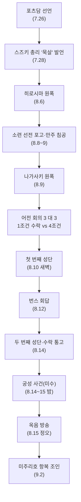
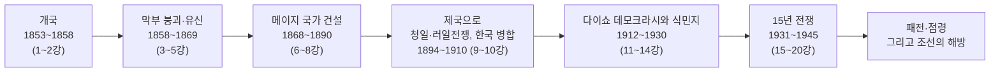

1945년 8월 15일 정오. 일본 전역의 라디오 앞에 사람들이 모였다. 전날 "중대 방송이 있으니 반드시 들으라"는 예고가 있었다. 기미가요가 흐른 뒤, 처음 듣는 높고 떨리는 목소리가 흘러나왔다. 천황 히로히토의 목소리였다. 일본 국민 대부분이 천황의 목소리를 듣는 것은 이것이 처음이었다. 녹음 상태가 나쁜 데다 어려운 한문투의 문장이어서 무슨 말인지 제대로 알아듣지 못한 사람도 많았다. 그러나 "견디기 어려운 것을 견디고, 참기 어려운 것을 참아"라는 대목에서, 사람들은 전쟁이 끝났다는 것을, 일본이 졌다는 것을 알았다. 땅에 엎드려 우는 사람도 있었고, 멍하니 서 있는 사람도 있었다.

같은 시각 서울에서도 사람들은 이 방송을 들었다. 처음에는 거리가 조용했다. 소식이 퍼진 것은 그날 오후부터였다. 이튿날인 8월 16일, 서대문 형무소에서 풀려난 정치범들과 함께 수많은 사람이 태극기를 들고 거리로 쏟아져 나와 "만세"를 외쳤다. 일본에게 8월 15일은 '종전'의 날이었지만, 조선 사람들에게는 35년 식민 지배에서 벗어난 **해방**의 날이었다.

이 강의는 일본 제국이 무너지는 마지막 1년을 따라간다. 1944년 가을부터 1945년 9월 2일 항복 조인까지, 일본은 왜 더 일찍 전쟁을 끝내지 못했는가? 그 사이 오키나와와 히로시마, 나가사키, 만주와 조선에서는 무슨 일이 일어났는가? 그리고 마지막으로 1853년 흑선에서 시작된 이 강좌 전체를 돌아본다.

> [!핵심] 이 강의의 질문
> 1. 패색이 짙었는데도 일본 지도부는 왜 항복을 미루었는가?
> 2. 특공, 공습, 오키나와 전투, 원자 폭탄은 사람들에게 어떤 고통을 남겼는가?
> 3. 일본의 항복은 어떻게 결정되었고, 그것은 조선에 무엇을 가져왔는가?

{{F:l20-opening}}

```timeline
1944.10 | 레이테만 해전, 첫 가미카제 특공 | 연합 함대 사실상 궤멸
1945.2 | 고노에 상주문 / 얄타 회담 | 소련의 대일 참전 밀약
1945.2~3 | 이오지마 전투 | 
1945.3.10 | 도쿄 대공습 | 하룻밤에 약 10만 명 사망
1945.4.1 | 미군 오키나와 상륙 | 6월 23일 조직적 전투 종결
1945.4 | 스즈키 간타로 내각, 전함 야마토 침몰 | 
1945.5 | 독일 항복 | 
1945.7.26 | 포츠담 선언 | 스즈키 총리의 '묵살' 발언
1945.8.6 | 히로시마 원폭 | 
1945.8.8~9 | 소련 대일 선전 포고, 만주·조선 북부 침공 | 
1945.8.9 | 나가사키 원폭 / 어전 회의 '성단' | 
1945.8.14 | 포츠담 선언 수락 통고 | 
1945.8.15 | 옥음 방송 / 조선 해방 | 
1945.9.2 | 미주리호 함상 항복 조인 | 
1945.9.9 | 서울에서 조선 총독의 항복 조인 | 
```

## 무너지는 제국

### 레이테만 해전과 특공

1944년 10월, 맥아더가 이끄는 미군이 필리핀의 레이테섬에 상륙했다. "나는 돌아왔다." 일본 해군은 남은 전함과 항공모함을 모두 동원해 마지막 결전에 나섰다(**레이테만 해전**). 그러나 일본 함대는 전함 무사시를 비롯해 수많은 군함을 잃고 패했다. 이 해전으로 연합 함대는 사실상 사라졌다.

이 해전에서 처음으로 **가미카제 특별 공격대**가 등장했다. 250kg 폭탄을 매단 전투기가 조종사와 함께 그대로 미국 군함에 부딪치는 공격이었다. 이미 비행기와 숙련 조종사가 모자라 정상적인 공격으로는 미국 함대에 타격을 줄 수 없었던 일본 해군이 생각해 낸 '필사(必死)'의 전술이었다. 처음에는 '지원'이라는 형식을 취했지만, 거절하기 어려운 분위기 속에서 사실상 강요되었다. 이후 특공은 비행기만이 아니라 사람이 조종하는 어뢰(가이텐), 폭탄을 실은 모터보트(신요), 사람이 조종하는 로켓 폭탄(오카)으로까지 넓어졌다.

{{F:l20-kamikaze}}

비행기 특공으로 죽은 일본 육해군 병사는 약 4,000명에 이른다. 그 가운데 많은 수가 학도 출진(17강)으로 군대에 간 대학생과 10대 후반의 소년 비행병이었다. 조선인 특공 전사자도 10여 명 이상 확인되어 있다. 특공으로 미군 함정을 침몰시킨 성공률은 그리 높지 않았지만, 일본 정부와 언론은 이들을 '군신'으로 떠받들었다. 젊은이들이 남긴 유서에는 나라와 가족을 위해 죽겠다는 다짐과 함께, 죽음에 대한 두려움과 삶에 대한 미련이 담겨 있다.

### 고노에 상주문

1945년 2월, 전 총리 고노에 후미마로는 천황에게 글을 올렸다(**고노에 상주문**). "유감이지만 패전은 이미 피할 수 없다고 생각합니다." 고노에가 두려워한 것은 패전 그 자체보다, 전쟁이 길어져 생활이 무너진 국민 사이에서 **공산 혁명**이 일어나 천황제, 곧 '국체'가 무너지는 것이었다. 그러니 하루라도 빨리 전쟁을 끝내야 한다는 것이었다. 그러나 천황은 "한 번 더 전과를 올린 뒤가 아니면 이야기는 어렵다"고 답했다. 한 번 크게 이겨서 조금이라도 유리한 조건으로 강화하자는 '**일격 강화론**'이었다. 이 판단으로 전쟁은 반년 더 계속되었고, 그 사이 수많은 목숨이 사라졌다.

### 도쿄 대공습

1945년 3월 10일 0시가 막 지난 시각, 300대 가까운 B-29 폭격기가 도쿄 동부의 서민 동네 상공에 나타났다. 미군의 커티스 르메이 소장은 그때까지의 고공 정밀 폭격을 버리고, 낮은 고도에서 밤에 **소이탄**을 비처럼 퍼붓는 작전을 택했다. 나무와 종이로 지은 집들이 빽빽한 동네는 순식간에 불바다가 되었다. 강한 북풍에 불길은 거대한 화염의 소용돌이가 되었고, 사람들은 불을 피해 강과 다리로 몰려들었다가 그대로 타 죽거나 물에 빠져 죽었다. 하룻밤 사이에 약 10만 명이 숨지고, 100만 명이 집을 잃었다.

{{F:l20-tokyo}}

이후 미군은 나고야, 오사카, 고베 등 대도시를 차례로 불태운 뒤 지방의 중소 도시까지 폭격했다. 일본 전국의 200개가 넘는 도시가 공습을 받았다. 정부는 1944년부터 도시의 국민학교 아이들을 시골로 보내는 **학동 소개**를 실시했지만, 남은 사람들은 방공호와 양동이 릴레이로 소이탄에 맞서라는 명령을 받았다. 원폭을 포함한 공습으로 죽은 민간인은 수십만 명에 이른다. 16강에서 본 충칭 폭격처럼, 도시의 시민을 겨냥한 전략 폭격은 이제 일본 자신에게 되돌아왔다.

### 이오지마와 오키나와

1945년 2월 19일, 미군은 도쿄와 사이판의 중간에 있는 작은 화산섬 **이오지마**에 상륙했다. 일본군 약 2만 1천 명은 섬 전체에 굴을 파고 한 달 넘게 저항하다 거의 모두 전사했다. 미군도 2만 6천 명에 가까운 사상자를 냈다. 섬의 꼭대기 스리바치산에 성조기를 세우는 미국 해병대의 사진은 미국에서 승리의 상징이 되었다.

{{F:l20-iwojima}}

4월 1일, 미군은 마침내 일본 영토인 **오키나와** 본섬에 상륙했다. 1,500척에 가까운 함선과 54만 명의 병력이 동원된 태평양 전쟁 최대의 상륙 작전이었다. 오키나와의 일본군은 본토 결전을 준비할 시간을 벌기 위한 '버리는 돌'이었다. 일본군은 주민들을 진지 구축과 전투에 동원했다. 남학생들은 '철혈 근황대'로, 여학생들은 '히메유리 학도대' 등의 간호대로 전장에 나갔다. 일본군 사령부가 있던 슈리가 함락된 뒤에도 일본군은 항복하지 않고 주민들이 피란해 있던 남부로 물러나 싸웠다. 그 때문에 피해는 더욱 커졌다. 6월 23일 무렵 사령관 우시지마 미쓰루가 자결하며 조직적인 전투가 끝났다.

| 구분 | 사망자 (추정) |
|---|---|
| 미군 | 약 1만 2천 명 |
| 일본군 (오키나와 밖 출신) | 약 6만 6천 명 |
| 오키나와 출신 군인·군속 | 약 2만 8천 명 |
| 오키나와 주민 (일반 시민) | 약 9만 4천 명 |
| 합계 | 약 20만 명 |

표: 오키나와 전투의 희생자 (오키나와현 집계 등을 바탕으로 한 대략적인 수치). 이 밖에 조선에서 끌려간 군부와 '위안부' 등 많은 조선인이 희생되었으나 정확한 수는 알 수 없다

오키나와 주민들의 희생은 미군의 공격 때문만이 아니었다. 미군에게 붙잡히면 남자는 죽고 여자는 욕을 당한다는 일본군의 선전과 '살아서 포로가 되지 말라'는 가르침 속에서, 많은 주민이 가족끼리 서로를 죽이는 **집단 자결**(강제 집단사)로 내몰렸다. 일본군이 피란민이 숨어 있던 동굴에서 주민을 쫓아내거나, 우는 아이를 죽이라고 하거나, 오키나와 말을 쓰는 주민을 간첩으로 몰아 죽인 일도 있었다. 오키나와 사람들은 지금도 6월 23일을 '위령의 날'로 기린다. 오키나와 남부의 '평화의 초석'에는 국적과 군인·민간인을 가리지 않고 이 전투의 희생자 24만여 명의 이름이 새겨져 있으며, 그 가운데에는 조선인의 이름도 있다.

{{F:l20-okinawa}}

4월 7일, 세계 최대의 전함 **야마토**는 오키나와로 가는 편도 연료만 싣고 '해상 특공'에 나섰다가 미군기의 공격을 받아 3,000명 넘는 승무원과 함께 가라앉았다. 같은 날 도쿄에서는 2·26 사건 때 총탄을 맞고도 살아남은 77세의 해군 대장 **스즈키 간타로**가 총리가 되었다. 천황은 그에게 은밀히 전쟁을 끝내기를 기대했다.

## 항복으로 가는 길

### 소련에 건 마지막 희망

1945년 5월 독일이 항복하자, 일본은 홀로 연합국 전체와 싸우는 처지가 되었다. 일본 지도부는 아직 중립 조약을 맺고 있던 **소련**에 미국·영국과의 화평을 중개해 달라고 부탁하기로 했다. 고노에 후미마로를 특사로 모스크바에 보내려는 계획까지 세웠다. 그러나 소련은 이미 2월의 **얄타 회담**에서 독일이 항복하고 2~3개월 뒤 일본과의 전쟁에 들어가겠다고 미국·영국과 비밀리에 약속해 두고 있었다. 4월에는 일소 중립 조약을 연장하지 않겠다고 일본에 통고했다. 소련은 일본의 부탁에 분명한 답을 주지 않은 채 시간을 끌었다.

### 포츠담 선언과 '묵살'

1945년 7월 26일, 미국·영국·중국은 독일의 포츠담에서 일본에 항복을 요구하는 **포츠담 선언**을 발표했다.

- 일본 국민을 속여 세계 정복에 나서게 한 **군국주의 세력을 영구히 제거**한다.
- 일본이 평화를 위협하지 않게 될 때까지 연합국이 일본을 **점령**한다.
- **카이로 선언**을 이행하며, 일본의 주권은 혼슈·홋카이도·규슈·시코쿠와 연합국이 정하는 작은 섬들로 한정한다.
- 일본 군대는 완전히 **무장 해제**한다.
- 포로 학대를 포함한 **전쟁 범죄인을 엄중히 처벌**하고, 민주주의를 부활·강화하며, 언론·종교·사상의 자유와 기본적 인권을 확립한다.
- 일본 정부가 모든 일본 군대의 **무조건 항복**을 선언하기를 요구한다. 그렇지 않으면 "신속하고 완전한 파멸"뿐이다.

선언에는 천황의 지위에 대한 언급이 없었다. 일본 정부는 소련의 중개에 대한 희망을 버리지 못하고 있었고, 군부는 수락에 반대했다. 7월 28일 스즈키 총리는 기자 회견에서 이 선언을 "**묵살**한다"고 말했다. '논평할 가치가 없다'는 정도의 애매한 말이었지만, 연합국에서는 이를 **거부**로 받아들였다.

### 히로시마와 나가사키

1945년 8월 6일 아침 8시 15분, 미국 폭격기 에놀라 게이가 **히로시마** 상공에서 원자 폭탄 '리틀 보이'를 떨어뜨렸다. 도시 한가운데 상공 약 600m에서 터진 폭탄은 엄청난 열선과 폭풍, 방사선으로 도시를 한순간에 파괴했다. 그해 말까지 약 14만 명이 목숨을 잃었다. 8월 9일 오전 11시 2분에는 **나가사키**에 두 번째 원자 폭탄 '팻 맨'이 떨어져, 그해 말까지 약 7만 4천 명이 숨졌다. 살아남은 사람들도 방사선 장애와 암, 그리고 차별에 오랫동안 시달렸다.

{{F:l20-hiroshima}}

{{F:l20-nagasaki}}

> [!주의] 조선인 피폭자
> 히로시마와 나가사키에는 노무 동원 등으로 건너온 많은 조선인이 살고 있었다. 한국 측의 추산에 따르면 조선인 피폭자는 약 7만 명이며, 그 가운데 약 4만 명이 숨졌다. 일본인 다음으로 많은 피해자였다. 살아남아 해방 뒤 고향으로 돌아간 피폭자들은 한국에서도 오랫동안 치료와 지원을 받지 못했고, 일본 정부의 피폭자 지원에서도 오랫동안 제외되었다. '한국의 히로시마'라 불리는 경상남도 합천에는 지금도 많은 원폭 피해자와 그 후손이 살고 있다. 히로시마 평화 기념 공원 안에 한국인 원폭 희생자 위령비가 세워진 것은 1970년, 공원 안으로 옮겨진 것은 1999년의 일이다.

원폭 투하를 둘러싸고는 지금도 논쟁이 있다. 미국에서는 원폭이 본토 상륙 작전에서 생길 막대한 희생을 막고 전쟁을 빨리 끝냈다는 주장이 오랫동안 주류였다. 반면 일본은 이미 항복 직전이었으며 원폭은 전후 소련을 견제하려는 목적이 컸다는 주장, 시민을 무차별로 죽인 원폭 투하 자체가 전쟁 범죄라는 비판도 있다. 오늘날 많은 연구자는 일본의 항복을 끌어낸 것은 원폭과 함께, 아래에서 볼 **소련의 참전**이었다고 본다.

### 소련의 참전

8월 8일 밤, 소련은 일본에 선전 포고를 했다. 8월 9일 새벽, 150만 명이 넘는 소련군이 만주와 조선 북부, 사할린 남부로 한꺼번에 밀려들었다. '무적'이라 불리던 관동군은 이미 정예 부대를 남방과 본토로 빼낸 껍데기였다. 관동군은 주민들을 남겨 두고 먼저 후퇴했다. 버려진 일본인 개척민들은 소련군의 공격과 현지 주민의 습격, 굶주림과 추위 속에 피란길에 나섰고, 집단 자결도 잇따랐다. 만주에서 죽은 일본 민간인은 약 24만 명에 이른다. 부모를 잃거나 부모와 헤어져 중국인 가정에 맡겨진 아이들은 '중국 잔류 고아'가 되었다. 항복한 일본군 약 60만 명은 시베리아 등지로 끌려가 강제 노동을 했고, 그 가운데 6만 명가량이 죽었다. 여기에는 일본군으로 동원된 조선인도 있었다.

소련의 참전은 일본 지도부의 마지막 희망을 무너뜨렸다. 중개를 부탁하던 상대가 적이 된 것이다. 그리고 소련군이 한반도 북부로 들어오자, 미국은 소련이 한반도 전체를 차지할 것을 걱정해 북위 **38도선**을 경계로 북쪽은 소련군이, 남쪽은 미군이 일본군의 항복을 받자고 제안했다. 소련은 이를 받아들였다. 일본의 항복이 늦어진 대가는 한반도의 **분단**이라는 형태로도 남게 되었다.

### 성단

8월 9일 밤 11시가 넘은 시각, 궁성 안의 방공호에서 천황이 참석한 **어전 회의**가 열렸다. 쟁점은 포츠담 선언을 어떤 조건으로 받아들일 것인가였다.

```compare
항목 | 즉시 수락파 (1조건) | 계속 항전파 (4조건)
대표 | 도고 시게노리 외무대신, 요나이 미쓰마사 해군대신, 히라누마 기이치로 추밀원 의장 | 아나미 고레치카 육군대신, 우메즈 요시지로 참모총장, 도요다 소에무 군령부총장
조건 | 국체 호지(천황 통치 체제의 유지)만 | 국체 호지 + 일본 스스로의 무장 해제 + 일본 스스로의 전범 처벌 + 본토 점령 반대
논리 | 이 이상 버티면 국가가 멸망한다 | 본토 결전으로 큰 타격을 주면 더 나은 조건을 얻을 수 있다
```

의견이 3 대 3으로 갈리자, 8월 10일 새벽 2시가 넘어 스즈키 총리가 천황에게 결정을 청했다. 천황은 외무대신의 의견에 찬성한다고 말했다. 이것을 **성단**(聖斷, 천황의 결단)이라 한다. 일본은 천황의 지위를 바꾸지 않는다는 양해 아래 포츠담 선언을 받아들이겠다고 연합국에 알렸다. 연합국의 답변(번스 회답)은 천황과 일본 정부의 통치 권한은 연합국 최고 사령관에게 '종속된다(subject to)'는 애매한 것이었다. 군부는 다시 반발했지만, 8월 14일 두 번째 어전 회의에서 천황은 다시 수락을 결정했다. 일본은 그날 밤 포츠담 선언 수락을 연합국에 통고했다.



8월 14일 밤, 천황은 국민에게 알리는 「종전 조서」를 읽어 녹음했다. 그날 밤 항복에 반대하는 일부 육군 장교들이 근위사단장을 죽이고 궁성을 점거한 채 녹음 원반을 빼앗으려 했지만 실패했다(궁성 사건). 육군대신 아나미 고레치카는 15일 새벽 자결했다.

## 8월 15일, 그리고 9월 2일

### 옥음 방송

8월 15일 정오, 녹음된 「종전 조서」가 방송되었다(**옥음 방송**). 조서에는 '항복'이나 '패전'이라는 말이 한 번도 나오지 않았다. 대신 일본이 미국·영국에 선전한 것은 "제국의 자존과 동아의 안정을 바라서"였지 남의 주권을 짓밟고 영토를 침략하는 것은 본디 천황의 뜻이 아니었다고 하고, 적이 "새롭게 잔학한 폭탄"을 사용했으므로 전쟁을 계속하면 민족이 멸망하고 인류 문명까지 파괴될 것이라 했다. 그리고 "시운이 향하는 바, 견디기 어려운 것을 견디고 참기 어려운 것을 참아 만세를 위해 태평을 열고자 한다"고 했다. 조서에는 중국과의 전쟁도, 식민지 지배도 언급되지 않았다.

> [!사료] 「종전 조서」에 담긴 것과 담기지 않은 것
> 조서는 전쟁을 끝내는 이유를 원자 폭탄과 '민족의 멸망'에서 찾았다. 그것은 전쟁을 일으킨 책임을 묻기보다 천황이 '평화를 결단했다'는 이야기를 만들었다. 패전 뒤 일본에서는 8월 15일을 '종전 기념일'로 부르며, '패전'이 아니라 '종전'이라는 말이 널리 쓰이게 되었다. 이 조서와 '성단'의 이야기는 전후 천황이 전쟁 책임을 추궁받지 않고 상징 천황으로 남는 데에도 영향을 주었다.

### 미주리호의 항복 조인

8월 17일 황족 히가시쿠니노미야 나루히코가 총리가 되어 항복 절차를 맡았다. 8월 30일 연합국 최고 사령관 **맥아더**가 옥수수 파이프를 입에 물고 가나가와현의 아쓰기 비행장에 내렸다. 그리고 1945년 9월 2일, 도쿄만에 정박한 미국 전함 **미주리호** 갑판에서 일본 정부 대표 외무대신 **시게미쓰 마모루**와 군 대표 참모총장 **우메즈 요시지로**가 항복 문서에 서명했다. 시게미쓰는 1932년 상하이의 훙커우 공원에서 윤봉길의 폭탄에 다리를 잃은 바로 그 사람이었다(15강). 그는 의족을 짚고 갑판에 올랐다. 이로써 1931년 만주사변부터 15년 가까이 이어진 일본의 전쟁은 공식적으로 끝났다.

{{F:l20-missouri}}

9월 9일, 서울의 조선 총독부 청사에서 조선 총독 아베 노부유키가 미군 사령관 하지 중장 앞에서 항복 문서에 서명했다. 청사 앞 국기 게양대에서 일장기가 내려갔다. 그러나 그 자리에 올라간 것은 태극기가 아니라 **성조기**였다. 38도선 남쪽에서는 미군정이, 북쪽에서는 소련군이 통치를 시작했다. 해방은 곧 독립이 아니었다.

{{F:l20-seoul}}

### 전쟁의 희생

아시아·태평양 전쟁은 아시아와 태평양 전역에 헤아릴 수 없는 희생을 남겼다.

| 지역·집단 | 사망자 (추정, 여러 설이 있음) |
|---|---|
| 중국 | 1,000만 명 이상 (중국 정부는 군민 사상자 3,500만 명으로 발표) |
| 인도네시아 | 수백만 명 (기근과 강제 노동 포함, 추정 폭이 매우 큼) |
| 베트남 | 100만 명 이상 (1944~45년 기근) |
| 필리핀 | 약 100만 명 |
| 조선 | 군인·군속, 노무 동원, 피폭, '위안부' 등 수십만 명으로 추정되나 정확한 수는 알 수 없음 |
| 일본 | 약 310만 명 (군인·군속 약 230만, 민간인 약 80만) |
| 연합군 (미국·영국·오스트레일리아 등) | 수십만 명 (포로 사망자 포함) |

표: 아시아·태평양 전쟁의 희생자

```chart
{
  "type": "bar",
  "caption": "1945년의 주요 피해 (사망자 추정, 만 명). 도쿄 대공습은 하룻밤, 원폭은 1945년 말까지, 오키나와는 미군·일본군·주민 전체, 만주는 일본 민간인의 수치다",
  "data": {
    "labels": ["도쿄 대공습 (3.10)", "오키나와 전투 (4~6월)", "히로시마 원폭 (8.6)", "나가사키 원폭 (8.9)", "만주의 일본 민간인 (8월~)"],
    "datasets": [{ "label": "사망자(만 명)", "data": [10, 20, 14, 7.4, 24] }]
  },
  "options": { "indexAxis": "y", "plugins": { "legend": { "display": false } } }
}
```

해외에는 약 660만 명의 일본 군인과 민간인이 남아 있었고, 이들이 귀환하는 데에는 몇 년이 걸렸다. 일본 본토에 살던 약 200만 명의 조선인 가운데 많은 사람이 고향으로 돌아갔지만, 60만 명 정도는 여러 사정으로 일본에 남았다.

## 강좌를 마치며: 1853년에서 1945년까지

1853년 페리의 흑선이 우라가 앞바다에 나타났을 때(1강), 일본은 서양 열강의 압력 앞에서 나라의 독립을 지켜야 하는 처지였다. 일본은 막부를 무너뜨리고(4~5강) 메이지 국가를 세워(6~8강), 놀라운 속도로 근대 국가를 만들어 냈다. 헌법과 의회를 가진 아시아 최초의 입헌 국가가 되었고, 불평등 조약을 고쳤다.

그러나 그 근대화는 처음부터 이웃 나라를 발판으로 삼는 길이기도 했다. 강화도 조약(7강), 청일전쟁(9강), 러일전쟁과 한국 병합(10강), 21개조 요구(11강)를 거치며 일본은 서양 열강의 '학생'에서 아시아의 '제국'이 되었다. 다이쇼 시대의 정당 정치와 데모크라시(12강)는 식민지 사람들에게까지 미치지 못했고(13강), 공황과 국제 질서의 동요(14강) 속에서 군부의 독주(15강)를 막지 못했다. 만주사변에서 시작된 전쟁은 중일전쟁(16강)과 총력전(17강), 그리고 미국과의 전쟁(18~19강)으로 번져, 마침내 1945년의 파국(20강)에 이르렀다.



이 92년의 역사는 하나의 질문을 남긴다. 서양의 압력에서 독립을 지키려던 나라가 어떻게 다른 나라의 독립을 빼앗는 나라가 되었는가? 그리고 그 과정에서 왜 누구도 멈추라고 말하지 못했는가? 일본의 근대사는 일본만의 역사가 아니다. 그것은 조선과 중국, 동남아시아 사람들의 역사와 떼려야 뗄 수 없게 얽혀 있다. 1945년 8월 15일 이후의 이야기, 즉 점령과 전후 개혁, 일본국 헌법, 한반도의 분단과 전쟁, 한일 국교 정상화와 지금까지 이어지는 역사 문제는 또 다른 강좌의 몫이다.

## 정리

> [!핵심] 20강 요약
> - **레이테만 해전**(1944.10)으로 연합 함대가 무너지고, 사람이 무기가 되는 **특공**이 시작되었다. 천황은 **고노에 상주문**의 조기 종전 건의를 '일격 강화론'으로 물리쳤다.
> - **도쿄 대공습**(1945.3.10)으로 하룻밤에 약 10만 명이 숨지는 등 본토 공습이 이어졌다. **오키나와 전투**에서는 주민 약 9만 4천 명을 포함해 약 20만 명이 숨졌고, **집단 자결**의 비극이 일어났다.
> - 일본은 소련의 중개에 기대어 **포츠담 선언**을 '묵살'했다. **히로시마**(8.6)·**나가사키**(8.9)에 원자 폭탄이 떨어지고 **소련이 참전**(8.8~9)했다. 조선인 피폭자도 약 7만 명에 이르렀다.
> - 어전 회의의 **성단**으로 '국체 호지'를 조건으로 항복을 결정했고, 8월 15일 **옥음 방송**, 9월 2일 **미주리호 항복 조인**으로 전쟁이 끝났다.
> - 조선은 **해방**되었지만, 소련 참전과 함께 그어진 **38도선**으로 남북에 미군과 소련군이 들어와 분단이 시작되었다.

### 생각해 볼 질문

1. 1945년 2월 고노에 상주문이 받아들여졌다면 무엇이 달라졌을까? 오키나와, 히로시마, 나가사키, 만주, 그리고 한반도의 운명을 함께 생각해 보자.
2. 「종전 조서」에 '항복'과 '패전', 중국과 식민지에 대한 언급이 없는 것은 전후 일본의 전쟁 기억에 어떤 영향을 주었을까?
3. 이 강좌 전체를 돌아보며, 일본의 근대화에서 '독립을 지키는 것'과 '이웃을 지배하는 것'이 어떻게 이어졌는지 자신의 말로 정리해 보자.

### 강좌를 마치며

20강에 걸친 『일본근대사』 강좌를 여기서 마친다. 흑선에서 패전까지 92년의 이야기가, 오늘의 일본과 한국, 그리고 동아시아를 이해하는 데 작은 실마리가 되기를 바란다.
