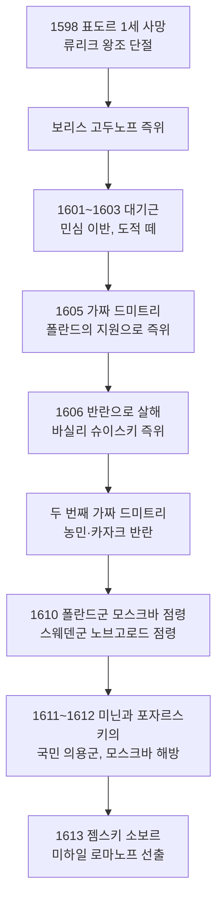

1613년 3월 14일, 볼가강 상류의 도시 코스트로마. 강가의 **이파티예프 수도원** 앞에 모스크바에서 온 긴 행렬이 멈춰 섰다. 성직자와 귀족, 상인과 카자크의 대표들이 성상(聖像)을 앞세우고 수도원 안으로 들어갔다. 그들이 찾아온 사람은 이곳에 어머니와 함께 몸을 숨기고 있던 열여섯 살의 소년 **미하일 로마노프**였다. 한 달 전 모스크바에서 열린 전국 회의, **젬스키 소보르**가 그를 새 차르(황제)로 뽑은 것이다.

소년의 어머니는 처음에 거절했다고 한다. 지난 15년 동안 러시아의 왕좌에 오른 사람들은 독살 의혹 속에 죽거나, 군중에게 맞아 죽거나, 외국에 포로로 끌려갔다. 나라는 기근과 내전, 외국 군대의 침략으로 무너져 있었고, 모스크바의 크렘린은 막 폴란드군의 점령에서 풀려난 참이었다. 사절단은 몇 시간 동안 간청한 끝에야 승낙을 받아 냈다.

이렇게 시작된 **로마노프 왕조**는 그 뒤 300년 넘게 러시아를 다스렸다. 그리고 1918년 7월, 마지막 황제 니콜라이 2세와 그의 가족은 우랄 지방의 도시 예카테린부르크에서 볼셰비키에게 총살되었다. 그들이 갇혀 있던 상인의 집 이름은 우연히도 **이파티예프 저택**이었다. 로마노프 왕조는 '이파티예프'에서 시작해 '이파티예프'에서 끝난 셈이다.

이 강좌는 표트르 대제가 러시아를 유럽의 강대국으로 바꾸기 시작한 17세기 말부터, 1917년 혁명과 내전을 거쳐 소련이 탄생하는 1922년까지를 다룬다. 첫 강의인 이 강의에서는 그 무대가 된 러시아가 어떻게 생겨났는지를 살펴본다. 키예프 루스에서 몽골의 지배, 모스크바 대공국의 성장과 이반 뇌제, 그리고 '동란 시대'를 거쳐 로마노프 왕조가 자리 잡기까지의 800년이다.

> [!핵심] 이 강의의 질문
> 1. 러시아라는 나라는 어디에서 시작되었으며, 몽골의 지배는 무엇을 남겼는가?
> 2. 작은 공국이던 모스크바는 어떻게 거대한 차르의 나라가 되었는가?
> 3. 로마노프 왕조가 물려받은 17세기 러시아는 어떤 나라였는가? 표트르 대제의 개혁은 무엇을 바꾸려 했는가?

{{F:r01-opening}}

> [!참고] 이 강좌의 날짜 표기
> 러시아는 1918년 2월까지 율리우스력(구력)을 썼다. 율리우스력은 오늘날 쓰는 그레고리력(신력)보다 17세기에는 10일, 18세기에는 11일, 19세기에는 12일, 20세기에는 13일 늦다. 그래서 1917년의 '10월 혁명'은 그레고리력으로는 11월 7일에 일어났다. 이 강좌는 러시아 안의 사건은 당시 러시아가 쓰던 율리우스력으로, 국제적인 사건이나 두 날짜가 크게 다를 때는 그레고리력을 함께 적는다.

## 루스의 탄생

### 바랴그인과 키예프

오늘날 러시아, 우크라이나, 벨라루스 사람들의 조상은 동슬라브인이다. 이들은 6~9세기 무렵 드네프르강과 볼호프강 유역의 숲과 초원에 흩어져 살며 농사를 짓고 모피를 거래했다. 이 강들은 북쪽의 발트해와 남쪽의 흑해를 잇는 교역로였다. 스칸디나비아의 바이킹, 곧 러시아 사람들이 '바랴그인'이라 부른 무사 상인들이 이 길을 따라 비잔티움 제국(동로마 제국)의 수도 콘스탄티노폴리스까지 내려가 모피와 노예, 꿀을 팔았다.

12세기 초에 쓰인 러시아 최초의 역사서 『원초 연대기』는, 862년 서로 다투던 슬라브인들이 바랴그인 **류리크**를 불러들여 노브고로드를 다스리게 했다고 전한다. 그의 후계자 올레크는 882년 남쪽의 키예프(오늘날 우크라이나의 수도 키이우)를 차지하고 수도로 삼았다. 이렇게 생겨난 나라를 역사가들은 **키예프 루스**라고 부른다. '루스'는 원래 바랴그인을 가리키던 말로, 훗날 '러시아'라는 이름의 뿌리가 되었다. 류리크의 후손들은 이후 700년 넘게 이 땅을 다스렸다(류리크 왕조).

### 988년의 세례

키예프 루스의 역사에서 가장 중요한 사건은 988년 무렵 **블라디미르 1세** 대공이 비잔티움의 기독교, 곧 **정교회**를 받아들인 것이다. 『원초 연대기』에는 블라디미르가 이슬람교, 유대교, 로마 가톨릭, 정교회의 사절을 차례로 불러 비교한 뒤 정교회를 골랐다는 이야기가 실려 있다. 콘스탄티노폴리스의 성 소피아 대성당에 다녀온 사절들이 "우리는 하늘에 있는지 땅에 있는지 알 수 없었다"고 보고했다는 것이다. 블라디미르는 키예프 시민들을 드네프르강에 들어가게 해 한꺼번에 세례를 받게 했다.

정교회를 받아들인 것은 러시아의 운명을 크게 바꾸었다. 러시아는 비잔티움으로부터 문자(키릴 문자), 교회 건축과 성상화, 그리고 황제와 교회가 긴밀히 손잡는 정치 문화를 물려받았다. 반면 라틴어와 가톨릭 교회를 중심으로 이어진 서유럽과는 종교와 문화가 갈라졌다. 러시아가 유럽에 속하는지, 아니면 유럽과 다른 독자적 문명인지는 이후 러시아 지식인들이 끝없이 논쟁한 질문이 된다(13강).

## 몽골의 지배

### '타타르의 멍에'

12세기에 들어 키예프 루스는 류리크 가문의 여러 공(크냐지)이 다스리는 작은 공국들로 쪼개졌다. 1237년부터 1240년까지 칭기즈 칸의 손자 **바투**가 이끄는 몽골군이 이 공국들을 차례로 휩쓸었다. 랴잔과 블라디미르가 불타고, 1240년에는 키예프도 무너졌다. 이후 러시아의 공국들은 볼가강 하류의 사라이를 수도로 한 몽골 국가, **킵차크 칸국**(금장 칸국)의 지배를 받게 되었다. 러시아 사람들은 이 시기를 훗날 **'타타르의 멍에'**라고 불렀다.

몽골은 러시아 땅을 직접 다스리지 않았다. 러시아의 공들은 칸에게 가서 무릎을 꿇고 통치를 허락하는 문서(야를리크)를 받아야 했고, 해마다 무거운 공물을 바쳐야 했다. 칸은 공들 가운데 한 사람에게 공물을 걷어 바치는 일을 맡기고 '대공'의 칭호를 주었다. 몽골은 정교회에는 세금을 면제해 주고 간섭하지 않았다. 그 덕분에 교회는 이 시기에 땅과 재산을 크게 늘리며 러시아 사람들을 하나로 묶는 구심점이 되었다.

몽골 지배가 러시아에 남긴 영향은 지금도 논쟁거리다. 한쪽에서는 몽골 지배가 러시아를 서유럽의 르네상스와 상업 발전에서 떼어 놓고, 전제적인 정치 문화를 심었다고 본다. 다른 쪽에서는 몽골의 역참 제도, 인구 조사와 세금 제도가 훗날 모스크바 국가의 기틀이 되었다고 본다.

### 모스크바의 성장

몽골 지배 아래에서 뜻밖의 승자가 나타났다. 1147년 연대기에 처음 이름이 등장한 작은 마을 **모스크바**였다. 모스크바의 공들은 칸에게 충성하며 대공 칭호를 얻어 냈고, 공물을 걷는 일을 맡아 다른 공국들을 누르고 재산을 모았다. 1325년 무렵에는 러시아 정교회의 수장인 대주교가 모스크바로 옮겨 오면서, 모스크바는 러시아의 종교 중심지가 되었다.

1380년 모스크바 대공 **드미트리**는 돈강 근처의 쿨리코보 들판에서 킵차크 칸국의 군대를 처음으로 크게 물리쳤다. 이 승리로 그는 '돈스코이(돈강의)'라는 별명을 얻었다. 몽골의 지배는 그 뒤로도 100년 가까이 이어졌지만, 쿨리코보 전투는 러시아 사람들에게 몽골에 맞설 수 있다는 자신감을 심어 주었다.

## 모스크바 대공국에서 차르의 나라로

### 이반 3세: '모든 루스의 군주'

15세기 후반 **이반 3세**(재위 1462~1505)는 모스크바를 진정한 국가로 만들었다. 그는 오랜 경쟁자였던 상업 도시 노브고로드(1478)와 트베리(1485)를 병합해 러시아 북동부를 하나로 묶었다. 1480년에는 킵차크 칸국의 후신인 대(大)오르다의 군대가 공물을 거부한 모스크바를 치러 왔지만, 두 군대는 우그라강을 사이에 두고 몇 주 동안 대치하다 싸우지 않고 물러났다. 이 '우그라강의 대치'로 240년에 걸친 몽골의 지배가 공식적으로 끝났다고 본다.

1453년 오스만 제국이 콘스탄티노폴리스를 점령해 비잔티움 제국이 멸망하자, 모스크바는 스스로를 정교회 세계의 새로운 중심으로 여기기 시작했다. 이반 3세는 마지막 비잔티움 황제의 조카딸 **소피아 팔레올로기나**와 결혼하고, 비잔티움의 상징인 **쌍두 독수리**를 문장으로 삼았다. 16세기 초 한 수도사는 대공에게 보낸 편지에서 이렇게 썼다. "두 로마(로마와 콘스탄티노폴리스)는 무너졌고, 세 번째 로마(모스크바)는 서 있으며, 네 번째 로마는 없을 것입니다." 이 **'제3의 로마'** 사상은 러시아가 특별한 사명을 지닌 나라라는 믿음의 뿌리가 되었다.

이반 3세 때 모스크바의 크렘린(성채)도 지금의 모습을 갖추었다. 그는 이탈리아의 건축가들을 불러 붉은 벽돌 성벽과 탑, 우스펜스키 대성당 같은 성당들을 새로 지었다.

{{F:r01-kremlin}}

| 칭호 | 뜻 | 쓰인 시기 |
|---|---|---|
| 크냐지 (공) | 공국의 군주 | 키예프 루스 이래 |
| 벨리키 크냐지 (대공) | 여러 공 가운데 으뜸 | 키예프·블라디미르·모스크바의 군주 |
| 차르 | 로마의 '카이사르'에서 나온 말. 황제 | 이반 4세가 1547년 정식으로 처음 사용 |
| 임페라토르 (황제) | 서유럽식 황제 칭호 | 표트르 1세가 1721년부터 사용(3강) |

표: 러시아 군주의 칭호

### 이반 4세 '뇌제'

1547년 열여섯 살의 **이반 4세**(재위 1533~1584)는 모스크바 크렘린의 우스펜스키 대성당에서 '차르'로 대관식을 올렸다. 러시아의 군주가 정식으로 차르라는 칭호를 쓴 것은 이때가 처음이다. 그는 1552년 볼가강 중류의 카잔 칸국을, 1556년 하류의 아스트라한 칸국을 정복해 볼가강 전체를 손에 넣었다. 카잔 정복을 기념해 붉은 광장에 지은 것이 양파 모양의 화려한 지붕으로 유명한 **성 바실리 대성당**이다.

그러나 이반 4세는 '뇌제(雷帝)', 곧 '무서운 황제'로 더 잘 알려져 있다. 첫 왕비가 죽은 뒤 귀족(보야르)들을 의심하게 된 그는 1565년 나라를 둘로 나누어, 자신이 직접 다스리는 땅 **오프리치니나**를 만들었다. 검은 옷을 입고 말안장에 개의 머리와 빗자루를 매단 친위대 '오프리치니키'가 반역자를 '물어뜯고 쓸어 낸다'며 귀족과 그 가족, 농민을 학살했다. 1570년에는 반역을 꾀했다는 의심을 받은 노브고로드에서 몇 주에 걸쳐 수천 명이 죽었다. 1581년에는 화가 나 휘두른 지팡이에 맞아 그의 맏아들이 죽었다.

이반 4세 시대에 러시아는 동쪽으로 뻗어 나가기 시작했다. 1582년 무렵 카자크 대장 **예르마크**가 상인 스트로가노프 가문의 지원을 받아 우랄산맥을 넘어 시비르 칸국을 무너뜨렸다. '시베리아'라는 이름은 이 칸국에서 나왔다. 그 뒤 러시아의 모피 사냥꾼과 카자크들은 강을 따라 동쪽으로 나아가, 불과 60년도 안 된 1639년 태평양 연안의 오호츠크해에 이르렀다.

```chart
{
  "type": "bar",
  "caption": "모스크바 국가와 러시아 제국의 영토 (만 km², 연구자들의 대략적인 추정치). 이반 3세가 즉위할 무렵 40만 km² 남짓이던 모스크바 대공국은 시베리아로 뻗어 나가며 17세기 말에는 유럽과 아시아에 걸친 세계 최대의 나라가 되었다. 1914년 러시아 제국의 영토는 약 2,280만 km²였다. 지금의 한반도(약 22만 km²)와 비교해 보자",
  "data": {
    "labels": ["1462 (이반 3세 즉위)", "1533 (이반 4세 즉위)", "1600 무렵", "1700 무렵", "1800 무렵", "1914"],
    "datasets": [{ "label": "영토 (만 km²)", "data": [43, 280, 540, 1500, 1700, 2280] }]
  },
  "options": { "plugins": { "legend": { "display": false } } }
}
```

## 동란 시대 (1598~1613)

### 왕조의 단절

이반 4세가 죽은 뒤 몸이 약한 아들 **표도르 1세**가 즉위했지만, 실제 권력은 처남 **보리스 고두노프**가 쥐었다. 1591년 이반 4세의 막내아들 드미트리가 우글리치에서 목에 칼이 찔린 채 죽었다. 조사단은 간질 발작 중에 스스로 칼에 찔렸다고 결론 내렸지만, 많은 사람은 고두노프가 왕위를 노리고 죽였다고 믿었다. 1598년 표도르 1세가 자식 없이 죽자 700년 넘게 이어진 류리크 왕조가 끊겼다. 젬스키 소보르는 고두노프를 차르로 뽑았다.

고두노프는 유능한 통치자였지만 불운했다. 1601년부터 1603년까지 화산 폭발로 인한 이상 기후 때문에 여름에도 서리가 내려 3년 연속 흉년이 들었다. 대기근으로 수많은 사람이 굶어 죽었고, 굶주린 농민과 도망 노예들이 떼 지어 도적이 되었다. 사람들은 이 재앙이 정당하지 않은 차르에 대한 신의 벌이라고 수군거렸다.

### 참칭자와 외국의 개입

이때 폴란드에서 한 젊은이가 나타나 자신이 우글리치에서 기적적으로 살아남은 드미트리 왕자라고 주장했다. 폴란드 귀족들의 지원을 받은 이 **가짜 드미트리**는 1605년 고두노프가 갑자기 죽자 모스크바에 들어가 차르가 되었다. 그러나 그가 폴란드인 왕비를 맞고 가톨릭에 호의적인 모습을 보이자 1606년 귀족들이 반란을 일으켜 그를 죽였다. 그의 시신은 불태워졌고, 그 재를 대포에 넣어 그가 온 폴란드 쪽으로 쏘았다고 전한다.

그 뒤 러시아는 완전한 혼란에 빠졌다. 귀족 바실리 슈이스키가 차르가 되었지만, 두 번째 가짜 드미트리가 나타나 모스크바 근처에 따로 궁정을 차렸고, 농민과 카자크의 반란이 잇달았다. 스웨덴과 폴란드는 이 틈을 노려 군대를 보냈다. 1610년 귀족들은 슈이스키를 폐위하고 폴란드 왕의 아들을 차르로 맞기로 했으며, 폴란드군이 모스크바 크렘린에 들어왔다. 스웨덴은 노브고로드를 점령했다. 러시아는 나라가 사라질 위기에 놓였다.

### 국민 의용군과 로마노프의 선출

나라를 구한 것은 차르도 귀족도 아닌 지방의 백성들이었다. 1611년 볼가강 가의 상업 도시 니즈니노브고로드의 고기 상인 **쿠지마 미닌**은 시민들에게 재산의 3분의 1을 내놓아 의용군을 만들자고 호소했다. 의용군의 지휘는 귀족 출신의 장군 **드미트리 포자르스키** 공이 맡았다. 1612년 가을 의용군은 모스크바를 포위해 굶주린 폴란드 수비대의 항복을 받아 냈다. 오늘날 러시아는 이날을 기념해 11월 4일을 '국민 통합의 날'로 기린다. 붉은 광장의 성 바실리 대성당 앞에는 1818년에 세운 미닌과 포자르스키의 동상이 서 있다.

1613년 초 전국의 귀족, 성직자, 도시민, 카자크, 그리고 일부 국유지 농민의 대표 수백 명이 모스크바에 모여 젬스키 소보르를 열었다. 여러 후보 가운데 그들이 고른 사람이 미하일 로마노프였다. 그가 뽑힌 까닭은 여러 가지였다. 그의 집안은 이반 4세의 첫 왕비 아나스타시야의 친정이어서 옛 왕조와 이어져 있었고, 아버지 필라레트는 존경받는 고위 성직자였다. 무엇보다 그는 어리고 경험이 없어, 동란 시대에 어느 편에도 깊이 서지 않았다. 귀족들은 그가 다루기 쉬운 차르가 되리라 기대했다고 전한다. 폴란드에 포로로 잡혀 있던 아버지 필라레트는 1619년에 돌아와 모스크바 총대주교가 되어 아들과 함께 나라를 다스렸다.

{{F:r01-troubles}}



## 17세기 러시아: 로마노프 왕조가 물려받은 나라

### 차르와 귀족, 그리고 농노

미하일과 그의 아들 **알렉세이**(재위 1645~1676)의 시대에 러시아는 동란의 상처를 딛고 질서를 되찾았다. 그 질서의 중심에는 강력한 차르와, 차르에게 봉사하는 대가로 땅을 받는 귀족, 그리고 그 땅에 묶인 농민이 있었다.

러시아는 땅은 넓었지만 일할 사람이 모자랐다. 농민들은 더 나은 조건을 찾아 다른 지주의 땅이나 남쪽 변경, 시베리아로 도망치곤 했다. 귀족들은 차르에게 농민의 이동을 막아 달라고 요구했다. 1648년 모스크바에서 소금세에 항의하는 '소금 폭동'이 일어나 고관들이 군중에게 살해되자, 알렉세이는 이듬해인 1649년 새 법전 **소보르 법전**(울로제니예)을 만들었다. 이 법전은 도망 농민을 붙잡아 돌려보낼 수 있는 기한을 없애, 농민을 영원히 지주의 땅에 묶어 두었다. 러시아의 **농노제**가 법으로 완성된 것이다. 농노제는 1861년 해방령(12강)까지 200년 넘게 러시아 사회의 뼈대가 되었다.

> [!사료] 소보르 법전 제11장 제2조의 요지 (1649)
> "어느 군주의 땅에서든, 어느 귀족의 영지에서든 도망한 농민과 그 아내와 자식은, 군주께서 정하신 기한 없이 그 지주에게 돌려보낸다." 그 전까지는 도망한 농민을 되찾을 수 있는 기한이 몇 년으로 정해져 있었다. 이 조항으로 그 기한이 사라졌다.

### 교회의 분열

17세기 중반 러시아 정교회는 큰 분열을 겪었다. 1652년 총대주교가 된 **니콘**은 오랜 세월 필사로 전해지며 생긴 러시아 교회의 예배서와 의식의 차이를 그리스 정교회의 기준에 맞추어 고치려 했다. 예를 들어 성호를 그을 때 손가락 두 개를 쓰던 것을 세 개로 바꾸게 했다. 사소해 보이는 이 변화에 많은 신자가 격렬히 반발했다. 그들에게 옛 의식은 구원과 직결된 것이었고, 그리스 교회는 오스만 제국 아래에서 타락한 교회였다.

1666~1667년 교회 회의는 개혁을 받아들이고 반대파를 파문했다. 옛 의식을 지키려는 사람들은 **구교도**(분리파)라 불리며 박해를 받았다. 그들의 지도자 **아바쿰** 수사제는 북극 지방의 감옥에 갇혔다가 1682년 화형을 당했다. 수많은 구교도가 박해를 피해 숲과 변경으로 달아났고, 일부는 군대가 오자 교회에 모여 스스로 불을 질러 죽었다. 이 분열로 교회는 힘을 잃었고, 국가는 교회를 더욱 강하게 통제하게 되었다. 이것은 표트르 대제가 총대주교 제도를 아예 없애는 길을 열었다(3강).

### 반란과 팽창

17세기 러시아는 '반란의 세기'라 불릴 만큼 반란이 잦았다. 그 가운데 가장 큰 것이 1670~1671년 돈 카자크의 대장 **스텐카 라진**의 반란이다. 라진은 볼가강을 따라 올라가며 도시들을 점령하고 지주와 관리를 죽였고, 농노와 소수 민족이 그에게 몰려들었다. 반란은 진압되었고 라진은 모스크바 붉은 광장에서 처형되었지만, 그는 민요 속의 영웅으로 오래 살아남았다.

동시에 러시아는 사방으로 뻗어 나갔다. 1654년 폴란드에 맞서 반란을 일으킨 드네프르강 유역의 카자크 지도자 보흐단 흐멜니츠키가 페레야슬라프에서 차르에게 충성을 맹세하면서, 키예프를 포함한 드네프르강 동쪽의 우크라이나가 러시아에 들어왔다. 이 사건의 의미는 오늘날까지 러시아와 우크라이나 사이에서 서로 다르게 해석된다.

> [!참고] 조선과 러시아의 첫 만남, 나선 정벌
> 러시아가 시베리아를 가로질러 흑룡강(아무르강)에 이르자, 이 지역을 자기 땅으로 여기던 청나라와 충돌했다. 청은 조선에 조총 부대를 보내 달라고 요구했다. 효종은 1654년 변급, 1658년 신유가 이끄는 조총군을 보냈고, 조선군은 흑룡강과 송화강 일대에서 러시아의 카자크 부대와 싸워 이겼다. 조선은 러시아 사람을 '나선(羅禪)'이라 불렀기 때문에 이를 **나선 정벌**이라 한다. 한국과 러시아의 첫 만남은 전쟁터에서였다. 두 나라는 200여 년 뒤인 1884년에야 정식으로 수교한다(15강).

{{F:r01-village}}

### 서유럽을 향한 창

17세기 러시아는 바깥 세상에 완전히 닫힌 나라는 아니었다. 모스크바에는 군대를 가르치고 대포를 만들고 무역을 하러 온 서유럽 사람들이 모여 사는 **독일인 마을**이 있었다. 당시 러시아 사람들은 서유럽 사람을 통틀어 '독일인'이라 불렀다. 알렉세이 차르의 군대에는 서유럽식으로 훈련받은 연대가 늘어 갔고, 궁정에서는 처음으로 서유럽식 연극이 공연되었다.

1672년 알렉세이와 두 번째 왕비 나탈리야 나리시키나 사이에서 한 아들이 태어났다. 키가 2미터를 넘게 자란 이 소년은 어린 시절 독일인 마을을 드나들며 배 만들기와 대포 쏘기, 서유럽의 기술에 빠져들었다. 그가 바로 러시아를 송두리째 바꾸어 놓을 **표트르 1세**, 곧 표트르 대제다.

```timeline
862 | 류리크, 노브고로드의 통치자가 됨 (『원초 연대기』) | 류리크 왕조의 시작
882 | 올레크, 키예프를 수도로 | 키예프 루스
988 | 블라디미르 1세, 정교회 수용 | 
1240 | 몽골군, 키예프 함락 | '타타르의 멍에'의 시작
1380 | 쿨리코보 전투 | 드미트리 돈스코이의 승리
1480 | 우그라강의 대치 | 몽골 지배의 종식
1547 | 이반 4세, 차르로 대관 | 
1552 | 카잔 칸국 정복 | 성 바실리 대성당 건립(1555~1561)
1582 | 예르마크의 시베리아 원정 | 
1598 | 표도르 1세 사망, 류리크 왕조 단절 | 동란 시대 시작
1610 | 폴란드군, 모스크바 점령 | 
1612 | 미닌과 포자르스키, 모스크바 해방 | 
1613 | 미하일 로마노프, 차르로 선출 | 로마노프 왕조의 시작
1649 | 소보르 법전 | 농노제의 법적 완성
1654 | 페레야슬라프 협정 / 조선의 1차 나선 정벌 | 
1666 | 교회 회의, 니콘의 개혁 승인 | 구교도 분열
1670 | 스텐카 라진의 반란 | 
1682 | 표트르 1세, 열 살에 공동 차르로 즉위 | 2강
```

## 정리

> [!핵심] 1강 요약
> - 러시아의 뿌리는 9세기 바랴그인 류리크 가문이 세운 **키예프 루스**다. 988년 **정교회**를 받아들이며 러시아는 비잔티움의 문화와 정치 전통을 물려받았다.
> - 1240년부터 약 240년 동안 러시아의 공국들은 **킵차크 칸국**의 지배('타타르의 멍에')를 받았다. 그 아래에서 **모스크바**가 칸의 대리인이자 교회의 중심지로 성장했다.
> - **이반 3세**는 러시아 북동부를 통일하고 몽골 지배를 끝냈으며, '제3의 로마' 사상을 받아들였다. **이반 4세**는 차르를 칭하고 볼가강 유역을 정복했지만, 오프리치니나의 공포 정치로 나라를 흔들었다.
> - 류리크 왕조가 끊긴 뒤 기근, 참칭자, 반란, 폴란드·스웨덴의 침략이 겹친 **동란 시대**가 이어졌다. **미닌과 포자르스키**의 국민 의용군이 모스크바를 되찾고, 1613년 젬스키 소보르가 **미하일 로마노프**를 차르로 뽑았다.
> - 17세기 러시아에서는 **소보르 법전**(1649)으로 농노제가 완성되고, 니콘의 개혁으로 **교회가 분열**했으며, 반란이 잦은 가운데 영토는 시베리아와 우크라이나로 넓어졌다.

### 생각해 볼 질문

1. 몽골의 지배는 러시아에 무엇을 남겼을까? 러시아가 서유럽과 다른 길을 걷게 된 원인으로 몽골 지배를 꼽는 견해를 어떻게 평가할 수 있을까?
2. 동란 시대에 나라를 구한 것은 차르나 귀족이 아니라 상인과 지방 백성이었다. 그런데도 그 결과는 더 강한 전제 군주정이었다. 왜 그랬을까?
3. 소보르 법전으로 농노제가 완성된 것은 러시아의 넓은 땅, 적은 인구와 어떤 관계가 있을까?

### 다음 강 예고

2강 「표트르 대제 1: 대사절단과 북방 전쟁」에서는 열 살에 즉위한 표트르가 누이 소피야와의 권력 다툼에서 살아남아, 신분을 숨기고 서유럽을 여행하며 네덜란드 조선소에서 목수로 일하고, 스웨덴과 21년에 걸친 북방 전쟁을 벌여 발트해로 나아가는 과정을 따라간다.
