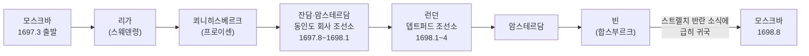

1697년 8월, 네덜란드 암스테르담 북쪽의 작은 조선 마을 잔담에 낯선 사내가 나타났다. 키가 2미터를 훌쩍 넘는 이 거구의 젊은이는 붉은 네덜란드식 작업복을 입고 스스로를 '표트르 미하일로프'라는 러시아 목수라고 소개했다. 그는 대장장이 집에 방을 얻고 조선소에 나가 도끼질을 했다. 그런데 마을 사람들은 곧 수군거리기 시작했다. 러시아에서 일하다 돌아온 한 대장장이가 그를 알아본 것이다. 그는 다름 아닌 러시아의 차르 **표트르 1세**였다.

한 나라의 군주가 신분을 숨기고 외국의 조선소에서 목수로 일한다는 것은 당시 유럽 어디에서도 상상하기 어려운 일이었다. 러시아의 차르라면 더욱 그랬다. 그때까지 러시아의 차르는 크렘린 궁전 깊숙이 머물며 성스러운 존재로 숭배받았고, 나라 밖으로 나간 적이 한 번도 없었다. 표트르는 그 모든 관습을 깨뜨렸다. 그리고 유럽에서 배운 것을 무기로 북유럽의 강대국 스웨덴과 21년 동안 싸워, 러시아를 발트해의 주인이자 유럽 열강의 하나로 만들었다.

이 강의에서는 열 살에 즉위한 표트르가 권력을 쥐기까지의 과정, 서유럽을 돌아본 **대사절단**, 그리고 러시아의 운명을 바꾼 **북방 전쟁**을 따라간다. 그가 나라 안에서 벌인 개혁과 새 수도 상트페테르부르크는 3강에서 다룬다.

> [!핵심] 이 강의의 질문
> 1. 표트르는 어떤 환경에서 자랐으며, 그 경험은 그의 생각에 어떤 영향을 주었는가?
> 2. 대사절단은 무엇을 위해 떠났고, 표트르는 유럽에서 무엇을 보고 배웠는가?
> 3. 러시아는 어떻게 북방 전쟁에서 스웨덴을 이기고 유럽의 강대국이 되었는가?

{{F:r02-opening}}

## 표트르의 어린 시절

### 1682년의 스트렐치 반란

1676년 알렉세이 차르가 죽은 뒤 첫 왕비에게서 난 몸이 약한 아들 표도르 3세가 즉위했지만, 그는 6년 만에 자식 없이 죽었다. 1682년 4월 귀족들은 첫 왕비의 아들로 앞을 잘 보지 못하고 병약했던 열여섯 살 **이반**을 건너뛰고, 두 번째 왕비 나탈리야 나리시키나의 아들인 건강한 열 살 소년 표트르를 차르로 세웠다.

첫 왕비의 친정인 밀로슬랍스키 가문은 이에 반발했다. 그들은 모스크바의 상비군인 **스트렐치**(총병대)를 부추겼다. 밀린 봉급과 지휘관들의 착취에 불만이 쌓여 있던 스트렐치들은 나리시키나 가문이 이반을 죽였다는 헛소문을 듣고 크렘린으로 몰려들었다. 나탈리야는 이반과 표트르를 데리고 궁전의 붉은 계단 위에 나와 두 왕자가 살아 있음을 보여 주었지만, 흥분한 스트렐치들은 표트르가 보는 앞에서 그의 외삼촌과 어머니의 후견인을 창끝으로 받아 계단 아래로 내던졌다. 사흘 동안 크렘린은 피로 물들었다.

결국 이반과 표트르가 함께 차르가 되고(이반 5세와 표트르 1세), 이반의 누나인 스물다섯 살의 **소피야**가 섭정이 되어 실권을 쥐었다. 크렘린의 무기고에는 지금도 두 소년 차르가 나란히 앉던 이중 옥좌가 남아 있다. 옥좌 등받이에는 작은 창이 뚫려 있어, 그 뒤에 숨은 소피야가 어린 차르들에게 할 말을 속삭였다고 전한다.

### 전쟁놀이와 독일인 마을

소피야가 크렘린에서 나라를 다스리는 동안 표트르와 어머니는 모스크바 교외의 프레오브라젠스코예 마을에서 지냈다. 이것은 오히려 표트르에게 행운이었다. 그는 크렘린의 엄격한 의례와 성직자들의 교육 대신, 자유롭게 놀며 자랐다. 그는 또래 소년들과 마구간지기, 하인들을 모아 '놀이 연대'를 만들어 진짜 대포를 쏘고 성을 쌓아 공격하는 전쟁놀이를 했다. 이 놀이 연대가 훗날 러시아 근위대의 핵심이 되는 **프레오브라젠스키 연대**와 **세묘노프스키 연대**다.

표트르는 근처의 **독일인 마을**에도 자주 드나들었다. 그곳에서 그는 스코틀랜드 출신의 노장군 패트릭 고든, 스위스 출신의 쾌활한 모험가 프란츠 르포르 같은 친구를 사귀며 서유럽의 기술과 생활 방식을 배웠다. 어느 날 그는 창고에서 낡은 영국식 작은 배를 발견했다. 바람을 거슬러 나아갈 수 있는 이 배에 매혹된 표트르는 평생 배와 바다에 빠져 살았다. 이 배는 훗날 '러시아 해군의 할아버지'라 불리며 보존되었다.

### 소피야의 몰락과 네르친스크 조약

1689년 소피야의 측근 골리친 공이 이끈 크림 칸국 원정이 두 번째로 실패하자 소피야의 권위가 흔들렸다. 그해 8월 소피야가 자신을 해치려 한다는 소문에 놀란 표트르는 한밤중에 말을 달려 트로이체-세르기예프 수도원으로 피신했다. 귀족과 군대가 하나둘 표트르 쪽으로 넘어왔고, 소피야는 노보데비치 수도원에 갇혔다. 열일곱 살의 표트르가 권력을 잡았지만, 그 뒤 몇 년 동안 나라는 어머니와 그 측근들이 다스렸다. 이반 5세는 1696년 죽을 때까지 이름뿐인 공동 차르로 남았다.

같은 1689년, 러시아는 동쪽 끝에서 중요한 조약을 맺었다. 1강에서 본 흑룡강(아무르강) 일대의 충돌을 끝내기 위해 청나라와 맺은 **네르친스크 조약**이다. 러시아는 흑룡강 유역에서 물러나고, 두 나라는 스타노보이산맥(외흥안령)을 국경으로 삼았다. 중국이 서양 나라와 대등한 형식으로 맺은 첫 조약으로, 청 측의 예수회 선교사들이 통역을 맡아 라틴어로 된 조약문이 정본이 되었다.

## 대사절단 (1697~1698)

### 흑해를 향한 첫 도전: 아조프 원정

권력을 잡은 표트르가 처음 눈을 돌린 곳은 남쪽의 흑해였다. 흑해로 나가는 길은 돈강 하구의 오스만 제국 요새 **아조프**가 막고 있었다. 1695년 표트르는 아조프를 포위했지만, 바다를 통해 보급을 받는 요새를 무너뜨리지 못하고 물러났다. 교훈을 얻은 그는 겨울 동안 돈강 상류의 보로네시에서 수천 명의 농민과 목수를 동원해 갤리선과 바지선으로 이루어진 함대를 만들었다. 1696년 이 함대로 바다를 막자 아조프는 항복했다. 러시아 해군의 첫 승리였다.

### 서유럽으로

1697년 3월 표트르는 250명이 넘는 대규모 사절단을 서유럽으로 보냈다. 공식 목적은 오스만 제국에 맞설 유럽 동맹을 만드는 것이었다. 그러나 표트르의 진짜 관심은 배 만드는 기술과 서유럽의 학문, 군사 기술을 배우고, 그 기술을 가진 사람들을 러시아로 데려오는 것이었다. 표트르는 '프레오브라젠스키 연대의 하사관 표트르 미하일로프'라는 가명으로 사절단에 끼었다. 물론 그를 알아보지 못하는 사람은 거의 없었다. 2미터가 넘는 키와 얼굴의 경련, 거친 행동은 숨길 수 없었다.

사절단은 스웨덴령 리가와 프로이센의 쾨니히스베르크를 거쳐 네덜란드로 갔다. 표트르는 잔담에서 일주일을 보낸 뒤 암스테르담에 있는 네덜란드 **동인도 회사의 조선소**에서 넉 달 동안 일하며 프리깃함 한 척을 처음부터 끝까지 짓는 과정에 참여했다. 틈틈이 그는 해부학 강의를 듣고, 박물관과 공장, 인쇄소, 병원을 찾아다녔으며, 현미경을 만든 레이우엔훅을 만나 그의 현미경을 들여다보았다.

1698년 초에는 영국으로 건너가 석 달 동안 머물렀다. 템스강 가의 뎁트퍼드 왕립 조선소에서 영국의 조선술이 네덜란드보다 이론적이라는 것을 배웠고, 왕립 조폐국과 그리니치 천문대, 의회를 찾아갔다. 그가 머문 집은 일행이 가구와 그림을 부수고 정원을 망가뜨려 엉망이 되었다고 한다. 표트르는 네덜란드와 영국에서 조선공, 선장, 기술자, 의사 등 수백 명의 전문가를 고용해 러시아로 보냈다.



{{F:r02-embassy}}

### 사절단이 깨달은 것

외교의 목적은 이루지 못했다. 서유럽의 강대국들은 오스만 제국과 싸울 생각이 없었다. 그들의 관심은 스페인 국왕이 후계자 없이 죽을 경우 스페인의 거대한 영토를 누가 차지할 것인가에 쏠려 있었다(이것은 1701년 스페인 왕위 계승 전쟁으로 이어진다). 대신 표트르는 새로운 기회를 보았다. 서유럽 열강이 서쪽에서 서로 싸우는 동안, 러시아는 북쪽의 스웨덴을 쳐서 발트해로 나가는 길을 열 수 있었다. 귀국길에 그는 폴란드 왕을 겸하던 작센 선제후 아우구스트 2세와 스웨덴에 맞서기로 뜻을 모았다.

### 스트렐치의 처형과 수염 자르기

1698년 여름, 빈에 머물던 표트르에게 스트렐치가 다시 반란을 일으켰다는 소식이 날아들었다. 반란은 이미 진압되었지만, 급히 돌아온 표트르는 직접 수사를 지휘했다. 고문 끝에 반란군이 소피야를 다시 섭정으로 세우려 했다는 자백이 나오자, 그해 가을 1,000명이 넘는 스트렐치가 처형되었다. 처형된 시신들은 경고의 뜻으로 겨울 내내 모스크바 곳곳과 소피야가 갇힌 수도원의 창문 앞에 매달려 있었다. 스트렐치는 얼마 뒤 해체되었다.

귀국 바로 다음 날, 표트르는 자신을 맞으러 온 대귀족들의 긴 수염을 직접 가위로 잘라 버렸다. 당시 러시아 남자들에게 수염은 신이 주신 모습이자 정교회 신자의 표시였다. 표트르는 이어서 귀족과 관리들에게 수염을 깎고 긴 러시아식 옷 대신 짧은 서유럽식 옷을 입으라고 명령했다. 수염을 기르고 싶은 사람은 해마다 '수염세'를 내고 그 증표인 동전을 지니고 다녀야 했다. 서유럽식 개혁의 상징적인 출발이었다.

## 북방 전쟁 (1700~1721)

### 나르바의 패배

1700년 러시아는 덴마크, 작센-폴란드와 동맹을 맺고 스웨덴에 전쟁을 선포했다. 당시 스웨덴은 발트해 연안 대부분을 차지한 북유럽의 강대국이었고, 왕은 막 열여덟 살이 된 **카를 12세**였다. 동맹국들은 어린 왕을 얕보았다. 그러나 카를 12세는 타고난 군사 천재였다. 그는 먼저 덴마크를 공격해 몇 주 만에 전쟁에서 끌어냈다. 그리고 발트해를 건너 러시아군이 포위하고 있던 나르바 요새로 진격했다.

1700년 11월 19일(그레고리력 11월 30일) 거센 눈보라 속에 1만 명 남짓한 스웨덴군이 3만 명이 넘는 러시아군의 진지를 덮쳤다. 서유럽식 훈련이 덜 된 러시아군은 무너졌고, 외국인 장교들은 앞다투어 항복했다. 러시아군은 대포를 거의 모두 잃었다. 표트르는 전투 전날 진지를 떠나 있었다.

### 패배에서 배우다

카를 12세는 러시아를 더 이상 위협이 되지 않는 상대로 보고, 다음 6년 동안 폴란드에서 아우구스트 2세를 쫓는 데 힘을 쏟았다. 표트르는 이 시간을 헛되이 보내지 않았다. 그는 나라 전체를 전쟁 기계로 바꾸었다.

- **군대**: 농민 20가구마다 한 명씩 평생 복무할 병사를 뽑는 징병 제도를 만들어 대규모 상비군을 길렀다. 장교는 귀족이 맡았고, 서유럽식으로 훈련했다.
- **대포**: 나르바에서 잃은 대포를 다시 만들기 위해 교회와 수도원 종의 4분의 1을 녹이라고 명령했다. 우랄산맥에 제철소와 대포 공장을 세웠다.
- **해군**: 발트해의 함대를 새로 지었다.
- **재정**: 전쟁 비용을 대려고 온갖 물건에 세금을 매겼다. 국가 수입의 대부분이 군대에 들어갔다.

1703년 러시아군은 네바강 하구의 스웨덴 요새를 빼앗았다. 표트르는 그 늪지대에 새 요새를 쌓기 시작했다. 이곳이 훗날 러시아의 새 수도가 되는 **상트페테르부르크**다(3강).

### 폴타바 전투

1708년 폴란드를 굴복시킨 카를 12세는 마침내 모스크바를 향해 진격했다. 표트르는 정면 대결을 피하며 스웨덴군이 지나는 길의 마을과 곡식을 불태웠다. 9월 러시아군은 레스나야에서 스웨덴군의 보급 부대를 격파했다. 표트르는 이 전투를 '폴타바의 어머니'라 불렀다. 보급을 잃은 카를 12세는 남쪽의 우크라이나로 방향을 틀었다. 우크라이나 카자크의 지도자 **이반 마제파**가 러시아를 배신하고 스웨덴 편에 섰지만, 그를 따른 카자크는 많지 않았다. 1708~1709년 겨울은 유럽 전체가 얼어붙은 혹한이었다. 수많은 스웨덴 병사가 얼어 죽었다.

1709년 6월 27일(그레고리력 7월 8일), 우크라이나의 요새 도시 **폴타바** 근처에서 결전이 벌어졌다. 지친 스웨덴군은 굶주림과 추위로 크게 줄어 있었고, 카를 12세는 며칠 전 발에 총을 맞아 들것에 실려 지휘했다. 두 배가 넘는 러시아군과 압도적인 대포 앞에서 스웨덴군은 몇 시간 만에 무너졌다. 며칠 뒤 남은 스웨덴군 1만 6,000여 명이 드네프르강 가에서 항복했다. 카를 12세는 마제파와 함께 오스만 제국으로 달아났다.

```chart
{
  "type": "bar",
  "caption": "나르바 전투(1700)와 폴타바 전투(1709)의 병력 (명, 연구에 따라 차이가 있는 대략적인 수치). 나르바에서는 수가 세 배 넘게 많은 러시아군이 무너졌지만, 폴타바에서는 9년 동안 다시 만든 러시아군이 지친 스웨덴군을 압도했다",
  "data": {
    "labels": ["나르바 (1700)", "폴타바 (1709)"],
    "datasets": [
      { "label": "러시아군", "data": [34000, 42000] },
      { "label": "스웨덴군", "data": [10500, 17000] }
    ]
  },
  "options": { "scales": { "y": { "title": { "display": true, "text": "병력 (명)" } } } }
}
```

폴타바 전투는 북유럽의 세력 판도를 바꾸었다. 스웨덴은 다시는 강대국의 자리를 되찾지 못했고, 러시아가 그 자리를 차지했다. 그날 저녁 표트르는 승리를 축하하는 연회에 붙잡힌 스웨덴 장군들을 초대해, 자신에게 전쟁을 가르쳐 준 '스승들'을 위해 건배했다고 전한다.

{{F:r02-poltava}}

### 프루트강의 위기와 강구트 해전

승리는 오래 이어지지 않았다. 오스만 제국에 머물던 카를 12세의 부추김으로 1710년 오스만 제국이 러시아에 전쟁을 선포했다. 1711년 표트르는 오스만 제국 아래의 발칸 기독교도들이 일어나리라 기대하고 몰다비아로 깊숙이 진격했다가, 프루트강 가에서 훨씬 많은 오스만군에게 포위되었다. 러시아군은 굶주림 속에 전멸할 위기에 놓였고, 표트르는 원로원에 자신이 포로가 되면 자신의 명령을 따르지 말라는 편지까지 썼다고 전한다. 다행히 오스만군 사령관은 비교적 관대한 조건으로 평화를 받아들였다. 러시아는 아조프를 돌려주고 흑해 함대를 포기해야 했다. 흑해로 나가는 꿈은 반세기 넘게 미뤄졌다(6강).

발트해에서는 전쟁이 계속되었다. 1714년 러시아의 갤리선 함대는 핀란드 남쪽의 강구트(항코)곶에서 스웨덴 함대를 물리쳤다. 러시아 해군 최초의 큰 해전 승리였다. 러시아군은 핀란드를 점령하고 스웨덴 본토 해안까지 습격했다. 1718년 카를 12세가 노르웨이의 한 요새를 공격하다 총에 맞아 죽자 스웨덴은 마침내 평화를 받아들였다.

### 뉘스타드 조약과 '러시아 제국'

1721년 8월 30일 스웨덴과 러시아는 핀란드의 뉘스타드에서 평화 조약을 맺었다. 러시아는 리보니아, 에스토니아, 잉그리아(상트페테르부르크 일대), 카렐리야의 일부를 얻어 발트해 연안을 차지했다. 표트르가 말한 '유럽을 향한 창'이 열린 것이다. 그 대신 러시아는 핀란드 대부분을 돌려주고 배상금을 냈다.

그해 10월 원로원은 표트르에게 **'대제'**, **'조국의 아버지'**, 그리고 서유럽식 **'임페라토르'**(황제) 칭호를 바쳤다. 이때부터 러시아는 공식적으로 **러시아 제국**이 되었다. 서유럽 나라들은 처음에는 이 칭호를 인정하기를 꺼렸지만, 결국 러시아를 유럽 열강의 하나로 받아들일 수밖에 없었다.

| 전쟁·사건 | 연도 | 결과 |
|---|---|---|
| 아조프 원정 | 1695~1696 | 두 번째 원정에서 아조프 점령. 러시아 해군의 출발 |
| 나르바 전투 | 1700 | 스웨덴군에 대패 |
| 상트페테르부르크 건설 시작 | 1703 | 네바강 하구에 요새 |
| 레스나야 전투 | 1708 | 스웨덴 보급 부대 격파 |
| 폴타바 전투 | 1709 | 스웨덴군 주력 궤멸 |
| 프루트강 원정 | 1711 | 오스만군에 포위, 아조프 반환 |
| 강구트 해전 | 1714 | 러시아 해군 최초의 대승 |
| 뉘스타드 조약 | 1721 | 발트해 연안 획득. 러시아 제국 선포 |

표: 표트르 대제의 전쟁

> [!더알아보기] 북방 전쟁의 대가
> 북방 전쟁은 러시아를 강대국으로 만들었지만 그 대가는 컸다. 21년 동안 국가 수입의 대부분이 군대와 함대에 들어갔다. 새로 거둔 인두세를 비롯한 무거운 세금, 징병, 도시 건설과 운하 공사를 위한 강제 노동이 농민을 짓눌렀다. 표트르 시대에 납세 인구가 늘지 않고 오히려 줄어든 지역이 많았다는 연구도 있다. 표트르의 개혁을 '위로부터의 혁명'이라 부르는 것은, 그것이 백성의 엄청난 희생 위에서 차르의 의지로 강요되었기 때문이기도 하다.

## 정리

> [!핵심] 2강 요약
> - 표트르는 1682년 열 살에 이반 5세와 함께 차르가 되었고, 누이 **소피야**가 섭정했다. 스트렐치 반란의 공포를 겪은 그는 교외에서 '놀이 연대'와 **독일인 마을**의 외국인들 사이에서 자라며 배와 군사 기술에 빠졌다.
> - 1689년 소피야를 몰아냈고, 같은 해 청나라와 **네르친스크 조약**을 맺었다. 1696년 함대를 만들어 **아조프**를 점령했다.
> - **대사절단**(1697~1698)에서 표트르는 가명으로 네덜란드와 영국의 조선소에서 일하며 서유럽의 기술과 학문을 배우고 전문가들을 데려왔다. 귀국 뒤 스트렐치를 처형하고 귀족의 **수염을 잘랐다**.
> - **북방 전쟁**(1700~1721)에서 러시아는 **나르바**에서 대패했지만, 징병과 대포 제조, 함대 건설로 군대를 다시 세워 **폴타바**(1709)에서 카를 12세를 무찔렀다.
> - **뉘스타드 조약**(1721)으로 발트해 연안을 얻고, 표트르는 '대제'이자 황제가 되어 러시아는 **러시아 제국**이 되었다.

### 생각해 볼 질문

1. 표트르가 크렘린이 아닌 교외에서 자란 것은 그의 생각과 개혁에 어떤 영향을 주었을까?
2. 나르바의 대패가 오히려 러시아에 도움이 되었다는 평가가 있다. 어떤 점에서 그럴까?
3. 강대국이 된 대가를 치른 것은 누구였을까? 표트르의 전쟁을 농민의 눈으로 보면 어떻게 보일까?

### 다음 강 예고

3강 「표트르 대제 2: 개혁과 상트페테르부르크」에서는 표트르가 나라 안에서 벌인 개혁을 살펴본다. 늪지 위에 세운 새 수도 상트페테르부르크, 원로원과 참의회, 관등표, 교회 개혁과 신성 종무원, 학교와 과학 아카데미, 그리고 개혁에 반대한 아들 알렉세이 황태자의 비극적인 최후를 다룬다.
