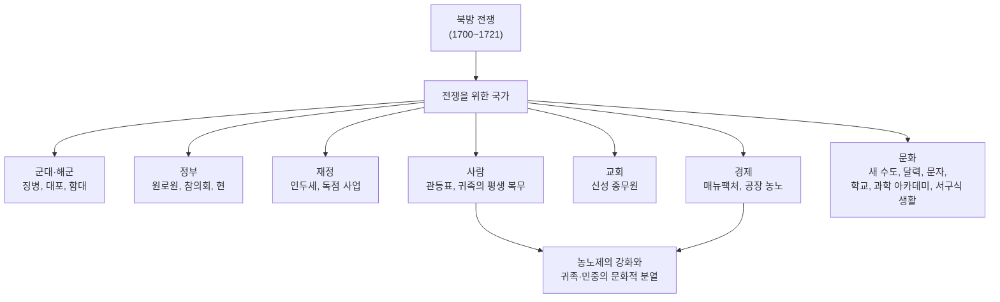

1703년 5월 16일, 발트해로 흘러드는 네바강 하구의 작은 섬 자야치섬('토끼섬'). 스웨덴군에게서 막 빼앗은 이 늪지에서 표트르는 총검으로 잔디를 떠내 십자 모양으로 놓으며 말했다고 전한다. "여기에 도시가 있으리라." 그 자리에 먼저 흙으로 된 요새가 세워졌다. 그것이 오늘날의 **페트로파블롭스크 요새**이고, 그 주위에 생겨난 도시가 **상트페테르부르크**다.

그곳은 도시를 세우기에 최악의 땅이었다. 낮은 늪지는 해마다 홍수에 잠겼고, 겨울은 길고 어두웠으며, 돌도 목재도 멀리서 실어 와야 했다. 게다가 전쟁 중인 스웨덴군이 바로 옆에 있었다. 그러나 표트르에게 이곳은 '유럽을 향한 창'이었다. 그는 수만 명의 농민과 포로를 끌고 와 늪을 메우고 운하를 팠으며, 귀족과 상인들을 억지로 이주시켰다. 그리고 1712년, 수백 년 동안 러시아의 심장이던 모스크바를 버리고 이 새 도시로 수도를 옮겼다.

새 수도는 표트르의 개혁 전체를 상징한다. 그는 러시아를 낡은 모스크바의 전통에서 떼어 내어, 서유럽처럼 합리적으로 조직된 강력한 국가로 바꾸려 했다. 이 강의에서는 상트페테르부르크의 건설과 함께, 표트르가 국가 기구, 귀족, 교회, 경제, 교육과 생활 문화에 걸쳐 벌인 개혁을 살펴보고, 그 개혁이 남긴 빛과 그늘을 생각해 본다.

> [!핵심] 이 강의의 질문
> 1. 표트르는 왜 늪지 위에 새 수도를 세웠으며, 그 대가는 무엇이었는가?
> 2. 표트르의 개혁은 국가와 귀족, 교회, 사회를 어떻게 바꾸었는가?
> 3. 표트르의 개혁은 러시아에 무엇을 남겼으며, 오늘날 어떻게 평가받는가?

```figure
src: asset:39298edfdfebff6c8def6bc899285d69
caption: 네바강 건너편에서 본 페트로파블롭스크 요새와 대성당의 첨탑(1914년). 1703년 도시의 첫 건물로 세운 이 요새는 훗날 정치범의 감옥이 되었고, 대성당에는 표트르 대제 이후 거의 모든 러시아 황제가 묻혔다.
credit: 키스톤 뷰 컴퍼니 입체 사진, 1914년 · 미국 의회도서관 소장
license: Public Domain (미국 의회도서관: 출판 제한 없음)
source: https://www.loc.gov/item/2021641344/
```

## 늪 위의 도시

### 강제로 세운 수도

상트페테르부르크라는 이름은 표트르의 수호성인인 성 베드로(러시아어로 표트르)에서 따왔다. 원래 이름은 네덜란드식으로 '산크트 피테르 부르흐'였다. 도시는 처음부터 서유럽의 도시, 특히 표트르가 사랑한 암스테르담을 본떠 계획되었다. 거리는 곧게 뻗고, 운하가 도시를 가로질렀으며, 건물은 서유럽 건축가들이 설계했다.

건설은 엄청난 희생을 치렀다. 해마다 수만 명의 농민이 나라 곳곳에서 강제로 끌려와 몇 달씩 일하고 돌아갔다. 그들은 늪지에서 맨손과 나무 삽으로 흙을 날랐고, 질병과 굶주림, 추위로 많은 사람이 죽었다. 사망자 수에 대한 추정은 수만 명에서 그보다 훨씬 적은 수까지 엇갈리지만, '뼈 위에 세운 도시'라는 말이 생길 만큼 희생이 컸던 것은 분명하다.

표트르는 도시를 빨리 키우기 위해 강압적인 수단을 썼다. 1714년에는 상트페테르부르크를 제외한 러시아 전역에서 돌로 집을 짓는 것을 금지했다. 전국의 석공을 새 수도로 모으기 위해서였다. 도시에 들어오는 모든 배와 수레는 일정량의 돌을 가져와야 했다. 귀족과 부유한 상인들은 정해진 수의 가족을 데리고 이주해 정해진 양식으로 집을 지어야 했다. 많은 귀족은 모스크바의 편안한 저택을 떠나 습하고 물가가 비싼 새 도시로 오는 것을 싫어했지만, 황제의 명령을 거스를 수 없었다.

### 유럽의 도시

1712년부터 궁정과 정부 기관이 상트페테르부르크로 옮겨 왔다. 해군성과 조선소, 여름 궁전, 원로원과 참의회 건물이 들어섰다. 1719년에는 러시아 최초의 박물관인 **쿤스트카메라**가 문을 열었다. 표트르가 유럽에서 사들인 해부학 표본과 기형 생물, 광물, 과학 기구를 전시한 곳으로, 표트르는 사람들이 오도록 입장객에게 보드카 한 잔을 대접하게 했다고 한다. 핀란드만 건너편에는 베르사유를 본뜬 여름 별궁 **페테르고프**가 지어졌다.

표트르가 죽은 1725년 무렵 상트페테르부르크의 인구는 4만 명 정도였다. 이 도시는 1918년 볼셰비키가 수도를 모스크바로 다시 옮길 때까지 200년 넘게 러시아 제국의 수도였다. 그동안 이름도 바뀌었다. 제1차 세계대전 때 독일식 이름을 피해 **페트로그라드**(1914), 레닌이 죽은 뒤 **레닌그라드**(1924)가 되었다가, 1991년 소련이 해체될 무렵 시민 투표로 다시 상트페테르부르크가 되었다.

```chart
{
  "type": "line",
  "caption": "상트페테르부르크의 인구 (만 명, 1725~1914년, 대략적인 추정치). 표트르가 죽을 무렵 4만 명 남짓이던 도시는 19세기 후반 산업화와 함께 빠르게 커져, 1914년에는 200만 명이 넘는 유럽 굴지의 대도시가 되었다",
  "data": {
    "labels": ["1725", "1750", "1800", "1825", "1850", "1869", "1890", "1900", "1914"],
    "datasets": [{ "label": "인구 (만 명)", "data": [4, 9.5, 22, 42, 49, 67, 95, 144, 217] }]
  },
  "options": { "scales": { "y": { "min": 0 } }, "plugins": { "legend": { "display": false } } }
}
```

## 국가의 개혁

### 원로원과 참의회

표트르 이전 러시아의 정부는 수십 개의 '프리카스'(관청)가 맡은 일이 서로 겹치는 복잡한 조직이었다. 대귀족들의 회의인 보야르 두마가 차르에게 조언했다. 표트르는 전쟁을 치르면서 이 낡은 기구를 하나씩 새로 바꾸었다.

1711년 프루트강 원정을 떠나며 표트르는 자신이 없는 동안 나라를 다스릴 기관으로 **원로원**(세나트)을 만들었다. 원로원은 그 뒤 최고 행정 기관이자 최고 법원이 되었다. 1717~1718년에는 스웨덴의 제도를 본떠 낡은 관청들을 외교, 육군, 해군, 재정, 사법, 상업 등을 나누어 맡는 **참의회**(콜레기야)로 바꾸었다. 참의회는 한 사람이 아니라 여러 위원이 함께 결정하는 합의 기관이었다. 1722년에는 원로원을 감시하는 **검찰총장**을 두었다. 표트르는 그를 '군주의 눈'이라 불렀다. 지방은 1708년부터 큰 단위의 **현**(구베르니야)으로 나누어 다스렸다.

### 관등표

1722년 표트르는 러시아 사회를 300년 가까이 규정한 **관등표**를 만들었다. 군인, 문관, 궁정관의 모든 관직을 1등부터 14등까지 열네 등급으로 나눈 것이다. 이제 관직은 가문이 아니라 원칙적으로 능력과 근무 연수에 따라 오를 수 있었다. 평민 출신이라도 군대에서 가장 낮은 장교 계급(14등)에 오르거나 문관으로 8등에 오르면 세습 귀족이 되었다. 표트르의 측근 가운데 가장 큰 권력을 누린 멘시코프는 모스크바 거리에서 파이를 팔던 소년이었다는 소문이 있을 만큼 미천한 출신이었다.

| 등급 | 군인 (육군) | 문관 | 비고 |
|---|---|---|---|
| 1등 | 원수 | 재상 | |
| 2등 | 대장 | 현임 추밀 고문관 | |
| 4등 | 소장 | 현임 국가 고문관 | 이 위로는 '각하'로 불림 |
| 8등 | 소령 | 참의회 사정관 | 문관은 이 등급부터 세습 귀족 (1845년까지) |
| 14등 | 소위보 | 참의회 등록관 | 군인은 이 등급부터 세습 귀족 |

표: 관등표의 일부 (1722, 관직 이름은 시기에 따라 조금씩 바뀌었다). 관등표는 1917년 혁명 때까지 쓰였다. 고골의 「외투」 주인공 아카키 아카키예비치 같은 '9등관'(명예 고문관)이 러시아 소설에 자주 나오는 것도 이 때문이다

### 귀족의 의무

표트르는 귀족에게 국가에 대한 **평생 복무**를 요구했다. 귀족 남자는 15세 무렵부터 군대나 관청에서 일해야 했고, 늙거나 병들 때까지 집에 돌아갈 수 없었다. 귀족 자제들은 수학과 기하학을 배워야 했고, 이를 배우지 못하면 결혼을 허락받지 못한다는 법령까지 나왔다. 수백 명의 젊은 귀족이 항해술과 조선술을 배우러 외국으로 보내졌다. 표트르 아래에서 귀족은 특권 계층이라기보다 국가의 봉사자였다. 이 의무는 표트르가 죽은 뒤 점점 느슨해져 1762년에 폐지된다(4강).

### 세금과 인두세

전쟁 비용을 마련하기 위해 표트르는 세금 제도도 바꾸었다. 그전까지는 가구마다 세금을 매겼는데, 세금을 피하려고 여러 가구가 한집에 모여 사는 일이 많았다. 표트르는 1718년부터 전국의 남자 인구를 조사해, 1724년부터 귀족과 성직자를 뺀 모든 남자 한 사람 한 사람에게 세금을 매기는 **인두세**를 걷었다. 세금이 '영혼'(남자 한 명)마다 매겨졌기 때문에, 러시아에서는 농노의 수를 '영혼'으로 세게 되었다. 고골의 소설 『죽은 혼』은 서류상으로만 살아 있는 죽은 농노의 '영혼'을 사들이는 사기꾼의 이야기다. 인두세는 국가 수입을 크게 늘렸지만, 농민의 부담도 그만큼 무거워졌다.

```figure
src: asset:bc78153eacdec3dabb7062543549e1c1
caption: 1890년 무렵 위에서 내려다본 상트페테르부르크 중심가. 앞쪽은 해군성 앞의 정원이고, 네바강 건너 멀리 페트로파블롭스크 요새의 첨탑이 보인다. 해군성은 1704년 표트르가 세운 조선소에서 시작되었다.
credit: 포토글로프 사 포토크롬, 1890년 무렵 · 미국 의회도서관 소장
license: Public Domain (미국 의회도서관: 출판 제한 없음)
source: https://www.loc.gov/item/2001697486/
width: wide
```

## 교회와 문화의 개혁

### 총대주교 대신 신성 종무원

1700년 총대주교 아드리안이 죽자 표트르는 후임을 뽑지 않았다. 그는 1666년 총대주교 니콘이 차르와 권력을 다툰 일을 기억했고, 교회가 개혁에 반대하는 세력의 구심점이 되는 것을 경계했다. 1721년 그는 총대주교 제도를 아예 없애고, 성직자 여러 명으로 이루어진 국가 기관 **신성 종무원**(시노드)이 교회를 다스리게 했다. 이듬해부터는 일반 관리인 **총감**이 종무원을 감독했다. 교회는 사실상 국가의 한 부서가 되었고, 이 체제는 1917년까지 이어졌다.

### 달력, 문자, 신문

표트르는 일상생활과 문화에도 손을 댔다.

- **달력**: 그때까지 러시아는 천지 창조를 기준으로 해를 세고 9월 1일을 새해로 삼았다. 표트르는 창조 이후 7208년이던 해의 다음 해를 서유럽처럼 그리스도 탄생 기준의 1700년으로 바꾸고, 1월 1일을 새해로 정했다. 다만 서유럽의 그레고리력이 아니라 율리우스력을 그대로 썼다.
- **문자**: 1708년 교회 문자를 단순하게 다듬은 '민간 문자'를 만들어 세속 책을 찍게 했다. 오늘날 러시아 문자의 바탕이다.
- **신문**: 1702년 말 명령을 내려 이듬해 1월 러시아 최초의 인쇄 신문 『베도모스티』(소식)의 첫 호를 펴냈다.
- **학교**: 1701년 모스크바에 수학·항해 학교를 세웠고, 지방에는 수학을 가르치는 학교들을 만들었다.
- **과학 아카데미**: 1724년 상트페테르부르크에 과학 아카데미를 세웠다. 처음에는 교수 대부분이 독일인 같은 외국인 학자였다. 훗날 수학자 오일러도 이곳에서 일했다.

### 생활의 서구화

표트르는 귀족들이 서유럽식으로 살기를 바랐다. 2강에서 본 수염 자르기와 서유럽식 옷에 이어, 1718년에는 **아셈블레야**라는 사교 모임을 만들었다. 귀족의 집에서 번갈아 열린 이 모임에서는 남녀가 함께 춤추고 이야기를 나누며 카드놀이를 했다. 그때까지 러시아 귀족 여성들은 '테렘'이라는 집 안의 별채에서 거의 바깥에 나오지 않고 살았기 때문에, 여성이 남성과 함께 사교 모임에 나오는 것은 큰 변화였다. 표트르는 서유럽식 예절을 가르치는 책 『젊은이의 정직한 거울』(1717)도 펴냈다. 이 책은 식탁에서 손가락으로 이를 쑤시지 말라, 남의 말을 끊지 말라 같은 예절을 가르쳤다.

```figure
src: asset:fcbaac92db295887dbf4aea3f0cd6bb1
caption: 핀란드만에 면한 여름 별궁 페테르고프의 바다 운하와 분수(1890년 무렵). 표트르가 베르사유를 본떠 짓기 시작했다.
credit: 포토글로프 사 포토크롬, 1890년 무렵 · 미국 의회도서관 소장
license: Public Domain (미국 의회도서관: 출판 제한 없음)
source: https://www.loc.gov/item/2017660925/
```

## 경제와 산업

표트르의 경제 정책은 당시 서유럽의 **중상주의**를 따랐다. 수출을 늘리고 수입을 줄여 나라에 돈을 모으고, 군대에 필요한 물자를 나라 안에서 만들게 하는 것이다. 그는 국가가 직접 공장을 세우거나 상인에게 특권과 자금을 주어 공장을 세우게 했다. 표트르가 죽을 무렵 러시아에는 국영과 민영을 합쳐 200개 안팎의 큰 작업장(매뉴팩처)이 있었다. 우랄산맥의 제철소들은 빠르게 커져, 18세기 중엽 러시아는 한때 세계 최대의 철 생산국이 되었다.

그런데 이 공장들에서 일할 노동자가 모자랐다. 자유로운 노동자는 드물었기 때문이다. 1721년 표트르는 상인이 공장에서 일할 농노를 마을째 사들일 수 있도록 허락했다. 이렇게 공장에 묶인 농노를 '세습 공장 농노'라 한다. 서유럽에서 산업이 자유로운 노동자의 고용과 함께 자랐다면, 러시아의 산업은 농노의 강제 노동에 기대어 자랐다. 표트르의 근대화는 농노제를 약하게 만들기는커녕 오히려 더 넓고 단단하게 만들었다.

## 개혁의 그늘: 알렉세이 황태자

표트르의 개혁에 가장 가까운 곳에서 반대한 사람은 그의 맏아들 **알렉세이**였다. 표트르가 첫 아내를 수녀원에 보낸 뒤 어머니와 떨어져 자란 알렉세이는 조용하고 신앙심 깊은 청년으로, 아버지의 전쟁과 개혁, 거친 생활을 싫어했다. 개혁에 불만을 품은 성직자와 귀족들은 그에게 기대를 걸었다. 표트르는 아들을 여러 번 꾸짖으며 개혁을 이어받든지, 아니면 수도원에 들어가라고 다그쳤다.

1716년 알렉세이는 몰래 국경을 넘어 처남인 오스트리아 황제가 있는 빈으로 달아났다. 표트르는 사절을 보내 용서를 약속하며 그를 데려왔지만, 1718년 돌아온 알렉세이를 반역 혐의로 재판에 넘겼다. 고문 끝에 원로원과 고위 관리들은 그에게 사형을 선고했고, 알렉세이는 6월 페트로파블롭스크 요새의 감옥에서 숨졌다. 고문의 상처 때문이었는지, 다른 이유 때문이었는지는 지금도 분명하지 않다.

이 비극은 후계 문제를 남겼다. 1722년 표트르는 황제가 후계자를 자유롭게 지명한다는 **황위 계승법**을 만들었다. 그러나 1725년 1월 그는 후계자를 지명하지 못한 채 쉰두 살에 세상을 떠났다. 이 공백은 그 뒤 수십 년 동안 근위대가 황제를 세우고 갈아 치우는 '궁정 혁명의 시대'를 불러왔다(4강).

> [!사료] 표트르가 알렉세이에게 보낸 편지의 요지 (1715)
> "나는 네가 무능하다는 것을 보며 슬퍼하고 있다. … 나는 내 목숨도 아끼지 않았고, 조국과 백성을 위해 지금도 아끼지 않는다. 그런데 어찌 쓸모없는 너를 아끼겠느냐. 나는 차라리 쓸모 있는 남에게 넘겨줄지언정 쓸모없는 아들에게 넘겨주지 않겠다."



## 표트르를 어떻게 볼 것인가

표트르 대제는 러시아 역사에서 가장 논쟁적인 인물 가운데 하나다. 그의 개혁 덕분에 러시아는 유럽 열강의 하나가 되었고, 근대 국가의 틀과 과학, 세속 문화를 갖추게 되었다. 그러나 그 개혁은 강제와 폭력으로 이루어졌고, 농민의 부담과 농노제를 더욱 무겁게 만들었다.

표트르의 개혁은 러시아 사회를 둘로 갈라놓기도 했다. 서유럽식 옷을 입고 프랑스어와 독일어를 쓰며 유럽의 문화를 누리는 귀족과, 수염을 기르고 정교회의 옛 전통 속에 사는 대다수의 농민 사이에 깊은 문화적 골이 생겼다. 19세기 러시아 지식인들은 이 문제를 두고 크게 둘로 나뉘었다. 러시아가 표트르의 길을 따라 더 서유럽처럼 되어야 한다는 **서구파**와, 표트르가 러시아 고유의 정신을 망가뜨렸다고 본 **슬라브파**다(10강).

1782년 예카테리나 2세는 상트페테르부르크의 네바강 가에 표트르의 기마상을 세우고 '표트르 1세에게, 예카테리나 2세가'라고 새겼다. 1833년 시인 푸시킨은 이 동상을 소재로 쓴 시 「청동 기마상」에서, 홍수로 약혼녀를 잃은 가난한 관리가 동상을 향해 주먹을 휘두르다 미쳐 가는 이야기를 그렸다. 위대한 국가를 세운 황제와 그 아래에서 짓밟힌 '작은 사람' 사이의 긴장은, 그 뒤 러시아 역사 내내 되풀이된 질문이 되었다.

```gallery
src: asset:e76c6c2f389a4cea7d8d61f867f01bfb
caption: 원로원 광장의 표트르 대제 기마상, 이른바 '청동 기마상'(1890년 무렵). 예카테리나 2세가 프랑스 조각가 팔코네에게 맡겨 1782년 세웠다. 뒤에 성 이사아크 대성당이 보인다.
credit: 포토글로프 사 포토크롬, 1890년 무렵 · 미국 의회도서관 소장
license: Public Domain (미국 의회도서관: 출판 제한 없음)
source: https://www.loc.gov/item/2001697500/
---
src: asset:a2da1996e8c0b14ae30fc62d1e3135c2
caption: 1794년의 판화 「상트페테르부르크 첫 번째 풍경」. 바위 받침 위의 청동 기마상과 넓은 광장, 네바강이 보인다. 받침돌은 핀란드만 근처에서 찾아낸 1,000톤 넘는 거대한 화강암으로, 몇 달에 걸쳐 옮겨 왔다.
credit: 작자 미상 판화, 1794년 · 암스테르담 국립미술관 소장
license: Public Domain (레이크스 미술관: CC0)
source: https://www.rijksmuseum.nl/en/collection/RP-P-OB-54.279
```

```timeline
1700 | 새 달력 사용, 북방 전쟁 시작 | 총대주교 아드리안 사망, 후임 없음
1701 | 모스크바 수학·항해 학교 | 
1703 | 신문 『베도모스티』 첫 호 | 
1703 | 상트페테르부르크 건설 시작 | 페트로파블롭스크 요새
1708 | 현(구베르니야) 설치, 민간 문자 | 
1711 | 원로원 설치 | 
1712 | 수도를 상트페테르부르크로 옮김 | 
1714 | 수도 밖 석조 건축 금지 | 
1718 | 참의회 설치, 알렉세이 황태자 사망 | 아셈블레야 시작
1721 | 신성 종무원 설치, 러시아 제국 선포 | 공장의 농노 매입 허용
1722 | 관등표, 황위 계승법 | 
1724 | 인두세 징수 시작, 과학 아카데미 설립 | 
1725 | 표트르 사망 | 예카테리나 1세 즉위(4강)
```

## 정리

> [!핵심] 3강 요약
> - 표트르는 1703년 네바강 하구의 늪지에 **상트페테르부르크**를 세우고 1712년 수도를 옮겼다. 강제 노동과 강제 이주로 세운 이 도시는 '유럽을 향한 창'이자 개혁의 상징이었다.
> - 국가 기구를 **원로원**, **참의회**, **현**으로 바꾸고, **관등표**(1722)로 능력과 근무에 따른 승진 체계를 만들었다. 귀족에게는 **평생 복무**를 요구했다.
> - **인두세**로 재정을 늘리고, 총대주교 대신 **신성 종무원**으로 교회를 국가 아래에 두었다.
> - 달력과 문자를 바꾸고 신문, 학교, 과학 아카데미를 세웠으며, 수염 자르기와 아셈블레야로 귀족의 생활을 서구화했다.
> - 중상주의 정책으로 공장을 세웠지만, 공장 노동도 농노에 기대어 **농노제는 오히려 강화**되었다. 개혁은 귀족과 민중 사이의 문화적 분열을 낳았다.
> - 개혁에 반대한 **알렉세이 황태자**는 1718년 감옥에서 죽었고, 후계자 없이 표트르가 죽으면서 궁정 혁명의 시대가 열렸다.

### 생각해 볼 질문

1. 표트르의 개혁은 '근대화'였을까, '서구화'였을까? 두 말은 어떻게 다를까?
2. 관등표는 귀족 사회에 능력주의를 들여왔지만, 동시에 모든 사람을 국가의 등급 안에 묶어 두었다. 이 제도의 장점과 한계를 생각해 보자.
3. 같은 시기 조선은 숙종(재위 1674~1720)과 경종, 영조의 시대였다. 표트르의 개혁과 같은 '위로부터의 급격한 개혁'이 조선에서는 왜 일어나지 않았을까?

### 다음 강 예고

4강 「궁정 혁명의 시대」에서는 표트르가 죽은 뒤 1762년까지 37년 동안 여섯 명의 황제가 근위대의 손으로 세워지고 쫓겨난 시대를 살펴본다. 농민 출신 황후 예카테리나 1세, 독일인 총신들의 시대를 연 안나 여제, 무도회와 프랑스 문화를 사랑한 옐리자베타 여제, 그리고 귀족을 의무에서 해방한 표트르 3세와 그를 몰아낸 아내 예카테리나까지 이어진다.
