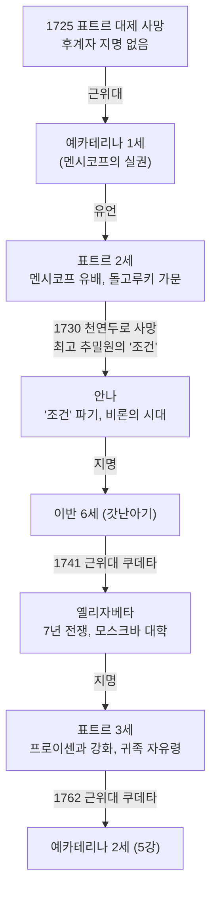

1740년 2월, 상트페테르부르크의 네바강 가에 기묘한 건물이 들어섰다. 길이 16미터, 높이 10미터 남짓의 궁전이 통째로 얼음으로 지어진 것이다. 얼음 벽돌을 쌓고 물을 부어 붙인 벽은 유리처럼 투명했고, 안에는 얼음으로 깎은 침대와 탁자, 시계, 트럼프 카드까지 놓였다. 문 앞의 얼음 대포는 실제로 포탄을 쏘았고, 얼음 코끼리는 코로 물을 뿜었다.

이 **얼음 궁전**은 **안나 여제**가 한 결혼식을 위해 지은 것이었다. 신랑은 명문 귀족 출신이지만 가톨릭 신자와 결혼했다는 이유로 궁정 광대가 된 쉰 살의 골리친 공작이었고, 신부는 여제가 '못생긴' 하녀로 골라 준 칼미크인 여성이었다. 러시아 곳곳의 소수 민족 남녀들이 전통 의상을 입고 낙타와 순록, 개가 끄는 썰매를 타고 행렬을 이루었다. 신혼부부는 영하 수십 도의 추위 속에 얼음 침대에서 첫날밤을 보내야 했다. 두 사람은 살아남았지만, 이 잔인한 장난은 이 시대 러시아 궁정의 모습을 상징적으로 보여 준다.

1725년 표트르 대제가 후계자를 정하지 못하고 죽은 뒤부터 1762년 예카테리나 2세가 즉위할 때까지 37년 동안, 러시아의 황제는 여섯 번 바뀌었다. 그 가운데 네 번은 근위대가 무력으로 황제를 세우거나 몰아냈다. 역사가들은 이 시대를 **'궁정 혁명의 시대'**라고 부른다. 이 강의에서는 이 혼란한 시대를 따라가며, 그 속에서 귀족은 어떻게 힘을 키웠는지, 그리고 표트르의 개혁은 어떻게 살아남았는지 살펴본다.

> [!핵심] 이 강의의 질문
> 1. 표트르 대제가 죽은 뒤 왜 근위대가 황제를 세우고 몰아내는 일이 되풀이되었는가?
> 2. 이 시대에 귀족의 지위는 어떻게 바뀌었는가?
> 3. 혼란 속에서도 러시아는 어떻게 유럽의 강대국이자 문화 국가로 자랐는가?

{{F:r04-opening}}

## 근위대가 만드는 황제

### 예카테리나 1세: 세탁부에서 황후로

1725년 1월 28일 새벽 표트르 대제가 숨을 거두자, 궁전의 한 방에서는 고위 관리와 귀족들이 다음 황제를 두고 논쟁을 벌이고 있었다. 명문 귀족들은 표트르의 손자로 열 살인 **표트르 알렉세예비치**(알렉세이 황태자의 아들)를 밀었다. 그러나 그때 프레오브라젠스키 연대와 세묘노프스키 연대의 근위병들이 북을 울리며 궁전 마당으로 몰려왔다. 그들은 표트르의 아내 **예카테리나**를 황제로 세우라고 외쳤다. 귀족들은 물러설 수밖에 없었다.

예카테리나 1세(재위 1725~1727)의 삶은 그 자체로 놀라운 이야기다. 그녀는 리보니아(지금의 라트비아 일대)의 가난한 농민 집안 출신으로, 본래 이름은 마르타 스카브론스카야였다. 북방 전쟁 때 러시아군의 포로가 된 그녀는 멘시코프의 집에서 일하다 표트르의 눈에 띄었고, 1712년 정식으로 황후가 되었다. 글을 거의 읽지 못했지만 밝고 강인한 성격으로 거친 표트르를 다룰 줄 알았다. 이제 그녀는 러시아 역사상 첫 여성 황제가 되었다.

실권은 그녀를 황제로 만든 **멘시코프**가 쥐었다. 2강에서 본 대로 미천한 출신이었다고 전해지는 그는 표트르의 가장 가까운 친구로서 공작이 되고 막대한 재산을 모았다. 정부의 최고 기관으로 **최고 추밀원**이 새로 만들어졌다.

### 표트르 2세와 귀족들

예카테리나 1세가 2년 만에 죽자 유언에 따라 열한 살의 **표트르 2세**(재위 1727~1730)가 즉위했다. 멘시코프는 자기 딸을 어린 황제와 약혼시켜 권력을 굳히려 했지만, 오래된 귀족 가문인 돌고루키 가문이 어린 황제의 마음을 얻었다. 멘시코프는 갑자기 모든 재산과 지위를 빼앗기고 시베리아의 작은 마을 베료조프로 유배되어 그곳에서 죽었다. 돌고루키 가문은 표트르 2세를 모스크바로 데려갔고, 궁정과 정부도 한동안 모스크바로 돌아갔다. 상트페테르부르크는 잠시 버려진 도시가 되었다.

1730년 1월, 돌고루키 가문의 딸과 결혼식을 올리기로 한 바로 그날 표트르 2세는 천연두로 죽었다. 열네 살이었다. 표트르 대제의 남자 후손은 이로써 끊겼다.

### 안나 여제와 '조건'

최고 추밀원의 귀족들은 이번에는 황제를 직접 골랐다. 그들은 표트르 대제의 이복형 이반 5세의 딸로, 발트해 연안의 작은 공국 쿠를란트에서 과부로 살던 **안나**를 선택했다. 그리고 그녀에게 서명을 조건으로 내걸었다. 황제는 최고 추밀원의 동의 없이 전쟁을 하거나 평화를 맺지 않고, 세금을 걷지 않고, 귀족을 재판 없이 처벌하지 않으며, 결혼하거나 후계자를 정하지 않는다는 것이었다. 이 **'조건'**이 지켜졌다면 러시아의 전제 군주정은 영국처럼 귀족이 견제하는 제한 군주정으로 바뀌었을지도 모른다.

안나는 쿠를란트에서 이 조건에 서명했다. 그러나 모스크바에 와 보니, 소수의 명문 귀족이 권력을 독차지하는 것을 싫어하는 다수의 중소 귀족과 근위대 장교들이 그녀에게 전제 권력을 되찾으라고 청원했다. 1730년 2월 25일, 안나는 귀족들이 보는 앞에서 '조건'이 적힌 문서를 찢어 버렸다. 제한 군주정의 시도는 몇 주 만에 끝났다.

안나 여제(재위 1730~1740)의 시대는 흔히 '독일인의 시대'라고 불린다. 그녀는 쿠를란트에서 데려온 총신 **비론**에게 큰 권력을 맡겼고, 정부와 군대의 높은 자리에 발트 독일인들이 많이 올랐다. 반대파에 대한 감시와 처벌이 가혹해 2만 명 넘는 사람이 시베리아로 유배되었다는 기록도 있다. 러시아 귀족들은 이 시대를 '비로노프시나'(비론의 통치)라 부르며 원망했다. 다만 최근 연구는 안나 시대의 통치가 생각보다 안정적이었고, 정부의 실무는 러시아인 관리들이 이끌었다고 본다.

### 옐리자베타의 쿠데타

안나는 죽기 전 조카딸의 아들로 태어난 지 두 달 된 **이반 6세**를 후계자로 정했다. 아기 황제의 섭정은 그의 어머니 안나 레오폴도브나가 맡았다. 1741년 11월 25일 밤, 표트르 대제의 딸 **옐리자베타**가 갑옷 위에 외투를 걸치고 프레오브라젠스키 연대의 막사에 나타났다. "얘들아, 내가 누구의 딸인지 알지?" 300명 남짓의 근위병이 그녀를 따라 겨울 궁전으로 쳐들어갔고, 섭정과 아기 황제를 체포했다. 피 한 방울 흘리지 않은 쿠데타였다.

한 살배기 이반 6세는 그 뒤 평생을 감옥에서 보냈다. 이름조차 부르지 못하게 하고 '이름 없는 죄수'로 가두었다. 1764년 한 장교가 그를 구출하려 하자, 경비병들은 미리 받은 명령대로 그를 죽였다. 스물세 살이었다.

| 황제 | 재위 | 즉위 방식 | 끝 |
|---|---|---|---|
| 예카테리나 1세 | 1725~1727 | 근위대의 지지 (표트르의 아내) | 병사 |
| 표트르 2세 | 1727~1730 | 예카테리나 1세의 유언 (표트르의 손자) | 천연두로 사망, 열네 살 |
| 안나 | 1730~1740 | 최고 추밀원의 선택, '조건' 파기 (이반 5세의 딸) | 병사 |
| 이반 6세 | 1740~1741 | 안나의 지명 (안나의 조카딸의 아들) | 쿠데타로 폐위, 평생 감금 |
| 옐리자베타 | 1741~1761 | 근위대 쿠데타 (표트르의 딸) | 병사 |
| 표트르 3세 | 1761~1762 | 옐리자베타의 지명 (표트르의 외손자) | 아내의 쿠데타로 폐위, 살해 |

표: 궁정 혁명 시대의 황제들

## 귀족의 시대

### 근위대는 왜 황제를 만들었나

이 시대에 근위대가 황제를 마음대로 세운 데에는 몇 가지 이유가 있었다. 첫째, 표트르 대제가 1722년 황위 계승법으로 장자 상속의 원칙을 없앴지만 정작 후계자를 정하지 못했다. 누가 황제가 되어야 하는지 정한 규칙이 사라진 것이다. 둘째, 수도에 머무는 근위대는 황제를 직접 보호하는 무력이었고, 그 병사와 장교 대부분이 귀족이었다. 근위대는 사실상 무장한 귀족 사회였다. 셋째, 수도의 귀족들은 외국인 총신이나 몇몇 명문가의 독주를 싫어했고, 자신들의 이익을 지켜 줄 황제를 원했다.

### 귀족이 얻은 것

근위대를 통해 황제를 만든 귀족들은 그 대가로 표트르 대제가 지운 부담에서 하나씩 풀려났다.

- **1731년**: 귀족 자제를 위한 **육군 유년 학교**가 세워졌다. 귀족은 졸병 생활을 거치지 않고 바로 장교가 될 수 있었다.
- **1736년**: 평생이던 귀족의 국가 복무 기간이 **25년**으로 줄었다. 아들이 여럿인 집안은 한 명을 집에 남겨 영지를 돌보게 할 수 있었다.
- **1760년**: 지주는 말을 듣지 않는 농노를 **시베리아로 유배**할 수 있게 되었다.
- **1762년**: 표트르 3세가 **귀족 자유령**을 내려 귀족의 의무 복무를 아예 없앴다. 귀족은 원하면 국가에 봉사하지 않고 영지에서 살 수 있고, 외국에 나갈 수도 있게 되었다.

이렇게 귀족은 국가에 대한 의무에서 풀려났지만, 농노에 대한 지배권은 오히려 커졌다. 역사가 바실리 클류쳅스키는 이 불공평에 대해 이렇게 지적했다. 귀족의 의무가 농노제의 근거였다면, 귀족이 의무에서 해방된 날 다음 날에는 농노도 해방되어야 했다. 실제로 농노 해방은 99년 뒤인 1861년에야 이루어졌다(12강). 많은 농민은 황제가 농노도 해방했는데 귀족들이 그 칙령을 숨기고 있다고 믿었다. 이 믿음은 5강에서 볼 푸가초프의 반란에 불을 지폈다.

```chart
{
  "type": "line",
  "caption": "러시아의 인구 (만 명, 1719~1795년, 국가가 세금을 걷으려고 실시한 인구 조사 '레비지야'를 바탕으로 한 역사가들의 대략적인 추정치). 늘어난 인구에는 새로 얻은 영토의 주민도 포함된다. 1795년의 증가에는 폴란드 분할로 얻은 땅의 주민이 크게 더해졌다(6강)",
  "data": {
    "labels": ["1719", "1744", "1762", "1782", "1795"],
    "datasets": [{ "label": "인구 (만 명)", "data": [1560, 1820, 2320, 2840, 3740] }]
  },
  "options": { "scales": { "y": { "min": 0 } }, "plugins": { "legend": { "display": false } } }
}
```

## 옐리자베타의 시대

### 화려한 궁정

**옐리자베타**(재위 1741~1761)는 아버지 표트르 대제의 정책으로 돌아가겠다고 약속했다. 그녀는 안나 시대에 권력을 잡은 독일인들을 몰아내고, 러시아 귀족들을 높은 자리에 앉혔다. 그녀는 즉위하면서 사형을 집행하지 않겠다고 맹세했고, 실제로 재위 동안 사형 판결은 집행되지 않았다. 다만 매질과 혀 자르기 같은 가혹한 형벌은 계속되었다.

옐리자베타는 아름다움과 무도회, 옷을 사랑했다. 그녀가 죽은 뒤 옷장에서 1만 5,000벌의 드레스가 나왔다는 이야기가 전한다. 궁정에서는 남자는 여자 옷을, 여자는 남자 옷을 입는 가장무도회가 자주 열렸는데, 키가 크고 다리가 늘씬했던 여제는 남장이 잘 어울렸다고 한다. 이탈리아 출신의 건축가 **라스트렐리**는 그녀를 위해 화려한 바로크 양식의 건물을 잇달아 지었다. 오늘날 에르미타주 박물관이 들어선 **겨울 궁전**, 차르스코예 셀로의 **예카테리나 궁전**, 스몰니 수도원이 그의 작품이다.

### 로모노소프와 모스크바 대학

이 시대에 러시아는 처음으로 자국 출신의 위대한 학자를 얻었다. **미하일 로모노소프**(1711~1765)는 백해 연안 어촌의 어부 아들로 태어났다. 열아홉 살에 글을 배우려고 걸어서 모스크바까지 와 신학교에 들어갔고, 귀족이 아니라는 사실을 숨겨야 했다. 이후 과학 아카데미의 장학생으로 독일에서 공부한 그는 화학, 물리학, 천문학, 지질학, 문법, 시, 모자이크 미술에 이르기까지 다방면에서 업적을 남겼다. 1761년에는 금성의 태양면 통과를 관측하며 금성에 대기가 있다고 주장했다.

1755년 로모노소프와 옐리자베타의 총신 슈발로프의 노력으로 **모스크바 대학**이 세워졌다. 러시아 최초의 대학으로, 오늘날 로모노소프의 이름을 따 '로모노소프 모스크바 국립대학교'라고 부른다. 1757년에는 상트페테르부르크에 미술 아카데미도 세워졌다. 러시아 귀족 사회에서는 프랑스어와 프랑스 문화가 급속히 퍼졌다.

{{F:r04-elizabeth}}

### 7년 전쟁: 베를린에 들어간 러시아군

옐리자베타 시대 후반에 러시아는 유럽의 큰 전쟁에 뛰어들었다. 1756년 시작된 **7년 전쟁**에서 러시아는 오스트리아, 프랑스와 손잡고 프로이센의 프리드리히 2세(대왕)에 맞섰다. 러시아군은 1757년 그로스예거스도르프에서, 1759년 쿠너스도르프에서 프로이센군을 크게 이겼다. 쿠너스도르프의 패배 뒤 프리드리히는 "모든 것을 잃었다"며 자결을 생각했다고 한다. 1760년에는 러시아군이 잠시 프로이센의 수도 베를린을 점령하기도 했다. 동프로이센은 몇 년 동안 러시아의 통치를 받았고, 쾨니히스베르크 시민들은 옐리자베타 여제에게 충성을 맹세했다.

1761년 말, 프로이센은 무너지기 직전이었다. 그런데 1761년 12월 25일 옐리자베타가 죽었다.

## 표트르 3세와 1762년의 쿠데타

### '브란덴부르크 가문의 기적'

옐리자베타의 후계자는 그녀의 언니 안나의 아들로, 독일 홀슈타인 공국에서 자란 조카 **표트르 3세**였다. 그는 프리드리히 대왕을 숭배했다. 즉위하자마자 그는 러시아군을 전쟁에서 빼내고, 러시아가 피 흘려 얻은 동프로이센을 아무 대가 없이 돌려주었으며, 오히려 프로이센과 동맹을 맺었다. 프로이센은 기적처럼 살아남았다. 프로이센 사람들은 이를 '브란덴부르크 가문의 기적'이라 불렀다.

표트르 3세는 6개월 남짓한 재위 동안 중요한 개혁도 했다. 앞서 본 귀족 자유령을 내리고, 사람들이 두려워하던 비밀 경찰 기구를 없앴으며, 구교도에 대한 박해를 멈추고, 교회 땅을 국가가 관리하는 일에 착수했다. 그러나 그는 러시아 근위대에 프로이센식 군복과 훈련을 강요하고, 덴마크와 전쟁을 벌여 고향 홀슈타인의 영토를 되찾으려 했다. 정교회의 의식을 깔보는 태도도 숨기지 않았다. 근위대와 귀족, 성직자 사이에서 불만이 커졌다.

### 아내의 쿠데타

표트르 3세의 아내는 독일의 작은 공국 안할트체르프스트 출신의 공녀로, 열다섯 살에 러시아에 와서 정교회로 개종하고 **예카테리나**라는 이름을 받은 여성이었다. 두 사람의 결혼 생활은 처음부터 불행했다. 남편과 달리 예카테리나는 러시아어를 열심히 배우고 정교회 의식을 정성껏 지켰으며, 근위대 장교들 사이에 지지자를 쌓았다. 그중 핵심이 근위대 장교 **오를로프** 형제였다.

1762년 6월 28일 새벽, 예카테리나는 오를로프 형제와 함께 이즈마일롭스키 연대의 막사로 가서 지지를 얻었다. 근위대와 수도의 군중은 그녀를 여제로 환호했다. 그녀는 근위대 군복을 입고 말을 타고 군대를 이끌어 남편이 머물던 페테르고프로 향했다. 저항할 힘이 없던 표트르 3세는 다음 날 퇴위 문서에 서명했다. 일주일 뒤 그는 감시받던 롭샤의 별장에서 죽었다. 공식 발표는 '치질로 인한 복통'이었지만, 그를 지키던 알렉세이 오를로프 등과 다투다 살해된 것으로 보인다.

이렇게 독일 출신의 서른세 살 여성이 러시아의 황제가 되었다. 그녀는 34년 동안 러시아를 다스리며 '대제'라는 칭호를 얻는다. **예카테리나 2세**의 시대는 5강에서 다룬다.

{{F:r04-coup}}



## 정리

> [!핵심] 4강 요약
> - 표트르 대제가 후계자 없이 죽은 뒤 1725~1762년 여섯 명의 황제가 바뀌었고, 그 가운데 여러 번은 **근위대**가 황제를 세우고 몰아냈다(**궁정 혁명의 시대**).
> - 1730년 **최고 추밀원**은 안나에게 **'조건'**을 걸어 군주권을 제한하려 했지만, 중소 귀족과 근위대의 지지를 받은 안나가 이를 찢어 버렸다. 안나 시대에는 비론 등 독일인이 큰 권력을 쥐었다.
> - 근위대를 통해 힘을 키운 귀족은 복무 기간 단축(1736)에서 **귀족 자유령**(1762)까지 국가 의무에서 풀려났지만, 농노에 대한 지배는 오히려 강해졌다.
> - **옐리자베타** 시대에는 라스트렐리의 바로크 건축, **로모노소프**와 **모스크바 대학**(1755)으로 상징되는 학문과 문화가 꽃피었다. **7년 전쟁**에서 러시아군은 프로이센을 패배 직전까지 몰아붙였다.
> - **표트르 3세**는 프로이센과 강화하고 개혁을 서둘렀지만 근위대와 귀족의 반감을 사, 1762년 아내 **예카테리나**의 쿠데타로 쫓겨나 살해되었다.

### 생각해 볼 질문

1. 1730년의 '조건'이 지켜졌다면 러시아 역사는 어떻게 달라졌을까? 다수의 귀족이 오히려 전제 군주정을 원한 이유는 무엇일까?
2. 귀족은 의무에서 풀려났는데 농노는 그대로 묶여 있었다. 이 불균형은 러시아 사회에 어떤 긴장을 낳았을까?
3. 이 시대의 황제 여섯 명 가운데 네 명이 여성이었다. 남성 중심의 궁정 사회에서 여성 군주가 잇달아 나올 수 있었던 까닭은 무엇일까?

### 다음 강 예고

5강 「예카테리나 2세와 계몽 전제」에서는 볼테르, 디드로와 편지를 주고받은 '철학자 여제' 예카테리나 2세가 계몽사상에 따라 러시아를 개혁하려 한 시도, 그리고 러시아 역사상 가장 큰 농민 반란인 푸가초프의 반란과 그 뒤의 변화를 살펴본다.
