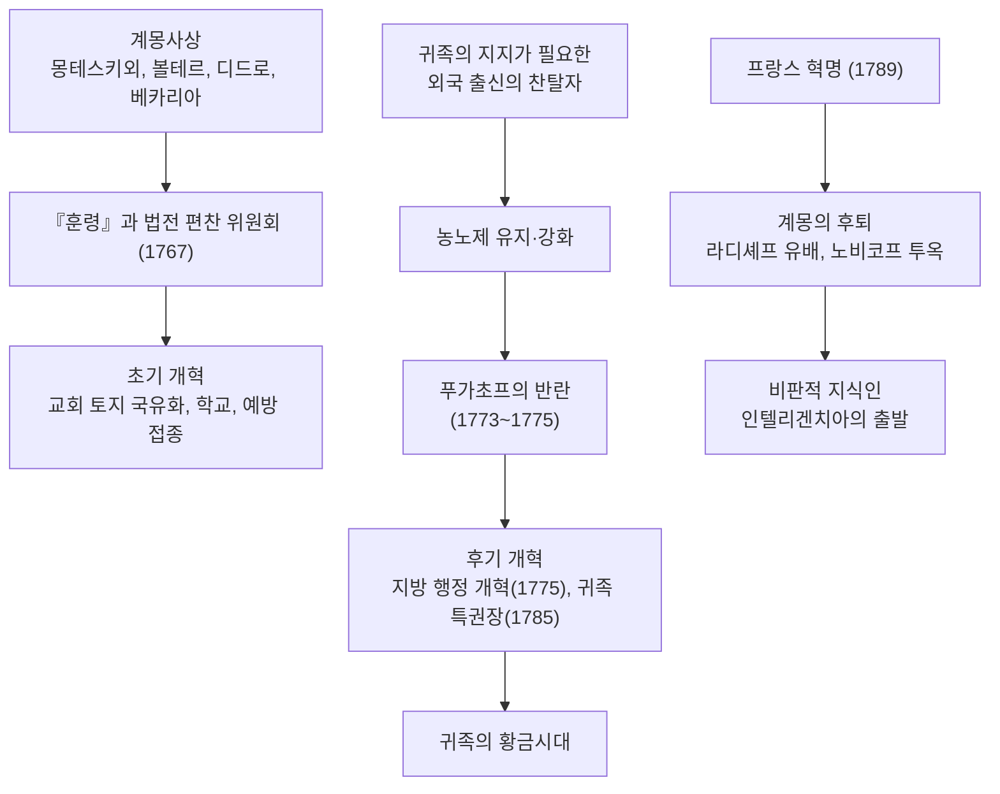

1767년 7월 30일, 모스크바 크렘린의 그라노비타야 궁전에 러시아 전국에서 뽑혀 온 대표 500여 명이 모였다. 귀족과 도시민, 국유지 농민, 카자크, 그리고 타타르인과 바시키르인 같은 비러시아 민족의 대표들이었다. 그들은 러시아의 새 법전을 만들기 위해 모인 **법전 편찬 위원회**의 대표들이었다. 그 자리에서 여제가 손수 쓴 긴 문서가 낭독되었다. 제목은 **『훈령』**(나카즈).

500조가 넘는 이 문서에는 당시 유럽에서 가장 앞선 생각들이 담겨 있었다. "모든 시민이 같은 법의 보호를 받는 평등", "고문은 폐지되어야 한다", "사형은 거의 필요 없다", "법은 범죄를 처벌하기보다 예방해야 한다." 상당 부분은 프랑스의 사상가 몽테스키외의 『법의 정신』과 이탈리아의 법학자 베카리아의 『범죄와 형벌』에서 거의 그대로 옮겨 온 것이었다. 프랑스에서는 이 문서가 너무 급진적이라며 판매가 금지되었다. 일부 대표들은 낭독을 들으며 감격해 눈물을 흘렸다고 전한다.

이 문서를 쓴 사람은 1762년 남편을 몰아내고 황제가 된 독일 출신의 여제 **예카테리나 2세**였다. 그녀는 볼테르, 디드로 같은 계몽사상가들과 편지를 주고받으며 '북방의 세미라미스'(전설적인 아시리아의 여왕)라는 찬사를 받았다. 그런데 같은 여제의 통치 아래에서 러시아의 농노제는 가장 넓고 가혹해졌고, 러시아 역사상 가장 큰 농민 반란이 일어났다. 이 강의에서는 이 모순을 따라가며 **계몽 전제**란 무엇이었는지 생각해 본다.

> [!핵심] 이 강의의 질문
> 1. 예카테리나 2세는 계몽사상을 어떻게 받아들였고, 무엇을 바꾸려 했는가?
> 2. 푸가초프의 반란은 왜 일어났으며, 러시아에 무엇을 남겼는가?
> 3. '계몽 전제'는 왜 농노제와 함께 갈 수 있었는가?

```figure
src: asset:e67a63d4ece460866becebd4cc99ba67
caption: 예카테리나 2세의 초상 메달리온(1773년 판화). 아래에 러시아 제국의 쌍두 독수리가 있다. 이해 디드로가 상트페테르부르크를 찾았고, 푸가초프의 반란이 시작되었다.
credit: 프랑수아 안 다비드 판각, 1773년 · 암스테르담 국립미술관 소장
license: Public Domain (레이크스 미술관: CC0)
source: https://www.rijksmuseum.nl/en/collection/RP-P-OB-63.791
width: narrow
```

## 철학자 여제

### 안할트체르프스트의 소피

예카테리나 2세의 본래 이름은 **조피 프리데리케 아우구스테**였다. 1729년 프로이센의 항구 도시 슈테틴에서 독일의 작은 공국 안할트체르프스트의 공작 집안 딸로 태어났다. 1744년 열네 살의 그녀는 옐리자베타 여제가 고른 황태자 표트르(훗날의 표트르 3세)의 신부가 되기 위해 러시아에 왔다. 그녀는 정교회로 개종하며 예카테리나라는 이름을 받았다.

불행한 결혼 생활 속에서 그녀는 18년 동안 책을 읽었다. 볼테르, 몽테스키외, 백과전서 같은 계몽사상의 책들이었다. 그리고 러시아어를 익히고 러시아 귀족과 근위대 장교들 사이에 지지자를 쌓았다. 4강에서 본 1762년의 쿠데타는 그 결실이었다. 그녀는 러시아 피가 한 방울도 섞이지 않은 외국인이었고, 정당한 계승권도 없었다. 그래서 그녀는 계몽된 통치로 자신의 정당성을 보여 주어야 했다.

### 계몽 전제란 무엇인가

18세기 후반 유럽에는 계몽사상을 받아들인 군주들이 나타났다. 프로이센의 프리드리히 2세, 오스트리아의 요제프 2세, 그리고 예카테리나 2세가 대표적이다. 이들은 군주가 '국가의 첫째 머슴'으로서 이성에 따라 나라를 개혁하고 백성의 행복을 늘려야 한다고 생각했다. 그러나 그 개혁은 의회나 백성의 참여가 아니라, 군주의 절대 권력을 통해 위로부터 이루어져야 한다고 보았다. 이것을 **계몽 전제**(계몽 절대주의)라고 한다.

예카테리나는 계몽사상가들과 활발히 교류했다. 그녀는 볼테르와 15년 동안 편지를 주고받았다. 『백과전서』의 편집자 **디드로**가 딸의 결혼 지참금을 마련하려고 서재를 팔려 하자, 예카테리나는 그의 장서를 사들이면서 그가 죽을 때까지 책을 맡아 관리하게 하고 사서로서 급여까지 주었다. 1773년 디드로는 상트페테르부르크를 찾아와 다섯 달 동안 거의 매일 여제와 대화를 나누었다. 흥분한 디드로가 여제의 무릎을 두드리며 이야기하는 바람에 여제는 둘 사이에 탁자를 놓아야 했다고 한다. 그러나 디드로가 러시아의 개혁을 위해 내놓은 제안들에 대해 여제는 이렇게 답했다. "당신은 무엇이든 견디는 종이 위에서 일하지만, 나는 훨씬 더 예민하고 다루기 어려운 인간의 살갗 위에서 일합니다."

```gallery
src: asset:9d173804fa6ff712393bc7613ae01398
caption: 지팡이를 짚고 걷는 노년의 볼테르(1778년 에칭). 예카테리나는 15년 동안 그와 편지를 주고받았고, 그가 죽은 뒤 그의 장서를 통째로 사들였다.
credit: 안 클로드 필리프 드 케뤼스 원작, 1778년 · 암스테르담 국립미술관 소장
license: Public Domain (레이크스 미술관: CC0)
source: https://www.rijksmuseum.nl/en/collection/RP-P-OB-42.513
---
src: asset:8a343871c39c3305450692a42074104a
caption: 드니 디드로의 옆얼굴(1766년 판화). 『백과전서』의 편집자인 그는 1773~1774년 다섯 달 동안 여제와 거의 매일 대화를 나누었다.
credit: 오귀스탱 드 생토뱅 판각, 1766년 · 암스테르담 국립미술관 소장
license: Public Domain (레이크스 미술관: CC0)
source: https://www.rijksmuseum.nl/en/collection/RP-P-1944-1164
```

### 『훈령』과 법전 편찬 위원회

예카테리나가 처음 벌인 큰 사업은 법전 편찬이었다. 러시아는 1649년 소보르 법전(1강) 이후 새 법전이 없었다. 그녀는 2년 동안 직접 『훈령』을 쓰고, 1767년 전국의 대표를 모아 법전 편찬 위원회를 열었다.

```chart
{
  "type": "doughnut",
  "caption": "예카테리나 2세의 『훈령』(1767) 526개 조의 출처 (역사가들의 대략적인 분석). 절반 넘게 몽테스키외의 『법의 정신』에서, 100여 개 조는 베카리아의 『범죄와 형벌』에서 옮겨 오거나 고쳐 썼다. 예카테리나 자신은 편지에서 몽테스키외의 책을 '군주들의 기도서'라고 불렀다",
  "height": 300,
  "data": {
    "labels": ["몽테스키외 『법의 정신』", "베카리아 『범죄와 형벌』", "그 밖의 저술과 예카테리나 자신"],
    "datasets": [{ "data": [294, 108, 124] }]
  }
}
```

위원회는 1년 반 동안 200번 넘게 회의를 열었다. 그러나 대표들은 법전의 원칙을 토론하기보다, 각자 자기 신분의 이익을 요구하는 데 몰두했다. 귀족은 농노를 소유할 권리를 귀족에게만 달라고 했고, 상인들은 자신들도 농노를 사서 공장에서 부릴 수 있게 해 달라고 했다. 정작 인구의 절반 가까이를 차지한 지주의 농노들은 대표를 보낼 수 없었다. 1768년 오스만 제국과의 전쟁이 일어나자 위원회는 사실상 해산되었고, 새 법전은 끝내 만들어지지 않았다.

그렇다고 위원회가 아무 의미가 없었던 것은 아니다. 여제는 대표들이 가져온 1,500건 가까운 진정서를 통해 러시아 각 지방과 신분의 사정을 자세히 알게 되었다. 이것은 그 뒤의 개혁에 바탕이 되었다.

## 예카테리나의 개혁

예카테리나는 34년의 통치 동안 많은 개혁을 했다. 그 성격은 시기에 따라 달랐다. 초기에는 계몽사상의 이상을 내세웠지만, 푸가초프의 반란(1773~1775) 이후에는 지방 질서를 다지고 귀족의 협력을 얻는 쪽으로 기울었다.

| 연도 | 개혁 | 내용 |
|---|---|---|
| 1764 | 교회 토지의 국유화 | 교회와 수도원의 땅과 농민 약 100만 명(남자)을 국가가 관리. 표트르 3세가 시작한 일을 마무리 |
| 1764 | 스몰니 학원 | 귀족 여성을 위한 러시아 최초의 여학교 |
| 1765 | 자유 경제 협회 | 농업 개량을 연구하는 학회. 농노의 재산권 문제를 현상 공모 |
| 1768 | 천연두 예방 접종 | 영국 의사 딤스데일을 불러 여제와 황태자가 먼저 접종하며 보급 |
| 1769 | 지폐(아시냐) 발행 | 러시아 최초의 지폐. 전쟁 비용을 대려고 찍다 가치가 떨어짐 |
| 1775 | 지방 행정 개혁 | 전국을 인구 기준의 현과 군으로 다시 나누고 귀족이 지방 행정을 맡게 함 |
| 1785 | 귀족 특권장·도시 특권장 | 귀족의 특권을 법으로 보장. 도시민에게 자치 기구 |
| 1786 | 국민 학교령 | 현과 군마다 공립 학교 설립 계획 |

표: 예카테리나 2세의 주요 개혁

1785년의 **귀족 특권장**은 4강에서 본 귀족 해방의 완성이었다. 귀족은 세금과 체형에서 면제되고, 재판 없이 귀족 신분과 재산을 빼앗기지 않으며, 현과 군마다 귀족 회의를 열어 대표를 뽑을 수 있게 되었다. 18세기 후반은 러시아 귀족의 **황금시대**였다. 귀족들은 영지에 프랑스식 저택과 정원을 짓고, 프랑스어로 이야기하며, 서재와 극장, 농노 오케스트라를 두었다.

### 에르미타주

예카테리나는 열정적인 미술품 수집가였다. 1764년 그녀는 베를린의 한 상인이 프리드리히 2세에게 넘기려다 대금 때문에 남은 그림 200여 점을 사들였다. 이것이 **에르미타주** 미술관의 출발이다. '에르미타주'는 프랑스어로 '은둔처'라는 뜻으로, 여제가 겨울 궁전 옆에 지은 작은 별관에서 측근들과 그림을 감상하며 쉬던 데서 나온 이름이다. 그녀가 죽을 무렵 에르미타주에는 4,000점 가까운 그림이 있었다. 오늘날 에르미타주는 세계에서 가장 큰 미술관 가운데 하나다.

```gallery
src: asset:5bb426f009fbd5a9ce3a209e250c0fe9
caption: 상트페테르부르크 신에르미타주의 입구(1860~1890년 무렵 사진). 거대한 화강암 아틀라스 상들이 현관을 떠받치고 있다. 예카테리나의 수집품에서 시작된 에르미타주는 1852년 이 건물에서 일반에 공개되었다.
credit: 작자 미상 사진, 1860~1890년 · 암스테르담 국립미술관 소장
license: Public Domain (레이크스 미술관: CC0)
source: https://www.rijksmuseum.nl/en/collection/RP-F-F15993
---
src: asset:964d98c5ca09db1cb50f23c4d3a405f8
caption: 스몰니 수도원(1890년 무렵). 1764년 예카테리나가 이곳에 귀족 여성을 위한 러시아 최초의 여학교 '스몰니 학원'을 열었다. 이 건물은 1917년 볼셰비키의 본부가 된다(20강).
credit: 포토글로프 사 포토크롬, 1890년 무렵 · 미국 의회도서관 소장
license: Public Domain (미국 의회도서관: 출판 제한 없음)
source: https://www.loc.gov/item/2017660352/
```

## 농노제의 절정

### 계몽의 그늘

예카테리나의 시대는 러시아 농노제가 가장 넓고 가혹해진 시대이기도 했다. 그녀 자신은 『훈령』의 초안에 농노의 처지를 개선하자는 생각을 담았지만, 귀족 측근들의 반대로 대부분 빠졌다. 오히려 그녀의 통치 아래에서 농노의 처지는 더 나빠졌다.

- **1765년**: 지주는 농노를 시베리아의 강제 노동에 보낼 수 있게 되었다.
- **1767년**: 농노가 지주를 고발하는 청원을 여제에게 내는 것이 금지되었다. 어기면 매를 맞고 시베리아로 보내졌다.
- **1783년**: 우크라이나 좌안 지역의 농민들이 이동의 자유를 잃고 농노가 되었다.
- 여제는 총신들과 공신들에게 국유지 농민 80만 명 가까이를 '선물'로 주었다. 그들은 국가의 농민에서 개인 지주의 농노가 되었다.

당시 농노는 사실상 지주의 재산이었다. 신문에는 농노를 파는 광고가 실렸고, 가족이 따로 팔려 나가기도 했다. 모스크바의 귀족 부인 살티코바는 농노 수십 명을 고문해 죽였다가 1768년 재판을 받고 평생 감옥에 갇혔는데, 이 사건이 유명해진 것은 그런 처벌이 드물었기 때문이기도 하다.

### 푸가초프의 반란 (1773~1775)

1773년 가을, 우랄산맥 남쪽의 야이크강 가에서 **예멜리얀 푸가초프**라는 돈 카자크 출신의 탈영병이 자신이 바로 1762년에 죽었다고 알려진 **표트르 3세**라고 선언했다. 그는 '아내 예카테리나가 귀족들과 짜고 나를 죽이려 했지만 나는 살아남았다'고 말했다. 4강에서 본 것처럼 많은 농민은 표트르 3세가 귀족 자유령과 함께 농노도 해방하려 했는데 귀족들이 그를 없앴다고 믿었다. 그 믿음 위에 '살아 돌아온 진짜 차르'가 나타난 것이다.

반란에는 다양한 사람들이 몰려들었다. 특권을 빼앗긴 야이크 카자크, 땅과 종교의 자유를 빼앗긴 바시키르인과 타타르인, 우랄의 광산과 제철소에서 강제 노동에 시달린 공장 농노, 그리고 볼가강 유역의 농노들이었다. 반란군은 1년 넘게 우랄과 볼가 지역을 휩쓸며 요새와 공장을 점령하고 지주와 관리들을 죽였다. 1774년 7월에는 볼가강 가의 대도시 카잔을 점령해 불태웠다. 그달 푸가초프는 '표트르 3세'의 이름으로 농노를 해방하고 땅을 주며 세금과 징병을 없앤다는 선언문을 냈다.

> [!사료] 푸가초프의 선언문 요지 (1774년 7월)
> "우리는 이 선언문으로, 지금까지 농민이자 지주의 신민이던 모든 이들에게 우리 왕관의 충실한 노예가 될 자유를 주며 … 인두세와 그 밖의 세금 없이 땅과 숲과 목초지와 어장과 소금 호수를 갖게 하노라. … 귀족과 지주, 그리고 백성을 괴롭히고 짓밟은 관리와 재판관들은 잡아서 처형하라."

마침 1774년 7월 오스만 제국과의 전쟁이 끝나면서 정예군이 돌아왔다. 반란군은 거듭 패했고, 1774년 9월 푸가초프는 자기 부하들에게 배신당해 정부군에 넘겨졌다. 그는 쇠 우리에 갇혀 모스크바로 옮겨졌고, 1775년 1월 모스크바의 볼로트나야 광장에서 처형되었다. 여제는 반란의 기억을 지우려고 야이크강의 이름을 **우랄강**으로, 야이크 카자크를 우랄 카자크로 바꾸게 했다.

```gallery
src: asset:92c8bc644155e3ae1f18e47f9441b14e
caption: 로스토프 박물관에 있던 푸가초프의 초상화를 프로쿠딘-고르스키가 1911년 무렵 컬러 사진으로 찍은 것. 그림 아래에 '실물을 보고 그린 초상'이라는 글이 있다.
credit: 세르게이 프로쿠딘-고르스키 촬영, 1911년 무렵 · 미국 의회도서관 소장
license: Public Domain (미국 의회도서관: 출판 제한 없음)
source: https://www.loc.gov/item/2018680837/
---
src: asset:221a37519df820e500ce8cbca2e27830
caption: 1775년 1월 10일 모스크바 볼로트나야 광장의 푸가초프 처형 장면을 그린 채색 민화(1865년 간행). 수많은 군중과 군대가 처형대를 둘러싸고 있다.
credit: A. 루드네프, 1865년 간행 · 미국 의회도서관 소장
license: Public Domain (미국 의회도서관: 출판 제한 없음)
source: https://www.loc.gov/item/2012648848/
```

푸가초프의 반란은 예카테리나에게 큰 충격을 주었다. 그녀는 지방의 질서를 다지기 위해 1775년 지방 행정을 개혁하고, 귀족이 그 운영을 맡게 했다. 여제와 귀족은 농민의 반란 앞에서 더욱 단단히 손을 잡았다. 같은 해 정부군은 드네프르강 하류에 있던 자포로지예 카자크의 근거지(시치)를 없앴다. 60년 뒤 시인 푸시킨은 이 반란을 배경으로 소설 『대위의 딸』을 썼다. 그 속의 한 구절은 지금도 자주 인용된다. "무의미하고 무자비한 러시아의 반란을 신께서 보지 않게 해 주시기를."

## 계몽의 끝

### 프랑스 혁명과 라디셰프

1789년 프랑스 혁명이 일어나자 예카테리나의 태도는 크게 바뀌었다. 계몽사상이 군주를 처형하는 혁명으로 이어지는 것을 본 그녀는 계몽사상 자체를 의심하게 되었다. 1793년 프랑스 국왕 루이 16세가 처형되자 그녀는 충격으로 며칠 동안 앓아누웠다고 한다.

1790년 상트페테르부르크 세관의 관리였던 **알렉산드르 라디셰프**가 『상트페테르부르크에서 모스크바로의 여행』이라는 책을 익명으로 펴냈다. 여행기의 형식을 빌려, 길에서 만난 농노들의 비참한 삶과 지주의 횡포를 고발하고 전제 정치를 비판한 책이었다. 여제는 책의 여백에 분노에 찬 메모를 적어 넣으며 그를 "푸가초프보다 더 나쁜 반란자"라고 불렀다. 라디셰프는 사형 선고를 받았다가 감형되어 시베리아로 유배되었다. 1792년에는 러시아 출판 문화를 이끈 출판인 **노비코프**도 체포되어 요새 감옥에 갇혔다.

라디셰프는 러시아 최초의 **인텔리겐치아**, 곧 국가와 사회의 부정의를 고발하며 민중을 위해 자신을 희생하려 한 지식인의 원형으로 꼽힌다. 표트르 대제가 들여온 서유럽의 교육과 사상은 이제 귀족 가운데 일부를 전제 정치와 농노제를 비판하는 사람들로 만들기 시작했다. 이 흐름은 9강의 데카브리스트와 13강의 혁명 운동으로 이어진다.

### 예카테리나를 어떻게 볼 것인가

예카테리나 2세는 1796년 11월 예순일곱 살로 세상을 떠났다. 그녀의 통치 동안 러시아의 인구는 두 배 가까이 늘었고(4강의 그래프), 영토는 남쪽과 서쪽으로 크게 넓어졌다(6강). 러시아는 유럽 정치를 좌우하는 강대국이 되었고, 귀족 문화는 서유럽에 뒤지지 않을 만큼 세련되어졌다. 그러나 그 번영은 수백만 농노의 희생 위에 서 있었다.

계몽 전제는 계몽사상과 전제 군주정, 그리고 귀족의 이익 사이의 아슬아슬한 줄타기였다. 예카테리나는 귀족의 지지 없이는 권좌를 지킬 수 없다는 것을 누구보다 잘 알았다. 그녀가 남편을 몰아낼 수 있었던 것도 근위대 귀족 덕분이었다. 그래서 그녀는 계몽사상의 이상을 말하면서도, 귀족의 가장 큰 재산인 농노제에는 손대지 않았다.



## 정리

> [!핵심] 5강 요약
> - 독일 출신의 **예카테리나 2세**(재위 1762~1796)는 계몽사상가들과 교류하며 군주의 절대 권력으로 이성적 개혁을 하려는 **계몽 전제**를 펼쳤다.
> - 몽테스키외와 베카리아를 바탕으로 한 **『훈령』**과 **법전 편찬 위원회**(1767)는 새 법전을 만들지 못했지만, 여제에게 러시아 사회의 실상을 알려 주었다.
> - 교회 토지 국유화, 스몰니 학원, 예방 접종, 지방 행정 개혁(1775), **귀족 특권장**(1785) 등의 개혁이 이어졌고, 귀족은 황금시대를 누렸다. **에르미타주** 미술관도 이때 시작되었다.
> - 반면 농노제는 가장 넓고 가혹해졌다. 자신이 표트르 3세라고 주장한 **푸가초프의 반란**(1773~1775)은 러시아 역사상 가장 큰 농민 반란이었다.
> - 프랑스 혁명 뒤 예카테리나는 계몽사상에서 물러섰고, 농노제를 고발한 **라디셰프**를 유배했다. 라디셰프는 러시아 인텔리겐치아의 원형으로 꼽힌다.

### 생각해 볼 질문

1. "나는 인간의 살갗 위에서 일한다"는 예카테리나의 말은 계몽 전제의 어떤 한계를 보여 줄까?
2. 수많은 농민이 '살아 돌아온 표트르 3세'를 믿고 따른 까닭은 무엇일까? 농민들은 황제 자체가 아니라 '나쁜 귀족'을 적으로 보았다. 이런 '착한 차르' 신앙은 러시아 역사에서 어떤 역할을 했을까?
3. 같은 시기 조선의 정조(재위 1776~1800)도 규장각을 세우고 서얼을 등용하는 등 학문과 개혁을 중시했다. 예카테리나와 정조의 개혁을 비교해 보자.

### 다음 강 예고

6강 「예카테리나의 팽창: 크림과 폴란드 분할」에서는 예카테리나 시대 러시아의 영토 확장을 살펴본다. 두 차례의 러시아-튀르크 전쟁과 체슈메 해전, 크림 칸국의 병합과 포툠킨의 '노보로시야' 건설, 그리고 세 차례에 걸친 폴란드 분할로 한 나라가 지도에서 사라지는 과정을 다룬다.
