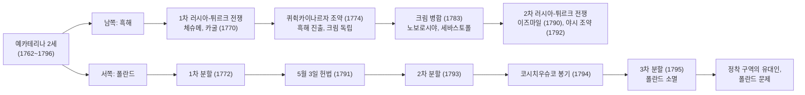

1787년 5월, 크림반도 남서쪽의 인케르만 언덕. 흑해 연안의 새 영토를 둘러보는 긴 여행 끝에 이곳에 이른 예카테리나 2세와 신성 로마 제국 황제 요제프 2세, 그리고 유럽 각국의 외교관들이 궁전 안에서 식사를 하고 있었다. 식사가 끝날 무렵 갑자기 창의 커튼이 걷혔다. 눈 아래 펼쳐진 만에 전함들이 줄지어 떠 있었고, 함대는 일제히 예포를 쏘아 여제를 맞았다. 불과 4년 전까지 오스만 제국에 속한 크림 칸국의 땅이던 곳에, 러시아의 흑해 함대와 새 항구 **세바스토폴**이 들어서 있었던 것이다.

이 여행을 기획한 사람은 여제의 총신이자 남부 러시아의 총독이던 **그리고리 포툠킨**이었다. 유럽의 외교관들 사이에는 그가 여제가 지나가는 강변에 마분지로 만든 가짜 마을을 세우고 농민들을 옮겨 가며 번영을 꾸며 냈다는 소문이 퍼졌다. 이 소문에서 **'포툠킨 마을'**, 곧 겉만 번지르르한 눈속임을 가리키는 말이 생겼다. 그러나 오늘날 역사가들은 이 이야기가 크게 과장되었다고 본다. 포툠킨은 실제로 헤르손, 세바스토폴, 예카테리노슬라프 같은 도시를 세우고 수십만 명의 이주민을 데려와 남부 초원을 개척했다.

예카테리나 2세의 34년 동안 러시아는 남쪽으로는 흑해 연안을, 서쪽으로는 폴란드-리투아니아의 절반을 차지했다. 이 강의에서는 두 차례의 러시아-튀르크 전쟁과 크림 병합, 그리고 한 나라를 지도에서 지워 버린 세 차례의 폴란드 분할을 살펴본다. 오늘날 러시아, 우크라이나, 폴란드, 벨라루스, 리투아니아 사이의 많은 문제가 이때 시작되었다.

> [!핵심] 이 강의의 질문
> 1. 러시아는 어떻게 흑해 연안과 크림반도를 손에 넣었는가?
> 2. 폴란드-리투아니아는 왜, 어떻게 세 강대국에 나뉘어 사라졌는가?
> 3. 예카테리나 시대의 팽창은 러시아 제국과 그 주변에 무엇을 남겼는가?

{{F:r06-opening}}

## 흑해를 향하여

### 첫 번째 러시아-튀르크 전쟁 (1768~1774)

흑해로 나가는 것은 표트르 대제 때부터의 숙원이었다. 표트르는 아조프를 얻었다가 프루트강의 위기로 다시 잃었다(2강). 흑해 북쪽의 초원은 오스만 제국의 보호를 받는 **크림 칸국**의 땅이었다. 칭기즈 칸의 후손이 다스리는 이 나라의 기병은 수백 년 동안 러시아와 폴란드의 마을을 습격해 사람들을 붙잡아 노예로 팔았다.

1768년 폴란드 문제를 둘러싼 갈등 끝에 오스만 제국이 러시아에 전쟁을 선포했다. 러시아는 육지와 바다 모두에서 놀라운 승리를 거두었다. 1770년 여름 **루먄체프** 장군은 지금의 몰도바 지역인 라르가강과 카굴강에서 몇 배나 많은 오스만군을 무찔렀다. 같은 해 러시아의 발트 함대는 유럽을 빙 돌아 지중해에 나타났고, 7월 에게해의 **체슈메**만에서 오스만 함대를 불태워 거의 전멸시켰다. 러시아 함대가 발트해에서 지중해까지 원정한 것은 처음이었다.

1774년 7월 두 나라는 도나우강 남쪽의 **퀴췩카이나르자**에서 평화 조약을 맺었다. 러시아는 아조프와 케르치 등 흑해 북쪽의 항구를 얻고, 흑해와 보스포루스·다르다넬스 해협을 상선이 자유롭게 지날 권리를 얻었다. 크림 칸국은 오스만 제국에서 떨어져 '독립'했다. 조약에는 러시아가 오스만 제국 안의 정교회 교회를 위해 발언할 수 있다는 조항도 들어갔는데, 러시아는 훗날 이 조항을 오스만 제국 안의 모든 정교회 신자를 보호할 권리로 넓게 해석했다. 이 해석은 80년 뒤 크림 전쟁의 불씨가 된다(11강).

### 크림 병합과 노보로시야

'독립'한 크림 칸국은 사실상 러시아의 보호국이 되었다. 러시아가 세운 칸에 맞서 반란이 잇따르자, 1783년 4월 예카테리나는 크림 칸국을 러시아에 병합한다고 선언했다. 오스만 제국은 항의했지만 막을 힘이 없었다. 같은 해 캅카스산맥 남쪽의 정교회 왕국인 **조지아**(그루지야)의 동부 왕국도 게오르기예프스크 조약으로 러시아의 보호를 받아들였다.

새로 얻은 흑해 북쪽의 넓은 초원은 **노보로시야**('새 러시아')라 불렸다. 그 개척을 맡은 포툠킨은 1778년 드네프르강 하구에 조선소 도시 헤르손을, 1783년 크림반도에 해군 기지 세바스토폴을 세웠다. 러시아 농민과 함께 독일인, 그리스인, 불가리아인, 세르비아인 등 여러 민족의 이주민이 땅을 받고 이곳에 정착했다. 반면 크림 타타르인 상당수는 오스만 제국으로 떠났다. 1794년에는 흑해 연안의 작은 튀르크 요새가 있던 자리에 항구 도시 **오데사**가 세워졌다. 오데사는 19세기에 러시아 남부 최대의 무역항으로 자랐다.

> [!더알아보기] 예카테리나의 '그리스 계획'
> 예카테리나와 포툠킨은 오스만 제국을 유럽에서 몰아내고 콘스탄티노폴리스에 비잔티움 제국을 되살리는 꿈을 꾸었다. 이것을 '그리스 계획'이라 한다. 1779년 태어난 여제의 둘째 손자에게 마지막 비잔티움 황제와 같은 이름인 **콘스탄틴**을 붙이고, 그리스인 유모를 두어 그리스어를 가르친 것도 이 때문이었다. 이 꿈은 이루어지지 않았지만, 콘스탄티노폴리스와 해협을 손에 넣으려는 러시아의 욕망은 1차 세계대전까지 이어졌다(18강).

### 두 번째 러시아-튀르크 전쟁 (1787~1792)

1787년 오스만 제국은 크림을 되찾으려고 다시 전쟁을 일으켰다. 이 전쟁의 영웅은 러시아 역사상 가장 위대한 장군으로 꼽히는 **알렉산드르 수보로프**였다. 키가 작고 마른 그는 병사들과 함께 맨바닥에서 자고 검은 빵을 먹었으며, "총알은 바보, 총검은 사나이"라는 말로 빠른 기동과 과감한 돌격을 강조했다. 평생 60번이 넘는 전투에서 한 번도 지지 않았다고 전한다.

1790년 12월 수보로프는 도나우강 하구의 난공불락이라던 오스만 요새 **이즈마일**을 공격했다. 그는 요새 사령관에게 "생각할 시간으로 24시간을 준다. 그다음은 자유가 아니면 죽음이다"라는 최후통첩을 보냈다. 몇 시간에 걸친 처절한 돌격 끝에 요새가 함락되었고, 수비군 대부분이 죽었다. 1792년 1월 야시 조약으로 오스만 제국은 크림 병합을 인정하고, 드네스트르강까지의 흑해 연안을 러시아에 넘겼다.

{{F:r06-south}}

## 폴란드 분할

### 귀족의 공화국

러시아 서쪽에는 유럽에서 손꼽히게 넓은 나라, **폴란드-리투아니아 연방**이 있었다. 1569년 폴란드 왕국과 리투아니아 대공국이 합쳐 생긴 이 나라는 독특한 정치 체제를 가지고 있었다. 왕은 세습되지 않고 귀족들의 선거로 뽑혔으며, 의회(세임)에서는 귀족 한 사람만 반대해도 법안이 통과되지 않았다. 이것을 **자유 거부권**(리베룸 베토)이라 한다. 인구의 10% 가까이를 차지한 귀족(슐라흐타)은 이 제도를 '황금 자유'라 부르며 자랑스러워했다.

그러나 이 제도는 18세기에 나라를 마비시켰다. 외국 강대국들은 귀족 한 사람을 매수하기만 하면 폴란드 의회의 어떤 결정도 막을 수 있었다. 왕의 선거 때마다 러시아, 프로이센, 오스트리아, 프랑스가 돈과 군대로 개입했다. 1764년 예카테리나는 자신의 옛 연인이던 폴란드 귀족 **스타니스와프 아우구스트 포니아토프스키**를 군대를 동원해 폴란드 왕으로 세웠다.

### 첫 번째 분할 (1772)

포니아토프스키는 예카테리나의 꼭두각시가 되기를 거부하고 개혁을 꾀했다. 러시아가 폴란드의 정교회 신자와 개신교도의 권리를 내세워 간섭하자, 1768년 가톨릭 귀족들이 바르 연맹을 결성해 반란을 일으켰다. 러시아군이 반란을 진압하는 동안 앞서 본 러시아-튀르크 전쟁이 일어났다.

러시아가 흑해 쪽에서 크게 이기자 프로이센과 오스트리아는 러시아만 커지는 것을 경계했다. 프로이센의 프리드리히 2세는 세 나라가 폴란드 땅을 조금씩 나누어 갖자고 제안했다. 1772년 세 강대국은 폴란드 땅의 약 30%를 나누어 가졌다. 러시아는 벨라루스 동부를, 프로이센은 발트해 연안의 서프로이센을, 오스트리아는 남쪽의 갈리치아를 얻었다. 폴란드 의회는 외국 군대에 둘러싸인 채 이를 승인할 수밖에 없었다. 오스트리아의 마리아 테레지아 여제는 분할에 참여하면서 눈물을 흘렸는데, 프리드리히 2세는 "그녀는 울면서도 받아 간다"고 비꼬았다.

{{F:r06-partition}}

### 5월 3일 헌법과 두 번째 분할 (1793)

첫 번째 분할의 충격은 폴란드에 개혁의 바람을 불러왔다. 1773년 유럽 최초의 국가 교육 위원회가 세워졌고, 1788년부터 4년 동안 열린 의회는 개혁 법안을 차례로 통과시켰다. 1791년 5월 3일 의회는 새 헌법을 채택했다. 자유 거부권을 없애고, 왕위를 세습으로 하며, 입법·행정·사법을 나누고, 도시민에게 권리를 주는 내용이었다. 미국 헌법에 이어 세계에서 두 번째, 유럽에서 첫 번째로 만들어진 근대적 성문 헌법이었다.

예카테리나는 이 헌법을 '프랑스 혁명의 전염병'으로 보았다. 1792년 개혁에 반대하는 폴란드 귀족들이 러시아의 지원 아래 타르고비차 연맹을 만들자, 그들을 돕는다는 명분으로 러시아군이 폴란드에 쳐들어왔다. 헌법은 폐지되었고, 1793년 러시아와 프로이센은 다시 폴란드 땅을 나누어 가졌다(두 번째 분할). 러시아는 벨라루스와 우크라이나 서부의 넓은 땅을 얻었다.

### 코시치우슈코 봉기와 세 번째 분할 (1795)

1794년 3월 미국 독립 전쟁에서 싸운 경험이 있는 폴란드의 장군 **타데우시 코시치우슈코**가 크라쿠프에서 봉기를 일으켰다. 낫을 든 농민군이 라츠와비체에서 러시아군을 물리쳤고, 바르샤바와 빌뉴스에서도 시민들이 들고일어났다. 그러나 러시아와 프로이센의 대군 앞에 봉기군은 무너졌다. 10월 코시치우슈코는 부상당한 채 포로가 되었고, 11월 수보로프의 군대는 바르샤바 맞은편의 프라가 지구를 함락했다. 이때 수천 명의 주민이 학살되었다.

1795년 세 강대국은 남은 폴란드 땅을 모두 나누어 가졌다(세 번째 분할). 포니아토프스키는 왕위에서 물러났다. 800년 넘게 이어진 폴란드라는 나라는 1918년 제1차 세계대전이 끝날 때까지 123년 동안 유럽 지도에서 사라졌다. 폴란드 사람들은 나라 없이도 언어와 가톨릭 신앙, 문화로 민족의식을 지켰다. 오늘날 폴란드 국가는 "폴란드는 아직 망하지 않았다, 우리가 살아 있는 한"이라는 구절로 시작한다.

```chart
{
  "type": "bar",
  "caption": "세 차례 폴란드 분할에서 세 나라가 얻은 영토 (만 km², 대략적인 수치). 러시아는 전체 면적의 60% 넘게 차지했지만, 인구가 조밀한 서쪽 지역은 프로이센과 오스트리아가 가져갔다",
  "data": {
    "labels": ["1차 분할 (1772)", "2차 분할 (1793)", "3차 분할 (1795)"],
    "datasets": [
      { "label": "러시아", "data": [9.2, 25.0, 12.0] },
      { "label": "프로이센", "data": [3.6, 5.8, 5.5] },
      { "label": "오스트리아", "data": [8.3, 0, 4.7] }
    ]
  },
  "options": { "scales": { "x": { "stacked": true }, "y": { "stacked": true, "title": { "display": true, "text": "면적 (만 km²)" } } } }
}
```

### 분할이 남긴 것

폴란드 분할로 러시아는 오늘날의 벨라루스, 리투아니아, 우크라이나 서부 대부분을 얻었다. 러시아의 국경은 처음으로 독일 국가들과 맞닿게 되었다. 이 땅을 얻으면서 러시아 제국은 처음으로 많은 **가톨릭교도**와 **유대인**을 백성으로 맞았다.

당시 폴란드-리투아니아에는 유럽에서 가장 큰 유대인 공동체가 있었다. 1791년 예카테리나는 유대인이 러시아 본토로 옮겨 오는 것을 막고, 새로 얻은 서부 지역과 흑해 연안에만 살게 하는 법령을 내렸다. 이 지역을 **'정착 구역'**(유대인 거주 제한 지역)이라 한다. 정착 구역은 1917년 혁명 때까지 유지되었고, 19세기 말 수백만 명의 유대인이 차별과 학살(포그롬)을 피해 미국 등지로 떠나는 배경이 되었다(14강).

폴란드인들은 러시아의 지배에 맞서 1830년과 1863년 두 차례 큰 봉기를 일으켰다(10강, 12강). 폴란드 문제는 19세기 내내 러시아 제국의 가장 아픈 곳이었다.

| 지역 | 얻은 시기 | 방법 |
|---|---|---|
| 아조프·케르치 등 흑해 북부 | 1774 | 퀴췩카이나르자 조약 |
| 벨라루스 동부 | 1772 | 1차 폴란드 분할 |
| 크림반도 | 1783 | 크림 칸국 병합 |
| 동부 조지아 | 1783 | 게오르기예프스크 조약 (보호국) |
| 드네스트르강까지의 흑해 연안 | 1792 | 야시 조약 |
| 벨라루스·우크라이나 서부 | 1793 | 2차 폴란드 분할 |
| 리투아니아·쿠를란트 | 1795 | 3차 폴란드 분할 |
| 알래스카 (코디악섬) | 1784 | 셸리호프의 상인 정착지 |

표: 예카테리나 2세 시대 러시아가 얻은 땅



## 정리

> [!핵심] 6강 요약
> - **1차 러시아-튀르크 전쟁**(1768~1774)에서 러시아는 체슈메와 카굴에서 이기고 **퀴췩카이나르자 조약**으로 흑해에 진출했다. 이 조약의 정교회 보호 조항은 훗날 크림 전쟁의 불씨가 된다.
> - 1783년 **크림 칸국을 병합**하고, 포툠킨이 **노보로시야**를 개척하며 헤르손, 세바스토폴, 오데사 같은 도시를 세웠다. '포툠킨 마을' 이야기는 크게 과장된 것이다.
> - **2차 러시아-튀르크 전쟁**(1787~1792)에서 수보로프가 **이즈마일**을 함락했고, 야시 조약으로 드네스트르강까지 흑해 연안을 얻었다.
> - 귀족의 '황금 자유'로 마비된 **폴란드-리투아니아**는 1772, 1793, 1795년 세 차례 **분할**되어 사라졌다. **5월 3일 헌법**(1791)과 **코시치우슈코 봉기**(1794)는 이를 막지 못했다.
> - 분할로 러시아는 벨라루스, 리투아니아, 우크라이나 서부와 많은 가톨릭교도·유대인을 얻었다. 유대인은 **정착 구역**에 묶였고, 폴란드 문제는 19세기 내내 이어졌다.

### 생각해 볼 질문

1. '포툠킨 마을'이라는 말은 오늘날에도 눈속임 정책을 비판할 때 쓰인다. 사실과 다른 이야기가 이렇게 오래 살아남는 이유는 무엇일까?
2. 폴란드-리투아니아의 '황금 자유'는 귀족에게는 자유였지만 나라에는 독이 되었다. 지나친 견제와 균형은 어떤 위험을 낳을까?
3. 크림반도는 1783년 이후 러시아, 1954년 이후 소련 안의 우크라이나에 속했고, 2014년 러시아가 병합을 선언했다. 한 지역의 역사를 누구의 관점에서 보느냐에 따라 어떻게 다르게 읽힐 수 있을까?

### 다음 강 예고

7강 「파벨 1세와 알렉산드르 1세」에서는 어머니 예카테리나를 미워한 아들 파벨 1세의 짧고 기괴한 통치와 그의 비극적인 최후, 그리고 '천사 같은 황제'라 불린 알렉산드르 1세의 개혁 구상과 스페란스키, 나폴레옹과의 틸지트 회담을 살펴본다.
