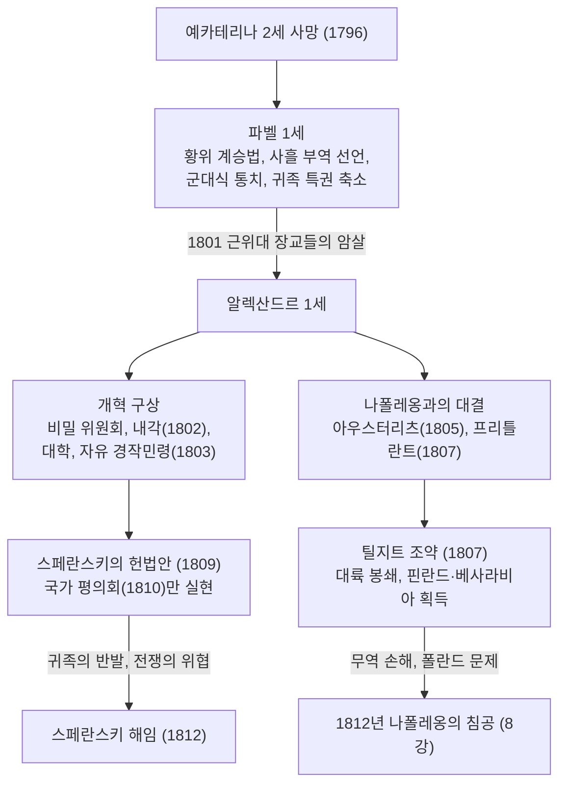

1801년 3월 11일 밤, 상트페테르부르크의 **미하일롭스키 성**. 해자로 둘러싸인 이 붉은 성은 황제 **파벨 1세**가 암살을 두려워해 요새처럼 지은 새 궁전이었다. 그가 이곳으로 옮겨 온 지 40일이 지난 그날 자정 무렵, 술에 취한 근위대 장교 수십 명이 비밀 통로를 지나 황제의 침실로 몰려들었다. 그들을 이끈 것은 수도의 군정 장관 팔렌 백작과 장군 베니히센, 그리고 예카테리나 2세의 마지막 총신이던 주보프 형제였다.

장교들은 칸막이 뒤에 숨은 황제를 끌어내 퇴위 문서에 서명하라고 다그쳤다. 황제가 거부하자 몸싸움이 벌어졌고, 누군가 금으로 된 담뱃갑으로 그의 관자놀이를 내리쳤다. 장교들은 장교용 허리띠로 그의 목을 졸랐다. 다음 날 아침 러시아 국민은 황제가 '뇌졸중'으로 갑자기 세상을 떠났다는 발표를 들었다.

같은 성의 아래층에서는 스물세 살의 황태자 **알렉산드르**가 그 소식을 들었다. 그는 아버지를 퇴위시키려는 계획은 알고 있었지만, 죽이는 데까지는 동의하지 않았다고 한다. 울음을 터뜨린 그에게 팔렌 백작이 말했다. "어린아이처럼 굴지 마십시오. 나가서 통치하십시오." 알렉산드르는 평생 아버지의 죽음에 대한 죄책감을 안고 살았다.

이 강의에서는 예카테리나 2세의 뒤를 이은 두 황제, 짧고 기괴한 통치 끝에 살해된 파벨 1세와, '천사 같은 황제'라 불리며 개혁의 기대를 한 몸에 받은 알렉산드르 1세의 시대 전반(1796~1812)을 살펴본다. 그리고 러시아가 나폴레옹의 프랑스와 처음 맞서는 과정을 따라간다.

> [!핵심] 이 강의의 질문
> 1. 파벨 1세는 어떤 황제였으며, 왜 살해되었는가? 그는 무엇을 남겼는가?
> 2. 알렉산드르 1세는 어떤 개혁을 구상했고, 왜 대부분 실현되지 못했는가?
> 3. 러시아는 나폴레옹과 어떻게 싸우고, 왜 틸지트에서 손을 잡았는가?

{{F:r07-opening}}

## 파벨 1세 (1796~1801)

### 어머니를 미워한 아들

**파벨 1세**는 1754년 예카테리나와 표트르 3세 사이에서 태어났다. 그가 일곱 살 때 어머니는 쿠데타로 아버지를 몰아냈고, 아버지는 곧 의문의 죽음을 맞았다. 어머니는 아들이 성인이 된 뒤에도 권력을 나누어 주지 않았고, 나랏일에서 철저히 멀리했다. 그는 수도 근처의 가치나 영지에서 프로이센식으로 훈련한 작은 사병을 거느리며 30년 넘게 기다렸다. 예카테리나는 아들을 건너뛰고 손자 알렉산드르에게 제위를 물려주려 했다는 소문도 있었다.

1796년 마흔두 살에 마침내 황제가 된 파벨은 어머니가 한 일을 하나하나 뒤집었다. 그는 아버지 표트르 3세의 유해를 무덤에서 꺼내어 어머니의 시신과 함께 장례를 치르고 나란히 묻었다. 그리고 어머니 시대에 유배되거나 감옥에 갇힌 라디셰프, 노비코프, 코시치우슈코 등을 풀어 주었다.

### 황위 계승법과 농민

파벨의 통치에서 가장 오래 남은 업적은 1797년 대관식 날 반포한 **황위 계승법**이다. 이 법은 황위를 황제의 맏아들에게, 아들이 없으면 남자 형제에게 차례로 물려주도록 정했다. 1722년 표트르 대제가 장자 상속을 없앤 이래 계속된 혼란과 쿠데타(4강)를 끝내려는 것이었다. 이 법은 1917년까지 러시아 황위 계승의 기준이 되었다. 다만 이 법은 여성이 황제가 되는 길을 사실상 막았다. 18세기 러시아를 다스린 여제의 시대는 끝났다.

같은 날 파벨은 지주가 농노에게 일주일에 사흘 넘게 부역(지주의 땅에서 무상으로 일하는 것)을 시키지 말고, 일요일에는 일을 시키지 말라는 선언을 냈다. 국가가 처음으로 지주와 농노의 관계에 제한을 두려 한 것이다. 그러나 이 선언은 권고에 가까웠고, 제대로 지켜지지 않았다.

### '군대식' 통치

파벨은 질서와 규율에 집착했다. 그는 군대에 다시 프로이센식 군복과 가발, 땋은 머리를 강요했고, 매일 아침 열병식을 열어 직접 지켜보았다. 사소한 실수로 장교를 강등시키거나 유배 보내는 일이 잦았다. 그는 귀족의 생활에도 간섭했다. 프랑스 혁명을 상징한다며 둥근 모자, 조끼, 왈츠를 금지했고, '시민', '사회', '클럽' 같은 말도 쓰지 못하게 했다. 길에서 황제의 마차를 만나면 귀부인도 마차에서 내려 무릎을 꿇어야 했다. 외국 책의 수입도 금지되었다.

파벨은 예카테리나 2세가 귀족에게 준 특권(5강)도 깎았다. 귀족도 체형을 받을 수 있게 하고, 귀족 회의의 권한을 줄였다. 근위대 장교들은 하루아침에 시베리아로 보내질까 늘 두려워했다. 결국 그를 죽인 것은 그가 가장 아낀 군대와 귀족이었다.

### 변덕스러운 외교

파벨의 외교도 예측하기 어려웠다. 처음에 그는 혁명 프랑스에 맞서는 대불 동맹에 가담했다. 나폴레옹이 1798년 이집트로 가는 길에 지중해의 몰타섬을 점령하자, 몰타 기사단의 단장이 되어 그들을 보호하겠다고 나섰다. 정교회의 황제가 가톨릭 기사단의 단장이 된 것이다. 1799년 일흔 살의 **수보로프**는 이탈리아에서 프랑스군을 연이어 물리쳤고, 이어서 눈 덮인 알프스산맥을 넘어 스위스로 들어가는 놀라운 원정을 해냈다.

그러나 동맹국인 오스트리아와 영국이 러시아를 이용만 한다고 여긴 파벨은 갑자기 동맹을 깨고, 이제 프랑스의 제1 통령이 된 나폴레옹에게 다가갔다. 1801년 초에는 영국의 식민지 인도를 치겠다며 돈 카자크 2만여 명을 중앙아시아의 사막으로 출발시키기까지 했다. 지도도 제대로 없던 이 원정대는 그가 살해된 직후 돌아왔다. 영국과의 무역에 기대어 곡물과 목재를 수출하던 러시아 귀족들은 이런 외교에 크게 불만을 품었다.

{{F:r07-paul}}

## 알렉산드르 1세의 개혁 구상

### 공화주의자의 제자

**알렉산드르 1세**(재위 1801~1825)는 할머니 예카테리나 2세의 손에서 자랐다. 할머니는 손자의 가정교사로 스위스의 공화주의자 **라 아르프**를 불렀다. 라 아르프는 어린 알렉산드르에게 계몽사상과 인간의 평등, 법의 지배를 가르쳤다. 동시에 알렉산드르는 아버지 파벨이 있는 가치나에 드나들며 프로이센식 군대를 좋아하게 되었다. 할머니의 계몽된 궁정과 아버지의 엄격한 연병장 사이를 오가며 자란 그는, 상대에 따라 다른 얼굴을 보여 주는 데 능숙해졌다. 나폴레옹은 그를 '비잔티움 사람처럼 속을 알 수 없는 사람'이라 했고, 프랑스 외교관들은 '북방의 스핑크스'라 불렀다.

즉위하면서 알렉산드르는 "모든 것이 할머니 때처럼 될 것"이라고 선언했다. 그는 아버지가 유배한 1만 명 넘는 사람을 풀어 주고, 귀족 특권장을 되살렸으며, 비밀 경찰을 없애고 외국 책의 수입을 다시 허락했다. 수도의 귀족들은 환호했다.

### '비밀 위원회'와 내각

젊은 황제는 마음이 맞는 친구 네 명과 '비밀 위원회'를 만들어 러시아의 개혁을 논의했다. 폴란드의 귀족 차르토리스키, 스트로가노프 백작, 노보실체프, 코추베이였다. 그들은 농노제의 폐지와 헌법을 꿈꾸었다. 그러나 그 꿈은 구체적인 개혁으로 이어지지 못했다. 그들이 실제로 이룬 것은 1802년 표트르 대제가 만든 참의회(3강)를 서유럽식의 **내각**(부처)으로 바꾼 것이었다. 내무부, 외무부, 재무부, 교육부 같은 부처가 이때 생겼고, 각 부처를 장관 한 사람이 책임지게 되었다.

### 교육과 농노 문제

알렉산드르 시대 초기에는 교육이 크게 발전했다. 1802년 도르파트(지금의 에스토니아 타르투), 1804년 카잔과 하르키우(하리코프)에 대학이 세워졌고, 1819년 상트페테르부르크 대학이 문을 열었다. 1811년에는 차르스코예 셀로에 귀족 자제를 위한 엘리트 학교인 **리체이**(학습원)가 세워졌는데, 그 첫 입학생 가운데 열두 살의 시인 **푸시킨**이 있었다.

농노 문제에서는 1803년 지주가 원하면 농노에게 땅을 주고 해방할 수 있게 하는 **자유 경작민령**이 나왔다. 그러나 농노를 풀어 주려는 지주는 거의 없었다. 알렉산드르의 재위 동안 이 법으로 해방된 농노는 5만 명이 안 되었다. 당시 러시아 지주의 농노는 남자만 해도 1,000만 명이 넘었다.

### 스페란스키의 헌법안

1808년부터 알렉산드르는 **미하일 스페란스키**라는 뛰어난 관리를 중용했다. 시골 사제의 아들로 태어나 신학교를 거쳐 실력만으로 높은 자리에 오른 그는 황제의 명으로 러시아 국가 개혁의 큰 그림을 그렸다. 1809년 그가 내놓은 계획은 입법·행정·사법의 삼권 분립을 바탕으로 하여, 재산을 가진 사람들이 선거로 뽑는 지방 의회와 전국 의회(국가 두마)를 두는 것이었다. 실현되었다면 러시아는 입헌 군주국의 길로 들어섰을 것이다.

그러나 계획 가운데 실현된 것은 1810년 황제의 자문 기구로 세운 **국가 평의회**뿐이었다. 귀족들은 출신이 미천한 스페란스키를 미워했다. 그가 관리가 되려면 대학 졸업이나 시험을 거쳐야 한다는 규칙을 만들고 귀족에게도 세금을 물리려 하자, 반감은 더 커졌다. 역사가 카람진은 1811년 황제에게 올린 글에서 전제 정치야말로 러시아를 위대하게 만든 힘이라며 개혁을 비판했다. 나폴레옹과의 전쟁이 다가오자 스페란스키는 '프랑스의 첩자'라는 모함까지 받았다. 1812년 3월 알렉산드르는 그를 해임하고 지방으로 유배했다.

> [!참고] 일본을 찾아간 러시아 사절
> 알렉산드르 1세 시대에 러시아는 태평양에서도 활동을 넓혔다. 1799년 알래스카와 알류샨 열도의 모피 무역을 독점하는 **러시아-아메리카 회사**가 세워졌다. 1803~1806년 크루젠시테른이 이끈 러시아 최초의 세계 일주 항해에 동행한 외교관 레자노프는 1804년 일본의 나가사키에 와서 통상을 요구했지만, 반년 넘게 기다린 끝에 거절당했다. 이 일은 막부가 외국선에 대한 경계를 높이는 계기가 되었다(일본근대사 1강).

## 나폴레옹과의 대결

### 아우스터리츠와 프리틀란트

1804년 프랑스 황제가 된 나폴레옹은 유럽을 휩쓸었다. 알렉산드르는 영국, 오스트리아와 손잡고 제3차 대불 동맹에 가담했다. 1805년 12월 2일, 오늘날 체코의 **아우스터리츠**에서 러시아와 오스트리아의 연합군은 나폴레옹에게 참패했다. 전투를 직접 지휘하겠다고 나섰던 스물일곱 살의 알렉산드르는 혼란 속에 말을 타고 도망쳐야 했다. 톨스토이의 소설 『전쟁과 평화』에서 부상당한 안드레이 공작이 아우스터리츠의 하늘을 올려다보는 장면이 이 전투를 배경으로 한다.

1806년 프로이센이 무너진 뒤 러시아군은 동프로이센에서 홀로 프랑스군과 싸웠다. 1807년 2월 아일라우에서는 눈보라 속에 양쪽 모두 엄청난 희생을 낸 채 승부를 가리지 못했지만, 6월 **프리틀란트**에서 러시아군은 크게 졌다.

### 틸지트의 뗏목

1807년 6월 25일, 러시아와 프로이센의 국경을 흐르는 네만강 한가운데에 큰 뗏목이 띄워졌다. 뗏목 위에는 흰 천을 두른 정자가 세워졌다. 양쪽 강가에서 노를 저어 온 두 황제, 나폴레옹과 알렉산드르가 그 안에서 단둘이 만났다. 알렉산드르의 첫마디는 "저도 폐하만큼 영국을 미워합니다"였다고 전한다. 나폴레옹은 "그렇다면 평화는 이루어진 것이오"라고 답했다.

**틸지트 조약**으로 두 황제는 유럽을 나누어 가졌다. 러시아는 나폴레옹이 영국과의 무역을 막으려고 만든 **대륙 봉쇄**에 가담하고, 나폴레옹이 프로이센의 폴란드 땅에 세운 **바르샤바 대공국**을 인정했다. 대신 러시아는 동쪽에서 자유를 얻었다. 러시아는 1808~1809년 스웨덴과 싸워 **핀란드**를 얻고, 자치를 인정하는 '핀란드 대공국'으로 삼았다. 오스만 제국과의 전쟁에서는 1812년 **베사라비아**(지금의 몰도바)를 얻었다.

그러나 틸지트의 동맹은 오래가지 못했다. 영국에 곡물과 목재를 팔던 러시아 지주와 상인들은 대륙 봉쇄로 큰 손해를 보았다. 1810년 말 러시아는 사실상 대륙 봉쇄에서 빠져나와 영국과의 무역을 다시 열었다. 나폴레옹이 폴란드를 되살려 러시아를 위협할지 모른다는 두려움도 커졌다. 1812년 6월, 나폴레옹의 대군이 네만강을 건넜다(8강).

{{F:r07-tilsit}}

| 시기 | 사건 | 결과 |
|---|---|---|
| 1799 | 수보로프의 이탈리아·스위스 원정 | 프랑스군을 연파했지만 동맹이 깨짐 |
| 1801 | 조지아 동부 병합 | 캅카스 진출 |
| 1805 | 아우스터리츠 전투 | 러시아·오스트리아 연합군 참패 |
| 1807 | 프리틀란트 전투, 틸지트 조약 | 프랑스와 동맹, 대륙 봉쇄 가담 |
| 1809 | 핀란드 획득 | 자치 대공국 |
| 1810 | 대륙 봉쇄에서 사실상 이탈 | 프랑스와 관계 악화 |
| 1812 | 부쿠레슈티 조약 (베사라비아 획득), 스페란스키 해임, 나폴레옹의 침공 | 8강 |

표: 알렉산드르 1세 전반기의 대외 관계

## 정리

> [!핵심] 7강 요약
> - **파벨 1세**(1796~1801)는 어머니 예카테리나의 정책을 뒤집었다. 1797년 **황위 계승법**으로 장자 상속을 정해 궁정 혁명의 시대를 끝냈고, 농노의 부역을 사흘로 제한하려 했다.
> - 그러나 군대식 규율과 귀족 특권 축소, 변덕스러운 외교로 귀족과 근위대의 반감을 사, 1801년 **미하일롭스키 성**에서 살해되었다.
> - **알렉산드르 1세**는 계몽사상을 배운 젊은 황제로서 '비밀 위원회'와 함께 개혁을 구상했다. **내각**(1802), 대학과 리체이, **자유 경작민령**(1803)이 나왔지만 농노제와 전제 정치는 그대로였다.
> - **스페란스키**의 입헌 개혁안(1809)은 **국가 평의회**(1810)만 실현되었고, 귀족의 반발 속에 그는 1812년 해임되었다.
> - 러시아는 **아우스터리츠**(1805)와 **프리틀란트**(1807)에서 나폴레옹에게 지고 **틸지트 조약**으로 손을 잡았다. 그 사이 핀란드와 베사라비아를 얻었지만, 대륙 봉쇄의 손해와 폴란드 문제로 관계가 깨져 1812년 전쟁으로 이어졌다.

### 생각해 볼 질문

1. 파벨 1세의 황위 계승법은 러시아 정치를 안정시켰지만 여성의 즉위를 막았다. 18세기 러시아의 여제들을 떠올리며 이 법의 의미를 생각해 보자.
2. 알렉산드르 1세는 진심으로 개혁을 원했을까, 아니면 개혁가처럼 보이고 싶었을까? 그의 개혁이 실현되지 못한 이유를 황제 개인과 러시아 사회의 두 측면에서 생각해 보자.
3. 대륙 봉쇄는 러시아 경제에 왜 그토록 큰 타격을 주었을까? 당시 러시아가 무엇을 수출하고 무엇을 수입했는지 생각해 보자.

### 다음 강 예고

8강 「1812년 조국 전쟁」에서는 60만 대군을 이끌고 러시아에 쳐들어온 나폴레옹과, 후퇴를 거듭하며 그를 깊숙이 끌어들인 러시아군, 보로디노의 혈전과 모스크바 대화재, 혹독한 겨울의 퇴각, 그리고 파리에 입성한 러시아군과 빈 회의까지를 따라간다.
