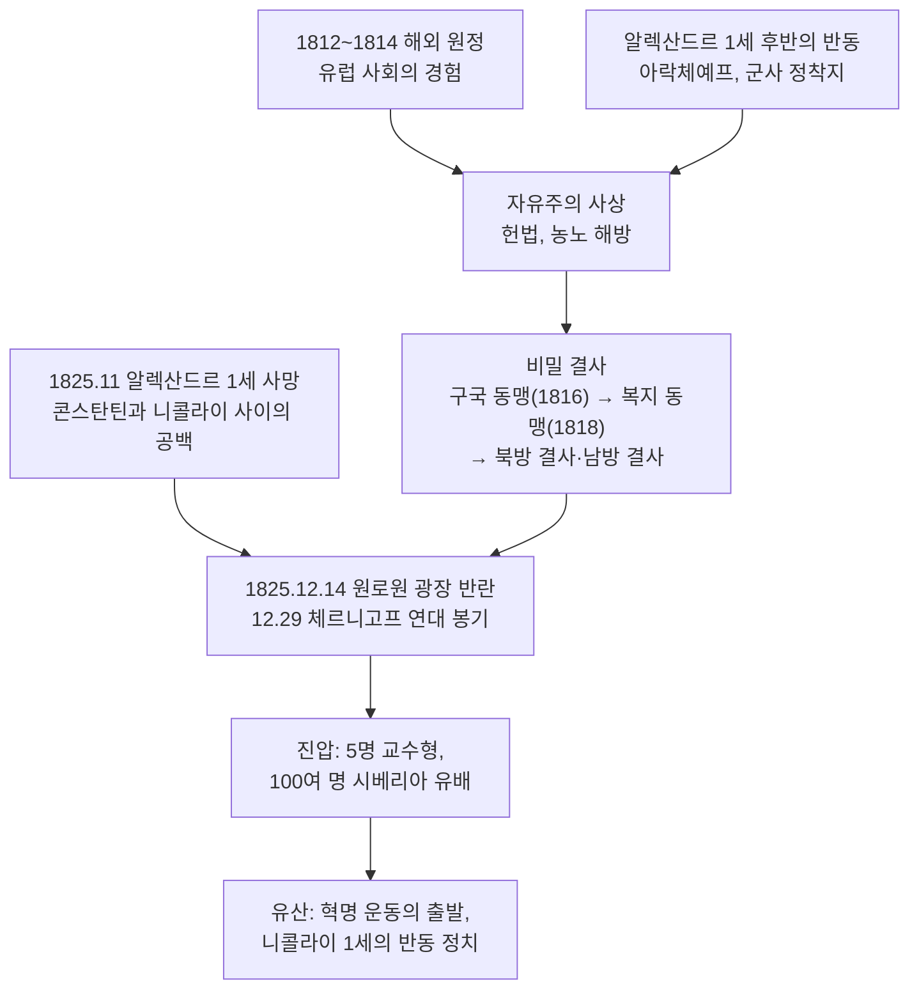

1825년 12월 14일 아침, 상트페테르부르크의 **원로원 광장**. 표트르 대제의 청동 기마상(3강) 옆에 3,000명 남짓의 병사가 네모난 대열을 짓고 섰다. 근위대 모스크바 연대와 해군 근위대, 근위 척탄병 연대의 병사들이었다. 이날은 새 황제 **니콜라이 1세**에게 충성을 맹세하는 날이었다. 그러나 이 병사들은 맹세를 거부했다. 그들은 장교들을 따라 "콘스탄틴 만세! 헌법 만세!"를 외쳤다.

병사들 대부분은 무슨 일이 벌어지는지 잘 몰랐다. 그들이 아는 것은, 황제의 형인 콘스탄틴 대공이 정당한 계승자인데 동생 니콜라이가 제위를 가로채려 한다는 장교들의 말뿐이었다. '헌법'(콘스티투치야)이 무엇인지 모르는 병사들이 그것을 콘스탄틴의 부인 이름으로 알았다는 이야기까지 전한다. 그러나 그들을 이끈 젊은 귀족 장교들은 분명한 목표가 있었다. 전제 정치를 끝내고 헌법을 세우며, 농노를 해방하는 것이었다.

반란군은 영하 8도의 추위 속에 다섯 시간 넘게 광장에 서 있었다. 날이 저물 무렵 니콜라이는 대포를 끌어오게 했다. 산탄이 대열에 쏟아졌고, 광장과 얼어붙은 네바강 위로 도망치던 병사들이 쓰러졌다. 반란은 한나절 만에 끝났다. 12월(러시아어로 데카브르)에 일어났기 때문에, 이 반란을 일으킨 사람들을 **데카브리스트**라고 부른다.

> [!핵심] 이 강의의 질문
> 1. 특권을 누리던 젊은 귀족 장교들은 왜 전제 정치와 농노제에 맞서 일어났는가?
> 2. 1825년 12월 14일, 원로원 광장에서 무슨 일이 일어났으며 반란은 왜 실패했는가?
> 3. 데카브리스트는 러시아 역사에 무엇을 남겼는가?

{{F:r09-opening}}

## 반동의 시대와 비밀 결사

### 유럽에서 돌아온 장교들

8강에서 본 것처럼 1813~1814년 러시아군은 독일과 프랑스를 거쳐 파리까지 진격했다. 수만 명의 젊은 귀족 장교들이 처음으로 서유럽 사회를 직접 보았다. 그들 가운데 한 사람은 이렇게 썼다. "우리는 독일과 프랑스를 지나며 그곳의 질서와 법, 시민의 자유를 보았다. 그리고 돌아와서 우리 농민들이 노예로 팔리는 것을 보았다." 그들은 루소와 몽테스키외를 읽고, 미국 헌법과 스페인의 1812년 헌법을 공부했다.

그들은 알렉산드르 1세가 개혁을 이루어 주기를 기대했다. 황제는 1818년 폴란드 의회 개회 연설에서 러시아 전체에도 '자유로운 제도'를 주고 싶다고 말했다. 그러나 그 약속은 지켜지지 않았다. 오히려 전쟁 뒤 황제는 점점 보수적이고 신비주의적으로 변했다.

### 아락체예프와 군사 정착지

알렉산드르 1세 후반기의 정치를 상징하는 인물은 그의 최측근인 **아락체예프** 장군이었다. 무섭도록 엄격하고 성실한 그는 사실상 나라의 행정을 도맡았다. 그가 추진한 대표적인 정책이 **군사 정착지**다. 군대를 유지하는 비용을 줄이기 위해, 병사들을 국유지 농민의 마을에 가족과 함께 살게 하며 농사와 군사 훈련을 함께 시키는 것이었다. 정착지의 농민과 병사들은 정해진 시간에 일어나고, 정해진 군복을 입고, 줄을 맞춰 밭을 갈아야 했다. 결혼도 허락을 받아야 했다. 1820년대 초 정착지에 사는 사람은 수십만 명에 이르렀다. 1819년 추구예프의 정착지에서 반란이 일어나자 수십 명이 매를 맞아 죽었다.

1820년에는 황제가 아끼던 근위대 세묘노프스키 연대에서 잔인한 연대장에 항의하는 소동이 벌어졌다. 황제는 연대를 해체하고 병사들을 지방 부대로 흩어 버렸다. 같은 해 유럽 곳곳(스페인, 나폴리, 포르투갈)에서 혁명이 일어나자, 알렉산드르는 신성 동맹(8강)을 이끌며 혁명을 군대로 누르는 데 앞장섰다. 대학에서는 자유주의 교수들이 쫓겨났다.

### 북방 결사와 남방 결사

개혁의 희망이 사라지자 젊은 장교들은 비밀 결사를 만들었다. 1816년의 **구국 동맹**, 1818년의 **복지 동맹**을 거쳐 1821년 무렵 두 개의 결사가 생겼다. 수도의 근위대 장교들이 중심이 된 **북방 결사**와, 우크라이나에 주둔한 제2군 장교들이 중심이 된 **남방 결사**다.

두 결사는 목표에서 차이가 있었다. 북방 결사를 이끈 **니키타 무라비요프**가 쓴 헌법안은 미국을 본떠 황제의 권력을 제한하는 입헌 군주국과 연방제를 구상했다. 투표권은 재산이 있는 사람에게만 주었다. 남방 결사를 이끈 **파벨 페스텔** 대령의 「루스카야 프라브다」는 훨씬 급진적이었다. 그는 황실을 없애고 공화국을 세우며, 강력한 혁명 독재를 거쳐 중앙 집권 국가를 만들고, 농노를 해방하면서 땅의 절반을 농민에게 나누어 주자고 했다.

| | 북방 결사 | 남방 결사 |
|---|---|---|
| 중심 인물 | 니키타 무라비요프, 시인 콘드라티 릴레예프, 트루베츠코이 공 | 파벨 페스텔 대령, 세르게이 무라비요프아포스톨 |
| 근거지 | 상트페테르부르크 (근위대) | 우크라이나 (제2군) |
| 국가 형태 | 입헌 군주국, 연방제 | 공화국, 중앙 집권 |
| 농노 문제 | 농노 해방 (땅은 조금만) | 농노 해방과 토지 분배 |
| 권력 이행 | 헌법 제정 회의 | 임시 혁명 정부의 독재 |

표: 데카브리스트의 두 결사

결사의 회원은 수백 명이었고, 그 대부분은 명문 귀족 출신의 근위대 장교와 1812년 전쟁의 참전 용사였다. 그들은 민중을 혁명에 끌어들일 생각이 없었다. 프랑스 혁명의 공포 정치나 푸가초프의 반란(5강) 같은 '아래로부터의 폭력'을 두려워했기 때문이다. 그들은 군대를 움직여 위에서 정치 체제를 바꾸려 했다. 그들은 1826년 여름 황제가 군대를 사열할 때 거사하려고 계획을 다듬고 있었다.

## 1825년 12월 14일

### 황제의 죽음과 계승의 혼란

1825년 11월 19일, 알렉산드르 1세가 남쪽의 항구 도시 타간로그에서 갑자기 병으로 죽었다. 마흔일곱 살이었다. 자식이 없었으므로 파벨 1세의 황위 계승법(7강)에 따르면 다음 황제는 바로 아래 동생인 **콘스탄틴** 대공이었다. 그런데 바르샤바에서 폴란드 왕국의 군 총사령관으로 지내며 폴란드 귀족 여성과 결혼한 콘스탄틴은 이미 몇 년 전 제위를 포기한다는 뜻을 밝혀 두었다. 알렉산드르는 이를 받아들여 셋째 동생 **니콜라이**를 후계자로 정한 문서를 만들었지만, 이 사실을 비밀로 했다. 니콜라이 자신도 그 문서의 내용을 정확히 알지 못했다.

황제의 죽음이 알려지자 혼란이 벌어졌다. 근위대에서 인기가 없다는 것을 알고 있던 니콜라이는 콘스탄틴에게 먼저 충성을 맹세했다. 그러나 콘스탄틴은 바르샤바에서 제위를 받지 않겠다고 했다. 그렇다고 수도로 와서 공식적으로 포기를 선언하지도 않았다. 3주 동안 러시아에는 사실상 황제가 없었다. 결국 니콜라이는 12월 14일에 자신에 대한 충성 맹세를 하기로 정했다. 결사의 지도자들은 이 혼란이 혁명의 기회라고 판단했다. 계획은 서둘러 세워졌다.

### 광장의 하루

계획은 근위대 연대들을 원로원 광장으로 끌고 나와, 원로원이 니콜라이에게 맹세하지 못하게 막고, 대신 임시 정부를 세우고 헌법 제정 회의를 소집한다는 선언을 내게 하는 것이었다. 독재관에는 트루베츠코이 공이 뽑혔다.

그러나 처음부터 어긋났다. 원로원 의원들은 이미 새벽 일찍 니콜라이에게 맹세를 마치고 흩어진 뒤였다. 반란군의 수는 기대보다 훨씬 적었다. 독재관 트루베츠코이는 끝내 광장에 나타나지 않았다. 반란군은 공격도 후퇴도 하지 않은 채 광장에 서 있기만 했다. 니콜라이는 충성하는 부대들로 광장을 에워쌌다. 1812년 전쟁의 영웅인 수도 총독 **밀로라도비치** 장군이 말을 타고 다가와 병사들을 설득하자, 데카브리스트 카홉스키가 그를 쏘아 죽였다. 수도 대주교의 설득도 실패했다.

광장 주위에는 수천 명의 시민이 모여 반란군 쪽을 응원하며 정부군에게 장작과 돌을 던지기도 했다. 날이 저물고 시민들이 반란에 합류할까 두려워진 니콜라이는 오후 4시 무렵 대포로 산탄을 쏘라고 명령했다. 수십 발의 포격에 대열이 무너졌다. 얼음 위로 달아나던 병사들은 포탄에 깨진 얼음 사이로 빠졌다. 그날 몇 명이 죽었는지는 정확히 알 수 없다. 수십 명이라는 기록부터 1,000명이 넘는다는 추정까지 있다. 밤사이 경찰은 네바강의 얼음 구멍에 시신을 밀어 넣었다고 전한다.

남쪽에서는 남방 결사의 세르게이 무라비요프아포스톨이 12월 29일 체르니고프 연대를 이끌고 봉기했지만, 1826년 1월 3일 정부군에게 진압되었다. 페스텔은 반란 전날 이미 체포되어 있었다.

{{F:r09-square}}

## 재판과 시베리아

### 다섯 명의 교수형

니콜라이 1세는 직접 심문에 나섰다. 그는 체포된 장교들을 겨울 궁전으로 불러 한 사람씩 마주 앉아 회유하고 위협했다. 많은 데카브리스트가 동지의 이름과 계획을 털어놓았다. 500명이 넘는 사람이 조사를 받았고, 121명이 특별 재판에 넘겨졌다.

1826년 7월 13일 새벽, 페트로파블롭스크 요새의 성벽 위에서 다섯 명이 교수형을 당했다. 페스텔, 릴레예프, 세르게이 무라비요프아포스톨, 베스투제프류민, 그리고 밀로라도비치를 쏜 카홉스키였다. 처형 도중 밧줄 세 개가 끊어져 세 사람이 땅에 떨어졌다. 당시 관습으로는 이런 경우 사형을 면해 주기도 했지만, 그들은 다시 매달렸다. 무라비요프아포스톨은 "불쌍한 러시아, 사람을 제대로 목매달 줄도 모르는구나"라고 말했다고 전한다.

나머지 100여 명은 시베리아의 강제 노동과 유배, 또는 캅카스의 전선으로 보내졌다. 그들은 시베리아 동쪽 끝 네르친스크의 광산과 치타, 페트롭스키 자보드의 감옥에서 족쇄를 차고 일했다. 형기를 마친 뒤에도 시베리아에 정착해 살아야 했다. 1856년 알렉산드르 2세가 사면령을 내렸을 때, 살아서 돌아올 수 있었던 사람은 30명 남짓이었다.

### 남편을 따라간 아내들

데카브리스트 이야기에서 가장 많이 기억되는 것은 그들의 아내들이다. 남편이 시베리아로 보내지자 열한 명의 아내가 남편을 따라가겠다고 나섰다. 정부는 이를 막으려 했다. 따라가는 아내는 귀족 신분과 재산권을 잃고, 시베리아에서 낳은 아이들은 국유지 농민이 되며, 남편이 죽어도 돌아올 수 없다는 조건이 붙었다. 시베리아에서 낳지 않은 아이들은 데리고 갈 수도 없었다.

그래도 그들은 떠났다. 트루베츠코이 공의 아내 예카테리나 트루베츠카야가 가장 먼저 떠났고, 1812년 전쟁 영웅 라옙스키 장군의 딸 마리야 볼콘스카야는 갓난 아들을 남겨 두고 남편 세르게이 볼콘스키를 찾아 수천 킬로미터를 썰매로 달려갔다. 그녀가 떠나기 전날 밤 모스크바에서 열린 송별 모임에는 시인 푸시킨도 있었다. 1872년 시인 네크라소프는 이들을 기리는 서사시 「러시아의 여인들」을 썼다. 시베리아의 데카브리스트들과 그 아내들은 학교와 병원을 열고 농업을 가르치며 시베리아의 문화에 큰 흔적을 남겼다.

> [!사료] 푸시킨, 「시베리아로 보내는 편지」 (1827)
> "시베리아 광산 깊은 곳에서 / 자랑스러운 인내를 지켜 주오. / 그대들의 슬픈 노고도, 높은 뜻도 / 헛되이 사라지지 않으리니. … / 무거운 족쇄는 떨어지고 / 감옥은 무너지며, 자유가 / 기쁘게 그대들을 문 앞에서 맞으리니 / 형제들이 그대들에게 칼을 건네리라." 푸시킨은 데카브리스트 다수와 친구였다. 1826년 니콜라이 1세가 "12월 14일에 상트페테르부르크에 있었다면 어떻게 했겠느냐"고 묻자, 그는 "반란자들 속에 있었을 것입니다"라고 답했다고 전한다. 이 시는 볼콘스카야와 함께 떠난 무라비요바를 통해 시베리아에 전해졌다.

{{F:r09-siberia}}

## 데카브리스트의 유산

데카브리스트의 반란은 철저히 실패했다. 그러나 그 기억은 러시아 지식인들에게 오래 남았다. 사상가 알렉산드르 게르첸은 훗날 "원로원 광장의 대포 소리가 한 세대 전체를 깨웠다"고 썼다. 그는 열네 살 때 친구와 함께 모스크바의 참새 언덕에서 데카브리스트의 뜻을 잇겠다고 맹세했다. 데카브리스트는 귀족 출신의 지식인이 민중을 위해 자신의 특권과 목숨을 버린다는, 러시아 혁명 운동의 오래된 전통의 출발점이 되었다. 훗날 레닌은 그들을 러시아 해방 운동의 '첫 세대'라고 불렀다.

반란은 니콜라이 1세의 30년 통치에도 깊은 그림자를 드리웠다. 즉위 첫날 피로 반란을 진압한 그는 평생 혁명을 두려워했다. 그는 데카브리스트들의 진술을 모아 러시아 행정의 문제점을 정리한 문서를 곁에 두고 참고했지만, 무엇보다 감시와 질서를 강화하는 데 힘을 쏟았다. 그 시대는 10강에서 다룬다.



```timeline
1816 | 구국 동맹 결성 | 첫 비밀 결사
1818 | 복지 동맹 결성 | 
1820 | 세묘노프스키 연대 사건 | 
1821 | 북방 결사·남방 결사 형성 | 
1825.11.19 | 알렉산드르 1세, 타간로그에서 사망 | 
1825.12.14 | 원로원 광장 반란 | 니콜라이 1세 즉위
1825.12.29 | 체르니고프 연대 봉기 | 1826년 1월 3일 진압
1826.7.13 | 지도자 5명 교수형 | 나머지 시베리아 유배
1827 | 푸시킨, 「시베리아로 보내는 편지」 | 
1856 | 알렉산드르 2세의 사면 | 생존자 귀환
```

## 정리

> [!핵심] 9강 요약
> - 1812~1814년 유럽을 본 젊은 귀족 장교들은 헌법과 농노 해방을 꿈꾸었지만, 알렉산드르 1세 후반기는 **아락체예프**와 **군사 정착지**로 상징되는 반동의 시대였다.
> - 그들은 비밀 결사를 만들었다. 입헌 군주제를 구상한 **북방 결사**(니키타 무라비요프)와 공화제와 토지 분배를 주장한 **남방 결사**(페스텔)가 있었다.
> - 1825년 알렉산드르 1세가 죽고 콘스탄틴과 니콜라이 사이에 계승의 공백이 생기자, 12월 14일 **원로원 광장**에서 반란을 일으켰지만 니콜라이 1세의 대포에 진압되었다.
> - 5명이 교수형을 당하고 100여 명이 **시베리아**로 보내졌다. 열한 명의 아내가 특권을 버리고 남편을 따라갔다.
> - 데카브리스트는 귀족 지식인이 민중을 위해 희생하는 러시아 **혁명 운동의 출발점**이 되었고, 니콜라이 1세의 반동 정치를 낳았다.

### 생각해 볼 질문

1. 데카브리스트는 민중을 혁명에 끌어들이지 않으려 했다. 이것이 반란의 실패와 어떤 관계가 있을까? 그들은 왜 민중을 두려워했을까?
2. 데카브리스트의 아내들은 왜 그토록 큰 희생을 감수했을까? 그들의 선택은 당시 러시아 사회에서 어떤 의미를 가졌을까?
3. 실패한 반란이 성공한 개혁보다 더 오래 기억되는 경우가 있다. 데카브리스트는 왜 그렇게 기억되었을까?

### 다음 강 예고

10강 「니콜라이 1세와 공식 국민성」에서는 '유럽의 헌병'이라 불린 니콜라이 1세의 30년 통치를 살펴본다. 비밀 경찰인 제3부와 검열, '정교·전제·국민성'의 공식 이념, 그리고 그 억압 속에서 꽃핀 푸시킨과 고골의 문학, 서구파와 슬라브파의 논쟁을 다룬다.
