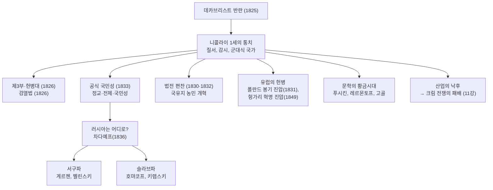

1836년 가을, 모스크바의 잡지 『텔레스코프』에 익명의 글 한 편이 실렸다. 「철학 서한」이라는 제목의 이 글은 러시아 사람들에게 충격을 주었다. "우리는 세계에 아무것도 주지 않았고, 세계로부터 아무것도 배우지 않았다. 우리는 인류의 사상에 단 하나의 생각도 보태지 않았다. … 우리는 서양에도 동양에도 속하지 않으며, 어느 쪽의 전통도 갖지 못했다. 우리는 마치 시간 밖에 서 있는 것 같다."

글쓴이는 1812년 전쟁에 참전했던 귀족 출신의 사상가 **표트르 차다예프**였다. 그는 러시아가 서유럽의 가톨릭 문명에서 떨어져 비잔티움의 정교회를 받아들인 탓에 역사의 큰 흐름에서 벗어나 정체되었다고 주장했다. 황제 **니콜라이 1세**의 반응은 빨랐다. 잡지는 폐간되고 편집자는 유배되었으며, 검열관은 해임되었다. 그리고 차다예프는 '정신병자'로 선고되었다. 그 뒤 1년 동안 의사가 날마다 그의 집에 찾아와 '진찰'을 했다. 국가가 비판자를 미친 사람으로 만든 것이다.

니콜라이 1세(재위 1825~1855)의 30년은 러시아 전제 정치가 가장 단단했던 시대였다. 그러나 차다예프의 글이 보여 주듯, 이 시대는 러시아가 무엇이며 어디로 가야 하는지를 둘러싼 뜨거운 논쟁이 시작된 시대이기도 했다. 그리고 푸시킨과 고골로 대표되는 러시아 문학의 '황금시대'가 열린 시대였다. 이 강의에서는 이 억압과 창조의 시대를 살펴본다.

> [!핵심] 이 강의의 질문
> 1. 니콜라이 1세는 어떤 방법으로 나라를 다스렸으며, '공식 국민성'이란 무엇인가?
> 2. 억압의 시대에 러시아 지식인들은 무엇을 고민했는가? 서구파와 슬라브파는 무엇을 두고 다투었는가?
> 3. 니콜라이 시대의 러시아는 서유럽과 비교해 어떤 상태였는가?

{{F:r10-opening}}

## 군인 황제

### 질서와 감시

니콜라이 1세는 군인으로 자랐고, 군인으로 나라를 다스렸다. 그는 황제가 될 것이라고 예상하지 않았기 때문에, 형들처럼 계몽사상가에게 교육받는 대신 공병 장교로 군대 생활을 했다. 키가 크고 위엄 있는 그는 새벽부터 밤늦게까지 일하며 모든 일을 직접 챙겼다. 그는 국가를 하나의 군대처럼 보았다. 모든 사람이 자기 자리에서 위의 명령에 따라 맡은 일을 해야 했다. 9강에서 본 것처럼 즉위 첫날 반란을 진압한 그는 평생 혁명의 재발을 두려워했다.

니콜라이는 정부의 관료 기구 대신 자신이 직접 거느리는 **'황제 직속 관방'**을 키워 나라를 다스렸다. 그 가운데 가장 유명한 것이 1826년 만든 **제3부**다. 제3부는 정치 경찰로서 혁명 사상, 외국인, 종교 분파를 감시하고 여론을 살폈다. 그 아래의 **헌병대**는 하늘색 제복을 입고 전국에 퍼져 있었다. 제3부의 수장 벤켄도르프는 황제에게서 받은 흰 손수건 이야기로 유명하다. 황제는 그에게 이 손수건으로 "불쌍한 사람들의 눈물을 닦아 주라"고 했다고 한다.

검열도 엄격해졌다. 1826년의 검열법은 '주철 법령'이라 불릴 만큼 가혹했다. 정부와 교회, 전제 정치를 비판하는 것은 물론, 모호하게 두 가지로 읽힐 수 있는 문장도 금지했다. 작가들은 검열을 피하려고 우화와 상징, 행간의 의미에 기대어 글을 썼다. 러시아 독자들은 '행간 읽기'의 달인이 되었다.

### 법전 편찬과 농민 문제

니콜라이 시대에 이룬 중요한 성과도 있다. 7강에서 유배되었다가 돌아온 **스페란스키**는 황제의 명을 받아, 1649년 소보르 법전 이후 쌓인 3만 건이 넘는 법령을 모아 1830년 『러시아 제국 법령 전집』 45권을 펴냈다. 이어 그 가운데 유효한 법을 정리해 1832년 『러시아 제국 법전』 15권을 펴냈다. 러시아는 처음으로 체계적인 법전을 갖게 되었다.

니콜라이는 농노제가 "러시아의 악"이라는 것을 알고 있었다. 그는 1842년 국가 평의회에서 이렇게 말했다. "농노제가 우리 모두에게 명백한 악이라는 데는 의심의 여지가 없다. 그러나 지금 그것에 손을 대는 것은 훨씬 더 파괴적인 악이 될 것이다." 그는 농노 문제를 논의하는 비밀 위원회를 열 번 가까이 만들었지만, 귀족의 반발과 혼란을 두려워해 근본적인 개혁은 하지 못했다. 대신 **키셀료프** 백작이 국유지 농민의 처지를 개선하는 개혁을 했다. 국유지 농민에게 자치와 학교, 병원, 곡물 창고를 마련해 준 이 개혁은 훗날 농노 해방(12강)의 준비가 되었다.

## 공식 국민성

### 정교, 전제, 국민성

1833년 교육부 장관 **세르게이 우바로프**는 러시아 교육의 기본 원칙을 세 단어로 요약했다. **'정교, 전제, 국민성'**이다. 이것을 **'공식 국민성'**이라고 부른다.

- **정교**: 러시아 정교회의 신앙이 러시아 사람들의 도덕과 삶의 바탕이다.
- **전제**: 무제한의 황제 권력만이 거대한 러시아를 하나로 묶고 지킬 수 있다.
- **국민성**: 러시아 민족은 고유한 정신을 지니고 있으며, 서유럽의 혁명 사상은 러시아에 맞지 않는다.

프랑스 혁명의 '자유, 평등, 박애'에 맞서는 러시아의 답이었다. 이 세 원칙은 학교 교육과 출판, 예술을 이끄는 지침이 되었다. 1836년 초연된 **글린카**의 오페라 「황제에게 바친 목숨」은 이 이념을 잘 보여 준다. 1613년 미하일 로마노프를 노리는 폴란드군을 깊은 숲으로 이끌어 자기 목숨을 바쳐 황제를 구했다는 농민 이반 수사닌의 이야기다(1강). 이 오페라는 러시아 국민 오페라의 출발로 꼽힌다.

### '유럽의 헌병'

니콜라이는 나라 밖에서도 혁명과 싸웠다. 1830년 11월 바르샤바에서 폴란드 사관생도들이 봉기하자 폴란드 왕국 전체가 들고일어났다. 러시아군은 1년 가까운 전쟁 끝에 바르샤바를 점령했다. 니콜라이는 알렉산드르 1세가 폴란드에 준 헌법과 의회, 군대를 없애고(8강), 바르샤바 대학을 닫았다. 수많은 폴란드 사람이 파리 등지로 망명했다. 봉기 직전 고국을 떠났던 작곡가 쇼팽도 다시는 돌아가지 못했다.

1848년 유럽 곳곳에서 혁명이 일어나자 니콜라이는 러시아 국경을 닫고 대학의 학생 수를 줄였으며 검열을 더 강화했다. 1849년에는 오스트리아의 요청을 받아 20만 명 가까운 군대를 보내 헝가리의 독립 혁명을 진압했다. 니콜라이는 **'유럽의 헌병'**이라 불렸다.

{{F:r10-nicholas}}

## 러시아는 어디로 가야 하는가

### 서구파와 슬라브파

차다예프의 「철학 서한」은 러시아 지식인들을 두 진영으로 갈라놓았다. 1840년대 모스크바의 귀족 살롱에서는 밤새도록 러시아의 운명을 둘러싼 논쟁이 벌어졌다.

| | 서구파 | 슬라브파 |
|---|---|---|
| 대표 인물 | 게르첸, 벨린스키, 그라놉스키 | 호먀코프, 키렙스키 형제, 악사코프 형제 |
| 표트르 대제 | 러시아를 유럽의 길로 이끈 위인 | 러시아 고유의 삶을 망가뜨리고 귀족과 민중을 갈라놓음 |
| 러시아의 길 | 서유럽과 같은 길(과학, 법치, 개인의 자유)을 따라야 함 | 정교회와 농민 공동체(미르) 같은 고유의 전통 위에서 발전해야 함 |
| 서유럽에 대한 생각 | 따라야 할 모범 | 개인주의와 합리주의로 병든 문명 |
| 공통점 | 농노제 폐지, 검열 완화, 공식 국민성 비판 | |

표: 서구파와 슬라브파

슬라브파는 '공식 국민성'과 비슷해 보였지만, 실제로는 정부와 자주 부딪쳤다. 그들은 관료적인 국가가 아니라 민중의 정신을 중시했고, 언론의 자유와 농노 해방을 요구했다. 슬라브파의 몇몇은 수염을 기르고 러시아 전통 옷을 입고 다니다 경찰에게 제지당하기도 했다. 정부의 눈에는 서구파든 슬라브파든 똑같이 수상했다. 이 논쟁은 형태를 바꾸어 오늘날까지 이어지고 있다. 러시아는 유럽인가, 아니면 독자적인 문명인가?

### 게르첸과 벨린스키

서구파의 대표 인물인 **알렉산드르 게르첸**은 1847년 러시아를 떠나 서유럽으로 망명했다. 그러나 1848년 혁명의 실패를 지켜보며 서유럽의 부르주아 사회에 실망한 그는, 오히려 러시아 농민의 공동체 '미르'에서 자본주의를 건너뛰는 사회주의의 싹을 보았다. 이 생각은 훗날 나로드니키 운동(13강)의 뿌리가 되었다. 그는 런던에서 러시아어 잡지 『종』을 펴내 러시아로 몰래 들여보냈다.

문학 비평가 **비사리온 벨린스키**는 문학이 사회의 진실을 그리고 민중을 위해 봉사해야 한다고 주장했다. 1847년 고골이 말년에 쓴 책에서 전제 정치와 농노제를 옹호하자, 벨린스키는 「고골에게 보내는 편지」에서 그를 격렬히 비판했다. 러시아에 필요한 것은 설교나 기도가 아니라 인간의 존엄을 일깨우는 것, 그리고 상식과 정의에 맞는 법과 그 법의 엄격한 집행이라는 것이었다. 이 편지는 손으로 베껴져 수많은 사람에게 몰래 읽혔다.

### 사형대 위의 도스토옙스키

1849년 12월 22일 아침, 상트페테르부르크의 세묘노프스키 연병장에 스물한 명의 젊은이가 끌려 나왔다. 사회주의 사상을 토론하던 페트라솁스키 모임의 회원들이었다. 그들의 죄는 금지된 책을 읽고 토론한 것, 특히 벨린스키의 「고골에게 보내는 편지」를 낭독한 것이었다. 사형 선고가 낭독되었고, 첫 세 사람이 기둥에 묶이고 눈이 가려졌다. 병사들이 총을 겨누었다. 바로 그때 전령이 달려와 황제의 감형을 알렸다. 모든 것은 황제가 미리 꾸민 연극이었다.

사형수 가운데 스물여덟 살의 작가 **표도르 도스토옙스키**가 있었다. 그는 4년 동안 시베리아 옴스크의 감옥에서 강제 노동을 하고, 이어 병사로 복무했다. 죽음 직전까지 갔던 이 경험은 그의 삶과 소설을 바꾸어 놓았다(13강).

{{F:r10-thinkers}}

## 문학의 황금시대

억압의 시대에 러시아 문학은 역설적으로 황금기를 맞았다. 정치적 토론이 막힌 사회에서, 문학은 사회와 인간에 대해 이야기할 수 있는 거의 유일한 공간이었다.

**알렉산드르 푸시킨**(1799~1837)은 러시아 근대 문학의 아버지로 불린다. 그는 소설 『예브게니 오네긴』, 희곡 『보리스 고두노프』, 시 「청동 기마상」(3강), 소설 『대위의 딸』(5강) 등으로 러시아 문학어의 기틀을 세웠다. 니콜라이 1세는 데카브리스트의 친구였던 그를 유배에서 풀어 주며 "내가 직접 너의 검열관이 되겠다"고 했다. 그것은 은혜이자 감시였다. 1837년 1월 푸시킨은 아내를 둘러싼 소문 끝에 프랑스 출신의 근위대 장교 단테스와 결투를 벌여 치명상을 입고 서른일곱 살에 숨졌다. 젊은 시인 **레르몬토프**는 그 죽음을 애도하며 궁정 사회를 고발하는 시 「시인의 죽음」을 썼다가 캅카스로 유배되었다. 그 역시 1841년 결투로 스물여섯 살에 죽었다.

우크라이나 출신의 **니콜라이 고골**(1809~1852)은 관료 사회의 부패와 어리석음을 풍자했다. 1836년 초연된 희극 『검찰관』은 지방 도시의 관리들이 한 건달을 수도에서 온 비밀 검찰관으로 착각해 벌이는 소동을 그렸다. 초연을 본 니콜라이 1세는 "모두가 혼났지만, 나 자신이 가장 많이 혼났다"고 말했다고 전한다. 1842년의 소설 『죽은 혼』은 서류상으로만 살아 있는 죽은 농노(3강의 '영혼')를 사들이는 사기꾼 치치코프의 여행을 통해 농노제 러시아의 지방 지주들을 그렸다.

## 뒤처지는 러시아

니콜라이 시대에 서유럽에서는 산업 혁명이 빠르게 진행되었다. 증기 기관과 철도, 공장이 사회를 바꾸고 있었다. 러시아에서도 1837년 상트페테르부르크와 차르스코예 셀로 사이 27킬로미터에 첫 철도가 놓였고, 1851년에는 상트페테르부르크와 모스크바를 잇는 650킬로미터의 철도가 개통되었다. 황제가 지도 위에 자를 대고 두 도시를 일직선으로 이었다는 전설이 있을 만큼 곧게 뻗은 철도였다. 그러나 1855년 러시아의 철도는 1,000킬로미터 남짓에 불과했다. 같은 무렵 영국의 철도는 1만 3,000킬로미터를 넘었다.

```chart
{
  "type": "bar",
  "caption": "러시아와 영국의 선철(제철 원료) 생산량 (만 톤, 1800·1830·1850년, 대략적인 수치). 18세기 말 우랄의 제철소 덕분에 세계 최대의 철 생산국 가운데 하나였던 러시아는(3강), 농노 노동에 기댄 낡은 생산 방식 때문에 산업 혁명을 이룬 영국에 크게 뒤처졌다",
  "data": {
    "labels": ["1800", "1830", "1850"],
    "datasets": [
      { "label": "러시아", "data": [16, 19, 23] },
      { "label": "영국", "data": [24, 68, 225] }
    ]
  },
  "options": { "scales": { "y": { "title": { "display": true, "text": "만 톤" } } } }
}
```

니콜라이의 러시아는 겉으로는 유럽에서 가장 강한 군사 대국처럼 보였다. 상트페테르부르크에는 거대한 **성 이사아크 대성당**이 40년에 걸쳐 지어졌고(1858년 완공), 모스크바에서는 1812년 승리를 기념하는 구세주 그리스도 대성당(8강)의 공사가 시작되었다. 100만 명이 넘는 상비군은 유럽 최대였다. 그러나 그 군대의 무기와 보급, 교통은 산업화한 서유럽에 크게 뒤떨어져 있었다. 이 차이는 1853년 시작된 크림 전쟁에서 드러난다(11강).



## 정리

> [!핵심] 10강 요약
> - **니콜라이 1세**(1825~1855)는 군인 황제로서 질서와 감시로 나라를 다스렸다. **제3부**와 헌병대, 엄격한 **검열**이 그 도구였다. 스페란스키가 **법전**을 편찬했고, 국유지 농민 개혁이 있었지만 농노제는 그대로였다.
> - 교육부 장관 우바로프가 내세운 **'정교, 전제, 국민성'**(공식 국민성)이 국가 이념이 되었다.
> - 니콜라이는 폴란드 봉기(1830~1831)와 헝가리 혁명(1849)을 진압해 **'유럽의 헌병'**이라 불렸다.
> - 차다예프의 「철학 서한」(1836)을 계기로 러시아의 길을 둘러싼 **서구파**와 **슬라브파**의 논쟁이 벌어졌다. 게르첸은 농민 공동체에서 사회주의의 싹을 보았고, 도스토옙스키는 페트라솁스키 사건으로 사형대에 섰다.
> - 억압 속에서 **푸시킨**, **레르몬토프**, **고골**의 문학이 꽃피었다.
> - 서유럽이 산업 혁명으로 앞서 나가는 동안 러시아는 철도와 산업에서 크게 뒤처졌다.

### 생각해 볼 질문

1. 검열이 심한 사회에서 문학이 오히려 꽃피는 경우가 있다. 니콜라이 시대 러시아에서 문학은 어떤 역할을 했을까?
2. 서구파와 슬라브파의 논쟁은 근대화를 겪은 다른 나라들(예: 조선 말기의 개화파와 위정척사파, 일본의 문명개화와 국수주의)의 논쟁과 어떤 점에서 비슷하고 다를까?
3. 니콜라이 1세는 농노제가 악이라는 것을 알면서도 왜 폐지하지 못했을까?

### 다음 강 예고

11강 「크림 전쟁」에서는 성지 예루살렘의 교회 열쇠를 둘러싼 다툼에서 시작해 영국, 프랑스, 오스만 제국 연합군과 러시아가 맞붙은 크림 전쟁을 살펴본다. 시노프 해전, 세바스토폴 포위전과 경기병 여단의 돌격, 나이팅게일, 그리고 사진으로 기록된 첫 전쟁과 러시아의 패배가 가져온 충격을 다룬다.
