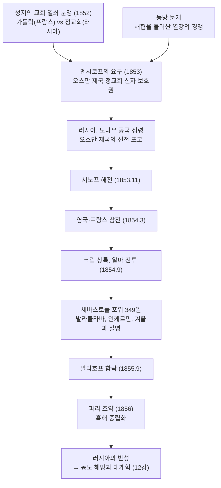

1854년 10월 25일 오전, 크림반도 남쪽의 항구 발라클라바 근처의 골짜기. 영국군 경기병 여단의 기병 600여 명이 말을 달려 골짜기 안으로 돌격했다. 골짜기 양쪽 언덕과 맞은편 끝에는 러시아군의 대포가 늘어서 있었다. 명령이 잘못 전달된 것이었다. 앞뒤와 양옆에서 쏟아지는 포탄 속에서 기병들은 2킬로미터 가까이 달려 러시아군 포대에 이르렀고, 다시 같은 길로 돌아왔다. 20분 남짓한 돌격으로 여단의 거의 절반이 죽거나 다치거나 포로가 되었다.

이 장면을 언덕 위에서 지켜본 프랑스의 보스케 장군은 이렇게 말했다. "장엄하다. 그러나 이것은 전쟁이 아니다. 미친 짓이다." 몇 주 뒤 영국의 시인 테니슨은 「경기병 여단의 돌격」이라는 시를 발표했다. "그들의 몫은 이유를 묻는 것이 아니었다. 그들의 몫은 행하고 죽는 것이었다." 이 시는 영국에서 가장 유명한 전쟁 시가 되었다.

이 전쟁이 **크림 전쟁**(1853~1856)이다. 러시아는 오스만 제국, 영국, 프랑스, 사르데냐의 연합군과 싸워 졌다. 나폴레옹을 무찌른 지 40년 만에, '유럽의 헌병'이라 불리던 러시아는 자기 땅에서 굴욕적인 패배를 당했다. 이 패배는 러시아 지배층에게 나라를 근본적으로 바꾸지 않으면 살아남을 수 없다는 사실을 깨닫게 했다. 이 강의에서는 크림 전쟁의 원인과 전개, 그리고 이 전쟁이 러시아에 남긴 충격을 살펴본다.

> [!핵심] 이 강의의 질문
> 1. 성지의 교회 열쇠를 둘러싼 다툼은 어떻게 유럽 열강의 전쟁으로 커졌는가?
> 2. 세바스토폴 포위전은 어떻게 전개되었으며, 러시아는 왜 졌는가?
> 3. 크림 전쟁은 러시아와 세계에 무엇을 남겼는가?

{{F:r11-opening}}

## 전쟁의 원인

### 베들레헴의 열쇠

전쟁의 시작은 멀리 오스만 제국의 땅 팔레스타인에서 벌어진 교회 다툼이었다. 예수가 태어난 곳으로 알려진 베들레헴의 성탄 교회와 예루살렘의 성묘 교회는 여러 기독교 종파가 함께 관리했다. 그 가운데 가톨릭과 정교회는 교회의 어느 문 열쇠를 누가 갖고, 어느 제단에서 누가 예배를 드릴지를 두고 오래 다투었다. 1852년 프랑스의 새 황제 나폴레옹 3세는 국내의 가톨릭 세력의 지지를 얻으려고 오스만 제국을 압박해, 성탄 교회의 열쇠를 가톨릭 쪽에 넘기게 했다.

니콜라이 1세는 이를 러시아와 정교회에 대한 모욕으로 받아들였다. 그는 1853년 해군 장관 멘시코프 공을 콘스탄티노폴리스에 보내, 오스만 제국 안의 정교회 신자 1,000만 명 넘는 사람들을 러시아 황제가 보호할 권리를 인정하라고 요구했다. 6강에서 본 퀴췩카이나르자 조약의 조항을 넓게 해석한 것이었다. 오스만 제국이 이를 받아들이면 러시아는 사실상 오스만 제국의 내정에 마음대로 간섭할 수 있게 된다. 오스만 제국은 영국과 프랑스 대사의 지지를 등에 업고 거절했다.

### '유럽의 병자'를 둘러싼 경쟁

이 다툼의 밑바탕에는 '동방 문제'가 있었다. 쇠퇴하는 오스만 제국의 운명을 둘러싼 열강의 경쟁이다. 니콜라이 1세는 1853년 영국 대사에게 오스만 제국을 "중병에 걸린 병자"에 빗대며, 그가 죽기 전에 영국과 러시아가 그 유산을 미리 나누자고 제안하기도 했다. 러시아의 목표는 흑해와 지중해를 잇는 보스포루스·다르다넬스 해협이었다.

영국은 러시아가 해협과 지중해로 나와 영국의 인도로 가는 길을 위협하는 것을 무엇보다 두려워했다. 프랑스의 나폴레옹 3세는 1815년 빈 회의 이후 프랑스를 묶어 둔 질서를 깨고, 큰아버지 나폴레옹 1세의 모스크바 패배를 설욕하고 싶었다. 니콜라이 1세는 1848~1849년 혁명 때 자신이 도와준 오스트리아가 러시아 편에 서리라 기대했고, 영국과 프랑스가 손잡으리라고는 생각하지 못했다. 그 오판이 러시아를 고립시켰다.

### 시노프 해전

1853년 7월 러시아군은 오스만 제국의 보호 아래 있던 도나우강의 몰다비아와 왈라키아(지금의 루마니아)를 점령했다. 10월 오스만 제국이 러시아에 전쟁을 선포했다. 11월 30일 **나히모프** 제독의 러시아 흑해 함대는 아나톨리아 북쪽 해안의 시노프항에 정박해 있던 오스만 함대를 공격해 몇 시간 만에 전멸시켰다. 러시아 함대는 폭발하는 포탄을 쏘는 신형 함포를 썼다. 오스만 쪽에서는 3,000명 가까이 죽었다.

영국의 신문들은 이 해전을 '시노프의 학살'이라 부르며 러시아에 대한 분노를 부채질했다. 1854년 3월 영국과 프랑스가 러시아에 전쟁을 선포했다. 오스트리아도 러시아에 도나우 지역에서 물러나라고 압박하며 군대를 국경에 모았다. 러시아는 도나우 지역에서 물러났지만, 영국과 프랑스는 이번 기회에 러시아의 흑해 함대를 없애기로 했다. 그 함대의 근거지가 크림반도의 **세바스토폴**이었다.

## 세바스토폴 포위전

### 크림 상륙

1854년 9월 영국, 프랑스, 오스만의 연합군 6만 명 남짓이 크림반도 서해안에 상륙했다. 9월 20일 알마강에서 러시아군은 연합군의 공격에 밀려 물러났다. 연합군의 병사들은 사정거리가 1,000미터가 넘는 신형 소총(미니에 소총)을 썼지만, 러시아군의 소총 대부분은 사정거리가 200~300미터인 낡은 활강총이었다. 러시아 병사들은 다가가기도 전에 쓰러졌다.

러시아 해군은 연합군 함대가 세바스토폴 항구에 들어오지 못하게 막으려고, 흑해 함대의 범선 여러 척을 항구 입구에 스스로 가라앉혔다. 수병들은 배에서 내린 대포를 들고 육지의 방어선으로 갔다. 젊은 공병 장교 **토틀레벤**의 지휘 아래 병사와 수병, 시민들은 밤낮으로 흙을 날라 도시를 둘러싼 보루와 참호를 쌓았다. 연합군은 곧바로 도시를 공격하는 대신 포위하기로 했다. 이렇게 시작된 **세바스토폴 포위전**은 349일 동안 이어졌다.

### 발라클라바와 인케르만

연합군의 보급 기지는 남쪽의 작은 항구 발라클라바였다. 1854년 10월 25일 러시아군이 이곳을 공격하면서 벌어진 전투에서 앞서 본 경기병 여단의 돌격이 있었다. 같은 전투에서 영국의 한 보병 연대는 붉은 군복을 입고 두 줄로 늘어서서 러시아 기병의 돌격을 막아 냈는데, 이를 본 기자는 그들을 '가느다란 붉은 선'이라 불렀다. 11월 5일 안개 낀 인케르만 고지에서 러시아군은 다시 포위를 풀려고 공격했지만, 큰 희생을 치르고 물러났다.

### 겨울과 질병

1854~1855년 겨울은 양쪽 모두에게 지옥이었다. 11월의 큰 폭풍으로 연합군의 보급선들이 가라앉았고, 천막과 겨울옷이 없는 병사들이 얼어 죽었다. 콜레라와 이질, 장티푸스가 퍼졌다. 크림 전쟁에서 죽은 병사들 대부분은 전투가 아니라 질병으로 죽었다.

영국의 간호사 **플로렌스 나이팅게일**은 1854년 11월 간호사 38명을 이끌고 흑해 건너편 스쿠타리(지금의 이스탄불 위스퀴다르)의 영국군 병원에 도착했다. 병원은 더럽고 환자들이 넘쳐났다. 그녀는 병원을 청소하고 위생을 개선하며, 밤에 등불을 들고 병실을 돌았다. '등불을 든 여인'의 전설이 여기서 생겼다. 그녀는 전쟁 뒤 병사들의 사망 원인을 통계 도표로 정리해, 대부분의 죽음이 막을 수 있는 질병 때문이었음을 보여 주었다.

러시아 쪽에도 비슷한 인물이 있었다. 외과 의사 **니콜라이 피로고프**는 세바스토폴에서 마취를 널리 쓰고, 부상자를 상처의 정도에 따라 나누어 치료하는 **분류**(트리아지) 방법을 체계적으로 도입했다. 러시아에서도 귀족 여성들이 '자비의 자매'라는 간호 단체를 만들어 전선에 나왔다.

{{F:r11-siege}}

### 함락

1855년 2월 18일(그레고리력 3월 2일), 니콜라이 1세가 감기에서 시작된 폐렴으로 세상을 떠났다. 쉰여덟 살이었다. 패전의 굴욕 속에 스스로 목숨을 끊었다는 소문도 돌았다. 그의 아들 **알렉산드르 2세**가 제위를 이었다.

1855년 봄과 여름 연합군은 수십만 발의 포탄을 세바스토폴에 퍼부었다. 사르데냐 왕국도 연합군에 가담했다. 러시아의 방어를 지휘하던 나히모프 제독은 7월 저격병의 총에 맞아 숨졌다. 9월 8일 프랑스군이 도시 방어선의 열쇠인 **말라호프 언덕**의 보루를 기습 점령했다. 그날 밤 러시아군은 도시의 남쪽에 불을 지르고 항구를 가로지르는 부교를 건너 북쪽으로 물러났다. 11개월 넘게 버틴 세바스토폴이 함락되었다.

> [!사료] 톨스토이, 『세바스토폴 이야기』 (1855)
> "이 이야기의 주인공은, 내가 온 마음으로 사랑하고 그 아름다움을 모두 그려 내려 애쓴 주인공은, 언제나 아름다웠고 지금도 아름다우며 앞으로도 아름다울 것은, 바로 진실이다." 젊은 포병 장교로 세바스토폴의 가장 위험한 보루에서 싸운 레프 톨스토이는 전쟁을 영웅담이 아니라 피와 진흙, 두려움과 허영 속에서 그렸다. 이 글은 그를 일약 유명 작가로 만들었다.

## 전쟁의 결과

### 파리 조약 (1856)

러시아는 아직 싸울 수 있었다. 캅카스에서는 1855년 11월 오스만 제국의 요새 카르스를 점령하기도 했다. 그러나 재정은 바닥났고, 오스트리아는 연합군 편에 서서 참전하겠다고 위협했다. 1856년 3월 30일 파리에서 평화 조약이 맺어졌다.

- **흑해의 중립화**: 흑해에서 모든 나라의 군함과 해군 기지를 금지했다. 러시아는 흑해 함대와 세바스토폴의 해군 기지를 가질 수 없게 되었다.
- **베사라비아 남부와 도나우강 하구**를 몰다비아에 넘겨주었다(7강).
- 러시아는 오스만 제국 안의 정교회 신자를 단독으로 보호한다는 주장을 포기했다.

흑해 중립화는 러시아에게 가장 큰 굴욕이었다. 러시아는 1870년 프로이센-프랑스 전쟁으로 유럽이 혼란한 틈을 타 이 조항을 일방적으로 폐기했다.

```chart
{
  "type": "bar",
  "caption": "크림 전쟁의 나라별 사망자 (명, 연구마다 차이가 큰 대략적인 추정치). 모든 나라에서 전투보다 질병으로 죽은 병사가 훨씬 많았다. 러시아의 사망자는 연합국 전체를 합친 것보다 많았다",
  "data": {
    "labels": ["러시아", "프랑스", "오스만 제국", "영국", "사르데냐"],
    "datasets": [{ "label": "사망자 (명)", "data": [450000, 95000, 45000, 22000, 2200] }]
  },
  "options": { "plugins": { "legend": { "display": false } } }
}
```

### 근대적 전쟁의 시작

크림 전쟁은 여러 면에서 '첫 근대 전쟁'이었다.

| 분야 | 새로운 점 |
|---|---|
| 무기 | 강선이 있는 소총(미니에 소총), 폭발하는 포탄, 증기 군함과 장갑 포대 |
| 통신 | 전신선이 전장과 런던·파리를 이어, 정부가 몇 시간 만에 전황을 알고 명령을 내림 |
| 언론 | 『타임스』의 기자 윌리엄 하워드 러셀 같은 종군 기자가 전쟁의 실상을 보도해 여론을 움직임 |
| 사진 | 영국의 사진가 로저 펜턴이 1855년 수백 장의 사진을 찍음. 전쟁을 사진으로 기록한 첫 사례 가운데 하나 |
| 의료 | 나이팅게일의 간호와 위생 개혁, 피로고프의 마취와 부상자 분류 |
| 보급 | 연합군은 발라클라바에서 포위선까지 철도를 놓음. 러시아는 모스크바 남쪽에 철도가 없어 보급이 몇 달씩 걸림 |

표: 크림 전쟁의 새로운 모습

### 러시아가 배운 것

크림 전쟁은 러시아의 약점을 적나라하게 드러냈다. 러시아 병사들은 용감했지만, 낡은 무기로 싸웠다. 철도가 없어 병력과 보급품을 수레로 실어 날라야 했는데, 모스크바에서 크림까지 몇 달이 걸렸다. 연합군은 증기선으로 3주 만에 프랑스와 영국에서 크림까지 보급품을 날랐다. 군대의 대부분은 25년 동안 복무하는 농노 출신 병사들이었고, 장교들의 부패와 무능도 심각했다. 공장과 산업은 근대적인 무기를 만들어 낼 수 없었다.

니콜라이 1세가 30년 동안 지켜 온 질서, 곧 농노제와 전제 정치, 검열과 감시의 체제가 근대 전쟁을 치를 힘을 주지 못한다는 것이 분명해졌다. 새 황제 알렉산드르 2세는 이렇게 판단했다. 러시아가 다시 강대국이 되려면 철도와 산업, 근대적 군대가 필요하고, 그러려면 먼저 농노제를 없애야 한다. 크림 전쟁의 패배는 러시아 역사상 가장 큰 개혁, 곧 1861년의 **농노 해방**과 '대개혁'(12강)의 문을 열었다.

{{F:r11-legacy}}



## 정리

> [!핵심] 11강 요약
> - **크림 전쟁**은 성지의 교회 열쇠를 둘러싼 프랑스와 러시아의 다툼에서 시작되었지만, 그 밑에는 쇠퇴하는 오스만 제국과 해협을 둘러싼 열강의 경쟁(**동방 문제**)이 있었다.
> - 러시아가 오스만 제국 안의 정교회 신자 보호권을 요구하며 도나우 지역을 점령하고 **시노프 해전**에서 오스만 함대를 전멸시키자, 영국과 프랑스가 참전했다.
> - 연합군은 크림에 상륙해 **세바스토폴**을 349일 동안 포위했다. 경기병 여단의 돌격, 나이팅게일과 피로고프의 의료 활동이 이 전쟁에서 나왔다. 1855년 9월 말라호프 언덕이 함락되며 세바스토폴이 무너졌다.
> - **파리 조약**(1856)으로 흑해가 중립화되어 러시아는 흑해 함대를 잃었다.
> - 크림 전쟁은 전신, 종군 기자, 사진, 신형 무기가 등장한 근대 전쟁이었다. 러시아의 낡은 무기, 철도 부족, 농노 군대의 한계가 드러났고, 이는 **알렉산드르 2세의 대개혁**으로 이어졌다.

### 생각해 볼 질문

1. 교회 열쇠라는 작은 문제가 어떻게 수십만 명이 죽는 전쟁으로 커졌을까? 지도자들의 오판은 어떤 역할을 했을까?
2. 크림 전쟁에서 전쟁의 실상을 알린 신문 보도와 사진은 영국의 여론과 정치에 어떤 영향을 주었을까? 오늘날의 전쟁 보도와 비교해 보자.
3. 전쟁의 패배가 오히려 나라를 개혁하는 계기가 되는 경우가 있다. 크림 전쟁 뒤의 러시아와 비슷한 다른 나라의 예를 찾아보자.

### 다음 강 예고

12강 「농노 해방과 대개혁」에서는 1861년 2월 19일 알렉산드르 2세가 2,000만 명이 넘는 농노를 해방한 과정과 그 한계, 그리고 젬스트보(지방 자치), 사법 개혁, 군사 개혁으로 이어진 '대개혁'을 살펴본다. 1867년 알래스카를 미국에 판 이야기도 함께 다룬다.
