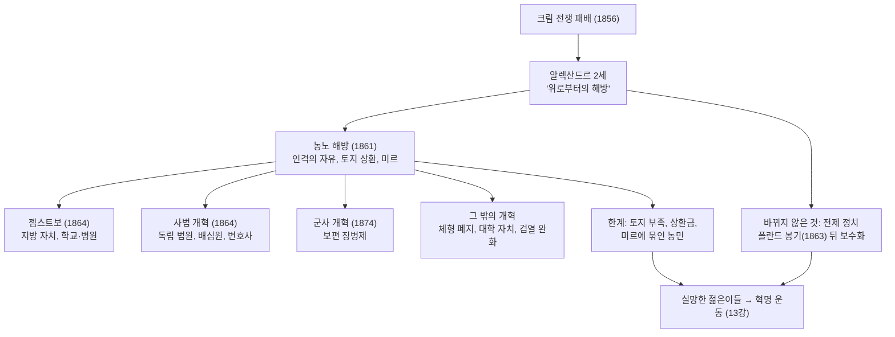

1861년 3월 5일, 사순절을 앞둔 '용서의 일요일'. 러시아 전국의 교회에서 사제들이 예배를 마친 뒤 긴 문서를 읽어 내려갔다. 2주 전인 2월 19일 황제 **알렉산드르 2세**가 서명한 선언문이었다. 성당 안을 가득 메운 농민들은 숨을 죽이고 귀를 기울였다. 선언문은 지주의 땅에 묶인 농노들에게 '자유로운 농촌 주민의 모든 권리'를 준다고 했다.

그러나 많은 농민은 어리둥절했다. 교회 슬라브어가 섞인 긴 문장은 알아듣기 어려웠고, 무엇보다 그들이 기다리던 말이 없었다. 땅은 어떻게 되는가? 선언문에 따르면 농민은 앞으로 2년 동안 지금처럼 지주에게 부역과 소작료를 바치고, 그 뒤에는 땅을 '되사야' 했다. 농민들은 이렇게 수군거렸다. "우리는 지주의 것이지만, 땅은 우리의 것이다." 그들은 오랫동안 자기가 갈아 온 땅이 당연히 자기 것이라고 믿었다. 몇몇 마을에서는 진짜 '황제의 자유'는 따로 있는데 지주와 관리들이 숨기고 있다는 소문이 돌았다. 볼가강 유역의 베즈드나 마을에서는 농민 수천 명이 그런 믿음 속에 모였다가, 4월 군대의 발포로 수십 명이 죽었다.

이렇게 러시아의 **농노 해방**이 시작되었다. 2,000만 명이 넘는 사람이 법적으로 자유를 얻은, 세계 역사상 가장 큰 규모의 해방이었다. 알렉산드르 2세는 이어서 지방 자치와 법원, 군대를 근본적으로 바꾸는 개혁을 잇달아 내놓았다. 역사가들은 이를 **'대개혁'**이라 부른다. 이 강의에서는 농노 해방의 과정과 내용, 그 한계, 그리고 대개혁이 러시아를 어떻게 바꾸었는지 살펴본다.

> [!핵심] 이 강의의 질문
> 1. 알렉산드르 2세는 왜 농노제를 없애기로 했는가?
> 2. 농노 해방의 조건은 무엇이었으며, 농민은 무엇을 얻고 무엇을 잃었는가?
> 3. 대개혁은 러시아의 지방 행정, 법원, 군대를 어떻게 바꾸었으며, 무엇이 바뀌지 않았는가?

```figure
src: asset:141040906fc858bf08b3de4369e6b7a0
caption: 네덜란드에서 펴낸 석판화 「러시아 농노의 해방」. 마을 교회 앞에 모인 농민들에게 신사가 해방 선언을 전하고, 한 농민은 땅에 엎드려 감사하고 있다. 바깥 세계가 상상한 해방의 장면이다.
credit: 크리스티안 보스 판화, 1861~1862년 · 암스테르담 국립미술관 소장
license: Public Domain (레이크스 미술관: CC0)
source: https://www.rijksmuseum.nl/en/collection/RP-P-1904-2501
width: wide
```

## 해방을 향하여

### "아래로부터 없어지기를 기다리기보다"

1855년 즉위한 **알렉산드르 2세**는 개혁가로 자라지 않았다. 아버지 니콜라이 1세 밑에서 군대식 교육을 받았고, 젊은 시절에는 농노제를 지키자는 쪽이었다. 그러나 11강에서 본 크림 전쟁의 패배는 그의 생각을 바꾸었다. 농노제 위에 선 나라는 근대 전쟁을 치를 수 없었다. 농노 출신의 병사는 25년 동안 복무해야 했고, 자유로운 노동자가 없으니 공장과 철도도 발전하기 어려웠다. 농민의 반란도 잦아지고 있었다.

1856년 3월, 크림 전쟁을 끝내는 파리 조약이 맺어진 직후 알렉산드르는 모스크바 귀족들 앞에서 이렇게 말했다. "농노제를 아래로부터 스스로 없어지기 시작할 때까지 기다리는 것보다, 위로부터 없애는 것이 훨씬 낫다." 귀족들은 충격에 빠졌다. 그 뒤 5년 동안 정부와 각 현의 귀족 위원회에서 해방의 방법을 놓고 치열한 논쟁이 벌어졌다. 지주들은 농민에게 땅을 주지 않고 몸만 풀어 주기를 바랐다. 개혁파 관리들, 특히 내무부의 **니콜라이 밀류틴**은 땅 없는 해방은 수많은 농민을 떠돌이로 만들어 혁명을 부를 것이라고 맞섰다. 결국 농민에게 땅을 주되, 그 값을 치르게 하는 타협안이 나왔다.

```gallery
src: asset:d989ecc5194cd5cc6fbc610c92745c44
caption: '해방 황제' 알렉산드르 2세(재위 1855~1881).
credit: 세르게이 레비츠키 사진관 촬영, 1870년대 · 미국 의회도서관 소장
license: Public Domain (저작권 보호 기간 만료 · 미국 의회도서관: 알려진 저작권 제한 없음)
source: https://www.loc.gov/item/99615678/
---
src: asset:965c7d699964d724c3d6e19a3a1632b4
caption: 알렉산드르 2세와 딸 마리야, 아들 세르게이. 세르게이 대공은 1905년 모스크바 총독으로 있다가 혁명가의 폭탄에 죽는다(16강).
credit: 작자 미상, 1860~1861년 · 미국 의회도서관 소장
license: Public Domain (저작권 보호 기간 만료 · 미국 의회도서관: 알려진 저작권 제한 없음)
source: https://www.loc.gov/item/2021669108/
```

### 1861년 2월 19일

1861년 2월 19일, 알렉산드르 2세는 즉위 6주년 기념일에 해방령에 서명했다. 그 주요 내용은 다음과 같다.

| 내용 | 설명 |
|---|---|
| 인격의 자유 | 농노는 곧바로 법적으로 자유인이 되었다. 지주에게 팔리거나 매를 맞지 않고, 결혼하고, 재산을 갖고, 소송을 하고, 장사를 할 수 있게 되었다 |
| 임시 의무 기간 | 땅의 분할이 끝날 때까지(처음 2년, 실제로는 더 오래) 농민은 지주에게 예전처럼 부역이나 소작료를 바쳤다 |
| 토지의 분배 | 농민은 지금까지 경작하던 땅의 일부를 받았다. 그러나 많은 지역에서 지주가 가장 좋은 땅과 목초지, 숲을 떼어 갔다('잘라 낸 땅') |
| 토지 상환금 | 땅값의 80% 안팎을 정부가 채권으로 지주에게 먼저 주고, 농민은 그 돈을 49년 동안 해마다 6%의 이자와 함께 국가에 갚아야 했다 |
| 농촌 공동체(미르) | 땅은 개별 농민이 아니라 마을 공동체가 받았다. 공동체가 상환금과 세금을 함께 책임졌고, 농민은 공동체의 허락 없이 마을을 떠나기 어려웠다 |

표: 1861년 농노 해방령의 주요 내용

1863년에는 황실 소유지의 농민, 1866년에는 국유지 농민도 비슷한 조건으로 땅을 받았다. 이렇게 해서 러시아 인구의 대다수를 차지하는 농민이 법적으로 자유인이 되었다.

```chart
{
  "type": "bar",
  "caption": "러시아의 농노 해방(1861)과 미국의 노예 해방(1863~1865)에서 자유를 얻은 사람의 수 (만 명, 대략적인 수치). 러시아는 지주의 농노만 2,000만 명이 넘었고, 1866년 국유지 농민까지 합치면 4,000만 명이 넘는 농민의 법적 지위가 바뀌었다. 미국의 노예 해방은 남북 전쟁을 치른 끝에 이루어졌다",
  "data": {
    "labels": ["러시아 지주 농노 (1861)", "러시아 국유지·황실 농민 (1863~1866)", "미국 노예 (1863~1865)"],
    "datasets": [{ "label": "만 명", "data": [2250, 2000, 400] }]
  },
  "options": { "plugins": { "legend": { "display": false } } }
}
```

### 해방의 그늘

농노 해방은 엄청난 변화였지만, 농민들의 기대에는 크게 못 미쳤다.

첫째, 농민이 받은 땅은 해방 전보다 적었다. 특히 땅이 기름진 남부의 흑토 지대에서는 지주가 땅의 상당 부분을 떼어 갔다. 농민은 지주에게 빼앗긴 목초지와 숲을 빌려 쓰려고 다시 지주의 땅에서 일해야 했다.

둘째, 땅값이 시장 가격보다 높게 매겨졌다. 실제로는 땅값에 지주가 잃은 농노 노동의 값까지 얹은 것이었다. 농민들은 무거운 상환금과 세금에 시달렸다. 상환금은 1905년 혁명(16강)이 일어난 뒤인 1907년에야 폐지되었다.

셋째, 농민은 개인이 아니라 **미르**(농촌 공동체)에 묶였다. 미르는 몇 년마다 가족의 수에 따라 땅을 다시 나누었고, 땅은 좁고 긴 띠 모양의 밭으로 잘게 쪼개져 있었다. 농민은 마음대로 땅을 팔거나 마을을 떠날 수 없었다. 이런 제도에서는 농업을 개량할 유인이 적었다. 인구가 빠르게 늘면서 한 집이 받는 땅은 점점 줄었다. 19세기 말 러시아 농촌은 '토지 부족'과 가난에 시달렸다.

그래도 해방은 러시아 사회를 바꾸었다. 농민은 더 이상 지주의 재산이 아니었고, 도시로 일하러 떠나는 농민이 늘었다. 이들이 19세기 말 러시아 산업화의 노동력이 되었다(14강). 반대로 농노 노동에 기대던 많은 귀족은 몰락의 길을 걸었다. 체호프의 희곡 『벚꽃 동산』(1904)은 해방 뒤 몰락해 가는 귀족 가문과, 농노의 아들로 부자가 된 상인이 그 영지를 사들이는 이야기다.

```gallery
src: asset:afa78f3b8d956593ef03838fc4730509
caption: 통나무집 앞에서 사모바르를 놓고 차를 마시는 농민들. 사진관에서 연출해 찍은 풍속 사진이다.
credit: 작자 미상, 1875년 무렵 · 미국 의회도서관 소장
license: Public Domain (미국 의회도서관: 출판 제한 없음)
source: https://www.loc.gov/item/2001705716/
---
src: asset:dc998d67f78cdac94be0538e910ad904
caption: 페름 현의 마을 마당에서 아마를 두드려 섬유를 고르는 농민 여성. 해방 뒤 반세기가 지난 농촌의 모습이다.
credit: 세르게이 프로쿠딘-고르스키 촬영, 1910년 · 미국 의회도서관 소장
license: Public Domain (미국 의회도서관: 출판 제한 없음)
source: https://www.loc.gov/item/2018679656/
```

## 대개혁

농노 해방은 다른 개혁을 불러왔다. 지주가 다스리던 수천만 명의 농민을 이제 누군가 새로 다스려야 했다. 지주가 해 오던 재판, 치안, 징세, 징병의 역할을 국가와 새로운 기관이 맡아야 했다.

### 젬스트보: 지방 자치

1864년 각 현과 군에 **젬스트보**라는 지방 자치 기관이 생겼다. 젬스트보의 의원은 지주, 도시민, 농민 공동체의 대표로 나누어 뽑았다. 지주의 비중이 컸지만, 농민도 처음으로 지방 의회에 대표를 보냈다. 젬스트보는 학교, 병원, 도로, 다리, 곡물 비축, 농업 개량, 통계 조사 같은 일을 맡았다. 1870년에는 도시에도 선거로 뽑힌 시 의회(두마)가 생겼다.

젬스트보는 러시아 농촌을 크게 바꾸었다. 수만 개의 농촌 학교와 수천 개의 농촌 병원이 젬스트보의 손으로 세워졌다. 교사, 의사, 농학자, 통계학자 같은 전문가들이 젬스트보에서 일하며 '제3의 요소'라 불리는 새로운 사회 집단을 이루었다. 작가 체호프도 젬스트보 의사로 농촌의 콜레라와 싸웠다. 젬스트보는 정치적 권한이 없었지만, 지방의 귀족과 지식인들이 공공의 일을 스스로 꾸려 가는 경험을 쌓는 곳이 되었다. 그들 가운데 많은 사람이 훗날 전국 의회와 헌법을 요구하게 된다(16강).

### 사법 개혁: 배심원과 변호사

1864년의 **사법 개혁**은 대개혁 가운데 가장 서유럽적이고 철저한 개혁으로 꼽힌다. 그전까지 러시아의 법원은 행정 관청의 일부였고, 재판은 서류로만 비밀리에 이루어졌으며, 부패가 심했다. 새 법원 제도는 이 모든 것을 바꾸었다.

- 판사는 행정부로부터 독립하고, 함부로 해임되지 않게 되었다.
- 재판은 공개되고, 법정에서 말로 다투었다.
- 형사 재판에 **배심원** 제도가 도입되었다.
- 전문 직업으로서 **변호사** 제도가 생겼다.
- 모든 신분이 원칙적으로 같은 법원에서 재판을 받았다. 다만 농민의 사소한 다툼은 따로 농민 법원에서 다루었다.

법정은 곧 러시아에서 가장 자유로운 공론장이 되었다. 신문은 유명한 재판의 변론을 그대로 실었고, 변호사들은 사회의 영웅이 되었다. 1878년 배심원들이 수도 경찰청장을 쏜 혁명가 베라 자술리치에게 무죄를 선고한 일(13강)은 정부에 큰 충격을 주었다.

### 군사 개혁

1874년 전쟁 장관 **드미트리 밀류틴**(니콜라이 밀류틴의 형)은 **보편 징병제**를 도입했다. 이제 신분에 관계없이 스무 살이 된 모든 남자가 제비뽑기로 병역 의무를 졌다. 복무 기간은 25년에서 현역 6년, 예비역 9년으로 줄었고, 학력이 높을수록 복무 기간이 짧아졌다. 군대에서 농민 병사들에게 글을 가르쳤다. 체벌도 크게 줄었다. 귀족도 병사로 복무해야 한다는 것은 신분제 사회에서 놀라운 변화였다.

### 그 밖의 개혁

- **체형 폐지(1863)**: 매질과 낙인 같은 가혹한 체형이 대부분 폐지되었다. 다만 농민 법원은 1904년까지 매질을 선고할 수 있었다.
- **대학 자치(1863)**: 대학이 교수를 뽑고 스스로 운영할 수 있게 되었다.
- **검열 완화(1865)**: 수도의 큰 책과 잡지는 출판 전 사전 검열을 받지 않아도 되었다.
- **재정 개혁**: 국가 예산이 처음으로 공개되고, 국립 은행이 세워졌다.

> [!사료] 1861년 2월 19일 선언문의 요지
> "농노 상태에 있는 농민은 정해진 때에 자유로운 농촌 주민의 모든 권리를 얻게 될 것이다. … 지주는 자신의 땅에 대한 소유권을 그대로 가지되, 농민에게 그들의 생활을 보장하고 국가와 지주에 대한 의무를 다할 수 있도록 일정한 땅을 영구적으로 쓰게 한다. … 정교회 신자들이여, 성호를 긋고 하느님의 축복을 빌며 자유로운 노동에 힘쓰라."

```figure
src: asset:3b98878851614d2ff8c9836be776aa7d
caption: 우랄 지방 키시팀에 세운 1861년 농노 해방 기념비. 해방 50주년을 한 해 앞두고 찍은 사진이다.
credit: 세르게이 프로쿠딘-고르스키 촬영, 1910년 · 미국 의회도서관 소장
license: Public Domain (미국 의회도서관: 출판 제한 없음)
source: https://www.loc.gov/item/2018679459/
width: narrow
```

## 바뀐 것과 바뀌지 않은 것

### 개혁의 한계

대개혁은 러시아를 크게 바꾸었지만 한 가지는 손대지 않았다. **전제 정치**였다. 젬스트보와 시 의회는 지방의 일만 다루었고, 전국 단위의 의회는 끝내 만들어지지 않았다. 귀족들 사이에서는 '건물에 지붕을 씌워 달라', 곧 지방 자치 위에 전국 대표 기관을 만들어 달라는 요구가 나왔지만, 황제는 이를 거부했다. 알렉산드르 2세는 개혁가였지만 끝까지 전제 군주였다.

1863년 1월 폴란드에서 다시 봉기가 일어났다. 1년 넘게 이어진 이 봉기를 진압한 뒤 정부는 폴란드의 자치를 거의 모두 없애고 러시아화 정책을 폈다. 폴란드 봉기와 1866년 한 대학생의 황제 암살 시도를 겪으며 알렉산드르의 정부는 점점 보수적으로 바뀌었다. 개혁에 기대를 걸었던 젊은이들 가운데 일부는 실망 끝에 혁명으로 돌아섰다(13강).

### 알래스카와 아시아

같은 시기 러시아는 제국의 경계도 새로 그었다. 1867년 러시아는 멀고 지키기 어려운 북아메리카의 식민지 **알래스카**를 720만 달러에 미국에 팔았다. 1에이커(약 4,000㎡)에 2센트 정도인 셈이었다. 미국에서는 이 거래를 추진한 국무 장관의 이름을 따 '수어드의 바보짓'이라는 조롱이 나왔지만, 30년 뒤 알래스카에서 금광이 발견되었다.

```gallery
src: asset:477e3e4ef30f9a20214a9da39ac21847
caption: 알래스카 매각 조약에 대한 알렉산드르 2세의 비준서 첫 장. 황제의 긴 칭호가 러시아어로 적혀 있다.
credit: 1867년 · 미국 국립문서기록관리청 소장
license: Public Domain (저작권 보호 기간 만료)
source: https://catalog.archives.gov/id/299810
---
src: asset:6fededdcdb3e1e1aea36fb0dce196101
caption: 미국 재무부가 알래스카 값 720만 달러를 치르려고 발행한 지급 명령서(1868년 8월 1일).
credit: 미국 재무부, 1868년 · 미국 국립문서기록관리청 소장
license: Public Domain (미국 연방정부 저작물)
source: https://catalog.archives.gov/id/301667
```

대신 러시아는 아시아로 눈을 돌렸다. 1858년과 1860년 청나라와 조약을 맺어 흑룡강 북쪽과 연해주를 얻고, 1860년 동해 연안에 **블라디보스토크**('동방을 지배하라')를 세웠다. 이로써 러시아는 조선과 국경을 맞대게 되었다(15강). 중앙아시아에서는 1865년 타슈켄트를 점령하고, 부하라와 히바를 보호국으로 삼았으며, 1876년 코칸트 칸국을 병합했다.



## 정리

> [!핵심] 12강 요약
> - 크림 전쟁의 패배 뒤 **알렉산드르 2세**는 농노제를 '위로부터' 없애기로 결심했다.
> - **1861년 2월 19일 해방령**으로 2,000만 명이 넘는 지주 농노가 인격의 자유를 얻었다. 농민은 땅을 받았지만 49년에 걸친 **토지 상환금**을 내야 했고, 땅은 줄었으며, 농촌 공동체 **미르**에 묶였다.
> - 해방에 이어 **젬스트보**(1864), **사법 개혁**(1864, 배심원·변호사), **보편 징병제**(1874), 체형 폐지, 대학 자치, 검열 완화 등의 **대개혁**이 이어졌다.
> - 그러나 전국 의회는 만들어지지 않아 **전제 정치는 그대로**였다. 1863년 폴란드 봉기 뒤 정부는 보수화했다.
> - 러시아는 1867년 **알래스카**를 미국에 팔고, 연해주와 중앙아시아로 영토를 넓혔다. 1860년 블라디보스토크를 세우며 조선과 국경을 맞대게 되었다.

### 생각해 볼 질문

1. "우리는 지주의 것이지만, 땅은 우리의 것이다." 농민들의 이 생각과 정부의 해방 조건은 어떻게 달랐을까? 이 차이는 훗날 러시아 혁명에 어떤 영향을 주었을까?
2. 러시아의 농노 해방은 전쟁 없이 이루어졌고, 미국의 노예 해방은 남북 전쟁을 거쳐 이루어졌다. 두 해방의 과정과 결과를 비교해 보자.
3. 지방 자치와 독립적인 법원은 생겼는데 전국 의회는 생기지 않았다. 이런 '지붕 없는 개혁'은 어떤 긴장을 낳았을까?

### 다음 강 예고

13강 「인텔리겐치아, 나로드니키와 황제 암살」에서는 대개혁의 시대에 등장한 급진적인 젊은이들, '허무주의자'와 '브 나로드' 운동, 비밀 혁명 조직 '인민의 의지'의 테러, 그리고 1881년 3월 1일 상트페테르부르크의 운하 가에서 일어난 '해방 황제' 알렉산드르 2세의 암살을 다룬다.
