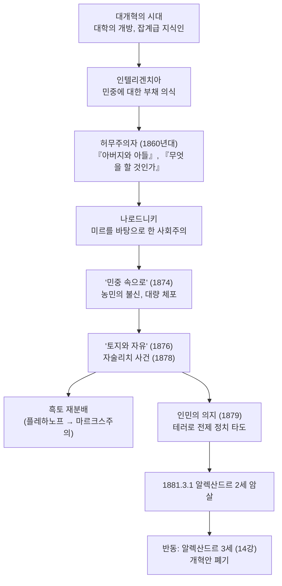

1881년 3월 1일 일요일 오후, 상트페테르부르크의 예카테리나 운하 가. 근위대 열병식을 보고 겨울 궁전으로 돌아가던 황제 **알렉산드르 2세**의 마차 밑으로 한 청년이 하얀 꾸러미를 던졌다. 폭발로 마차의 뒷부분이 부서지고 호위하던 카자크와 지나가던 소년이 쓰러졌다. 방탄 처리가 된 마차 안의 황제는 다치지 않았다. 그는 마차에서 내려 부상자들을 살피고, 붙잡힌 범인에게 다가갔다.

그때 운하 난간에 기대 서 있던 또 다른 청년이 황제의 발밑으로 두 번째 폭탄을 던졌다. 황제는 두 다리가 찢겨 나간 채 눈 위에 쓰러졌다. "춥다… 궁전으로 데려가라… 거기서 죽고 싶다." 그는 피를 쏟으며 겨울 궁전으로 옮겨졌고, 한 시간 남짓 뒤에 숨을 거두었다. 폭탄을 던진 청년도 그 자리에서 치명상을 입고 죽었다.

농노를 해방한 '해방 황제'를 죽인 것은 **'인민의 의지'**라는 비밀 혁명 조직이었다. 역설적이게도 그날 아침 황제는 내무 장관 로리스멜리코프가 올린 개혁안, 곧 사회 각계의 대표를 정부의 입법 논의에 참여시키는 계획을 승인한 참이었다. 사람들은 이것을 러시아 헌법의 첫걸음이라 불렀다. 그 계획은 황제의 죽음과 함께 사라졌다. 그가 쓰러진 자리에는 훗날 화려한 **'피의 구세주 교회'**가 세워졌다.

이 강의에서는 대개혁의 시대에 나타난 급진적인 지식인들, 곧 **인텔리겐치아**와 **나로드니키**(인민주의자)의 운동을 따라가며, 그것이 어떻게 황제 암살이라는 비극에 이르렀는지 살펴본다.

> [!핵심] 이 강의의 질문
> 1. '인텔리겐치아'란 누구이며, 그들은 무엇을 꿈꾸었는가?
> 2. 젊은이들은 왜 '민중 속으로' 들어갔고, 그 운동은 왜 실패했는가?
> 3. 혁명 운동은 왜 테러로 나아갔으며, 황제 암살은 러시아에 무엇을 가져왔는가?

```figure
src: asset:eafc4f8b030ff80f664f805e097014fa
caption: 알렉산드르 2세가 쓰러진 예카테리나 운하 가에 세운 '피 흘리신 구세주 성당'(1883~1907년 건립). 황제가 피를 흘린 바로 그 자리 위에 성당을 지었다.
credit: 오린 세이지 와이트먼 촬영, 1917년 · 미국 의회도서관 소장
license: Public Domain (미국 의회도서관: 출판 제한 없음)
source: https://www.loc.gov/item/2014646341/
```

## 인텔리겐치아

### 러시아만의 지식인 집단

**인텔리겐치아**라는 말은 1860년대 러시아에서 널리 쓰이기 시작해 세계 여러 언어로 퍼졌다. 단순히 교육받은 사람을 뜻하는 것이 아니었다. 인텔리겐치아는 국가와 사회의 불의에 맞서 민중을 위해 살아야 한다는 도덕적 의무감을 가진 비판적 지식인 집단을 가리켰다. 그들은 귀족 출신도 있었지만, 대개혁 뒤 대학이 열리면서 사제와 하급 관리, 상인의 자식 등 여러 신분 출신이 늘었다. 이들을 '잡계급 지식인'(라즈노친치)이라 불렀다.

러시아의 인텔리겐치아는 독특한 처지에 있었다. 그들은 유럽의 사상을 배웠지만, 그 사상을 펼칠 의회도 정당도 자유로운 언론도 없었다. 그리고 그들 아래에는 글을 읽지 못하는 거대한 농민 대중이 있었다. 1897년 러시아 최초의 근대적 인구 조사에서 글을 읽을 줄 아는 사람은 전체 인구의 5분의 1에 불과했다. 인텔리겐치아는 자신들이 누리는 교육과 문화가 그 민중의 노동 덕분이라는 '부채 의식'을 느꼈다.

```chart
{
  "type": "bar",
  "caption": "1897년 러시아 제국 인구 조사의 식자율 (%, 전체 인구 기준의 대략적인 수치). 글을 읽을 줄 아는 사람은 다섯 명 가운데 한 명꼴이었고, 농촌과 여성의 식자율은 특히 낮았다. 인텔리겐치아와 민중 사이에는 깊은 골이 있었다",
  "data": {
    "labels": ["전체", "남자", "여자", "도시", "농촌"],
    "datasets": [{ "label": "식자율 (%)", "data": [21, 29, 13, 45, 17] }]
  },
  "options": { "scales": { "y": { "min": 0, "max": 60 } }, "plugins": { "legend": { "display": false } } }
}
```

### 아버지와 아들

1862년 작가 **이반 투르게네프**는 소설 『아버지와 아들』을 펴냈다. 주인공 바자로프는 의학을 공부하는 젊은이로, 과학 말고는 어떤 권위도 믿지 않는다. 그는 예술도, 종교도, 귀족의 예절과 낭만적인 사랑도 쓸모없다며 비웃는다. 그는 스스로를 **'허무주의자'**(니힐리스트)라 부른다. "어떤 원칙도 믿음으로 받아들이지 않는 사람"이라는 뜻이었다. 이 말은 곧 기존 질서를 부정하는 1860년대의 급진적인 젊은이들을 가리키는 말이 되었다. 그들은 짧은 머리의 여학생, 푸른 안경, 거친 말투로 부모 세대를 놀라게 했다.

1863년에는 페트로파블롭스크 요새의 감옥에 갇혀 있던 비평가 **니콜라이 체르니솁스키**가 소설 『무엇을 할 것인가』를 펴냈다. 검열관이 별 내용 없는 연애 소설로 보고 통과시킨 이 책은 젊은이들의 교과서가 되었다. 소설 속의 여주인공 베라는 부모의 강요로 하는 결혼을 피해 독립하고, 여성들이 함께 일하고 이익을 나누는 바느질 협동조합을 만든다. 또 다른 인물 라흐메토프는 혁명을 위해 자기를 단련하려고 못을 박은 판자 위에서 잠을 자는 '새로운 인간'이다. 수많은 젊은이가 이 책을 읽고 삶을 바꾸었다. 40년 뒤 레닌은 자신의 책 제목을 똑같이 『무엇을 할 것인가』로 붙였다.

```figure
src: asset:a1235064011f1911786d1c5692246c25
caption: 이반 투르게네프. 『아버지와 아들』의 바자로프를 통해 '허무주의자'라는 말을 널리 퍼뜨렸다.
credit: 베젠베르크 사진관 촬영, 1880년 무렵 · 미국 의회도서관 소장
license: Public Domain (미국 의회도서관: 출판 제한 없음)
source: https://www.loc.gov/item/99615546/
width: narrow
```

### 도스토옙스키와 톨스토이

이 시대는 러시아 문학이 세계 문학의 정상에 오른 시대이기도 했다. 시베리아 유형(10강)에서 돌아온 **도스토옙스키**는 『죄와 벌』(1866)에서, 가난한 대학생 라스콜니코프가 '비범한 인간은 더 큰 목적을 위해 법을 넘어설 권리가 있다'는 생각으로 전당포 노파를 죽이고 괴로워하는 이야기를 썼다. 『악령』(1872)은 실제로 일어난 혁명 조직의 동지 살해 사건을 바탕으로, 목적을 위해 모든 수단을 정당화하는 혁명가들을 날카롭게 비판했다. 『카라마조프가의 형제들』(1880)을 마친 그는 황제가 암살되기 한 달 전인 1881년 1월 세상을 떠났다.

크림 전쟁에서 싸웠던 **톨스토이**(11강)는 『전쟁과 평화』(1869)와 『안나 카레니나』(1877)를 썼다. 그는 말년에 정교회와 국가, 사유 재산을 모두 거부하고 폭력에 대한 무저항과 단순한 농민의 삶을 설교해, 교회에서 파문당했다. 두 작가는 혁명가들과 다른 길에서 같은 질문을 던졌다. 러시아는, 그리고 인간은 어떻게 구원받을 수 있는가?

```gallery
src: asset:53c6aad0b56935f1d92973c7041b8885
caption: 스위스 출신 화가 펠릭스 발로통이 새긴 도스토옙스키 목판 초상. 작가가 죽고 14년 뒤 파리에서 만들었다.
credit: 펠릭스 발로통 목판화, 1895년 · 암스테르담 국립미술관 소장
license: Public Domain (레이크스 미술관: CC0)
source: https://www.rijksmuseum.nl/en/collection/RP-P-1923-220
---
src: asset:e4a0b1d895def396db85512249add7eb
caption: 야스나야 폴랴나의 서재에서 글을 쓰는 톨스토이(1908년 5월).
credit: 세르게이 프로쿠딘-고르스키 촬영, 1908년 · 미국 의회도서관 소장
license: Public Domain (미국 의회도서관: 출판 제한 없음)
source: https://www.loc.gov/item/2018679015/
```

## 민중 속으로

### 나로드니키

1860~1870년대 러시아 혁명 운동의 주류는 **나로드니키**(인민주의자)였다. '나로드'는 러시아어로 '민중', 특히 농민을 뜻한다. 나로드니키는 10강에서 본 게르첸의 생각을 이었다. 러시아는 서유럽처럼 자본주의와 공장 노동자의 비참함을 거치지 않고도, 농민 공동체 **미르**를 바탕으로 곧바로 사회주의로 나아갈 수 있다는 것이다. 미르에서는 땅을 공동으로 소유하고 함께 나누니, 농민은 본래 사회주의자라는 생각이었다.

나로드니키 안에는 여러 흐름이 있었다. 철학자 **표트르 라브로프**는 지식인이 민중에게 진 빚을 갚으려면 먼저 민중을 가르치고 의식을 깨워야 한다고 했다. 무정부주의자 **미하일 바쿠닌**은 농민은 이미 반란의 본능을 지니고 있으니 불씨만 던지면 된다고 했다. **표트르 트카초프**는 소수의 잘 조직된 혁명가들이 권력을 장악해야 한다고 했다. 1869년에는 세르게이 네차예프가 「혁명가의 교리 문답」에서 "혁명가는 운명이 정해진 사람이다. 그에게는 개인적인 이익도, 감정도, 이름도 없다"며 혁명을 위해서라면 어떤 수단도 정당하다고 주장했다. 그는 조직을 떠나려던 동지를 살해했고, 이 사건이 도스토옙스키의 『악령』의 소재가 되었다.

### 1874년의 '미친 여름'

1874년 봄과 여름, 수천 명의 젊은 학생들이 도시를 떠나 농촌으로 들어갔다. 이 운동을 **'브 나로드'**('민중 속으로')라 부른다. 그들은 농민의 옷을 입고, 대장장이나 목수, 교사, 간호사로 일하며 농민들에게 다가갔다. 농민들에게 글을 가르치고 사회주의를 설명하며, 차르와 지주에 맞서 일어나라고 호소했다. 귀족의 딸들도 집을 떠나 시골 학교의 교사가 되었다.

결과는 참담했다. 농민들은 도시에서 온 낯선 젊은이들을 의심했다. 그들의 말을 알아듣지 못하거나, 차르를 욕하는 말에 화를 내며 경찰에 넘겼다. 농민들은 여전히 '착한 차르'를 믿었고, 자신들의 불행은 나쁜 지주와 관리 탓이라고 생각했다. 그해 1,000명이 넘는 젊은이가 체포되었다. 1877~1878년 그 가운데 193명이 재판을 받았는데(193인 재판), 재판 전에 수십 명이 감옥에서 병들어 죽거나 미쳤다.

## 테러로

### '토지와 자유'와 베라 자술리치

'민중 속으로'의 실패를 겪은 나로드니키는 1876년 더 조직적인 비밀 결사 **'토지와 자유'**를 만들었다. 그들은 농촌에 오래 머물며 활동하는 한편, 정부의 탄압에 맞서기 시작했다.

1878년 1월 24일, 스물여덟 살의 여성 **베라 자술리치**가 상트페테르부르크 경찰청장 트레포프의 집무실에 들어가 권총을 쏘아 그에게 부상을 입혔다. 트레포프가 감옥에서 자신에게 모자를 벗지 않았다는 이유로 정치범 학생을 매질하게 한 데 대한 복수였다. 그녀는 도망치지 않고 체포되었다. 정부는 그녀를 12강에서 본 새로운 배심원 재판에 넘겼다. 변호사는 그녀를 불의에 맞선 양심의 상징으로 그렸고, 배심원들은 무죄를 선고했다. 법정을 가득 메운 사람들은 환호했고, 법원 밖의 군중은 그녀를 어깨에 메고 나갔다. 정부는 이후 정치범 재판을 군사 법정으로 넘겼다.

### '인민의 의지'

1879년 '토지와 자유'는 둘로 갈라졌다. 농촌에서의 선전을 계속하자는 쪽은 **'흑토 재분배'**를 만들었다. 그 지도자 게오르기 플레하노프는 훗날 러시아 최초의 마르크스주의자가 된다(14강). 정치 투쟁과 테러로 전제 정치를 무너뜨려야 한다는 쪽은 **'인민의 의지'**를 만들었다. 그들은 황제를 죽이면 체제 전체가 흔들리고 혁명이 시작될 것이라 믿었다.

1879년 8월 '인민의 의지'의 집행 위원회는 알렉산드르 2세에게 '사형 선고'를 내렸다. 그 뒤 1년 반 동안 황제를 향한 시도가 잇달았다. 1879년 11월에는 황제가 탄 기차를 철로 밑에 묻은 폭탄으로 폭파하려 했지만, 엉뚱한 기차가 폭발했다. 1880년 2월에는 겨울 궁전에 목수로 숨어든 스테판 할투린이 황제의 식당 바로 아래층에 다이너마이트를 터뜨렸다. 황제는 손님을 맞느라 식당에 늦게 들어가 무사했지만, 아래층의 근위병 11명이 죽었다.

| 연도 | 사건 |
|---|---|
| 1866 | 대학생 카라코조프가 여름 정원에서 황제에게 총을 쏨 (실패) |
| 1867 | 파리 방문 중 폴란드 망명자가 총을 쏨 (실패) |
| 1879.4 | 교사 출신 솔로비요프가 궁전 앞 광장에서 황제에게 다섯 발을 쏨 (실패) |
| 1879.11 | '인민의 의지', 모스크바 근처에서 황제의 기차 폭파 시도 (다른 기차가 폭발) |
| 1880.2 | 할투린, 겨울 궁전 식당 아래층 폭파 (근위병 11명 사망) |
| 1881.3.1 | 예카테리나 운하에서 폭탄 공격, 황제 사망 |

표: 알렉산드르 2세 암살 시도

### '마음의 독재'와 3월 1일

겨울 궁전 폭파 사건 뒤 황제는 아르메니아 출신의 장군 **로리스멜리코프**에게 비상 권한을 주었다. 그는 혁명가들은 엄하게 다스리되, 온건한 사회 세력은 개혁으로 끌어안는 정책을 폈다. 검열을 늦추고, 미움받던 제3부를 없애 경찰을 내무부 아래로 옮겼다. 사람들은 이를 '마음의 독재'라 불렀다. 1881년 초 그는 젬스트보와 시 의회의 대표를 뽑아 법안 논의에 참여시키자는 안을 올렸다. 3월 1일 아침 황제는 이 안을 승인했다.

그러나 '인민의 의지'는 이미 준비를 마쳐 놓고 있었다. 암살을 지휘한 것은 귀족 집안 출신의 스물일곱 살 여성 **소피야 페롭스카야**였다. 그녀의 아버지는 한때 상트페테르부르크 현 지사였다. 원래 지휘를 맡았던 그녀의 연인 젤랴보프가 이틀 전 체포되자, 그녀는 계획을 그대로 밀고 나갔다. 황제의 마차가 평소 다니던 길 대신 운하 쪽으로 돌자, 그녀가 손수건을 흔들어 폭탄을 든 동지들에게 신호를 보냈다.

```gallery
src: asset:22601d2cf4a230c311ed8db6e679519e
caption: 비계에 둘러싸인 채 짓고 있던 피 흘리신 구세주 성당(1897년 7월).
credit: 작자 미상 환등 슬라이드, 1897년 · 미국 의회도서관 소장
license: Public Domain (미국 의회도서관: 출판 제한 없음)
source: https://www.loc.gov/item/2011660319/
---
src: asset:c2a8953ba4225e6796a0a5d050004c9c
caption: 미국 잡지 『퍽』의 만평(1883). 횃불을 든 '허무주의자'와 사회주의자들이 유럽 군주국들의 숲으로 달려가고, 러시아는 곰으로 그려져 있다. 황제 암살 뒤 바깥 세계가 러시아 혁명가들을 어떻게 보았는지 보여 준다.
credit: 프리드리히 그레츠 그림, 1883년 · 미국 의회도서관 소장
license: Public Domain (미국 의회도서관: 출판 제한 없음)
source: https://www.loc.gov/item/2012645458/
```

### 그 뒤

암살 뒤에도 혁명은 일어나지 않았다. 민중은 들고일어나지 않았고, 오히려 많은 농민은 귀족들이 농노를 해방한 황제에게 복수했다고 믿었다. 1881년 4월 3일 페롭스카야, 젤랴보프, 그리고 폭탄을 만든 화학자 키발치치를 포함한 다섯 명이 상트페테르부르크의 세묘노프스키 연병장에서 수만 명의 군중 앞에 교수형을 당했다. 페롭스카야는 러시아에서 정치범으로 처형된 첫 여성이었다. 키발치치는 처형을 기다리는 감옥에서 사람이 탈 수 있는 로켓 비행 장치의 설계도를 그렸다. 그 설계도는 혁명 뒤에야 문서 보관소에서 발견되었다.

'인민의 의지'는 곧 경찰에 의해 거의 뿌리 뽑혔다. 새 황제 **알렉산드르 3세**는 아버지의 개혁을 되돌리는 반동 정치를 폈다. 로리스멜리코프의 개혁안은 버려졌고, 헌법은 다시 먼 이야기가 되었다. 혁명가들의 테러는 체제를 무너뜨리는 대신 더 단단한 전제 정치를 불러왔다(14강). 그러나 테러의 전통은 사라지지 않았다. 6년 뒤 '인민의 의지'의 뒤를 이은 한 학생 모임이 알렉산드르 3세 암살을 꾸미다 붙잡혔다. 처형된 다섯 명 가운데 스물한 살의 대학생 **알렉산드르 울랴노프**가 있었다. 그의 열일곱 살 동생 블라디미르는 훗날 '레닌'이라는 이름으로 역사에 나타난다.



## 정리

> [!핵심] 13강 요약
> - **인텔리겐치아**는 민중에 대한 도덕적 의무감을 지닌 러시아의 비판적 지식인 집단이었다. 대개혁 뒤 여러 신분 출신의 **잡계급 지식인**이 늘었다.
> - 1860년대에는 투르게네프의 『아버지와 아들』이 그린 **허무주의자**와 체르니솁스키의 『무엇을 할 것인가』가 젊은이들을 사로잡았다. 도스토옙스키와 톨스토이는 다른 길에서 러시아의 구원을 물었다.
> - **나로드니키**는 농촌 공동체 미르를 바탕으로 자본주의를 건너뛰는 사회주의를 꿈꾸었다. 1874년의 **'민중 속으로'** 운동은 농민의 불신과 대량 체포로 끝났다.
> - **'토지와 자유'**(1876)는 1879년 '흑토 재분배'와 **'인민의 의지'**로 갈라졌다. '인민의 의지'는 테러로 전제 정치를 무너뜨리려 했다.
> - 1881년 3월 1일 **알렉산드르 2세가 암살**되었다. 그날 아침 그는 제한적인 대의 기구 안을 승인했었다. 암살은 혁명 대신 **반동**을 불러왔다.

### 생각해 볼 질문

1. 농민을 해방한 황제를 혁명가들은 왜 죽이려 했을까? 혁명가들은 대개혁을 어떻게 평가했을까?
2. '민중 속으로' 들어간 젊은이들은 왜 농민의 마음을 얻지 못했을까? 지식인과 민중 사이의 거리는 어떻게 좁힐 수 있을까?
3. 목적이 정당하면 어떤 수단도 정당화될 수 있을까? 네차예프와 도스토옙스키의 생각을 비교해 보자.

### 다음 강 예고

14강 「알렉산드르 3세와 산업화」에서는 아버지의 죽음을 지켜본 알렉산드르 3세의 반동 정치와 러시아화 정책, 유대인 학살(포그롬)과 대규모 이주, 그리고 재무 장관 비테가 이끈 급속한 산업화와 시베리아 횡단 철도, 노동자 계급과 마르크스주의의 등장을 살펴본다.
