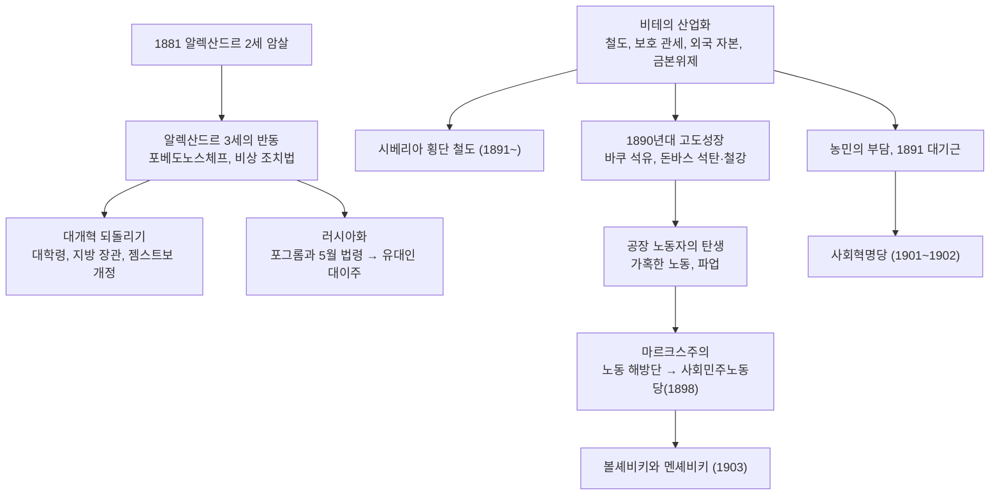

1891년 5월 19일(그레고리력 5월 31일), 동해 연안의 항구 도시 블라디보스토크. 스물세 살의 러시아 황태자 **니콜라이**가 삽으로 흙을 퍼 손수레에 담고, 그것을 몇 걸음 밀고 가서 새로 닦은 철길 둑 위에 부었다. 이어 그는 기차역의 첫 주춧돌을 놓았다. 지구 둘레의 4분의 1에 이르는 9,000킬로미터 넘는 길이로 모스크바와 태평양을 잇는 **시베리아 횡단 철도**의 동쪽 공사가 이렇게 시작되었다.

황태자는 9개월에 걸친 아시아 여행의 마지막 길이었다. 그는 이집트, 인도, 실론, 싱가포르, 자바, 사이공, 중국을 거쳐 일본에 들렀다. 그런데 블라디보스토크에 오기 직전, 일본의 오쓰에서 경비를 서던 일본인 순사가 갑자기 칼을 휘둘러 황태자의 머리에 상처를 입혔다. 이 '오쓰 사건'으로 니콜라이는 머리에 흉터와 함께 일본에 대한 깊은 불신을 안고 돌아왔다고 한다. 그가 첫 삽을 뜬 철도는 13년 뒤, 바로 그 일본과의 전쟁에서 러시아군을 실어 나르게 된다(15강).

1881년 아버지가 암살당하는 것을 지켜본 **알렉산드르 3세**(재위 1881~1894)는 정치에서는 개혁의 시대를 끝내고 철저한 반동으로 돌아섰다. 그러나 경제에서는 러시아를 세계에서 가장 빠르게 성장하는 산업 국가 가운데 하나로 만들었다. 이 강의에서는 알렉산드르 3세와 그 아들 니콜라이 2세 초기의 러시아를 살펴본다. 낡은 전제 정치와 새로운 산업 사회가 한 나라 안에서 부딪치기 시작한 시대다.

> [!핵심] 이 강의의 질문
> 1. 알렉산드르 3세는 어떤 정치를 폈으며, 러시아화 정책과 유대인 정책은 무엇을 낳았는가?
> 2. 비테의 산업화 정책은 무엇이었으며, 러시아 경제를 어떻게 바꾸었는가?
> 3. 산업화는 어떤 새로운 사회 집단과 사상을 낳았는가?

{{F:r14-opening}}

## 반동의 정치

### 포베도노스체프와 '흔들림 없는 전제'

알렉산드르 3세는 키가 크고 힘이 세서 맨손으로 말굽을 편다는 소문이 있을 만큼 건장했고, 소박하고 엄격한 성격이었다. 그의 스승이자 가장 가까운 조언자는 신성 종무원의 총감(3강) **콘스탄틴 포베도노스체프**였다. 그는 의회 민주주의를 "우리 시대의 가장 큰 거짓"이라 부르고, 언론의 자유와 배심원 재판, 대중 교육을 혐오했다. 그는 러시아가 살아남으려면 정교회 신앙과 전제 정치로 민중을 단단히 묶어 두어야 한다고 믿었다.

즉위 두 달 뒤인 1881년 4월, 알렉산드르 3세는 포베도노스체프가 쓴 선언문을 발표해 "전제 권력의 힘과 진리를 믿으며 이를 지키겠다"고 밝혔다. 로리스멜리코프의 개혁안(13강)은 버려졌고, 개혁파 장관들은 물러났다. 그해 8월에는 **'국가 질서 유지를 위한 조치에 관한 법'**이 나왔다. 정부가 어느 지역이든 '비상 상황'을 선포하면 재판 없이 사람을 체포하고 유배하며, 신문과 학교를 닫을 수 있게 하는 법이었다. '임시 조치'로 만든 이 법은 1917년까지 36년 동안 계속 효력을 가졌다.

### 대개혁 되돌리기

알렉산드르 3세의 정부는 아버지의 대개혁(12강)을 하나씩 거꾸로 돌렸다.

- **1884년 대학령**: 대학 자치를 없애고 교수 임명과 교육 내용을 정부가 통제했다.
- **1887년 '요리사의 자식' 회람**: 교육부 장관이 중등학교 교장들에게 '마부, 하인, 요리사, 세탁부, 작은 가게 주인 같은 사람의 자식'은 입학시키지 말라는 회람을 보냈다.
- **1889년 지방 장관 제도**: 귀족 출신의 '지방 장관'이 농민의 자치와 재판을 감독하며 농민을 처벌할 권한을 가졌다.
- **1890년 젬스트보 개정**: 젬스트보 선거에서 귀족의 비중을 늘리고 농민의 대표권을 줄였다.

### 러시아화와 유대인 박해

알렉산드르 3세 시대의 또 다른 특징은 **러시아화** 정책이었다. 러시아 제국 인구의 절반 가까이는 러시아인이 아니었다. 정부는 제국을 '하나의 차르, 하나의 신앙, 하나의 언어'로 묶으려 했다. 발트 지역의 독일인 학교, 폴란드의 학교와 관청에서 러시아어를 강요했고, 1876년부터 우크라이나어로 된 책의 출판을 사실상 금지했다. 정교회가 아닌 종교는 차별받았다.

가장 큰 고통을 겪은 것은 **유대인**이었다. 6강에서 본 대로 러시아 제국의 유대인은 서부의 '정착 구역'에 묶여 살았다. 알렉산드르 2세가 암살된 뒤 암살범 가운데 유대인 여성이 있었다는 소문이 돌자, 1881~1882년 우크라이나 남부를 중심으로 200곳이 넘는 도시와 마을에서 유대인의 집과 가게를 부수고 사람들을 해치는 폭동이 일어났다. 이런 폭동을 러시아어로 **포그롬**이라 한다. 정부는 폭동을 막기는커녕 오히려 유대인이 원인을 제공했다며, 1882년 '5월 법령'으로 유대인이 농촌에 새로 정착하거나 땅을 사는 것을 금지했다. 1887년부터는 중학교와 대학에 입학할 수 있는 유대인의 비율을 제한했고, 1891년에는 모스크바에 살던 유대인 2만여 명을 쫓아냈다.

박해를 피해 1881년부터 1914년까지 200만 명이 넘는 유대인이 러시아 제국을 떠났다. 대부분은 미국으로 갔다. 뉴욕의 이민자 거리에는 이디시어 신문과 극장이 생겼다. 일부는 오스만 제국의 땅이던 팔레스타인으로 가서 정착촌을 세웠는데, 이것은 시오니즘 운동의 한 뿌리가 되었다. 남은 유대인 젊은이들 가운데 많은 수가 혁명 운동에 뛰어들었다.

{{F:r14-repression}}

### 평화의 황제

알렉산드르 3세는 13년 동안 한 번도 전쟁을 하지 않아 '평화를 만든 황제'라고 불렸다. 그는 독일이 오스트리아와 손잡고 발칸에서 러시아와 맞서자, 공화국인 프랑스와 손을 잡았다. 1891년 프랑스 함대가 크론시타트에 오자, 황제는 혁명의 노래로 금지되어 있던 「라 마르세예즈」를 모자를 벗고 서서 들었다. 1894년 **러시아-프랑스 동맹**이 맺어졌다. 이 동맹은 훗날 제1차 세계대전의 두 진영 가운데 하나의 기둥이 된다(18강).

## 비테와 산업화

### 늦게 출발한 나라의 산업화

크림 전쟁(11강)과 농노 해방(12강) 이후 러시아에서도 철도와 공장이 늘기 시작했지만, 서유럽에 비하면 크게 뒤처져 있었다. 알렉산드르 3세와 니콜라이 2세의 정부는 국가가 앞장서서 산업화를 이끌기로 했다. 그 중심에 1892년부터 1903년까지 재무 장관을 지낸 **세르게이 비테**가 있었다. 그는 철도 회사의 매표원으로 시작해 사장이 된 철도 전문가였다.

비테의 정책은 다음과 같았다.

| 정책 | 내용 |
|---|---|
| 철도 건설 | 국가가 직접 철도를 짓거나 사들였다. 철도는 시장을 넓히고 철과 석탄 수요를 만들어 다른 산업을 끌어올렸다 |
| 보호 관세 | 1891년 세계에서 가장 높은 수준의 관세로 외국 공산품의 수입을 막아 국내 산업을 보호했다 |
| 외국 자본 유치 | 프랑스, 벨기에, 영국, 독일의 자본을 끌어들였다. 1900년 무렵 러시아 산업 투자의 상당 부분이 외국 자본이었다 |
| 금본위제 (1897) | 루블을 금으로 바꿀 수 있게 해 화폐 가치를 안정시키고 외국 투자자의 신뢰를 얻었다 |
| 재정 | 보드카의 판매를 국가가 독점해(1894) 막대한 수입을 얻고, 곡물을 수출해 외화를 벌었다 |

표: 비테의 산업화 정책

비테는 러시아가 서유럽의 '식민지'가 되지 않으려면 빨리 산업 국가가 되어야 한다고 생각했다. 그러나 그 비용은 주로 농민이 치렀다. 높은 관세 때문에 농민은 공산품을 비싸게 사야 했고, 정부는 세금과 곡물 수출을 위해 농민을 쥐어짰다. 1891~1892년 볼가강 유역에 큰 흉년이 들었을 때도 정부는 한동안 곡물 수출을 멈추지 않았다. 이 기근과 뒤이은 콜레라로 수십만 명이 죽었다. 톨스토이는 직접 기근 지역에 가서 무료 급식소를 열었다.

### 시베리아 횡단 철도

비테가 가장 공을 들인 사업이 **시베리아 횡단 철도**였다. 1891년 첫 삽을 뜬 이 철도는 서쪽의 첼랴빈스크와 동쪽의 블라디보스토크에서 동시에 공사를 시작했다. 수만 명의 노동자가 타이가의 숲과 늪, 영구 동토층을 뚫고 강마다 다리를 놓았다. 세계에서 가장 깊은 호수인 바이칼호 주변의 험한 산길은 처음에는 배로 열차를 실어 날랐는데, 겨울에는 얼음 위에 임시 철로를 깔기도 했다. 1904년 바이칼 우회 노선이 완성되며 모스크바에서 태평양까지 열차가 다닐 수 있게 되었다. 러시아 땅으로만 이어지는 아무르 노선까지 모두 완성된 것은 1916년이었다.

비테는 처음에 철도를 만주를 가로질러 블라디보스토크로 곧장 잇는 지름길을 원했다. 1896년 청나라에서 만주를 지나는 **동청 철도**의 부설권을 얻어 낸 것이 그 결과였다. 이 철도와 함께 러시아의 세력은 만주와 한반도로 뻗어 나갔다(15강).

```chart
{
  "type": "line",
  "caption": "러시아 제국의 철도 길이 (천 km, 1860~1913년, 대략적인 수치). 크림 전쟁 무렵 1,000km 남짓이던 철도는 1870년대와 1890년대 두 차례의 건설 붐을 거치며 1913년 7만 km를 넘었다. 시베리아 횡단 철도는 그 가운데 9,000km가 넘는다",
  "data": {
    "labels": ["1860", "1870", "1880", "1890", "1900", "1905", "1913"],
    "datasets": [{ "label": "철도 길이 (천 km)", "data": [1.6, 10.7, 22.9, 30.6, 53.2, 61.1, 70.2] }]
  },
  "options": { "scales": { "y": { "min": 0 } }, "plugins": { "legend": { "display": false } } }
}
```

### 석유, 석탄, 철강

1890년대 러시아의 공업 생산은 해마다 평균 8% 안팎으로 늘었다. 당시 세계에서 가장 빠른 성장 가운데 하나였다. 카스피해 연안의 **바쿠**에서는 스웨덴 출신의 노벨 형제(다이너마이트를 발명한 알프레드 노벨의 형들)와 프랑스의 로스차일드 가문이 유전을 개발했다. 1900년 무렵 러시아는 잠시 미국을 제치고 세계 최대의 석유 생산국이 되었다. 우크라이나의 **돈바스**에서는 석탄이 쏟아져 나왔고, 웨일스 출신 기업가 존 휴스가 세운 제철소 주변에 '유조프카'(지금의 도네츠크)라는 도시가 생겼다. 상트페테르부르크의 푸틸로프 공장과 모스크바의 섬유 공장은 수만 명의 노동자를 거느렸다.

{{F:r14-industry}}

## 새로운 사회

### 노동자의 탄생

산업화는 러시아에 새로운 사회 집단, 곧 **공장 노동자**를 만들었다. 1900년 무렵 러시아의 공장 노동자는 200만~300만 명이었다. 인구 전체에 비하면 적었지만, 그들은 몇몇 대도시와 거대한 공장에 집중되어 있었다. 대부분은 농촌에서 일자리를 찾아 올라온 농민이었고, 많은 사람이 여전히 고향 마을의 미르(12강)에 땅과 가족을 두고 있었다.

노동 조건은 가혹했다. 하루 12~14시간 일하는 것이 보통이었고, 임금은 낮았으며, 노동자들은 공장 기숙사의 좁은 방이나 지하실에서 수십 명씩 함께 살았다. 벌금이 임금의 상당 부분을 떼어 갔다. 노동조합과 파업은 불법이었다. 1896년 상트페테르부르크의 섬유 노동자 3만 명이 대규모 파업을 벌이자, 정부는 이듬해 공장 노동 시간을 하루 11시간 반으로 제한하는 법을 만들었다.

### 마르크스주의의 등장

나로드니키(13강)는 러시아가 자본주의를 건너뛸 수 있다고 믿었다. 그러나 1880~1890년대 러시아에서 자본주의가 빠르게 자라는 것을 보며, 일부 혁명가들은 카를 마르크스의 이론으로 돌아섰다. 마르크스주의에 따르면 역사는 생산 방식에 따라 단계적으로 발전하며, 자본주의가 발전하면 공장 노동자, 곧 **프롤레타리아트**가 혁명의 주역이 되어 사회주의를 이룬다.

1883년 스위스 제네바에서 '토지와 자유' 출신의 **게오르기 플레하노프**(13강)가 러시아 최초의 마르크스주의 단체 '노동 해방단'을 만들었다. 1895년 상트페테르부르크에서는 젊은 마르크스주의자들이 '노동 계급 해방 투쟁 동맹'을 만들었는데, 그 지도자 가운데 형을 처형으로 잃은(13강) 스물다섯 살의 변호사 **블라디미르 울랴노프**가 있었다. 그는 곧 체포되어 시베리아로 유배되었고, 유배에서 풀려난 뒤인 1901년부터 '레닌'이라는 필명을 쓰기 시작했다.

1898년 민스크에서 **러시아 사회민주노동당**이 창당되었다. 1903년 런던에서 열린 제2차 당 대회에서 당은 둘로 갈라졌다. 레닌은 소수의 직업 혁명가들로 이루어진 규율 있는 전위 정당을 주장했고, 마르토프는 더 넓게 열린 대중 정당을 원했다. 한 표결에서 레닌의 편이 다수가 되자, 레닌은 자기 쪽을 **'볼셰비키'**(다수파), 상대를 **'멘셰비키'**(소수파)라 불렀다. 실제로는 볼셰비키가 소수인 때가 많았지만, 이 이름은 그대로 굳었다. 한편 나로드니키의 전통을 이은 사람들은 1901~1902년 농민을 기반으로 한 **사회혁명당**을 만들었다.



## 마지막 황제

1894년 10월 알렉산드르 3세가 마흔아홉 살에 신장병으로 갑자기 죽었다. 스물여섯 살의 아들 **니콜라이 2세**가 제위에 올랐다. 그는 다정하고 예의 바른 가정적인 사람이었지만, 아버지의 그늘에서 자라 정치에 자신이 없었다. 그는 즉위하자마자 독일 헤센 공국의 공녀 알릭스(정교회 이름 **알렉산드라**)와 결혼했다.

1895년 1월 니콜라이는 젬스트보 대표들 앞에서 첫 연설을 했다. 일부 젬스트보가 정치에 참여하고 싶다는 뜻을 밝히자, 그는 이를 "무의미한 꿈"이라 부르며 "아버지처럼 전제의 원칙을 굳게 지키겠다"고 했다. 개혁을 바라던 사람들은 크게 실망했다.

1896년 5월 모스크바에서 대관식이 열렸다. 축하 행사로 교외의 호딘카 들판에서 선물을 나누어 준다는 소식에 수십만 명이 몰려들었다. 새벽에 선물이 바닥난다는 소문이 돌자 군중이 한꺼번에 밀려들었고, 들판의 참호와 구덩이에 사람들이 쓰러져 짓밟혔다. 1,300명 넘게 죽었다. 그날 저녁 황제 부부는 예정대로 프랑스 대사관의 무도회에 참석했다. 사람들은 이를 불길한 징조로 여겼다. 22년 뒤 그는 러시아의 마지막 황제로서 가족과 함께 총살된다(1강).

> [!참고] 러시아 근대 경제의 모순
> 1913년 러시아는 공업 생산에서 미국, 독일, 영국, 프랑스에 이은 세계 5위 안팎의 나라가 되었다. 그러나 1인당 소득은 서유럽의 몇 분의 1에 불과했고, 인구의 80% 가까이는 여전히 농민이었다. 세계 최대 규모의 공장들과 중세처럼 쟁기질하는 농촌, 유럽 최고 수준의 문학과 음악과 인구 다수의 문맹이 한 나라 안에 함께 있었다. 이 '불균등한 발전'은 러시아 혁명을 이해하는 열쇠 가운데 하나다.

## 정리

> [!핵심] 14강 요약
> - **알렉산드르 3세**는 포베도노스체프의 영향 아래 '흔들림 없는 전제'를 선언하고, **비상 조치법**과 대학령, 지방 장관 제도, 젬스트보 개정으로 대개혁을 되돌렸다.
> - **러시아화** 정책이 펼쳐졌고, 1881~1882년 **포그롬** 뒤 5월 법령 등 유대인 차별이 강화되어 200만 명 넘는 유대인이 러시아를 떠났다.
> - 대외적으로는 전쟁 없이 **러시아-프랑스 동맹**(1894)을 맺었다.
> - 재무 장관 **비테**는 철도 건설, 보호 관세, 외국 자본, **금본위제**(1897)로 급속한 산업화를 이끌었다. **시베리아 횡단 철도**(1891~)가 놓이고, 바쿠의 석유와 돈바스의 석탄·철강이 성장했다. 그 부담은 농민에게 돌아갔다.
> - 산업화는 **공장 노동자**를 낳았고, 플레하노프와 레닌의 **마르크스주의**가 퍼졌다. 1898년 사회민주노동당이 생겼고, 1903년 **볼셰비키**와 **멘셰비키**로 갈라졌다.
> - 1894년 즉위한 **니콜라이 2세**는 전제 정치를 지키겠다고 선언했고, 대관식에서는 호딘카 참사가 일어났다.

### 생각해 볼 질문

1. 정치적 반동과 경제적 근대화가 동시에 진행될 수 있을까? 알렉산드르 3세 시대의 러시아와 비슷한 다른 나라의 예를 생각해 보자.
2. 비테의 산업화 비용을 농민이 치렀다는 것은 무슨 뜻일까? 국가가 주도하는 산업화의 장점과 단점을 생각해 보자.
3. 러시아의 혁명가들은 왜 농민(나로드니키)에서 노동자(마르크스주의)로 눈을 돌렸을까?

### 다음 강 예고

15강 「러시아의 동방 진출과 조선」에서는 블라디보스토크 건설에서 시작해 조러 수교, 거문도 사건, 아관파천과 러시아 공사관, 뤼순 조차와 만주 진출, 그리고 1904~1905년 러일전쟁까지, 러시아의 동방 정책과 그것이 조선(대한제국)의 운명에 미친 영향을 살펴본다.
