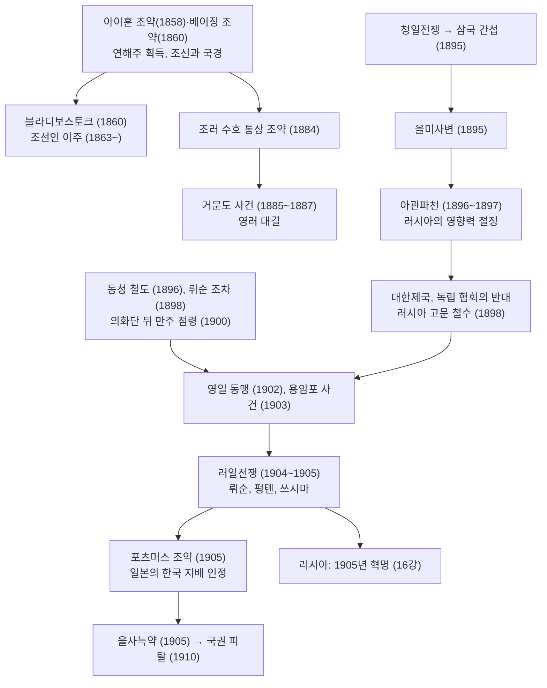

1896년 2월 11일 새벽, 서울 경복궁. 아직 어둠이 걷히지 않은 궁궐 문을 궁녀들이 타는 가마 두 채가 조용히 빠져나갔다. 가마 안에는 궁녀 대신 조선의 국왕 **고종**과 왕세자(훗날의 순종)가 타고 있었다. 가마는 서대문 쪽으로 향해, 정동 언덕 위에 하얀 탑을 세운 **러시아 공사관**으로 들어갔다. 넉 달 전 일본인들이 경복궁에 쳐들어와 왕비를 살해한 을미사변 이후, 일본의 감시 아래 갇혀 지내던 국왕이 외국 공사관으로 몸을 피한 것이다. 이 사건이 **아관파천**(俄館播遷)이다. '아관'은 러시아(아라사, 俄羅斯) 공사관을 뜻한다.

고종은 1년 동안 러시아 공사관에 머물며 나라를 다스렸다. 그동안 조선 정부에는 러시아의 군사 교관과 재정 고문이 들어왔다. 이 1년은 러시아가 한반도에서 가장 큰 영향력을 가진 시기였다. 그러나 8년 뒤 러시아는 바로 한반도와 만주를 두고 일본과 전쟁을 벌여 졌고, 그해 가을 대한제국은 일본에 외교권을 빼앗겼다.

이 강의에서는 러시아가 시베리아를 넘어 태평양에 이르고, 조선과 국경을 맞대고, 만주와 한반도를 두고 일본과 충돌하기까지의 과정을 살펴본다. 러시아 근대사의 한 장(章)이면서, 동시에 한국 근대사의 한 장이기도 한 이야기다.

> [!핵심] 이 강의의 질문
> 1. 러시아는 어떻게 동아시아로 진출했으며, 조선과 어떤 관계를 맺었는가?
> 2. 아관파천 이후 러시아는 대한제국에서 어떤 역할을 했는가?
> 3. 러일전쟁은 왜 일어났으며, 러시아와 대한제국에 무엇을 남겼는가?

```figure
src: asset:28742aa68f4a502fd045e8c9ee49c6d4
caption: 러시아 공사관 쪽에서 내려다본 1895년의 서울. 초가와 기와지붕 너머로 북악산이 보인다. 이듬해 고종이 이 공사관으로 옮겨 온다.
credit: 윌리엄 헨리 잭슨 촬영, 1895년 · 미국 의회도서관 소장
license: Public Domain (미국 의회도서관: 출판 제한 없음)
source: https://www.loc.gov/item/2004707502/
width: wide
```

## 태평양으로

### 흑룡강과 연해주

1강에서 본 것처럼 17세기 러시아의 카자크들은 흑룡강(아무르강)까지 내려왔다가 청나라와 조선 조총군에 밀려났고, 1689년 네르친스크 조약(2강)으로 흑룡강 유역에서 물러났다. 그 뒤 150년 넘게 러시아는 이 지역에 손을 대지 못했다. 상황이 바뀐 것은 19세기 중엽 청나라가 아편전쟁과 태평천국 운동으로 크게 흔들리면서였다.

1847년 동시베리아 총독이 된 **무라비요프**는 흑룡강 하구를 탐사하고 군대를 보내 사실상 이 지역을 차지했다. 1858년 아이훈 조약으로 청은 흑룡강 북쪽을 러시아에 넘겼다. 무라비요프는 이 공으로 '아무르스키'라는 칭호를 받았다. 1860년 영국·프랑스 연합군이 베이징을 점령하자, 러시아는 청과 영불 사이를 중재해 준 대가로 **베이징 조약**을 맺어 우수리강 동쪽의 **연해주**까지 얻었다. 크림 전쟁에서 진 러시아가, 같은 시기 아시아에서는 피 한 방울 흘리지 않고 한반도보다 넓은 땅을 손에 넣은 것이다.

이로써 러시아는 두만강 하구의 약 17킬로미터 구간에서 조선과 국경을 맞대게 되었다. 1860년 러시아는 연해주 남쪽 끝의 만에 군항을 세우고 **블라디보스토크**라 이름 지었다. '동방을 지배하라'는 뜻이다.

### 연해주의 조선인

국경이 생기자 곧 사람들이 그 국경을 넘었다. 1863년 무렵부터 함경도의 가난한 농민들이 두만강을 건너 연해주로 이주하기 시작했다. 1869년 함경도에 큰 흉년이 들자 수천 명이 한꺼번에 넘어갔다. 러시아 당국은 처음에 이들이 빈 땅을 개척하는 것을 반겼다. 조선인들은 연해주에 마을을 이루고 벼농사를 지었으며, 일부는 정교회로 개종하고 러시아 국적을 얻었다. 이들이 오늘날 중앙아시아와 러시아에 사는 **고려인**의 뿌리다.

```chart
{
  "type": "line",
  "caption": "러시아 극동의 조선인 인구 (만 명, 1902~1926년, 러시아 측 통계를 바탕으로 한 대략적인 수치). 1905년 을사늑약과 1910년 국권 피탈 이후 일제의 지배를 피해 건너간 사람이 크게 늘었다. 1926년 소련 인구 조사에서 극동의 조선인은 약 17만 명이었다. 이들은 1937년 스탈린에 의해 중앙아시아로 강제 이주되었다",
  "data": {
    "labels": ["1902", "1910", "1917", "1923", "1926"],
    "datasets": [{ "label": "조선인 인구 (만 명)", "data": [3.2, 5.1, 10, 11, 17] }]
  },
  "options": { "scales": { "y": { "min": 0 } }, "plugins": { "legend": { "display": false } } }
}
```

### 조러 수교와 거문도 사건

1876년 일본과 강화도 조약을 맺으며 문을 연 조선은 1882년 미국, 1883년 영국·독일에 이어 1884년 7월 러시아와 **조러 수호 통상 조약**을 맺었다. 러시아의 초대 공사로 부임한 **베베르**는 중국어에 능통하고 동아시아 사정에 밝은 외교관으로, 고종과 왕비의 깊은 신뢰를 얻었다. 1888년에는 두 나라 사이의 육로 무역에 관한 장정도 맺었다.

이 무렵 조선 정부 안에서는 청과 일본의 간섭을 견제하기 위해 러시아에 기대자는 움직임이 있었다. 1885년 조선 정부의 외교 고문이던 독일인 묄렌도르프가 러시아의 군사 교관을 초빙하려 한다는 이른바 '조러 밀약설'이 퍼졌다. 러시아가 한반도의 부동항을 얻을까 두려워한 영국은 1885년 4월 남해의 **거문도**를 기습 점령했다. 영국 함대는 2년 가까이 이 섬에 머물다, 러시아가 조선 땅을 차지하지 않겠다고 약속한 뒤인 1887년에야 물러났다. 거문도 사건은 한반도가 영국과 러시아의 세계적인 대결, 이른바 **'그레이트 게임'**의 무대가 되었음을 보여 주었다.

```gallery
src: asset:0af379cb849d8f42fe4fad50883dc270
caption: 세워진 지 얼마 안 된 블라디보스토크. 금각만 위 언덕에 나무집 몇 채가 흩어져 있다.
credit: V. V. 라닌 촬영, 1865~1871년 · 미국 의회도서관 소장
license: Public Domain (저작권 보호 기간 만료 · 미국 의회도서관: 알려진 저작권 제한 없음)
source: https://www.loc.gov/item/2018683730/
---
src: asset:63c6e7fdc05aab4fa4b93326cc862124
caption: 반세기 만에 큰 항구 도시가 된 블라디보스토크(사진엽서).
credit: 셰러, 나브골츠 사 사진엽서, 1904년 · 미국 의회도서관 소장
license: Public Domain (저작권 보호 기간 만료 · 미국 의회도서관: 알려진 저작권 제한 없음)
source: https://www.loc.gov/item/2018690945/
```

## 아관파천과 대한제국

### 삼국 간섭과 을미사변

1894~1895년 청일전쟁에서 이긴 일본은 시모노세키 조약으로 청에게서 타이완과 함께 만주 남쪽의 **랴오둥반도**를 얻었다. 그러나 엿새 뒤 러시아는 프랑스, 독일과 함께 일본에 랴오둥반도를 청에 돌려주라고 요구했다. 이것이 **삼국 간섭**이다. 세 강대국의 압력에 일본은 굴복했다. 러시아의 힘을 본 조선 왕실은 러시아에 기대어 일본을 견제하려 했다. 친러파가 정부에 들어서고 일본의 영향력이 줄었다.

위기를 느낀 일본 공사 미우라 고로는 1895년 10월 8일 새벽, 일본군과 낭인들을 이끌고 경복궁에 쳐들어가 왕비(명성황후)를 살해하고 시신을 불태웠다. 이 **을미사변**의 현장을 목격한 외국인 가운데 한 사람이 궁궐 건축을 맡고 있던 러시아인 건축가 **사바틴**이었다. 그의 증언은 일본의 범행을 세계에 알리는 데 중요한 역할을 했다. 사바틴은 정동의 러시아 공사관 건물과 독립문의 설계에 관여한 것으로도 알려져 있다.

### 러시아 공사관의 1년

을미사변 뒤 친일 내각이 단발령을 내리자 전국에서 의병이 일어났다. 1896년 2월, 서울의 군대가 의병을 진압하러 지방으로 내려가 궁궐의 경비가 느슨해진 틈을 타, 고종은 친러파 관료와 러시아 공사 베베르의 도움으로 러시아 공사관으로 옮겼다. 러시아는 공사관을 지키기 위해 인천에 정박한 군함에서 수병 100여 명을 서울로 불러올렸다.

공사관에 자리 잡은 고종은 친일 내각의 대신들을 역적으로 몰아 체포를 명했다. 총리대신 김홍집은 거리에서 군중에게 맞아 죽었다. 새로 친러 내각이 들어섰다. 그 뒤 1년 동안 러시아는 조선에 군사 교관을 보내 왕실 경호대를 훈련시켰고, 함경도의 광산 채굴권, 압록강과 울릉도의 삼림 채벌권 같은 이권을 얻었다. 미국, 프랑스, 독일 등 다른 열강도 이 틈에 철도와 광산의 이권을 앞다투어 가져갔다.

1896년 5월, 니콜라이 2세의 대관식(14강)에 참석하러 간 조선의 특명 전권 공사 **민영환**은 러시아 정부와 차관, 군사 교관 파견을 협상했다. 같은 대관식에 참석한 일본의 야마가타 아리토모는 러시아 외무 장관 로바노프와 조선 문제에 관한 비밀 협정을 맺었다. 일본과 러시아는 조선에서 서로의 이익을 인정하며 세력의 균형을 꾀했다. 조선의 운명은 조선이 모르는 사이에 강대국 사이에서 흥정되고 있었다.

### 대한제국과 독립 협회

1897년 2월 고종은 러시아 공사관을 떠나 경운궁(지금의 덕수궁)으로 돌아왔다. 그해 10월 그는 황제로 즉위하고 나라 이름을 **대한제국**으로 바꾸었다. 러시아는 재정 고문을 보내 탁지부(재정)를 장악하려 했고, 1898년 서울에 한러은행을 세웠으며, 부산 앞바다의 절영도(영도)를 석탄 기지로 빌려 달라고 요구했다.

이에 맞선 것이 1896년 서재필 등이 세운 **독립 협회**였다. 1898년 독립 협회는 서울 종로에서 수천 명의 시민이 모이는 **만민 공동회**를 열어 러시아의 이권 요구와 내정 간섭을 규탄했다. 마침 만주에 집중하기로 방향을 바꾸고 있던 러시아는 1898년 군사 교관과 재정 고문을 철수하고 한러은행을 닫았다. 같은 해 러시아와 일본은 니시-로젠 협정을 맺어, 러시아가 한반도에서 일본의 상공업 활동을 방해하지 않기로 했다.

```figure
src: asset:74699294fc4b986d7498e871756f063f
caption: 서울 러시아 공사관 뜰에 선 러시아 공사 파블로프 부부와 사람들. 러일전쟁이 일어나자 파블로프는 서울을 떠나야 했다.
credit: 로버트 L. 던 촬영, 1904년 무렵 · 미국 의회도서관 소장
license: Public Domain (미국 의회도서관: 출판 제한 없음)
source: https://www.loc.gov/item/2005679326/
```

## 만주와 러일전쟁

### 뤼순과 만주

러시아의 관심은 점점 한반도에서 만주로 옮겨 갔다. 14강에서 본 대로 비테는 1896년 청나라의 리훙장과 비밀 조약을 맺어, 만주를 가로질러 블라디보스토크로 가는 **동청 철도**의 부설권을 얻었다. 1898년 러시아는 3년 전 일본에게 돌려주라고 했던 바로 그 랴오둥반도 끝의 **뤼순**(포트아서)과 다롄(다른이)을 청에게서 25년 동안 빌렸다. 그리고 하얼빈에서 뤼순까지 남쪽으로 내려가는 지선을 놓았다. 러시아는 마침내 겨울에도 얼지 않는 태평양의 항구를 얻었다. 일본 사람들은 삼국 간섭의 굴욕을 '와신상담(臥薪嘗膽)'하며 갚겠다고 다짐했다.

1900년 청나라에서 외국 세력에 반대하는 **의화단 운동**이 일어나 만주의 철도까지 공격하자, 러시아는 대군을 보내 만주 전체를 점령했다. 사태가 진정된 뒤에도 러시아군은 철수 약속을 미루었다. 위협을 느낀 영국과 일본은 1902년 **영일 동맹**을 맺었다.

### 압록강의 목재와 협상의 실패

러시아 정부 안에서는 의견이 갈렸다. 재무 장관 비테는 철도와 상업으로 조용히 만주에 영향력을 넓히자고 했다. 반면 황제의 측근인 퇴역 장교 **베조브라조프** 일당은 압록강 유역의 삼림 이권을 이용해 한반도 북부까지 세력을 뻗치자고 주장했다. 니콜라이 2세는 베조브라조프 쪽에 귀를 기울였고, 1903년 비테를 재무 장관에서 물러나게 했다. 같은 해 러시아는 압록강 하구의 **용암포**에 목재 회사의 시설을 짓고 군대를 들여보냈다.

일본은 러시아가 만주를, 일본이 한반도를 차지하자는 이른바 '만한 교환'을 제안했다. 러시아는 한반도의 북위 39도 이북을 중립 지대로 하자고 맞섰다. 협상은 몇 달 동안 이어졌지만, 러시아는 일본이 감히 전쟁을 일으키지 못하리라 여겼다. 니콜라이 2세는 일본인을 '원숭이'라 부르며 얕보았다고 전한다.

### 러일전쟁 (1904~1905)

1904년 1월 대한제국은 전시 중립을 선언했지만 무시되었다. 2월 8일 밤 일본 해군은 뤼순항의 러시아 함대를 기습했고, 2월 9일 인천 앞바다(제물포)에서 러시아의 순양함 **바랴크**와 포함 코레예츠를 공격했다. 두 배는 압도적인 일본 함대에 맞서 싸우다 스스로 가라앉았다. 일본군은 곧바로 서울에 들어왔고, 2월 23일 대한제국에 **한일 의정서**를 강요해 한반도를 군사 기지로 쓸 권리를 얻었다.

| 시기 | 전투 | 결과 |
|---|---|---|
| 1904.2 | 뤼순 기습, 제물포 해전 | 전쟁 시작. 일본군 서울 진입 |
| 1904.5 | 압록강 전투 | 일본군, 압록강을 건너 만주로 |
| 1904.8~1905.1 | 뤼순 포위전 | 203고지 함락 뒤 1905년 1월 2일 뤼순 항복 |
| 1905.2~3 | 펑톈(선양) 회전 | 양쪽 합쳐 50만 명이 넘는 대전투. 러시아군 퇴각 |
| 1905.5.27~28 | 쓰시마 해전 | 러시아 발트 함대 전멸 |
| 1905.9.5 | 포츠머스 조약 | 전쟁 종결 |

표: 러일전쟁의 주요 전투

```gallery
src: asset:7ed7111fcb9e58fe95b006159bcc732d
caption: 뤼순항 어귀의 해전을 그린 일본의 다색 목판화(세 폭). 불타며 가라앉는 러시아 군함이 보인다. 전쟁 중 일본에서 이런 판화가 대량으로 팔렸다.
credit: 진사이 로세쓰 그림, 1904년 · 암스테르담 국립미술관 소장
license: Public Domain (레이크스 미술관: CC0)
source: https://www.rijksmuseum.nl/en/collection/RP-P-2010-310-65
---
src: asset:cf56bc990423643d45bbedcba25f9db6
caption: 일본 수병들이 군함을 쐐기처럼 러시아 거인의 입에 박아 넣는 풍자 목판화. 낡은 배를 가라앉혀 뤼순항 어귀를 막으려던 일본 해군의 작전을 비꼰 것이다.
credit: 고바야시 기요치카 그림, 1904년 · 미국 의회도서관 소장
license: Public Domain (미국 의회도서관: 출판 제한 없음)
source: https://www.loc.gov/item/2009630475/
```

러시아의 가장 큰 약점은 거리였다. 병력과 보급품은 아직 바이칼호 구간이 완성되지 않은 단선의 시베리아 철도로 9,000킬로미터를 실어 날라야 했다. 일본은 바다 건너 바로 옆에 있었다. 뤼순의 요새는 다섯 달의 포위 끝에 함락되었다. 일본군도 수만 명의 사상자를 냈다. 1905년 봄 만주의 펑톈에서 벌어진 대전투에서도 러시아군은 물러났다.

```gallery
src: asset:e93f5ae5f08ca9700063061edebb41f3
caption: 함락 뒤 뤼순항에 가라앉은 러시아 군함들(입체 사진 카드).
credit: 언더우드 앤드 언더우드, 1905년 · 미국 의회도서관 소장
license: Public Domain (미국 의회도서관: 출판 제한 없음)
source: https://www.loc.gov/item/2005678347/
---
src: asset:adcfd1b0996095a343464165d9064dec
caption: 포위된 뤼순 요새 안의 러시아군 포대(입체 사진 카드).
credit: 언더우드 앤드 언더우드, 1905년 · 미국 의회도서관 소장
license: Public Domain (미국 의회도서관: 출판 제한 없음)
source: https://www.loc.gov/item/2005678622/
```

니콜라이 2세는 마지막 희망을 발트 함대에 걸었다. 1904년 10월 발트해를 출발한 함대는 아프리카 남쪽 끝을 돌아 7개월 동안 3만 킬로미터 넘게 항해했다. 1905년 5월 27일 지친 함대가 쓰시마 해협에 이르자, 도고 헤이하치로가 이끄는 일본 연합 함대가 기다리고 있었다. 이틀 동안의 **쓰시마 해전**에서 러시아 함대는 거의 전멸했고, 일본 쪽 손실은 어뢰정 몇 척에 그쳤다.

```figure
src: asset:a3ec5c7547563f9406a2b8058a43adaf
caption: 쓰시마 해전 직후 네덜란드 주간지 『더 암스테르다머르』의 만평(1905년 6월 4일). 수병이 황제와 대신들에게 함대를 잃었다고 보고하는데, 그 곁에 횃불을 든 '자유'의 유령이 나타난다.
credit: 요한 브라컨시크 그림, 1905년 · 암스테르담 국립미술관 소장
license: Public Domain (레이크스 미술관: CC0)
source: https://www.rijksmuseum.nl/en/collection/RP-P-2022-4009-21
width: narrow
```

### 포츠머스 조약과 대한제국

양쪽 모두 지쳐 있었다. 러시아에서는 혁명이 일어나고 있었고(16강), 일본은 돈과 병력이 바닥나고 있었다. 미국 대통령 시어도어 루스벨트의 중재로 1905년 8월 미국 포츠머스에서 강화 회담이 열렸다. 러시아 대표는 다시 불려 나온 비테였다. 9월 5일 맺은 **포츠머스 조약**으로 러시아는 다음을 받아들였다.

- 일본이 **한국에서 정치·군사·경제적으로 특별한 이익**을 가진다는 것을 인정하고, 일본이 한국에 '지도, 보호, 감리'의 조치를 하는 것을 막지 않는다.
- 뤼순과 다롄의 조차권, 창춘에서 뤼순까지의 철도(남만주 철도)를 일본에 넘긴다.
- 사할린섬의 북위 50도 이남을 일본에 넘긴다.

비테는 배상금을 내지 않고 사할린의 절반만 내주는 것으로 협상을 마쳐, 러시아에서는 '사할린 반쪽 백작'이라는 별명을 얻었다. 루스벨트는 이 중재로 이듬해 노벨 평화상을 받았다. 그보다 앞선 1905년 7월, 미국과 일본은 미국의 필리핀 지배와 일본의 한국 지배를 서로 인정하는 가쓰라-태프트 밀약을 맺었다. 8월에는 영일 동맹이 갱신되며 영국도 일본의 한국 지배를 인정했다.

러시아라는 마지막 견제 세력이 사라지자, 1905년 11월 일본은 대한제국에 **을사늑약**을 강요해 외교권을 빼앗고 통감부를 세웠다. 일본근대사 강좌 10강에서 본 것처럼, 그것은 1910년의 국권 피탈로 이어졌다.

```gallery
src: asset:09af54e933524ddb7435a56b8e4b6a3e
caption: 미국 포츠머스 해군 조선소에서 마주 앉은 러시아와 일본의 강화 대표단.
credit: 에드먼드 노블 소장 사진엽서, 1905년 · 미국 의회도서관 소장
license: Public Domain (미국 의회도서관: 출판 제한 없음)
source: https://www.loc.gov/item/2005680017/
---
src: asset:759dd3ad9615371db0139a714f1172af
caption: 포츠머스의 웬트워스 호텔에서 이야기를 나누는 비테(오른쪽)와 로젠 남작.
credit: 1905년 · 미국 의회도서관 소장
license: Public Domain (미국 의회도서관: 출판 제한 없음)
source: https://www.loc.gov/item/2005680334/
---
src: asset:8090759a59846b1c72b5653f10060aa0
caption: 호텔 베란다에 모인 러시아 대표단과 기자들. 앞줄에 비테와 로젠이 앉아 있고, 사진에 두 사람의 서명이 있다.
credit: 페리 E. 코너 촬영, 1905년 · 미국 의회도서관 소장
license: Public Domain (미국 의회도서관: 출판 제한 없음)
source: https://www.loc.gov/item/2005680337/
```

> [!참고] 하얼빈과 연해주의 독립운동
> 러일전쟁 뒤에도 러시아의 극동은 한국 독립운동의 중요한 무대였다. 연해주에서는 의병들이 국내로 진격했고, 1911년 블라디보스토크에 한인 마을 신한촌이 생겼다. 1909년 10월 26일 **안중근**은 동청 철도의 하얼빈역 플랫폼에서 일본의 전 통감 이토 히로부미를 쏘았다. 하얼빈은 청나라 땅이었지만 동청 철도 부속지로서 러시아가 관할하고 있었다. 그날 이토는 러시아의 재무 장관 코콥초프를 만나러 하얼빈에 온 것이었다. 안중근은 현장에서 러시아 헌병에게 체포되었다가 일본 측에 넘겨졌다.



## 정리

> [!핵심] 15강 요약
> - 러시아는 1858년 아이훈 조약과 1860년 **베이징 조약**으로 흑룡강 이북과 **연해주**를 얻어 조선과 국경을 맞댔고, **블라디보스토크**를 세웠다. 1860년대부터 조선 농민이 연해주로 이주해 **고려인**의 뿌리가 되었다.
> - 1884년 **조러 수호 통상 조약**을 맺었다. 1885년 영국은 러시아를 견제해 **거문도**를 점령했다.
> - 삼국 간섭과 **을미사변** 뒤 1896년 고종이 러시아 공사관으로 옮긴 **아관파천**으로 러시아의 영향력이 절정에 이르렀다. 그러나 대한제국 수립과 **독립 협회**의 반대 속에 러시아는 1898년 고문을 철수하고 만주에 집중했다.
> - 러시아는 **동청 철도**와 **뤼순** 조차로 만주를 장악했고, 한반도 북부로 세력을 넓히려다 일본과 충돌했다.
> - **러일전쟁**(1904~1905)에서 러시아는 뤼순, 펑톈, **쓰시마**에서 졌다. **포츠머스 조약**으로 일본의 한국 지배가 인정되어 을사늑약과 국권 피탈로 이어졌고, 러시아에서는 1905년 혁명이 일어났다.

### 생각해 볼 질문

1. 고종은 왜 러시아 공사관으로 몸을 피했을까? 아관파천은 조선의 자주성에 어떤 의미를 가졌을까? 서로 다른 평가를 찾아 비교해 보자.
2. 러시아는 왜 한반도보다 만주를 더 중요하게 여겼을까? 시베리아 횡단 철도와 부동항이라는 두 가지 열쇠말로 설명해 보자.
3. 포츠머스 조약에는 대한제국의 대표가 없었다. 강대국들이 약소국의 운명을 그 나라 없이 결정한 다른 예를 찾아보자.

### 다음 강 예고

16강 「1905년 혁명과 두마」에서는 러일전쟁의 패배 속에 터져 나온 러시아의 첫 혁명을 다룬다. 노동자들의 평화 행진에 군대가 총을 쏜 '피의 일요일', 전함 포톰킨의 반란, 총파업과 10월 선언, 그리고 러시아 최초의 의회 두마가 열리기까지의 과정을 살펴본다.
