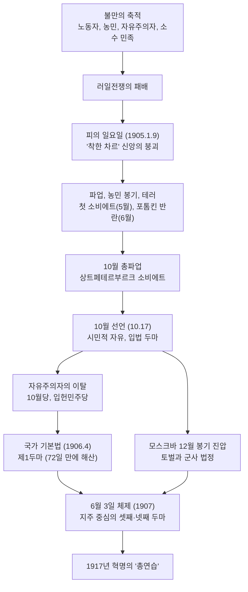

1905년 1월 9일 일요일 아침, 상트페테르부르크. 눈 덮인 거리마다 노동자와 그 가족들이 줄지어 겨울 궁전을 향해 걸었다. 그들은 손에 무기 대신 성상과 십자가, 그리고 황제 니콜라이 2세의 초상을 들고 있었다. 찬송가 「주여, 당신의 백성을 구하소서」를 부르며 걷는 행렬의 맨 앞에는 검은 사제복을 입은 서른다섯 살의 사제 **게오르기 가퐁**이 있었다. 그가 이끄는 노동자 단체는 황제에게 올릴 청원서를 준비했다. 하루 8시간 노동, 최저 임금, 그리고 헌법 제정 회의의 소집을 요구하는 청원서였다. 청원서는 이렇게 시작했다. "폐하! 우리, 상트페테르부르크의 노동자들과 우리의 아내, 자식, 늙은 부모들이 진실과 보호를 구하러 폐하께 왔습니다."

황제는 궁전에 없었다. 그는 전날 교외의 차르스코예 셀로로 떠나 있었다. 궁전으로 가는 다리와 광장에는 군대가 늘어서 있었다. 행렬이 다가오자 병사들이 총을 쏘았다. 나르바 개선문 앞에서, 트로이츠키 다리에서, 겨울 궁전 광장에서 사람들이 쓰러졌다. 공식 발표로는 130명 남짓이 죽었지만, 실제로는 수백 명이 넘었을 것으로 보인다. 그날 저녁 가퐁은 이렇게 썼다. "이제 신은 없다. 차르도 없다."

이날을 **'피의 일요일'**이라 부른다. 수백 년 동안 러시아 민중이 품어 온 '착한 차르'에 대한 믿음이 이날 무너졌다. 러일전쟁의 패배(15강)와 겹쳐, 피의 일요일은 러시아 전역을 휩쓴 **1905년 혁명**의 불씨가 되었다. 이 강의에서는 1905년 혁명의 전개와, 그 결과 생겨난 러시아 최초의 의회 **두마**를 살펴본다.

> [!핵심] 이 강의의 질문
> 1. 1905년 혁명은 왜 일어났으며, 누가 참여했는가?
> 2. 10월 선언은 무엇을 약속했으며, 혁명은 어떻게 끝났는가?
> 3. 두마의 탄생은 러시아의 전제 정치를 얼마나 바꾸었는가?

{{F:r16-opening}}

## 혁명의 한 해

### 쌓여 온 불만

1905년 혁명은 갑자기 일어나지 않았다. 14강에서 본 급속한 산업화는 가혹한 노동 조건 속에 사는 수백만의 노동자를 만들었다. 농민들은 땅이 부족하고 상환금과 세금에 짓눌렸으며, 1902년 남부 러시아에서는 농민들이 지주의 영지를 습격하는 봉기가 일어났다. 젬스트보의 자유주의자들은 헌법과 의회를 요구하며 1904년 가을 전국에서 '연회'를 열어 정치 토론을 벌였다. 폴란드, 핀란드, 발트 지역, 캅카스의 비러시아 민족들은 러시아화 정책에 반발했다. 학생들은 대학의 통제에 저항했다.

러일전쟁의 잇따른 패배는 이 모든 불만에 불을 붙였다. 1904년 7월 강경파 내무 장관 플레베가 사회혁명당의 폭탄에 죽었다. 1904년 12월 20일(그레고리력 1905년 1월 2일) 뤼순이 함락되었고, 3주도 지나지 않아 피의 일요일이 일어났다.

### 파업과 봉기의 물결

피의 일요일 소식이 퍼지자 전국에서 파업이 일어났다. 1월 한 달 동안만 40만 명이 넘는 노동자가 일손을 놓았다. 2월에는 황제의 숙부이자 모스크바 총독인 세르게이 대공이 크렘린에서 사회혁명당원의 폭탄에 죽었다. 봄과 여름에는 농촌에서 농민들이 지주의 영지를 불태우고 땅과 숲을 빼앗았다. 대학은 문을 닫았고, 학생들은 강의실을 정치 집회장으로 썼다. 변호사, 의사, 교사, 기술자 같은 전문직 단체들이 모여 '동맹의 동맹'을 만들고 헌법을 요구했다.

1905년 5월 모스크바 북동쪽의 섬유 도시 이바노보보즈네센스크에서 파업 노동자들이 대표를 뽑아 파업을 이끄는 위원회를 만들었다. 이것이 러시아 최초의 **'소비에트'**(평의회)였다. 노동자들이 공장마다 대표를 뽑아 스스로 결정하는 이 조직은 1917년 혁명의 핵심이 된다(19~20강).

### 전함 포톰킨

1905년 6월 14일, 흑해에서 훈련 중이던 전함 **포톰킨**호의 수병들이 구더기가 들끓는 고기로 끓인 수프를 거부했다. 함장이 주동자들을 총살하려 하자 수병들이 반란을 일으켜 장교들을 죽이고 배를 장악했다. 붉은 깃발을 단 전함은 마침 총파업이 벌어지던 오데사로 갔다. 오데사 항구에서는 반란 수병의 장례식에 수많은 시민이 모였고, 이를 진압하는 군대의 발포로 많은 사람이 죽었다. 전함은 11일 동안 흑해를 떠돌다 연료와 식량이 떨어지자 루마니아의 콘스탄차항에 들어가 항복했다.

포톰킨 반란은 러시아 군대의 충성마저 흔들리고 있음을 보여 주었다. 20년 뒤 소련의 영화감독 세르게이 에이젠시테인은 이 사건을 영화 「전함 포톰킨」(1925)으로 만들었다. 오데사 계단(6강)을 내려오는 군대와 굴러떨어지는 유모차 장면은 영화사의 가장 유명한 장면 가운데 하나지만, 실제로 그 계단에서 학살이 일어났다는 기록은 없다.

{{F:r16-potemkin}}

### 10월 총파업과 10월 선언

1905년 10월, 모스크바의 철도 노동자들이 시작한 파업이 순식간에 전국으로 번졌다. 철도가 멈추고, 공장과 상점, 은행, 학교, 관청, 극장, 심지어 발레단까지 일을 멈추었다. 러시아 역사상 처음이자 가장 큰 **총파업**이었다. 10월 13일 상트페테르부르크에서는 공장마다 뽑은 대표 수백 명이 모여 **상트페테르부르크 노동자 대표 소비에트**를 만들었다. 이 소비에트에서 가장 빛난 연설가는 스물여섯 살의 멘셰비키 **레프 트로츠키**였다.

러일전쟁을 끝내고 막 돌아온 비테(15강)는 황제에게 두 가지 길이 있다고 했다. 하나는 강력한 군사 독재로 혁명을 짓밟는 것, 다른 하나는 헌법을 주는 것이었다. 군사 독재를 맡을 사람을 찾지 못한 니콜라이는 마지못해 두 번째 길을 택했다. 1905년 10월 17일 그는 비테가 쓴 **10월 선언**에 서명했다.

> [!사료] 10월 선언(1905년 10월 17일)의 요지
> 1. 인격의 불가침, 양심·언론·집회·결사의 자유라는 시민적 자유의 기초를 국민에게 준다.
> 2. 지금까지 선거권이 없던 계층도 국가 두마 선거에 참여하게 한다.
> 3. 어떤 법률도 국가 두마의 승인 없이는 효력을 가질 수 없으며, 국민이 뽑은 대표가 정부 관리들의 행위의 합법성을 감독하는 데 실제로 참여할 수 있게 한다는 흔들림 없는 원칙을 세운다.

10월 선언은 혁명 세력을 갈라놓았다. 온건한 자유주의자들은 선언을 받아들이고 그 실현을 위해 **10월당**을 만들었다. 더 많은 것을 원한 자유주의자들은 **입헌민주당**(카데트)을 만들었다. 사회주의자들은 선언을 속임수로 보고 혁명을 계속하려 했다. 한편 선언이 나온 직후 여러 도시에서 황제를 지지한다는 '검은 백인대' 같은 극우 단체가 유대인과 학생, 지식인을 공격하는 포그롬을 벌였다. 오데사에서만 수백 명의 유대인이 죽었다.

### 모스크바 12월 봉기와 진압

10월 선언으로 자유주의자들이 물러서자 정부는 반격에 나섰다. 12월 3일 상트페테르부르크 소비에트의 대표들이 체포되었다. 12월 7일 모스크바의 볼셰비키는 총파업과 무장 봉기를 일으켰다. 노동자들은 프레스냐 지구 등에 바리케이드를 쌓고 열흘 가까이 싸웠지만, 수도에서 온 근위대 세묘노프스키 연대가 대포를 쏘며 진압했다. 1,000명 넘게 죽었다.

1906년 내내 정부는 군대와 '토벌대'를 보내 농촌과 철도, 변방의 봉기를 진압했다. 수천 명이 군사 법정에서 사형 선고를 받았다. 혁명은 진압되었다. 그러나 러시아는 더 이상 이전과 같을 수 없었다.

```chart
{
  "type": "bar",
  "caption": "러시아 제국의 파업 참가 노동자 수 (만 명, 1904~1914년, 공장 감독관 통계를 바탕으로 한 대략적인 수치. 1914년은 1~7월). 1905년 혁명 때 폭발했다가 진압 뒤 크게 줄었던 파업은 1912년 레나 금광 학살 사건 이후 다시 늘어, 1914년 전쟁 직전에는 1905년에 버금가는 수준에 이르렀다",
  "data": {
    "labels": ["1904", "1905", "1906", "1907", "1908", "1910", "1912", "1913", "1914"],
    "datasets": [{ "label": "파업 참가자 (만 명)", "data": [2.5, 286, 111, 74, 18, 5, 73, 89, 132] }]
  },
  "options": { "plugins": { "legend": { "display": false } } }
}
```

## 두마의 시대

### 기본법: 지붕은 씌웠지만

1906년 4월 23일, 첫 두마가 열리기 나흘 전에 정부는 **국가 기본법**을 공포했다. 사실상의 헌법이었다. 그러나 그 내용은 10월 선언의 약속에 크게 못 미쳤다.

| 내용 | 설명 |
|---|---|
| 황제의 권한 | 황제는 여전히 '최고의 전제 권력'을 가졌다(이전의 '무제한'이라는 말만 빠졌다). 장관을 임명하고, 외교와 군대를 지휘하며, 두마를 해산할 수 있었다 |
| 두 개의 의회 | 국민이 뽑는 **국가 두마**(하원) 위에, 절반을 황제가 임명하는 **국가 평의회**(상원)를 두었다. 법률은 두 의회와 황제의 승인을 모두 얻어야 했다 |
| 정부의 책임 | 장관들은 두마가 아니라 황제에게만 책임을 졌다 |
| 제87조 | 두마가 쉬는 동안 정부는 긴급 법령을 내릴 수 있었다 |
| 선거 | 보통·평등 선거가 아니라, 신분과 재산에 따라 나눈 여러 단계의 간접 선거였다 |

표: 1906년 국가 기본법의 주요 내용

### 제1·2 두마: '분노의 두마'

1906년 4월 27일, 겨울 궁전의 성 게오르기 홀에서 러시아 역사상 첫 의회의 개원식이 열렸다. 한쪽에는 금빛 제복의 궁정 관리와 장군들이, 다른 쪽에는 프록코트를 입은 변호사와 교수, 투박한 옷차림의 농민 의원들이 서 있었다. 두 세계가 처음으로 한 방에서 마주한 것이다. 두마는 이어 타우리다 궁전에서 회의를 열었다.

첫 두마에서는 입헌민주당이 가장 큰 세력이었고, 농민 출신의 '노동 그룹'(트루도비키)이 뒤를 이었다. 두마는 정치범 사면, 장관의 두마에 대한 책임, 그리고 무엇보다 지주의 땅을 강제로 사들여 농민에게 나누어 주는 토지 개혁을 요구했다. 정부는 이를 받아들일 수 없었다. 첫 두마는 72일 만에 해산되었다. 1907년 2월에 열린 둘째 두마는 사회주의 정당들이 선거에 참여하면서 더 급진적이었고, 석 달 만에 해산되었다.

### 6월 3일 체제

둘째 두마를 해산한 1907년 6월 3일, 정부는 기본법을 어기고 두마의 승인 없이 선거법을 바꾸었다. 새 선거법은 지주에게 압도적으로 유리했다. 지주는 약 230명마다 선거인 한 명을 뽑았지만, 농민은 약 6만 명, 노동자는 약 12만 5,000명마다 한 명을 뽑았다. 비러시아 민족의 대표권도 크게 줄었다. 사람들은 이를 '6월 3일 쿠데타'라 불렀다.

그 결과 1907년 가을에 뽑힌 셋째 두마는 정부에 협조적인 지주와 10월당이 다수를 차지했다. 셋째 두마는 처음으로 5년 임기를 다 채웠고, 넷째 두마(1912~1917)로 이어졌다. 두마는 예산을 심의하고 정부를 비판하는 연설을 할 수 있었으며, 그 연설은 신문에 실렸다. 러시아는 제한적이나마 의회와 정당, 합법적인 신문과 노동조합을 가진 나라가 되었다. 이 체제를 이끈 사람이 다음 강에서 볼 총리 **표트르 스톨리핀**이다.

{{F:r16-duma}}

## 1905년 혁명의 의미

1905년 혁명은 실패한 혁명이었다. 전제 정치는 무너지지 않았고, 니콜라이 2세는 끝까지 자신이 '전제 군주'라고 생각했다. 그러나 1905년은 러시아 사회를 크게 바꾸었다. 처음으로 의회가 생기고, 정당이 합법화되었으며, 검열이 크게 줄었다. 농민의 토지 상환금은 1907년부터 폐지되었다(12강).

무엇보다 1905년은 12년 뒤를 위한 '총연습'이었다. 노동자들은 소비에트를 경험했고, 군대의 충성이 흔들릴 수 있다는 것을 보았다. 레닌은 훗날 1905년이 없었다면 1917년의 승리도 없었을 것이라고 말했다. 반대로 정부는 군대가 충성하는 한 혁명을 진압할 수 있다는 교훈을 얻었다. 1917년, 전쟁에 지친 군대가 더 이상 총을 쏘지 않았을 때, 그 교훈은 통하지 않았다(19강).



## 정리

> [!핵심] 16강 요약
> - 산업화와 농촌의 가난, 자유주의자와 소수 민족의 불만이 쌓인 가운데, 러일전쟁의 패배와 1905년 1월 9일 **피의 일요일**이 **1905년 혁명**에 불을 붙였다.
> - 파업과 농민 봉기, 테러가 이어지고, 5월 이바노보에서 첫 **소비에트**가 생겼다. 6월에는 전함 **포톰킨**의 반란이 일어났다.
> - 10월 총파업과 상트페테르부르크 소비에트(트로츠키)의 압력 속에 니콜라이 2세는 **10월 선언**으로 시민적 자유와 입법 의회를 약속했다. 자유주의자들은 10월당과 입헌민주당으로 갈라졌고, 모스크바 12월 봉기는 진압되었다.
> - 1906년 **국가 기본법**으로 황제의 큰 권한을 남긴 채 **두마**가 생겼다. 제1·2 두마는 토지 개혁을 요구하다 해산되었고, 1907년 **6월 3일 선거법** 개정으로 지주 중심의 두마가 되었다.
> - 1905년은 실패한 혁명이었지만, 의회와 정당을 낳고 1917년 혁명의 '총연습'이 되었다.

### 생각해 볼 질문

1. 피의 일요일의 행렬은 왜 성상과 황제의 초상을 들었을까? 이날의 발포가 러시아 민중의 생각을 바꾼 이유는 무엇일까?
2. 10월 선언은 혁명을 끝냈을까, 아니면 혁명 세력을 갈라놓았을까? 정치적 양보가 혁명 운동에 미치는 영향을 생각해 보자.
3. 두마는 진짜 의회였을까? 1906년 기본법을 같은 시기의 다른 나라 헌법(예: 1889년 일본의 메이지 헌법)과 비교해 보자.

### 다음 강 예고

17강 「스톨리핀과 은의 시대」에서는 '20년의 평화'를 외친 총리 스톨리핀의 토지 개혁과 시베리아 이주, 그리고 그의 암살을 다룬다. 동시에 체호프와 고리키, 블로크, 칸딘스키, 스트라빈스키와 발레 뤼스로 대표되는 러시아 문화의 '은의 시대'를 살펴본다.
