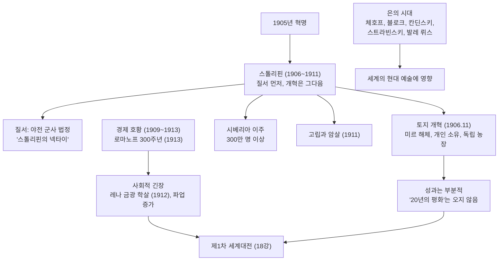

1911년 9월 1일 밤, 키이우(키예프) 시립 오페라 극장. 림스키코르사코프의 오페라 「살탄 황제 이야기」 제2막이 끝나고 막간 휴식이 시작되었다. 황제 니콜라이 2세와 두 딸이 귀빈석에 앉아 있었고, 맨 앞줄에는 흰 여름 제복을 입은 총리 **표트르 스톨리핀**이 무대 쪽 난간에 기대 서 있었다. 그때 연미복을 입은 젊은 남자가 통로를 걸어와 그의 가슴에 브라우닝 권총 두 발을 쏘았다.

스톨리핀은 잠시 그대로 서 있었다. 그는 피에 물든 제복을 내려다보고, 황제석을 향해 천천히 성호를 그은 뒤 의자에 주저앉았다. 그는 나흘 뒤 숨졌다. 범인 드미트리 보그로프는 사회혁명당과 관계를 맺으면서 동시에 비밀경찰의 정보원으로 일하던 스물네 살의 변호사였다. 그가 경찰이 발급한 입장권으로 극장에 들어왔다는 사실이 알려지면서, 누가 스톨리핀의 죽음을 원했는지를 둘러싼 의혹은 지금까지 풀리지 않았다.

스톨리핀은 1905년 혁명 뒤 무너질 듯하던 제국을 다시 세운 인물이었다. 그는 혁명가들을 가혹하게 처형하는 한편, 농민을 부유한 자영농으로 만들어 제국의 든든한 기반으로 삼으려는 대담한 토지 개혁을 벌였다. 이 강의에서는 스톨리핀의 개혁과 1906~1914년의 러시아를, 그리고 같은 시기 러시아 문화가 세계를 놀라게 한 **'은의 시대'**를 함께 살펴본다.

> [!핵심] 이 강의의 질문
> 1. 스톨리핀은 어떤 방법으로 혁명 뒤의 러시아를 안정시키려 했는가?
> 2. 스톨리핀의 토지 개혁은 무엇을 목표로 했으며, 어느 정도 성공했는가?
> 3. '은의 시대'의 러시아 문화는 어떤 모습이었으며, 왜 세계에 큰 영향을 주었는가?

{{F:r17-opening}}

## 스톨리핀

### 질서 먼저, 개혁은 그다음

스톨리핀은 1862년 오래된 귀족 집안에서 태어나 지방 관리로 일했다. 1905년 볼가강 유역의 사라토프 현 지사로서 농민 봉기를 단호하게 진압해 이름을 알렸다. 1906년 4월 내무 장관, 7월 총리가 된 그는 키가 크고 침착하며 두마에서 거침없이 연설하는 정치인이었다. 그의 원칙은 분명했다. 먼저 질서를 되찾고, 그다음 개혁한다.

그가 총리가 된 지 한 달 뒤인 1906년 8월, 사회혁명당의 한 분파가 그의 별장에 폭탄을 던졌다. 손님과 경비원 수십 명이 죽고, 그의 딸과 아들이 크게 다쳤다. 스톨리핀은 곧 **야전 군사 법정**을 도입했다. 테러와 무장 강도 혐의자를 이틀 안에 재판하고, 24시간 안에 형을 집행하는 제도였다. 그 뒤 몇 년 동안 1,000명이 넘는 사람이 처형되었다. 두마에서 한 의원이 교수대의 밧줄을 '스톨리핀의 넥타이'라고 부르자, 스톨리핀은 그에게 결투를 신청했고 의원은 사과해야 했다.

> [!사료] 스톨리핀의 두마 연설 (1907)
> "정부 반대자들은 급진주의의 길, 러시아의 역사적 과거와 문화적 전통으로부터의 해방의 길을 택하고 싶어 합니다. 여러분에게는 거대한 격변이 필요하지만, 우리에게는 위대한 러시아가 필요합니다." 그는 또 한 인터뷰에서 이렇게 말했다고 전한다. "나라에 안팎으로 20년의 평화를 주십시오. 그러면 오늘의 러시아를 알아볼 수 없게 될 것입니다."

### 토지 개혁: '강하고 건실한 농민'에게 걸다

스톨리핀은 1905년 혁명에서 농민이 가장 위험한 세력이었다고 보았다. 농민들은 지주의 땅을 원했고, 그 불만을 사회주의자들이 부추겼다. 그는 지주의 땅을 나누어 주는 대신, 농민 자신의 땅을 근본적으로 바꾸려 했다. 문제의 핵심은 12강에서 본 농촌 공동체 **미르**였다. 미르에서는 땅을 공동으로 소유하고 몇 년마다 다시 나누었으며, 한 집의 땅이 여기저기 좁은 띠 모양으로 흩어져 있었다. 이런 제도에서는 열심히 땅을 가꿀 유인이 없었다.

1906년 11월 9일, 스톨리핀은 기본법 제87조의 긴급 법령으로 **토지 개혁**을 시작했다. 농민은 이제 공동체를 떠나 자기 몫의 땅을 개인 소유로 바꿀 수 있었다. 나아가 흩어진 땅을 한곳으로 모아, 집까지 그 땅으로 옮긴 독립 농장(후토르)이나 집은 마을에 두고 땅만 모은 농장(오트루프)을 만들 수 있었다. 국가의 농민 토지 은행은 농민이 땅을 살 수 있게 돈을 빌려주었다. 스톨리핀은 이 개혁을 '가난하고 술 취한 농민'이 아닌 **'강하고 건실한 농민'**에게 거는 내기라고 불렀다. 서유럽의 자영농처럼 자기 땅을 가진 부유한 농민층이 생기면, 그들이 사유 재산과 질서를 지키는 보수적인 제국의 기둥이 되리라는 것이었다.

결과는 엇갈렸다. 1916년까지 유럽 러시아 농가의 4분의 1 남짓이 공동체에서 땅을 떼어 내 개인 소유로 바꾸었지만, 땅을 한곳에 모은 독립 농장을 이룬 것은 10% 남짓에 그쳤다. 많은 농민은 공동체를 떠나는 이웃을 배신자로 여겼고, 공동체를 떠난 농민들 가운데 상당수는 땅을 팔고 도시로 떠났다. 개혁이 성공하려면 스톨리핀이 말한 20년이 필요했지만, 러시아에 주어진 시간은 8년뿐이었다.

### 시베리아로

스톨리핀은 땅이 부족한 유럽 러시아의 농민을 시베리아와 중앙아시아의 넓은 땅으로 옮기는 정책도 폈다. 정부는 이주민에게 땅과 여행 경비, 대출을 주었다. 시베리아 횡단 철도(14강)는 이주민을 실어 나르는 특별 열차를 운행했다. 1906년부터 1914년까지 300만 명 넘는 농민이 우랄산맥을 넘어 동쪽으로 갔다. 그 가운데 일부는 혹독한 기후와 준비 부족으로 실패하고 돌아왔지만, 많은 사람이 정착해 시베리아는 버터와 곡물을 수출하는 농업 지대가 되었다.

```chart
{
  "type": "bar",
  "caption": "시베리아와 극동으로 간 이주민 수 (만 명, 1906~1913년, 대략적인 수치). 스톨리핀의 이주 정책으로 이주민이 크게 늘어 1908년 정점에 이르렀다. 준비 부족과 혹독한 환경 때문에 10% 이상이 다시 돌아오기도 했다",
  "data": {
    "labels": ["1906", "1907", "1908", "1909", "1910", "1911", "1912", "1913"],
    "datasets": [{ "label": "이주민 (만 명)", "data": [14, 43, 67, 62, 32, 19, 20, 23] }]
  },
  "options": { "plugins": { "legend": { "display": false } } }
}
```

### 스톨리핀의 고립과 죽음

스톨리핀은 양쪽에서 미움을 받았다. 혁명가들에게 그는 교수형 집행자였다. 궁정의 보수파와 극우 세력에게는 지나치게 개혁적인 관료였다. 1911년 그가 서부 지역에 젬스트보를 세우는 법안을 상원이 부결하자, 그는 황제에게 두마와 상원을 사흘 동안 정회시키고 제87조로 법안을 통과시키게 했다. 이 일로 그는 두마의 지지마저 잃었다. 황후 알렉산드라는 스톨리핀이 황제의 그늘을 가린다고 여겼고, 그가 황실에 드나들던 수도사 라스푸틴(18강)을 비판하자 더욱 그를 싫어했다. 1911년 9월 그가 암살될 무렵, 그의 해임은 시간문제라는 소문이 돌고 있었다.

## 폭풍 전의 러시아 (1907~1914)

스톨리핀이 죽은 뒤에도 러시아 경제는 빠르게 성장했다. 1909년부터 1913년까지 풍년이 이어지고 곡물 수출이 늘었으며, 공업 생산은 해마다 7~8%씩 늘었다. 1913년 러시아는 미국, 독일, 영국, 프랑스에 이어 세계 5위 안팎의 공업국이 되었다. 같은 해 로마노프 왕조 300주년을 맞아 전국에서 화려한 기념행사가 열렸다. 황제 부부는 1613년 미하일 로마노프가 차르 추대를 받아들인 코스트로마의 이파티예프 수도원(1강)을 찾았다. 황제는 민중이 여전히 자신을 사랑한다고 확신했다.

그러나 사회의 긴장은 사라지지 않았다. 1912년 4월 시베리아 레나강 유역의 금광에서 파업 노동자들을 향해 군대가 총을 쏘아 200명 넘게 죽었다. 이 **레나 금광 학살**은 전국에 파업의 물결을 일으켰다(16강의 그래프). 1914년 7월 전쟁 직전의 상트페테르부르크에서는 파업 노동자들이 바리케이드를 쌓았다. 역사가들은 오늘날까지 논쟁한다. 제1차 세계대전이 없었다면 러시아는 스톨리핀의 길을 따라 안정된 입헌 군주국으로 나아갔을까, 아니면 어차피 혁명을 맞았을까?

{{F:r17-empire}}

## 은의 시대

### 러시아 문화의 두 번째 꽃

푸시킨과 고골의 19세기 전반(10강)이 러시아 문화의 '황금시대'였다면, 1890년대부터 1920년대 초까지는 **'은의 시대'**라 불린다. 이 짧은 시기에 러시아의 문학, 미술, 음악, 연극, 무용은 유럽의 맨 앞자리에 섰다. 사회의 위기와 불안 속에서, 예술가들은 새로운 표현과 정신적 의미를 찾아 나섰다.

| 분야 | 인물과 작품 |
|---|---|
| 연극 | 스타니슬랍스키와 네미로비치단첸코의 모스크바 예술 극장(1898). 체호프의 『갈매기』, 『벚꽃 동산』(1904) |
| 문학 | 고리키의 『밑바닥에서』(1902). 상징주의 시인 블로크, 소설 『페테르부르크』(1913)의 벨리. 아흐마토바, 만델스탐. 미래파 시인 마야콥스키 |
| 미술 | 칸딘스키의 첫 추상화(1910년 무렵), 말레비치의 「검은 사각형」(1915), 샤갈. 컬렉터 슈킨과 모로조프가 사들인 마티스와 피카소 |
| 음악 | 스크랴빈, 라흐마니노프, 스트라빈스키. 베이스 가수 샬랴핀 |
| 무용 | 디아길레프의 '발레 뤼스'(1909년 파리 공연 시작). 니진스키, 안나 파블로바 |
| 사진 | 프로쿠딘-고르스키의 러시아 제국 컬러 사진 기록 사업(1909~1915) |

표: 은의 시대의 러시아 문화

### 파리를 사로잡은 발레 뤼스

1909년 예술 기획자 **세르게이 디아길레프**는 러시아의 무용수, 화가, 작곡가들을 이끌고 파리에서 공연을 열었다. 이렇게 시작된 **발레 뤼스**(러시아 발레단)는 20년 동안 유럽의 예술계를 휩쓸었다. 무용수 **니진스키**는 하늘에 멈춘 듯한 도약으로 관객을 사로잡았고, 박스트의 화려한 무대 의상과 장치는 파리의 패션까지 바꾸었다.

1913년 5월 29일, 파리의 샹젤리제 극장에서 발레 뤼스가 젊은 작곡가 **이고리 스트라빈스키**의 「봄의 제전」을 초연했다. 고대 슬라브의 이교 의식에서 처녀가 봄의 신에게 바쳐져 죽을 때까지 춤추는 이야기였다. 불협화음과 거친 리듬의 음악, 발을 안쪽으로 모으고 쿵쿵 구르는 니진스키의 안무에 관객석에서는 야유와 휘파람, 싸움이 벌어졌다. 이 '스캔들'은 20세기 현대 음악의 출발을 알린 사건으로 기억된다.

### 프로쿠딘-고르스키의 컬러 사진

이 강좌의 많은 사진을 찍은 **세르게이 프로쿠딘-고르스키**도 은의 시대의 인물이다. 화학자였던 그는 빨강, 초록, 파랑 필터를 차례로 끼우고 세 장의 흑백 원판을 찍어, 이를 겹쳐 컬러 사진을 만드는 방법을 개발했다. 1908년 그는 야스나야 폴랴나에서 여든 살을 앞둔 톨스토이를 찍었는데, 이것은 러시아 최초의 컬러 인물 사진으로 알려져 있다. 이 사진을 본 니콜라이 2세의 지원을 받아, 그는 1909년부터 특별 열차와 배를 타고 러시아 제국 곳곳을 돌며 수천 장의 사진을 찍었다. 혁명 뒤 그는 망명했고, 그의 원판은 1948년 미국 의회도서관이 사들였다. 오늘날 우리는 그 덕분에 사라진 제국의 모습을 생생한 색깔로 볼 수 있다.

> [!더알아보기] 톨스토이의 가출과 죽음
> 1910년 10월, 여든두 살의 톨스토이는 한밤중에 몰래 집을 떠났다. 재산과 저작권을 둘러싼 아내와의 갈등, 그리고 자신이 설교한 소박한 삶과 귀족 영지의 생활 사이의 모순을 견디지 못한 것이다. 그는 기차 안에서 폐렴에 걸려 작은 시골 역 아스타포보의 역장 관사에서 숨졌다. 기자들과 영화 촬영 기사들이 역으로 몰려들어 그의 마지막 날들을 세계에 전했다. 교회에서 파문당한 그를 위해 정교회는 장례 예배를 올리지 않았지만, 수많은 농민과 학생이 장례 행렬을 따랐다.

{{F:r17-culture}}



## 정리

> [!핵심] 17강 요약
> - 총리 **스톨리핀**(1906~1911)은 '질서 먼저, 개혁은 그다음'을 원칙으로, **야전 군사 법정**으로 혁명을 가혹하게 진압했다.
> - 1906년 **토지 개혁**으로 농민이 공동체 **미르**를 떠나 땅을 개인 소유로 바꾸고 독립 농장을 만들 수 있게 했다. '강하고 건실한 농민'을 제국의 기둥으로 삼으려 했지만, 성과는 부분적이었다.
> - 300만 명이 넘는 농민이 **시베리아**로 이주했다.
> - 스톨리핀은 혁명가와 보수파 모두의 미움을 받다가 1911년 키이우의 극장에서 **암살**되었다.
> - 1909~1913년 경제는 빠르게 성장했지만, **레나 금광 학살**(1912) 이후 파업이 다시 늘었다.
> - 같은 시기 러시아 문화는 **은의 시대**를 맞았다. 체호프와 모스크바 예술 극장, 상징주의와 미래파 시, 칸딘스키와 말레비치의 추상화, 스트라빈스키와 **발레 뤼스**, 프로쿠딘-고르스키의 컬러 사진이 나왔다.

### 생각해 볼 질문

1. "여러분에게는 거대한 격변이 필요하지만, 우리에게는 위대한 러시아가 필요하다." 스톨리핀의 이 말은 개혁과 혁명의 관계에 대해 무엇을 말하고 있을까?
2. 스톨리핀의 토지 개혁에 20년이 주어졌다면 러시아 혁명을 막을 수 있었을까? 찬반의 근거를 생각해 보자.
3. 정치적으로 불안한 시대에 예술이 오히려 꽃피는 까닭은 무엇일까? 은의 시대와 10강의 황금시대를 비교해 보자.

### 다음 강 예고

18강 「제1차 세계대전과 라스푸틴」에서는 사라예보의 총성에서 시작된 대전에 러시아가 뛰어든 과정, 탄넨베르크의 패배와 대퇴각, 황제의 최고 사령관 취임과 수도에 남은 황후, 그리고 시베리아 출신의 수도사 라스푸틴이 궁정을 쥐락펴락하다 암살되기까지를 살펴본다.
