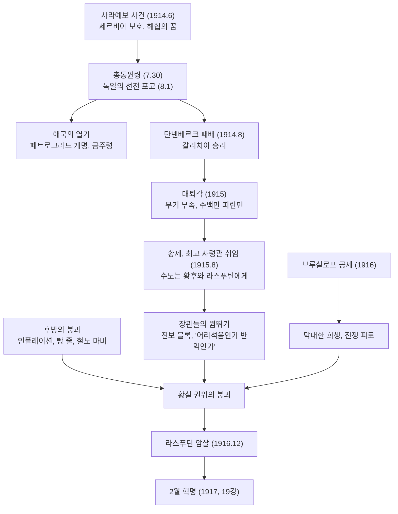

1916년 12월 17일 새벽, 페트로그라드 모이카 운하 가의 유수포프 궁전. 지하의 작은 방에 차려진 식탁에는 케이크와 마데이라 포도주가 놓여 있었다. 러시아 최고의 부자 가문의 상속자 **펠릭스 유수포프** 공이 손님을 기다리고 있었다. 위층에서는 황제의 사촌 드미트리 대공과 극우파 두마 의원 푸리시케비치 등이 축음기로 「양키 두들」을 틀어 놓고 숨죽이고 있었다. 자정을 넘겨 손님이 도착했다. 시베리아 출신의 수도사, 황후의 총애를 받으며 궁정을 쥐락펴락한다는 **그리고리 라스푸틴**이었다.

유수포프의 회고록에 따르면, 청산가리를 넣은 케이크와 포도주를 먹고 마셨는데도 라스푸틴은 멀쩡했다. 유수포프가 권총으로 그의 가슴을 쏘자 그는 쓰러졌다가 다시 일어나 마당으로 달아났고, 푸리시케비치가 뒤쫓아 가 총을 쏘았다. 공모자들은 시신을 천으로 싸서 얼어붙은 네바강 지류의 얼음 구멍에 밀어 넣었다. 사흘 뒤 시신이 발견되었다. 독약과 물에 빠진 뒤에도 살아 있었다는 극적인 이야기는 대부분 유수포프가 훗날 꾸며 낸 것으로 보이지만, 이 암살은 러시아 제국의 마지막 몇 달을 상징하는 사건이 되었다.

그들은 라스푸틴을 죽이면 황실이 구원되리라 믿었다. 그러나 두 달 뒤 제국은 무너졌다. 이 강의에서는 1914년 러시아가 제1차 세계대전에 뛰어든 과정과 전쟁의 전개, 그리고 전쟁이 러시아 사회와 황실을 어떻게 무너뜨렸는지 살펴본다.

> [!핵심] 이 강의의 질문
> 1. 러시아는 왜 제1차 세계대전에 뛰어들었으며, 전쟁은 어떻게 전개되었는가?
> 2. 전쟁은 러시아의 경제와 사회를 어떻게 바꾸었는가?
> 3. 라스푸틴은 누구이며, 그를 둘러싼 이야기는 왜 황실의 권위를 무너뜨렸는가?

```figure
src: asset:33d357141cdb239e54dfccaf246170b8
caption: 참호에서 소총을 겨눈 러시아 병사들(1915년 무렵).
credit: 베인 뉴스 서비스 사진 · 미국 의회도서관 소장
license: Public Domain (미국 의회도서관: 출판 제한 없음)
source: https://www.loc.gov/item/2014698625/
width: wide
```

## 1914년 여름

### 발칸의 불씨

1914년 6월 28일, 보스니아의 사라예보에서 오스트리아-헝가리의 황태자 프란츠 페르디난트가 세르비아계 청년에게 암살되었다. 오스트리아는 세르비아 정부가 배후에 있다며 받아들이기 어려운 최후통첩을 보냈다. 러시아는 같은 슬라브 민족이자 정교회 국가인 세르비아의 보호자를 자처했다. 6강과 11강에서 본 대로 러시아는 오래전부터 발칸반도와 콘스탄티노폴리스, 해협에 관심이 있었다. 1908년 오스트리아가 보스니아를 병합했을 때 러시아는 독일의 압력에 밀려 물러선 적이 있었다. 또다시 물러서면 러시아는 강대국의 체면을 잃을 것이었다.

7월 30일 니콜라이 2세는 망설임 끝에 **총동원령**에 서명했다. 독일은 러시아에 동원을 멈추라고 요구했고, 8월 1일 러시아에 선전 포고를 했다. 14강에서 본 러시아-프랑스 동맹에 따라 프랑스가, 이어 영국이 참전했다. 유럽 전체가 전쟁에 빠져들었다.

### 애국의 열기

전쟁이 시작되자 러시아에도 애국의 열기가 넘쳤다. 8월 2일 황제가 겨울 궁전의 발코니에 나타나자, 광장을 가득 메운 수만 명의 군중이 무릎을 꿇고 국가 「신이여, 차르를 지켜 주소서」를 불렀다. 파업은 멈추었고, 두마의 대부분 정당은 정부를 지지했다. 수도의 이름은 독일식인 상트페테르부르크에서 러시아식인 **페트로그라드**로 바뀌었다. 정부는 전쟁 동안 보드카 판매를 금지했다. 국민의 건강을 위한 조치였지만, 국가 수입의 4분의 1 가까이를 차지하던 보드카 독점 수입(14강)이 사라졌다.

```figure
src: asset:47542770f300172ae442e0e7e3abc820
caption: 병사들의 음식을 맛보는 니콜라이 2세. 곁에 최고 사령관 니콜라이 니콜라예비치 대공이 서 있다. 전쟁 초기에 만든 색칠 사진엽서다.
credit: 언더우드 앤드 언더우드 사진엽서, 1914~1915년 · 미국 의회도서관 소장
license: Public Domain (미국 의회도서관: 출판 제한 없음)
source: https://www.loc.gov/item/2012648262/
```

## 전쟁의 전개

### 탄넨베르크의 패배

러시아는 동맹국 프랑스를 돕기 위해, 동원이 끝나기도 전에 서둘러 독일의 동프로이센으로 쳐들어갔다. 처음에는 순조로웠다. 그러나 두 러시아 군대 사이의 연락이 끊기고, 무선 통신을 암호도 없이 보내 독일군에 작전이 모두 새어 나갔다. 1914년 8월 말 **탄넨베르크** 근처에서 힌덴부르크와 루덴도르프가 이끄는 독일군은 삼소노프 장군의 러시아 제2군을 포위해 무너뜨렸다. 9만 명이 넘는 러시아 병사가 포로가 되었고, 삼소노프는 숲속에서 스스로 목숨을 끊었다. 9월에는 마주리 호수 지대에서 또 다른 러시아군이 크게 졌다.

남쪽의 오스트리아-헝가리 전선에서는 사정이 달랐다. 러시아군은 1914년 가을 갈리치아의 중심 도시 렘베르크(지금의 우크라이나 르비우)를 점령하고, 1915년 3월에는 프셰미실 요새를 함락해 12만 명의 포로를 잡았다. 러시아군은 독일군에게는 약했지만, 오스트리아군에게는 강했다.

### 1915년의 대퇴각

1915년 5월 독일과 오스트리아의 연합군이 갈리치아의 고를리체에서 러시아군의 전선을 뚫었다. 러시아군은 무너졌다. 포탄과 소총이 모자라, 맨손으로 참호에 들어가 죽은 동료의 총을 주워 쓰라는 명령을 받은 병사들도 있었다. 포병은 하루에 몇 발의 포탄만 쏠 수 있었다. 그해 여름과 가을 러시아군은 폴란드, 리투아니아, 라트비아 일부를 내주고 수백 킬로미터를 물러났다. 이것이 **대퇴각**이다. 1915년 한 해에만 러시아군은 200만 명 가까운 사상자와 포로를 냈다.

퇴각하는 군대는 '초토화' 명령에 따라 마을과 곡식을 불태웠고, 수백만 명의 피란민이 동쪽으로 몰려들었다. 군 당국은 유대인과 독일계 주민을 적과 내통한다고 의심해 전선 지역에서 강제로 쫓아냈다. 피란민의 물결은 러시아 내륙의 도시들을 혼란에 빠뜨렸다.

### 황제, 최고 사령관이 되다

1915년 8월, 니콜라이 2세는 숙부인 니콜라이 니콜라예비치 대공을 해임하고 스스로 **최고 사령관**이 되어 전선 근처 모길료프의 대본영으로 떠났다. 장관 대부분이 반대했다. 군사 경험이 거의 없는 황제가 앞으로 모든 패배의 책임을 지게 될 것이었고, 수도의 정치는 황후에게 맡겨질 것이기 때문이었다. 그 우려는 현실이 되었다.

```gallery
src: asset:2f41524acf7a0fba83cfbc4c65f4bb83
caption: 전선을 찾은 니콜라이 2세와 자동차에 선 니콜라이 니콜라예비치 대공. 1915년 8월 황제는 이 숙부를 해임하고 스스로 최고 사령관이 되었다.
credit: 베인 뉴스 서비스 사진, 1914~1915년 · 미국 의회도서관 소장
license: Public Domain (미국 의회도서관: 출판 제한 없음)
source: https://www.loc.gov/item/2014699717/
---
src: asset:ec0f9792f20ccf94c287f688eff5ccbe
caption: 카자크 부대를 사열하는 니콜라이 2세와 황태자 알렉세이. 황태자는 1915년 가을부터 아버지를 따라 대본영과 전선에 머물곤 했다(도서관 목록의 1910년은 잘못된 날짜다).
credit: 베인 뉴스 서비스 사진, 1915~1916년 · 미국 의회도서관 소장
license: Public Domain (미국 의회도서관: 출판 제한 없음)
source: https://www.loc.gov/item/2014700293/
```

### 브루실로프 공세

1916년 러시아의 산업은 전쟁에 맞추어 움직이기 시작했다. 젬스트보와 도시 연합(젬고르), 기업가들의 전시 산업 위원회가 물자 생산을 도왔고, 포탄 생산은 크게 늘었다. 1916년 6월 남서부 전선의 사령관 **브루실로프** 장군은 긴 전선의 여러 곳에서 동시에 기습 공격을 펼쳐 오스트리아군의 전선을 무너뜨렸다. 오스트리아-헝가리군은 100만 명 넘는 사상자와 포로를 냈고, 다시는 혼자 힘으로 싸울 수 없게 되었다. 제1차 세계대전에서 협상국 쪽이 거둔 가장 큰 승리 가운데 하나였다. 그러나 러시아군도 수십만 명을 잃었고, 공세는 가을에 멈추었다.

```chart
{
  "type": "bar",
  "caption": "제1차 세계대전에서 러시아군의 손실 (만 명, 1914~1917년, 연구에 따라 차이가 큰 대략적인 추정치). 러시아는 1,500만 명 가까운 남자를 동원했다. 포로가 된 병사의 수가 특히 많았다는 것은 군대의 사기와 지휘의 문제를 보여 준다",
  "data": {
    "labels": ["전사·사망", "부상", "포로"],
    "datasets": [{ "label": "만 명", "data": [180, 480, 300] }]
  },
  "options": { "plugins": { "legend": { "display": false } } }
}
```

```gallery
src: asset:c1dea34182201752daf40516021d83e4
caption: 1915년 독일군에 붙잡혀 폴란드 북동부의 아우구스투프 광장에 모인 러시아군 포로들. 사진 제목에는 1만 5,000명이라고 적혀 있다.
credit: 베인 뉴스 서비스 사진, 1915년 · 미국 의회도서관 소장
license: Public Domain (미국 의회도서관: 출판 제한 없음)
source: https://www.loc.gov/item/2014699194/
---
src: asset:ac7ee783116030fe6df55b960781381b
caption: 전선으로 가는 카자크 기병들(1914년 무렵).
credit: 베인 뉴스 서비스 사진 · 미국 의회도서관 소장
license: Public Domain (미국 의회도서관: 출판 제한 없음)
source: https://www.loc.gov/item/2014697344/
```

## 무너지는 후방

### 인플레이션과 식량

전쟁이 길어지자 후방의 경제가 무너지기 시작했다. 정부는 전쟁 비용을 대려고 돈을 마구 찍었다. 물가는 1914년부터 1917년 초까지 서너 배로 뛰었지만, 노동자의 임금은 그만큼 오르지 않았다. 철도는 군대 수송에 매달려 곡물과 석탄을 도시로 제대로 나르지 못했다. 농민들은 공산품을 살 수 없게 되자 곡물을 팔지 않고 쌓아 두었다. 1916년 겨울 페트로그라드와 모스크바의 빵 가게 앞에는 새벽부터 긴 줄이 늘어섰다. 줄을 선 여성들 사이에서 정부와 '독일인 황후'에 대한 분노가 퍼졌다.

1916년 여름에는 중앙아시아에서 큰 반란이 일어났다. 그때까지 병역을 면제받던 카자흐인, 키르기스인 등 무슬림 주민을 전선 후방의 노동에 징발하겠다는 명령이 계기였다. 반란은 잔인하게 진압되었고, 수십만 명이 죽거나 중국으로 달아났다.

### '장관들의 뜀뛰기'

황제가 대본영으로 떠난 뒤 수도의 정치는 황후 **알렉산드라**의 손에 맡겨졌다. 독일 헤센 출신인 황후는 사람들에게 '독일 여자'라 불리며 의심받았다. 그녀는 두마와 자유주의자들을 혁명가로 여기며 남편에게 편지로 이렇게 썼다. "러시아는 채찍을 사랑합니다. … 표트르 대제가 되십시오, 이반 뇌제가 되십시오." 그녀는 라스푸틴의 말에 따라 장관을 갈아 치우라고 황제를 졸랐다. 1915년 가을부터 1917년 2월까지 1년 반 사이에 총리가 네 번, 내무 장관이 여섯 번 바뀌었다. 사람들은 이를 '장관들의 뜀뛰기'라 비웃었다.

두마의 다수 정당은 1915년 '진보 블록'을 만들어 국민의 신뢰를 받는 정부를 요구했지만, 황제는 거절했다. 1916년 11월 1일 입헌민주당 지도자 **밀류코프**는 두마 연단에서 정부의 실정을 하나하나 들며 그 끝마다 이렇게 물었다. "이것은 어리석음입니까, 반역입니까?" 이 연설은 검열에 걸렸지만, 손으로 베낀 사본이 전국으로 퍼졌다.

```figure
src: asset:c497cd3a3b1c8b01ae22f170e7e386c1
caption: 1915년 두마 의원들. 이해 여름 두마의 다수파는 '진보 블록'을 만들어 국민의 신뢰를 받는 정부를 요구했다.
credit: 베인 뉴스 서비스 사진, 1915년 · 미국 의회도서관 소장
license: Public Domain (미국 의회도서관: 출판 제한 없음)
source: https://www.loc.gov/item/2014704243/
```

## 라스푸틴

### 시베리아의 '성자'

**그리고리 라스푸틴**은 1869년 무렵 시베리아 서부 토볼스크 근처의 마을 포크롭스코예에서 농민의 아들로 태어났다. 젊은 시절 방탕하게 살았다고 전해지는 그는 서른 무렵 종교적 체험을 하고 러시아 각지의 수도원을 떠돌았다. 그는 정식 성직자가 아니라, 민중이 영적인 지도자로 따르는 떠돌이 순례자, 곧 '스타레츠'(장로)였다. 1905년 무렵 그는 상트페테르부르크의 귀족 살롱에 소개되었고, 곧 황실과 만났다.

황실이 그에게 의지한 데에는 감추어진 이유가 있었다. 1904년에 태어난 하나뿐인 황태자 **알렉세이**는 피가 잘 멎지 않는 유전병인 **혈우병**을 앓고 있었다. 작은 상처나 타박상에도 몸속에서 피가 멈추지 않아 극심한 고통을 겪었고, 언제든 죽을 수 있었다. 황실은 이 사실을 국민에게 철저히 숨겼다. 의사들이 손쓸 수 없을 때 라스푸틴이 기도하면 황태자의 상태가 나아지는 일이 여러 번 있었다. 1912년 폴란드의 사냥 별장에서 황태자가 죽을 고비에 놓였을 때, 시베리아에 있던 라스푸틴이 "아이는 죽지 않을 것이다. 의사들이 너무 괴롭히지 않게 하라"는 전보를 보냈고, 실제로 황태자는 회복되었다. 그가 최면처럼 아이를 진정시켜 출혈을 줄였다는 해석도 있다. 황후에게 그는 아들의 목숨을 지켜 주는 신의 사람이었다.

### 소문과 권위의 붕괴

그러나 궁정 밖에서 라스푸틴은 술과 여자를 즐기는 방탕한 농부로 알려졌다. 그가 황후와 공주들과 부적절한 관계라는 소문, 그가 독일의 첩자라는 소문이 신문과 거리의 만화, 군대의 참호까지 퍼졌다. 실제로 그는 전쟁에 반대했고 장관 인사에 영향을 미쳤지만, 그 정도는 소문보다 훨씬 작았을 것이다. 문제는 사실 여부가 아니었다. 러시아 국민이, 심지어 귀족과 장군들까지 황실이 '더러운 농부'에게 휘둘린다고 믿게 된 것이었다. 수백 년 동안 신성하게 여겨진 황제의 권위가 무너지고 있었다.

라스푸틴을 죽인 유수포프와 대공은 황실을 구하려 했다. 그러나 그들은 황제를 지키는 대신, 황제의 가장 가까운 친척과 귀족마저 황제를 믿지 않는다는 것을 온 나라에 보여 주었다. 라스푸틴은 죽기 얼마 전 황후에게 편지를 보내, 자신이 귀족에게 죽임을 당하면 황실도 2년 안에 무너질 것이라고 예언했다는 이야기가 전한다. 이 편지는 진짜인지 확인되지 않았다. 그러나 1917년 2월, 실제로 제국은 무너졌다.

```gallery
src: asset:385f3bcdc18e57610df8d9a9ed54ddfb
caption: 라스푸틴과 황후 알렉산드라, 다섯 자녀, 유모 마리야 비시냐코바로 알려진 사진(1908년 무렵). 여러 사진을 합성하거나 손질한 것이라는 견해가 많아, 이런 사진 자체가 소문을 퍼뜨리는 데 쓰였다.
credit: 작자 미상 · 미국 의회도서관 소장
license: Public Domain (미국 의회도서관: 출판 제한 없음)
source: https://www.loc.gov/item/89706196/
---
src: asset:252c10cbd058668321a609185bbedfc1
caption: 황후 알렉산드라와 황태자 알렉세이(1910년대 초). 황실은 황태자의 혈우병을 끝까지 국민에게 숨겼다.
credit: 베인 뉴스 서비스 사진 · 미국 의회도서관 소장
license: Public Domain (미국 의회도서관: 출판 제한 없음)
source: https://www.loc.gov/item/2014694368/
```



## 정리

> [!핵심] 18강 요약
> - 1914년 사라예보 사건 뒤 러시아는 세르비아를 보호하고 강대국의 체면을 지키려 **총동원령**을 내렸고, 독일의 선전 포고로 **제1차 세계대전**에 들어갔다. 처음에는 애국의 열기가 넘쳤다.
> - 1914년 **탄넨베르크**에서 크게 졌고, 1915년 **대퇴각**으로 폴란드와 리투아니아를 잃었다. 1916년 **브루실로프 공세**는 큰 승리였지만 희생도 막대했다.
> - 1915년 니콜라이 2세가 **최고 사령관**이 되어 전선으로 떠나자, 수도의 정치는 황후 알렉산드라와 라스푸틴의 영향 아래 놓였고 장관이 잇달아 바뀌었다.
> - 후방에서는 **인플레이션**과 식량난, 철도 마비로 도시민의 생활이 무너졌다. 두마는 '어리석음인가 반역인가'를 물으며 정부를 비판했다.
> - 혈우병을 앓는 황태자를 돌보던 **라스푸틴**을 둘러싼 소문은 황실의 권위를 무너뜨렸다. 그는 1916년 12월 귀족들에게 **암살**되었지만, 두 달 뒤 제국은 무너졌다.

### 생각해 볼 질문

1. 러시아가 1914년 세르비아를 위해 전쟁에 뛰어든 것은 피할 수 없는 선택이었을까? 니콜라이 2세에게 다른 길이 있었을까?
2. 라스푸틴의 실제 영향력보다 그에 대한 소문이 더 큰 힘을 발휘했다. 소문과 여론은 권력의 정당성을 어떻게 무너뜨릴 수 있을까?
3. 같은 전쟁을 치른 영국, 프랑스, 독일 가운데 러시아에서 가장 먼저 체제가 무너진 까닭은 무엇일까?

### 다음 강 예고

19강 「2월 혁명」에서는 1917년 2월 23일 국제 여성의 날, 빵을 달라는 여성 노동자들의 행진에서 시작된 혁명이 닷새 만에 300년 로마노프 왕조를 무너뜨린 과정을 따라간다. 임시 정부와 페트로그라드 소비에트의 '이중 권력', 그리고 봉인 열차를 타고 돌아온 레닌의 「4월 테제」를 다룬다.
