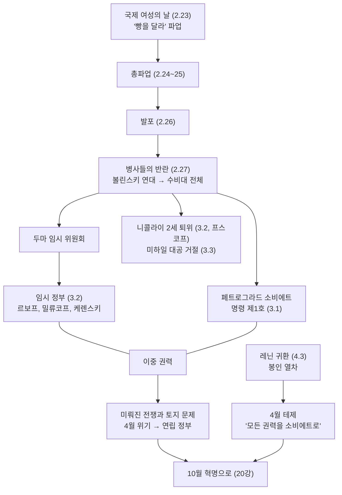

1917년 2월 23일(그레고리력 3월 8일) 아침, 페트로그라드의 노동자 지구 비보르크. 영하의 추위 속에서 섬유 공장의 여성 노동자들이 일손을 놓고 거리로 나왔다. 이날은 **국제 여성의 날**이었다. 사회주의 단체들은 이날 연설회 정도만 계획했고, 파업을 일으키자는 사람은 없었다. 그러나 새벽부터 빵 가게 앞에 몇 시간씩 줄을 서야 했던 여성들의 분노는 이미 한계에 이르러 있었다. 그들은 "빵을 달라!"를 외치며 이웃 공장으로 몰려가 남성 노동자들에게도 함께 나오라고 소리쳤다. 전날 공장 폐쇄로 쫓겨난 거대한 푸틸로프 공장의 노동자들도 합류했다. 그날 저녁까지 9만 명 가까운 노동자가 파업에 들어갔다.

누구도 이것이 혁명의 시작이라고 생각하지 않았다. 볼셰비키를 포함한 혁명가들조차 그랬다. 그러나 닷새 뒤 수도는 혁명가들의 손에 넘어갔고, 일주일 뒤에는 300년 넘게 러시아를 다스린 **로마노프 왕조**가 끝났다(1강). 그것도 어떤 정당이 계획하거나 이끈 것이 아니라, 굶주리고 전쟁에 지친 노동자들과, 그들에게 총을 쏘라는 명령을 거부한 병사들에 의해서였다.

이 강의에서는 **2월 혁명**이 어떻게 일어났는지, 그리고 혁명 뒤 러시아에 생긴 두 개의 권력, 곧 **임시 정부**와 **페트로그라드 소비에트**가 어떻게 공존하고 부딪쳤는지 살펴본다. 그리고 4월에 스위스에서 돌아온 한 망명 혁명가가 이 상황을 어떻게 바꾸기 시작했는지 따라간다.

> [!핵심] 이 강의의 질문
> 1. 2월 혁명은 어떻게 시작되었으며, 왜 닷새 만에 성공했는가?
> 2. 니콜라이 2세는 왜, 어떻게 퇴위했는가?
> 3. '이중 권력'이란 무엇이며, 레닌의 「4월 테제」는 무엇을 주장했는가?

{{F:r19-opening}}

## 닷새 동안의 혁명

### 빵과 파업

18강에서 본 것처럼 1916~1917년 겨울 페트로그라드의 식량 사정은 최악이었다. 철도가 마비되어 곡물과 연료가 도시에 제대로 들어오지 않았고, 영하 40도 가까운 혹한이 이어졌다. 빵이 바닥날 것이라는 소문이 돌자 사람들은 밤새 빵 가게 앞에 줄을 섰다. 노동자 가족들은 폭등한 물가를 감당하지 못했다.

2월 24일 파업은 20만 명으로, 25일에는 수도 전체의 총파업으로 번졌다. 시위대는 "빵을 달라"에서 "전쟁을 끝내라", "전제 정치 타도"로 구호를 바꾸었다. 시내 중심가인 넵스키 대로에 붉은 깃발이 나타났다. 경찰이 시위대를 막으려 했지만, 시위를 진압하러 나온 카자크 기병들은 시위대를 공격하지 않고 지나가게 해 주었다. 몇몇 카자크는 시위대를 공격하는 경찰을 오히려 막아섰다.

### 황제의 명령과 병사들의 선택

니콜라이 2세는 그때 모길료프의 대본영에 있었다. 2월 25일 밤 그는 수도의 군 사령관에게 전보를 보냈다. "전쟁이라는 어려운 시기에 용납할 수 없는 수도의 소요를 내일까지 멈추게 할 것을 명령한다." 26일 일요일, 군대는 명령에 따라 시위대에게 총을 쏘았다. 즈나멘스카야 광장 한 곳에서만 50명 넘게 죽었다.

그날 밤 막사로 돌아온 병사들은 괴로워했다. 수도의 병영에 있던 병사들은 대부분 전선으로 가기 전 훈련을 받는 젊은 신병이거나 부상에서 회복 중인 병사들로, 노동자와 같은 농민의 아들이었다. 2월 27일 새벽, 볼린스키 근위 연대의 훈련 중대 병사들이 하사관 키르피치니코프의 주도로 더 이상 총을 쏘지 않겠다고 결의했다. 그들은 시위대를 쏘라고 명령한 장교를 쏘아 죽이고, 무기를 든 채 거리로 나와 이웃 연대들에게 합류를 호소했다. 프레오브라젠스키 연대, 리톱스키 연대가 차례로 반란에 가담했다.

```chart
{
  "type": "bar",
  "caption": "2월 혁명 때 페트로그라드에서 반란에 가담한 병사의 수 (만 명, 1917년 2월 27일~3월 1일, 대략적인 수치). 2월 27일 아침 볼린스키 연대에서 시작된 반란은 그날 저녁 6만 명 남짓, 사흘 만에 수도 수비대 거의 전체로 번졌다. 군대가 더 이상 총을 쏘지 않자 정부는 무너졌다",
  "data": {
    "labels": ["2월 27일 아침", "2월 27일 저녁", "2월 28일", "3월 1일"],
    "datasets": [{ "label": "반란 병사 (만 명)", "data": [1, 6.6, 12.7, 17] }]
  },
  "options": { "plugins": { "legend": { "display": false } } }
}
```

그날 하루 동안 무장한 병사와 노동자들은 무기고를 점령하고, 감옥을 열어 정치범들을 풀어 주었으며, 경찰서와 법원에 불을 질렀다. 경찰들은 숨거나 붙잡혔다. 정부의 장관들은 체포되거나 달아났다. 1905년(16강)과 달리 군대가 혁명 편에 서자, 차르 정부는 하루 만에 무너졌다. 2월 혁명 동안 페트로그라드에서 죽거나 다친 사람은 모두 1,400명 남짓이었다.

### 타우리다 궁전의 두 권력

2월 27일 오후, 두마가 회의를 열던 **타우리다 궁전**(16강)으로 병사와 노동자들이 몰려들었다. 황제는 이미 두마의 정회를 명령했지만, 두마의 지도자들은 궁전의 한 방에 모여 질서를 되찾기 위한 **두마 임시 위원회**를 만들었다. 의장은 10월당의 로쟌코였다.

같은 날 저녁, 같은 궁전의 다른 방에서는 노동자와 병사들이 뽑은 대표들이 모여 1905년의 경험을 따라 **페트로그라드 노동자·병사 대표 소비에트**를 만들었다. 지도부는 멘셰비키와 사회혁명당 같은 온건 사회주의자들이 맡았다. 소비에트는 곧 수도의 철도와 우편, 전신, 식량 배급을 실제로 움직이는 권력이 되었다.

3월 1일 소비에트는 **명령 제1호**를 냈다. 수도의 모든 부대가 병사 위원회를 뽑고, 무기는 장교가 아닌 위원회가 관리하며, 군사 문제에서 두마 임시 위원회의 명령은 소비에트의 명령과 어긋나지 않을 때만 따르라는 것이었다. 장교에게 '각하'라고 부르지 않고, 병사를 '너'라고 낮추어 부르는 것도 금지했다. 이 명령은 곧 전선의 군대로 퍼져 장교들의 권위를 무너뜨렸다.

## 로마노프 왕조의 끝

### 프스코프의 기차

니콜라이 2세는 2월 28일 수도로 돌아가려고 대본영을 떠났다. 그러나 혁명군이 철도를 장악해 그의 기차는 수도로 들어가지 못하고, 북부 전선 사령부가 있는 **프스코프**로 돌아갔다. 3월 1일과 2일, 총참모장 알렉세예프 장군은 각 전선의 사령관들에게 전보로 의견을 물었다. 사령관들은 모두 같은 답을 보냈다. 전쟁을 계속하고 나라를 구하려면 황제가 물러나야 한다는 것이었다. 군대마저 그를 버린 것이다.

1917년 3월 2일 밤, 프스코프역에 서 있는 황제의 열차 안에서 니콜라이 2세는 퇴위 문서에 서명했다. 그는 처음에 열두 살의 아들 알렉세이에게 제위를 물려주려 했지만, 아들의 병(18강)이 낫지 않는다는 의사의 말을 듣고 아들과 함께 동생 **미하일** 대공에게 제위를 넘겼다. 그날 밤 그는 일기에 이렇게 썼다. "사방이 배신과 비겁과 기만이다."

다음 날 미하일 대공은 제헌 의회가 정부 형태를 결정할 때까지 제위를 받지 않겠다고 선언했다. 이로써 1613년 미하일 로마노프로 시작된 로마노프 왕조는(1강), 또 다른 미하일의 거절로 끝났다. 니콜라이와 그의 가족은 차르스코예 셀로의 궁전에 연금되었다.

{{F:r19-abdication}}

## 이중 권력

### 임시 정부

3월 2일 두마 임시 위원회는 소비에트 지도자들과 협의해 **임시 정부**를 세웠다. 총리는 젬스트보 운동의 지도자로 존경받던 르보프 공이었고, 외무 장관은 입헌민주당의 밀류코프, 전쟁 장관은 10월당의 구치코프였다. 장관 가운데 유일한 사회주의자는 사회혁명당 계열의 젊은 변호사 **알렉산드르 케렌스키**로, 법무 장관이 되었다. 그는 동시에 소비에트의 부의장이기도 했다.

임시 정부는 '임시'라는 이름 그대로, 전국민이 뽑는 **제헌 의회**가 새 헌법과 정부를 정할 때까지 나라를 이끄는 정부였다. 임시 정부는 처음 몇 주 동안 놀라운 개혁을 단숨에 이루었다.

- 모든 정치범을 사면하고, 망명자의 귀국을 허락했다.
- 언론, 집회, 결사, 파업의 자유를 보장했다.
- 신분과 종교, 민족에 따른 모든 차별을 없앴다. 유대인의 정착 구역(6강)도 사라졌다.
- 사형을 폐지했다.
- 경찰을 없애고 민병대로 바꾸었다.
- 보통·평등·직접·비밀 선거로 제헌 의회를 뽑겠다고 약속했다. 1917년 7월에는 여성의 투표권도 법으로 보장했다. 강대국 가운데 가장 앞선 것이었다.

미국의 언론은 러시아가 하룻밤 사이에 '세계에서 가장 자유로운 나라'가 되었다고 썼다. 미국은 혁명 정부를 가장 먼저 승인했다.

### 소비에트

그러나 임시 정부는 실제로 나라를 다스릴 힘이 없었다. 군대와 철도, 공장의 노동자들은 소비에트의 말을 따랐다. 소비에트 지도부의 온건 사회주의자들은 마르크스주의의 이론에 따라, 지금은 자본주의를 발전시키는 '부르주아 혁명'의 단계이므로 권력은 부르주아의 임시 정부가 맡아야 한다고 보았다. 그들은 임시 정부를 감시하고, 노동자와 병사의 이익을 지키는 데 그쳤다. 이렇게 법적 권위는 임시 정부에, 실제 힘은 소비에트에 있는 상태를 **'이중 권력'**이라 한다. 페트로그라드 소비에트를 본떠 전국의 도시와 군대, 농촌에 수천 개의 소비에트가 생겼다.

| | 임시 정부 | 페트로그라드 소비에트 |
|---|---|---|
| 구성 | 두마의 자유주의자 중심 (르보프, 밀류코프, 구치코프, 케렌스키) | 노동자·병사의 대표 (멘셰비키, 사회혁명당 중심) |
| 근거 | 옛 두마의 권위, 법적 정부 | 노동자와 병사의 지지, 실제 힘 |
| 전쟁 | 연합국과의 약속을 지켜 승리할 때까지 | '병합도 배상금도 없는 평화'를 위한 방어 전쟁 |
| 토지 | 제헌 의회에서 결정 | 제헌 의회에서 결정 (농민은 기다리지 않음) |
| 약점 | 실제 힘이 없고, 전쟁과 토지 문제를 미룸 | 권력을 잡을 생각이 없음 |

표: 이중 권력

### 미뤄진 문제들

임시 정부는 가장 중요한 두 가지 문제, 곧 **전쟁**과 **토지**를 해결하지 못했다. 임시 정부는 연합국과의 약속을 지켜 전쟁을 계속했고, 땅의 재분배는 제헌 의회가 결정할 일이라며 미루었다. 그 제헌 의회의 선거는 전쟁과 혼란 속에 계속 미뤄졌다.

4월 18일 외무 장관 밀류코프가 연합국에 러시아가 전쟁을 끝까지 계속하겠다는 각서를 보낸 사실이 알려지자, 페트로그라드에서 대규모 시위가 일어났다. 밀류코프와 구치코프는 물러났고, 5월에는 소비에트의 사회주의자들이 장관으로 참여하는 연립 정부가 생겼다. 그러나 이것은 사회주의자들도 인기 없는 전쟁과 정부의 실패에 함께 책임을 지게 되었다는 뜻이었다. 그사이 전선의 병사들은 탈영하기 시작했고, 농촌에서는 농민들이 지주의 땅을 차지하기 시작했다.

## 레닌의 귀환

### 봉인 열차

2월 혁명 소식을 들었을 때 **레닌**은 스위스 취리히에서 망명 생활을 하고 있었다. 전쟁 중이라 러시아로 돌아갈 길이 막혀 있었다. 이때 손을 내민 것은 러시아의 적국 독일이었다. 독일 정부는 전쟁에 반대하는 레닌이 러시아에 돌아가 혼란을 일으키면 동부 전선이 끝날 것이라 계산했다. 레닌과 30여 명의 망명자들은 독일 영토를 지나는 동안 아무도 타고 내리지 않는다는 조건으로 '봉인 열차'를 타고 독일을 가로질렀다. 이어 스웨덴과 핀란드를 거쳐, 1917년 4월 3일 밤 페트로그라드의 핀란드역에 도착했다.

역 앞에는 군악대와 군중, 탐조등이 그를 기다리고 있었다. 소비에트의 지도자들은 그에게 혁명을 함께 지키자는 환영사를 했다. 그러나 레닌은 그들에게 등을 돌려 군중을 향해 "세계 사회주의 혁명 만세!"라고 외쳤다. 그는 장갑차 위에 올라가 연설했다.

### 「4월 테제」

이튿날 레닌은 볼셰비키 회의에서 자신의 주장을 내놓았다. 이것이 **「4월 테제」**다.

> [!사료] 레닌, 「4월 테제」(1917년 4월 4일)의 요지
> 1. 지금의 전쟁은 여전히 약탈적인 제국주의 전쟁이다. '혁명적 조국 방위'에 조금도 양보해서는 안 된다.
> 2. 러시아의 현재 상황의 특징은, 권력을 부르주아에게 넘겨준 혁명의 첫 단계에서, 권력을 프롤레타리아트와 가난한 농민에게 넘겨주어야 하는 둘째 단계로 넘어가고 있다는 것이다.
> 3. 임시 정부를 조금도 지지하지 않는다.
> 5. 의회 공화국이 아니라, 노동자·농민 대표 소비에트의 공화국이다. 경찰, 군대, 관료제를 없앤다.
> 6. 지주의 모든 땅을 몰수하고 모든 땅을 국유화한다.

레닌의 주장은 볼셰비키 지도부조차 놀라게 했다. 마르크스주의의 전통적인 생각으로는 러시아처럼 뒤떨어진 농업 국가는 오랫동안 자본주의를 거쳐야 사회주의로 갈 수 있었다. 원로 마르크스주의자 플레하노프(14강)는 4월 테제를 "헛소리"라고 불렀다. 그러나 레닌의 구호는 단순하고 강력했다. **"평화, 땅, 빵"**, 그리고 **"모든 권력을 소비에트로!"** 전쟁에 지친 병사들, 땅을 원하는 농민들, 굶주린 노동자들이 원하는 것을 정확히 담고 있었다. 2월에 2만 명 남짓이던 볼셰비키 당원은 가을까지 20만 명 넘게 늘었다. 이 이야기는 20강에서 이어진다.

{{F:r19-lenin}}



## 정리

> [!핵심] 19강 요약
> - 1917년 2월 23일 **국제 여성의 날**, 빵을 달라는 여성 노동자들의 파업이 총파업으로 번졌다.
> - 2월 26일의 발포 뒤 27일 **병사들이 반란**을 일으켜 시위대 편에 서자 차르 정부는 무너졌다. 같은 날 **두마 임시 위원회**와 **페트로그라드 소비에트**가 생겼다.
> - 3월 2일 **니콜라이 2세**는 프스코프에서 퇴위했고, 3월 3일 미하일 대공이 제위를 거절하며 **로마노프 왕조가 끝났다**.
> - **임시 정부**는 시민적 자유와 평등, 사형 폐지, 여성 참정권 같은 개혁을 했지만, 실제 힘은 소비에트에 있었다(**이중 권력**). 임시 정부는 **전쟁과 토지** 문제를 미루며 지지를 잃었다.
> - 4월 독일의 도움으로 돌아온 **레닌**은 **「4월 테제」**에서 임시 정부 반대와 '모든 권력을 소비에트로'를 주장했다.

### 생각해 볼 질문

1. 2월 혁명은 어떤 정당도 계획하지 않은 혁명이었다. 그런데도 왜 그토록 빨리 성공했을까? 1905년과 비교해 보자.
2. 임시 정부는 왜 전쟁을 끝내지 못했을까? 연합국과의 약속, 애국심, 혁명을 지키려는 생각 등 여러 측면에서 생각해 보자.
3. 독일이 레닌의 귀국을 도운 것은 독일에게 성공한 선택이었을까? 길게 보면 어떤 결과를 낳았을까?

### 다음 강 예고

20강 「10월 혁명」에서는 7월 사태와 코르닐로프 사건을 거치며 볼셰비키가 힘을 키우고, 1917년 10월 25일 무장 봉기로 겨울 궁전을 점령해 권력을 잡기까지를 따라간다. 이어서 평화와 토지에 관한 포고, 제헌 의회의 해산, 그리고 독일과의 브레스트리토프스크 조약까지를 살펴본다.
