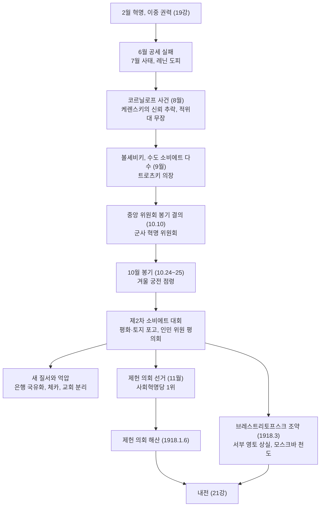

1917년 10월 25일(그레고리력 11월 7일) 밤 9시 40분, 페트로그라드. 네바강에 닻을 내린 순양함 **오로라**호의 함포가 공포탄 한 발을 쏘았다. 강 건너 **겨울 궁전**을 향한 공격 신호였다. 궁전 안에는 임시 정부의 장관들이 갇혀 있었다. 그들을 지키는 것은 사관생도 몇백 명과 카자크 일부, 그리고 여성 지원병으로 이루어진 '여성 결사대대'의 한 중대뿐이었다. 총리 케렌스키는 그날 아침 일찍 전선의 군대를 데려오겠다며 자동차를 타고 수도를 빠져나간 뒤였다.

밤이 깊어 가자 궁전의 수비병들은 하나둘 사라졌다. 수백 개의 방과 복도가 얽힌 거대한 궁전의 여러 문으로 무장한 노동자들의 '적위대'와 수병, 병사들이 조금씩 스며들었다. 10월 26일 새벽 2시 무렵, 혁명군의 지휘관 안토노프옵세옌코가 궁전의 작은 식당에 모여 있던 장관들에게 체포를 알렸다. 겨울 궁전 '공격'에서 죽은 사람은 몇 명에 불과했다. 10년 뒤 소련의 영화감독 에이젠시테인이 영화 「10월」에서 그린 장대한 '겨울 궁전 습격'은 실제보다 훨씬 극적으로 연출된 것이었다.

그날 밤 페트로그라드의 다른 곳에서는 전차가 다니고 극장에서는 공연이 열렸다. 그러나 이 조용한 밤에 일어난 일은 20세기 세계를 바꾸었다. **볼셰비키**가 권력을 잡은 것이다. 이 강의에서는 2월 혁명 뒤 반년 동안 볼셰비키가 어떻게 힘을 키워 권력을 잡았는지, 그리고 권력을 잡은 뒤 무엇을 했는지 살펴본다.

> [!핵심] 이 강의의 질문
> 1. 2월 혁명 뒤 임시 정부는 왜 무너졌으며, 볼셰비키는 어떻게 지지를 얻었는가?
> 2. 10월 25일의 봉기는 어떻게 일어났는가?
> 3. 권력을 잡은 볼셰비키는 무엇을 했으며, 제헌 의회와 브레스트리토프스크 조약은 무엇을 뜻했는가?

{{F:r20-opening}}

## 1917년 여름과 가을

### 6월 공세와 7월 사태

19강에서 본 대로 임시 정부는 전쟁을 계속했다. 1917년 6월 전쟁 장관 케렌스키는 직접 전선을 돌며 열정적인 연설로 병사들을 격려하고 대공세를 펼쳤다. 그러나 병사들은 더 이상 싸울 뜻이 없었다. 공세는 며칠 만에 무너졌고, 독일군의 반격에 러시아군은 다시 크게 물러났다. 전선에서는 탈영병이 수십만 명으로 늘었다.

7월 3일부터 5일까지 페트로그라드에서 무장한 병사와 수병, 노동자들이 "모든 권력을 소비에트로!"를 외치며 거리로 몰려나왔다(**7월 사태**). 볼셰비키 지도부는 아직 때가 아니라고 망설였고, 소비에트 지도부는 권력을 넘겨받기를 거부했다. 정부는 레닌이 독일의 돈을 받은 첩자라는 문서를 공개하고, 충성하는 부대로 시위를 진압했다. 볼셰비키 지도자들이 체포되었고, 레닌은 수염을 깎고 가발을 쓴 채 핀란드로 달아났다. 볼셰비키의 기세는 꺾인 듯했다. 7월 케렌스키가 총리가 되었다.

### 코르닐로프 사건

8월, 새로 임명된 최고 사령관 **코르닐로프** 장군이 질서를 되찾겠다며 군대를 이끌고 수도로 향했다. 그가 쿠데타를 노렸는지, 케렌스키와의 오해였는지는 지금도 논쟁거리다. 겁에 질린 케렌스키는 그를 반역자로 선언하고, 소비에트와 볼셰비키에게 도움을 청했다. 감옥에 있던 볼셰비키 지도자들이 풀려났고, 노동자들의 **적위대**가 무기를 받았다. 철도 노동자들은 코르닐로프의 군대를 실은 기차를 엉뚱한 곳으로 보냈고, 선전원들이 병사들을 설득했다. 코르닐로프의 군대는 수도에 이르기도 전에 흩어졌다.

**코르닐로프 사건**은 볼셰비키에게 결정적인 선물이었다. 케렌스키는 장군과 짜고 혁명을 배신하려 했다는 의심을 받으며 좌우 모두의 신뢰를 잃었다. 반혁명에 맞서 수도를 지킨 것은 볼셰비키였다는 평판이 퍼졌다. 9월 페트로그라드와 모스크바의 소비에트에서 볼셰비키가 처음으로 다수가 되었다. 7월에 볼셰비키에 합류했다가 7월 사태 뒤 체포되었던 **트로츠키**는 9월에 풀려나 페트로그라드 소비에트의 의장이 되었다.

### 무너지는 나라

그사이 나라는 무너지고 있었다. 농촌에서는 농민들이 제헌 의회를 기다리지 않고 지주의 땅을 빼앗고 저택을 불태웠다. 공장에서는 노동자들이 공장 위원회를 만들어 경영자를 쫓아내기도 했다. 우크라이나와 핀란드 같은 비러시아 지역은 자치와 독립을 요구했다. 물가는 계속 뛰었고, 도시의 빵 배급은 줄었다. 임시 정부의 명령은 수도 밖에서 거의 힘을 잃었다. 레닌의 표현대로라면 권력은 '길바닥에 떨어져' 있었다.

```chart
{
  "type": "line",
  "caption": "볼셰비키 당원 수 (만 명, 1917년, 연구에 따라 차이가 큰 대략적인 추정치). 2월 혁명 때 2만 명 남짓이던 볼셰비키는 '평화, 땅, 빵'과 '모든 권력을 소비에트로'라는 구호로 빠르게 커졌다",
  "data": {
    "labels": ["2월", "4월", "8월", "10월"],
    "datasets": [{ "label": "당원 (만 명)", "data": [2.4, 8, 20, 35] }]
  },
  "options": { "scales": { "y": { "min": 0 } }, "plugins": { "legend": { "display": false } } }
}
```

## 10월 25일

### "역사는 우리를 용서하지 않을 것이다"

핀란드에 숨어 있던 레닌은 9월부터 볼셰비키 중앙 위원회에 잇달아 편지를 보내 지금 당장 무장 봉기로 권력을 잡아야 한다고 다그쳤다. "지금 권력을 잡지 않으면 역사는 우리를 용서하지 않을 것이다." 변장을 하고 몰래 수도로 돌아온 레닌은 10월 10일 중앙 위원회 회의에서 봉기를 결의하게 했다. 지노비예프와 카메네프 두 사람만 반대했다. 그들은 볼셰비키가 곧 열릴 전국 소비에트 대회와 제헌 의회를 통해 합법적으로 힘을 얻을 수 있다고 보았다. 두 사람이 신문에 반대 의견을 실어, 봉기 계획은 사실상 공개된 비밀이 되었다.

봉기를 실제로 준비한 것은 트로츠키가 이끄는 페트로그라드 소비에트의 **군사 혁명 위원회**였다. 독일군이 수도에 다가오자 임시 정부가 수도의 수비대를 전선으로 보내려 하자, 위원회는 이를 '반혁명'이라 비난하며 수비대를 자기 지휘 아래에 두었다. 수도의 병사 대부분이 이제 임시 정부가 아닌 소비에트의 명령을 따랐다.

### 봉기

10월 24일 케렌스키가 볼셰비키 신문사를 폐쇄하려 하자, 군사 혁명 위원회는 행동에 나섰다. 그날 밤부터 25일 새벽까지 적위대와 병사들이 다리와 기차역, 전신국, 전화국, 발전소, 국립 은행을 차례로 점령했다. 저항은 거의 없었다. 레닌은 24일 밤 붕대로 얼굴을 감싸고 볼셰비키 본부가 있는 **스몰니 학원**(5강)으로 갔다.

25일 오전 10시, 아직 겨울 궁전이 함락되기도 전에 레닌은 「러시아 시민들에게」라는 선언문을 냈다. "임시 정부는 무너졌다. 국가 권력은 페트로그라드 노동자·병사 대표 소비에트의 기관인 군사 혁명 위원회의 손으로 넘어왔다." 그날 밤 스몰니에서 **제2차 전국 소비에트 대회**가 열렸다. 멘셰비키와 사회혁명당 우파는 볼셰비키의 '쿠데타'에 항의하며 대회장을 떠났다. 트로츠키는 그들의 뒤에 대고 외쳤다. "당신들은 파산자들이다. 당신들의 역할은 끝났다. 당신들이 가야 할 곳, 역사의 쓰레기통으로 가라!"

{{F:r20-uprising}}

## 소비에트 정부

### 평화에 관한 포고, 토지에 관한 포고

10월 26일 대회는 레닌이 쓴 두 개의 포고를 채택했다.

> [!사료] 1917년 10월 26일의 두 포고 (요지)
> **평화에 관한 포고**: "노동자와 농민의 정부는 모든 교전국의 국민과 정부에 공정하고 민주적인 평화, 곧 병합도 배상금도 없는 즉각적인 평화를 위한 협상을 바로 시작할 것을 제안한다."
> **토지에 관한 포고**: "지주의 토지 소유권은 보상 없이 즉시 폐지된다. 지주의 영지와 황실, 수도원, 교회의 모든 토지는 … 군(郡)의 토지 위원회와 농민 대표 소비에트가 관리한다." (토지의 국유화와 분배 방법은 사회혁명당의 농민 요구안을 거의 그대로 받아들였다.)

대회는 새 정부인 **인민 위원 평의회**를 세웠다. 의장은 레닌, 외무 인민 위원은 트로츠키, 민족 인민 위원은 조지아 출신의 **스탈린**이었다. 장관 대신 '인민 위원'이라는 이름을 쓴 것은 낡은 정부와의 단절을 보이기 위해서였다. 모스크바에서는 일주일 동안 치열한 시가전 끝에 볼셰비키가 권력을 잡았다. 소비에트 권력은 이후 몇 달 동안 철도를 따라 전국의 도시로 퍼졌다.

### 새로운 질서

볼셰비키 정부는 몇 달 사이에 낡은 러시아의 질서를 뿌리째 바꾸는 포고들을 잇달아 냈다.

| 시기 | 포고 | 내용 |
|---|---|---|
| 1917.10 | 노동 시간 | 하루 8시간 노동 |
| 1917.11 | 노동자 통제, 신분 폐지 | 공장에 대한 노동자의 감독, 귀족·상인 같은 모든 신분과 관등표(3강) 폐지 |
| 1917.11 | 민족 권리 선언 | 러시아 안의 모든 민족의 평등과 분리 독립권 |
| 1917.12 | 은행 국유화, 체카 설립 | 모든 은행을 국가가 접수. 반혁명과 사보타주를 단속하는 비상 위원회(체카) 설립 |
| 1918.1 | 교회와 국가의 분리 | 교회 재산 몰수, 학교에서 종교 교육 금지, 혼인의 세속화 |
| 1918.2 | 그레고리력 채택 | 1월 31일 다음 날을 2월 14일로 함. 러시아 달력이 서유럽과 같아짐 |

표: 볼셰비키 정부 초기의 주요 포고

동시에 새 정부는 반대파를 억눌렀다. 10월 혁명 직후 반대파 신문들이 문을 닫았고, 12월에는 입헌민주당을 '인민의 적'으로 규정했다. 폴란드 귀족 출신의 혁명가 **제르진스키**가 이끈 비밀경찰 **체카**는 곧 재판 없이 사람을 체포하고 처형하는 권력을 갖게 되었다.

## 제헌 의회와 브레스트리토프스크

### 하루 만에 해산된 의회

임시 정부가 약속한 제헌 의회 선거는 10월 혁명 뒤인 1917년 11월에 치러졌다. 러시아 역사상 처음으로 성인 남녀 모두가 투표한 자유 선거였다. 결과는 볼셰비키의 패배였다. 농민의 지지를 받은 **사회혁명당**이 40% 안팎을 얻어 1위가 되었고, 볼셰비키는 4분의 1 정도를 얻는 데 그쳤다. 볼셰비키는 도시와 군대에서는 강했지만, 인구의 대다수인 농민은 사회혁명당을 찍었다.

```chart
{
  "type": "doughnut",
  "caption": "1917년 11월 제헌 의회 선거의 정당별 득표율 (%, 대략적인 수치). 4,000만 명이 넘는 유권자가 투표했다. 사회혁명당이 1위를 했지만, 볼셰비키는 의회를 하루 만에 해산했다",
  "height": 300,
  "data": {
    "labels": ["사회혁명당", "볼셰비키", "입헌민주당", "멘셰비키", "민족별 정당(우크라이나 사회혁명당 등)", "기타"],
    "datasets": [{ "data": [38, 24, 5, 3, 21, 9] }]
  }
}
```

1918년 1월 5일 제헌 의회가 페트로그라드의 타우리다 궁전에서 열렸다. 의회는 사회혁명당의 체르노프를 의장으로 뽑고, 소비에트 정부를 인정하라는 볼셰비키의 요구를 거부했다. 볼셰비키 의원들은 대회장을 떠났다. 다음 날 새벽 4시, 경비를 맡은 수병 지휘관이 의장에게 다가가 말했다. "경비병들이 지쳤습니다. 회의장을 비워 주십시오." 그날 정부는 제헌 의회의 해산을 선언했다. 의회를 지지하는 시위대에게 총격이 가해졌다. 러시아의 첫 민주적 의회는 단 하루 만에 끝났다. 레닌은 소비에트 권력이 부르주아 의회보다 높은 형태의 민주주의라고 주장했다.

### 브레스트리토프스크 조약

'평화'는 볼셰비키의 가장 중요한 약속이었다. 그러나 연합국은 평화 협상 제안을 무시했다. 1917년 12월 볼셰비키 정부는 독일, 오스트리아와 휴전하고, 독일군 사령부가 있는 브레스트리토프스크에서 강화 회담을 시작했다. 독일은 폴란드와 발트 지역, 우크라이나를 넘기라고 요구했다. 외무 인민 위원 트로츠키는 협상을 질질 끌다가, 전쟁도 강화도 하지 않겠다며 일방적으로 전쟁 종결을 선언하고 회담장을 떠났다.

1918년 2월 독일군은 다시 공격을 시작했다. 군대가 사실상 사라진 러시아는 저항할 수 없었다. 독일군은 며칠 만에 수백 킬로미터를 진격했다. 레닌은 당 지도부에 사퇴하겠다고 위협하며 독일의 요구를 받아들이게 했다. 그는 혁명 정권이 살아남으려면 무슨 대가를 치르든 '숨 돌릴 틈'이 필요하다고 보았다. 1918년 3월 3일 **브레스트리토프스크 조약**이 맺어졌다.

러시아는 폴란드, 리투아니아, 라트비아, 에스토니아, 핀란드, 그리고 우크라이나에서 물러나야 했다. 표트르 대제 이후 200년 동안 얻은 서쪽 땅 대부분을 잃은 것이다(2강, 6강). 이 땅에는 제국 인구의 3분의 1, 공업의 절반, 석탄의 대부분이 있었다. 독일군을 피해 1918년 3월 볼셰비키 정부는 수도를 페트로그라드에서 **모스크바**로 옮겼다. 표트르 대제가 상트페테르부르크로 수도를 옮긴 지 200여 년 만이었다(3강). 조약에 반대한 좌파 사회혁명당은 정부에서 물러났다. 그해 11월 독일이 서부 전선에서 항복하자 조약은 무효가 되었지만, 그 사이 러시아는 이미 내전에 빠져들고 있었다(21강).

{{F:r20-brest}}



## 정리

> [!핵심] 20강 요약
> - 임시 정부는 1917년 **6월 공세**의 실패로 신뢰를 잃었다. **7월 사태** 뒤 볼셰비키는 탄압받았지만, 8월의 **코르닐로프 사건**으로 다시 힘을 얻어 9월 수도의 소비에트에서 다수가 되었다.
> - 나라가 무너지는 가운데 레닌은 무장 봉기를 다그쳤고, 트로츠키가 이끄는 **군사 혁명 위원회**가 10월 24~25일 수도의 요지를 장악했다. 10월 25일 밤 **겨울 궁전**이 점령되고 임시 정부가 무너졌다.
> - 제2차 소비에트 대회는 **평화에 관한 포고**와 **토지에 관한 포고**를 채택하고, 레닌을 의장으로 하는 **인민 위원 평의회**를 세웠다. 새 정부는 신분 폐지, 은행 국유화, 교회와 국가의 분리, 그레고리력 채택을 하는 한편, **체카**로 반대파를 억눌렀다.
> - 1917년 11월 **제헌 의회** 선거에서 사회혁명당이 1위를 하자, 볼셰비키는 1918년 1월 의회를 하루 만에 해산했다.
> - 1918년 3월 **브레스트리토프스크 조약**으로 러시아는 전쟁에서 빠져나왔지만 서부 영토의 대부분을 잃었고, 수도를 모스크바로 옮겼다.

### 생각해 볼 질문

1. 10월 혁명은 민중의 혁명이었을까, 소수 정당의 쿠데타였을까? 양쪽의 근거를 찾아 비교해 보자.
2. 볼셰비키가 제헌 의회를 해산한 것은 러시아의 정치에 어떤 의미를 가졌을까? 선거 결과를 따르지 않는 권력은 무엇에서 정당성을 찾을까?
3. 레닌은 왜 그토록 가혹한 브레스트리토프스크 조약을 받아들였을까? 그의 판단을 어떻게 평가할 수 있을까?

### 다음 강 예고

마지막 21강 「내전과 소련의 탄생」에서는 1918년부터 1922년까지 러시아를 휩쓴 내전을 다룬다. 적군과 백군, 체코 군단과 외국의 간섭, 황제 일가의 처형, 전시 공산주의와 대기근, 크론시타트 반란과 신경제 정책을 거쳐, 1922년 12월 30일 소비에트 사회주의 공화국 연방(소련)이 탄생하기까지를 살펴본다.
