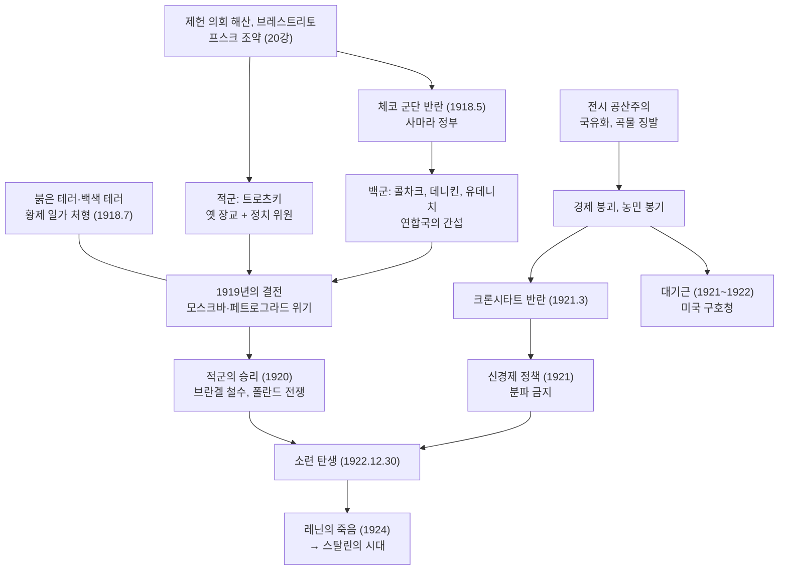

1918년 7월 17일 새벽 1시 반, 우랄산맥 동쪽의 도시 예카테린부르크. '특별 목적의 집'이라 불리던 상인의 저택에서 잠든 가족들이 깨워졌다. 경비대장 유롭스키는 도시에 총격이 있을 수 있어 안전한 곳으로 옮긴다며 그들을 반지하의 작은 방으로 데려갔다. 전 황제 **니콜라이 2세**는 열세 살의 아들 알렉세이를 안고 계단을 내려왔다. 황후 알렉산드라와 네 딸 올가, 타티야나, 마리야, 아나스타시야, 주치의 보트킨, 요리사, 하인, 하녀가 뒤따랐다. 황후는 의자를 가져다 달라고 했다.

몇 분 뒤 유롭스키가 종이 한 장을 꺼내 읽었다. 우랄 지역 소비에트가 그들을 처형하기로 결정했다는 것이었다. 니콜라이가 "뭐라고?" 하고 되묻는 순간 총격이 시작되었다. 열한 명이 모두 죽었다. 시신은 트럭에 실려 숲으로 옮겨져 불태워지고 묻혔다. 그 무렵 도시는 볼셰비키에 맞서 싸우던 체코 군단에게 포위되어 있었고, 볼셰비키는 황제 일가가 '백군'에게 구출되어 반혁명의 상징이 되는 것을 두려워했다. 체코 군단은 여드레 뒤 도시에 들어왔다.

그 저택의 이름은 **이파티예프 저택**이었다. 1강에서 본 것처럼, 305년 전 미하일 로마노프가 차르 추대를 받아들인 곳은 코스트로마의 이파티예프 수도원이었다. 로마노프 왕조는 '이파티예프'에서 시작해 '이파티예프'에서 끝났다.

황제 일가의 처형은 러시아를 휩쓴 **내전**의 한 장면이었다. 1918년부터 1922년까지 러시아에서는 볼셰비키의 '적군'과 반볼셰비키 세력인 '백군', 그리고 수많은 다른 세력이 뒤엉켜 싸웠다. 전쟁과 테러, 기아와 전염병으로 수백만 명이 죽었다. 이 강의에서는 이 내전과, 그 폐허 위에서 1922년 **소비에트 사회주의 공화국 연방**(소련)이 탄생하기까지를 살펴본다. 이 강좌의 마지막 강의다.

> [!핵심] 이 강의의 질문
> 1. 내전에서 싸운 세력은 누구였으며, 볼셰비키는 왜 이겼는가?
> 2. 전시 공산주의와 붉은 테러는 러시아 사회에 무엇을 남겼는가?
> 3. 신경제 정책과 소련의 탄생은 무엇을 뜻했으며, 러시아 근대사는 어떻게 마무리되었는가?

{{F:r21-opening}}

## 적군과 백군

### 내전의 시작

20강에서 본 대로 볼셰비키는 제헌 의회를 해산하고 브레스트리토프스크 조약으로 전쟁에서 빠져나왔다. 이 두 가지는 반대 세력을 하나로 묶었다. 1918년 봄 여러 곳에서 무장 저항이 시작되었다.

불씨가 된 것은 뜻밖에도 **체코슬로바키아 군단**이었다. 오스트리아-헝가리 군대에서 탈영하거나 포로가 된 체코인과 슬로바키아인 4만여 명으로 이루어진 이 군단은, 러시아 편에서 독일과 싸우다 혁명을 맞았다. 그들은 시베리아 횡단 철도(14강)를 타고 블라디보스토크로 가서 배로 프랑스 전선으로 가려 했다. 1918년 5월 볼셰비키 정부가 그들을 무장 해제하려 하자, 군단은 반란을 일으켜 볼가강에서 태평양까지 이어지는 철도를 따라 수많은 도시를 장악했다. 그 보호 아래 볼가강 가의 사마라에서는 해산된 제헌 의회의 사회혁명당 의원들이 정부를 세웠다.

남쪽 돈강 유역에서는 제정 시대의 장군들이 의용군을 만들었다. 코르닐로프(20강)가 전사한 뒤 **데니킨** 장군이 지휘를 맡았다. 1918년 11월 시베리아의 옴스크에서는 해군 제독 **콜차크**가 사회혁명당 정부를 쿠데타로 몰아내고 스스로 '최고 통치자'가 되었다. 북서쪽에서는 **유데니치** 장군이 에스토니아에서 페트로그라드를 노렸다. 이들을 통틀어 **백군**이라 불렀다.

### 외국의 간섭

1918년 영국, 프랑스, 미국, 일본 등 연합국도 군대를 보냈다. 처음에는 러시아 북부 항구 무르만스크와 아르한겔스크에 쌓인 연합국의 군수품이 독일 손에 들어가는 것을 막고, 체코 군단을 돕는다는 명분이었다. 영국군은 러시아 북부에, 프랑스군은 오데사에, 미국군 수천 명은 아르한겔스크와 블라디보스토크에 들어왔다. 가장 많은 병력을 보낸 것은 일본으로, 한때 7만 명 넘는 군대를 시베리아와 연해주에 두었다. 일본군은 다른 나라들이 1920년에 철수한 뒤에도 1922년까지 연해주에 머물렀다.

외국 군대는 백군에게 돈과 무기, 군복을 대 주었지만, 볼셰비키와 대규모로 싸우지는 않았다. 제1차 세계대전에 지친 연합국의 국민들은 또 다른 전쟁을 원하지 않았다. 오히려 외국 군대의 존재는 볼셰비키가 자신들을 '외세의 침략에 맞서 조국을 지키는 세력'으로 내세우는 데 도움이 되었다.

### 트로츠키와 적군

혁명 직후 볼셰비키에게는 이렇다 할 군대가 없었다. 적위대는 수도를 지키기에는 충분했지만, 거대한 내전을 치를 수는 없었다. 1918년 3월 전쟁 인민 위원이 된 **트로츠키**는 몇 년 사이에 수백만 명의 **적군**(노동자·농민의 붉은 군대)을 만들어 냈다. 그는 징병제를 되살리고, 혁명가들의 반대를 무릅쓰고 옛 제정 군대의 장교 수만 명을 군사 전문가로 썼다. 그들이 배신하지 않도록 부대마다 공산당의 **정치 위원**을 붙이고, 장교의 가족을 사실상 인질로 잡았다. 트로츠키는 장갑 열차를 타고 전선 곳곳을 돌며 병사들을 독려하고, 탈영병과 후퇴하는 부대를 가차 없이 처형했다.

### 1919년: 결정의 해

1919년 백군은 세 방향에서 모스크바와 페트로그라드로 진격했다. 봄에는 콜차크가 우랄을 넘어 볼가강 가까이 왔다. 가을에는 데니킨이 우크라이나를 거쳐 모스크바에서 400킬로미터 떨어진 오룔까지 올라왔고, 유데니치는 페트로그라드 교외까지 왔다. 볼셰비키 정권은 무너지기 직전이었다.

그러나 백군은 끝내 이기지 못했다. 1919년 말부터 적군의 반격에 백군은 차례로 무너졌다. 콜차크는 시베리아 철도를 따라 퇴각하다 1920년 2월 이르쿠츠크에서 총살되었다. 데니킨의 뒤를 이은 **브란겔** 장군은 크림반도에서 마지막까지 버티다, 1920년 11월 군인과 피란민 14만여 명을 배에 태워 콘스탄티노폴리스로 떠났다.

{{F:r21-war}}

### 볼셰비키는 왜 이겼나

| | 적군 (볼셰비키) | 백군 |
|---|---|---|
| 지역 | 인구와 공업, 철도가 모인 러시아 중심부 (모스크바·페트로그라드) | 서로 멀리 떨어진 변두리 (시베리아, 남부, 북서부) |
| 지도부 | 레닌과 트로츠키 아래 하나로 뭉침 | 장군들이 따로 움직이고 서로 경쟁함 |
| 목표 | '평화, 땅, 빵', 외세에 맞선 조국 방위 | 볼셰비키 타도. 그 뒤의 모습은 분명하지 않음 |
| 농민에게 | 곡물을 강제로 거두었지만, 지주를 돌아오게 하지는 않음 | 많은 지역에서 지주의 땅을 되돌려 주려 함 |
| 비러시아 민족에게 | 민족 자결을 약속 | '하나이고 나눌 수 없는 러시아'를 고집 |
| 외국과의 관계 | 간섭에 맞서는 애국 세력으로 내세움 | 외국의 지원에 의존해 '외세의 앞잡이'라는 비난을 받음 |

표: 적군은 왜 백군을 이겼나

농민들은 볼셰비키의 곡물 징발을 미워했다. 그러나 그들은 지주가 돌아와 땅을 다시 빼앗는 것을 더 두려워했다. 둘 가운데 하나를 골라야 할 때, 많은 농민은 마지못해 적군 쪽을 택했다.

## 테러와 전시 공산주의

### 붉은 테러와 백색 테러

1918년 8월 30일, 모스크바의 한 공장에서 연설을 마치고 나오던 레닌이 사회혁명당원 파니 카플란의 총에 맞아 크게 다쳤다. 같은 날 페트로그라드의 체카 의장이 암살되었다. 9월 볼셰비키 정부는 **'붉은 테러'**를 공식적으로 선포했다. 체카는 귀족, 성직자, 장교, 부유한 사람들을 '계급의 적'으로 몰아 인질로 잡고 재판 없이 처형했다. 몇 주 사이에 수천 명이 처형되었다.

백군도 잔인하기는 마찬가지였다. 백군이 점령한 지역에서는 볼셰비키로 의심받은 노동자와 농민이 처형되었다. 특히 우크라이나에서는 백군과 민족주의 군대, 무장 집단들이 유대인을 대규모로 학살했다. 내전 기간 우크라이나에서 학살된 유대인은 수만 명에서 십수만 명에 이른다. 그 밖에도 적군에도 백군에도 맞선 농민들의 '녹색군', 우크라이나의 무정부주의자 마흐노의 농민군 등 수많은 세력이 싸웠다. 내전은 전선이 아니라 마을과 마을, 이웃과 이웃 사이의 전쟁이었다.

### 전시 공산주의

내전을 치르기 위해 볼셰비키는 경제 전체를 국가의 통제 아래 두었다. 이를 **전시 공산주의**라 부른다. 1918년 6월 큰 공장들을 국유화했고, 곧 작은 작업장까지 국가가 가져갔다. 사적인 상업은 금지되었다. 화폐는 쓸모가 없어져 물물 교환이 퍼졌다. 무엇보다 농민에게서 곡물을 강제로 거두었다. 무장한 노동자 부대가 농촌으로 가서 '남는' 곡물을 징발했는데, 실제로는 다음 해에 뿌릴 씨앗까지 빼앗는 일이 많았다. 농민들은 곡물을 숨기거나 농사를 줄이는 것으로 맞섰다.

결과는 경제의 붕괴였다. 공장은 멈추고, 도시는 텅 비었다. 굶주림을 피해 노동자들이 농촌으로 돌아가면서 페트로그라드의 인구는 1917년 250만 명에서 1920년 70만 명 남짓으로 줄었다. 티푸스와 콜레라가 휩쓸었다.

```chart
{
  "type": "bar",
  "caption": "전쟁과 혁명, 내전이 러시아 경제에 남긴 상처 (1913년 = 100, 1921년의 수준, 대략적인 수치). 대규모 공업 생산은 5분의 1로, 선철 생산은 3%로 줄었다. 곡물 수확은 절반 남짓으로 떨어졌고, 이것이 1921~1922년 대기근의 바탕이 되었다",
  "data": {
    "labels": ["대규모 공업 생산", "선철 생산", "철도 화물", "곡물 수확"],
    "datasets": [
      { "label": "1913년", "data": [100, 100, 100, 100] },
      { "label": "1921년", "data": [21, 3, 25, 50] }
    ]
  },
  "options": { "scales": { "y": { "min": 0, "max": 110 } } }
}
```

### 독립한 나라들

제국의 변두리에서는 여러 민족이 독립을 선언했다. 핀란드(1917), 에스토니아, 라트비아, 리투아니아(1918)는 독립을 지켜 냈다. 123년 만에 되살아난 **폴란드**(6강)는 1920년 동쪽으로 국경을 넓히려 소비에트 러시아와 전쟁을 벌였다. 적군은 반격해 바르샤바 앞까지 진격했지만, 1920년 8월 폴란드군에 크게 졌다. 레닌은 적군이 혁명을 유럽으로 퍼뜨리기를 기대했지만, 폴란드의 노동자와 농민은 적군을 해방자가 아니라 침략자로 보았다. 반면 우크라이나, 벨라루스, 그리고 1921년의 조지아처럼 독립을 선언했던 여러 지역은 적군에 의해 다시 소비에트 정권 아래로 들어갔다.

> [!참고] 내전기 러시아 극동과 한국 독립운동
> 내전기의 러시아 극동은 한국 독립운동의 무대이기도 했다(15강). 연해주의 한인들은 1919년 3·1 운동 직후 대한국민의회를 세웠다. 레닌의 정부는 일본에 맞서는 한국의 독립운동가들에게 자금을 지원하기도 했고, 많은 한인 독립군이 일본군과 백군에 맞서 적군과 함께 싸웠다. 그러나 1921년 6월 아무르강 가의 자유시(스보보드니)에서는 독립군 부대들의 지휘권을 둘러싼 갈등 끝에 적군이 한인 부대를 강제로 무장 해제하는 과정에서 많은 독립군이 죽거나 포로가 되었다. 이것이 한국 독립운동사의 비극인 **자유시 참변**이다.

## 신경제 정책과 소련의 탄생

### 크론시타트의 반란

1920년 말 백군은 사라졌지만, 나라는 폐허였다. 곡물 징발에 분노한 농민들이 곳곳에서 봉기했다. 탐보프 현에서는 수만 명의 농민군이 1년 가까이 싸웠고, 적군은 대포와 독가스까지 써서 이를 진압했다. 도시에서는 굶주린 노동자들이 파업을 벌였다.

1921년 3월, 페트로그라드 앞바다의 해군 요새 **크론시타트**의 수병들이 반란을 일으켰다. 1917년 혁명의 가장 열렬한 지지자였던 바로 그 수병들이었다. 그들은 "공산당 없는 소비에트"를 요구했다. 소비에트의 자유선거, 언론과 집회의 자유, 곡물 징발의 중단, 농민과 수공업자의 자유로운 생산을 요구한 것이다. 볼셰비키는 이를 반혁명으로 규정했고, 투하쳅스키가 지휘하는 적군이 얼어붙은 바다를 건너 요새를 공격했다. 처절한 전투 끝에 반란은 진압되었고, 살아남은 수병 수천 명이 처형되거나 수용소로 보내졌다.

### 신경제 정책

크론시타트의 대포 소리가 들리던 1921년 3월, 모스크바에서 열린 제10차 공산당 대회에서 레닌은 방향을 크게 틀었다. 곡물 징발을 없애고, 농민이 정해진 양의 현물세만 내면 남는 곡물을 시장에서 자유롭게 팔 수 있게 한 것이다. 작은 상점과 작업장의 사적인 경영도 다시 허락되었고, 화폐가 다시 쓰였다. 큰 공장과 은행, 철도, 무역은 국가가 그대로 쥐었다. 이를 **신경제 정책**(네프)이라 한다. 레닌은 이를 사회주의를 향한 길에서의 '한 걸음 후퇴'라고 불렀다.

같은 당 대회는 당 안의 '분파' 활동을 금지했다. 경제는 풀어 주되 정치는 더 단단히 조인 것이다. 이미 다른 정당들은 사실상 사라졌고, 이제 공산당 안에서도 반대 의견을 조직하는 것이 금지되었다. 이 결정은 훗날 스탈린이 반대파를 제거하는 데 쓰이게 된다.

### 대기근

신경제 정책이 효과를 내기 전에 또 다른 재앙이 닥쳤다. 1921년 볼가강 유역에 가뭄이 들었다. 몇 년 동안의 곡물 징발로 비축 곡물이 바닥난 데다, 정부의 대응이 늦어 2,500만 명이 넘는 사람이 굶주렸다. 사람들은 풀과 나무껍질, 심지어 인육까지 먹었다는 기록이 있다. 1921~1922년 대기근으로 500만 명 안팎이 죽었다. 볼셰비키 정부는 마침내 외국에 도움을 청했다. 훗날 미국 대통령이 되는 허버트 후버가 이끈 **미국 구호청**은 한때 하루에 1,000만 명이 넘는 사람에게 음식을 나누어 주었다. 노르웨이의 탐험가 난센도 국제 구호를 이끌었다. 같은 시기 정부는 굶주린 사람을 돕는다는 명분으로 교회의 귀중품을 몰수하며 많은 성직자를 처형했다.

{{F:r21-famine}}

### 소련의 탄생

내전이 끝나 가면서 볼셰비키는 옛 러시아 제국의 땅 대부분을 다시 손에 넣었다. 1922년 12월 30일, 모스크바에서 열린 소비에트 대회에서 **러시아 소비에트 연방 사회주의 공화국**, **우크라이나**, **벨라루스**, **자캅카스**(조지아·아르메니아·아제르바이잔) 네 공화국이 연방 조약을 맺었다. **소비에트 사회주의 공화국 연방**, 곧 **소련**이 탄생한 것이다. 소련은 형식상 평등한 공화국들의 연방이었고 각 공화국은 탈퇴할 권리를 가졌지만, 실제로는 모스크바의 공산당이 모든 것을 다스렸다.

같은 해 레닌은 두 차례 뇌졸중으로 쓰러졌다. 그는 병상에서 당에 보내는 편지(이른바 '유언')를 받아 적게 하며, 그해 4월 공산당 서기장이 된 **스탈린**이 "너무 거칠다"며 그를 그 자리에서 물러나게 하라고 권했다. 그러나 그 권고는 받아들여지지 않았다. 레닌은 1924년 1월 숨졌다. 그 뒤 소련은 스탈린의 시대로 들어간다.



## 강좌를 마치며

이 강좌는 1613년 코스트로마의 이파티예프 수도원에서 시작했다. 우리는 표트르 대제가 늪 위에 세운 '유럽을 향한 창', 예카테리나 2세의 계몽과 농노제, 모스크바를 불태우며 지켜 낸 1812년, 원로원 광장의 젊은 장교들, 크림 전쟁의 패배와 농노 해방, 인텔리겐치아의 꿈과 테러, 시베리아 횡단 철도와 산업화, 그리고 블라디보스토크에서 서울의 정동까지 뻗어 온 러시아의 그림자를 따라왔다. 그리고 1918년 예카테린부르크의 이파티예프 저택에서 로마노프 왕조가 끝나고, 1922년 소련이 태어나는 것을 보았다.

러시아 근대사는 '위로부터의 개혁'과 '아래로부터의 반란'이 끝없이 엇갈린 역사였다. 표트르 대제, 예카테리나 2세, 알렉산드르 2세, 비테와 스톨리핀은 모두 서유럽을 따라잡기 위해 위에서 나라를 바꾸려 했다. 그러나 그 개혁은 늘 전제 정치의 틀 안에 머물렀고, 그 비용은 대부분 농민이 치렀다. 개혁이 멈추거나 되돌려질 때마다 아래로부터의 분노가 쌓였고, 그 분노는 1917년에 폭발했다. 그리고 그 폭발에서 태어난 소련은, 차르의 제국보다 더 강력한 '위로부터의 혁명'을 국민에게 강요하게 된다.

러시아는 유럽인가, 아니면 다른 길을 가는 문명인가? 차다예프와 서구파, 슬라브파가 던진 이 질문(10강)은 소련 시대를 거쳐 오늘날까지도 러시아의 정치와 외교를 이해하는 열쇠로 남아 있다. 이 강좌가 그 질문을 스스로 생각해 보는 데 작은 도움이 되었기를 바란다.

## 정리

> [!핵심] 21강 요약
> - 1918년 **체코 군단**의 반란을 계기로 **내전**이 시작되었다. 콜차크, 데니킨, 유데니치의 **백군**과 연합국의 **간섭군**이 볼셰비키에 맞섰다.
> - **트로츠키**는 옛 장교와 정치 위원을 결합해 수백만의 **적군**을 만들었다. 적군은 중심부를 장악하고 하나로 뭉쳤으며, 농민이 지주의 귀환을 두려워한 덕분에 1920년 백군을 무찔렀다.
> - 1918년 7월 **황제 일가**가 예카테린부르크의 이파티예프 저택에서 처형되었다. 내전 동안 **붉은 테러**와 백색 테러, 유대인 학살이 벌어졌다.
> - **전시 공산주의**(국유화, 곡물 징발)는 경제를 무너뜨렸다. 농민 봉기와 1921년 **크론시타트 반란** 뒤 레닌은 **신경제 정책**으로 물러섰다. 1921~1922년 **대기근**으로 500만 명 안팎이 죽었다.
> - 핀란드, 발트 3국, 폴란드는 독립했고, 우크라이나와 자캅카스 등은 다시 소비에트 정권 아래로 들어갔다. 1922년 12월 30일 **소련**이 탄생했다.

### 생각해 볼 질문

1. 백군이 이겼다면 러시아는 어떤 나라가 되었을까? 백군 안의 서로 다른 세력(군주제 지지자, 자유주의자, 사회혁명당)을 떠올리며 생각해 보자.
2. 크론시타트의 수병들은 '공산당 없는 소비에트'를 요구했다. 1917년의 혁명 구호였던 '모든 권력을 소비에트로'와 1921년의 현실은 어떻게 달라져 있었을까?
3. 이 강좌 전체를 돌아보자. 러시아 근대사에서 '위로부터의 개혁'이 되풀이해서 한계에 부딪친 이유는 무엇일까? 가장 중요한 갈림길은 어디였다고 생각하는가?
