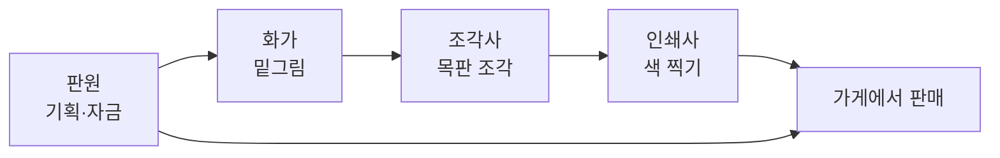

이 견본은 **플랫폼이 강의를 어떻게 보여 주는지** 확인하기 위한 것입니다. 실제 강의는 이보다 훨씬 길고 자세하게(수만 자 분량) 작성됩니다.

## 사진·사료

실제 강의에서는 위키미디어 공용(Wikimedia Commons), 각국 국립도서관·박물관의 공개 자료 등 **출처가 분명한 실물 자료**만 씁니다. 그림을 누르면 크게 볼 수 있습니다.

```figure
src: https://commons.wikimedia.org/wiki/Special:FilePath/Tsunami_by_hokusai_19th_century.jpg?width=1280
caption: 가쓰시카 호쿠사이, 「가나가와 앞바다의 큰 파도」(『후가쿠 36경』 중). 목판화.
credit: 가쓰시카 호쿠사이, 1831년경
license: Public Domain
source: https://commons.wikimedia.org/wiki/File:Tsunami_by_hokusai_19th_century.jpg
width: wide
```

> [!사료] 사료 인용 상자
> 원문 사료를 인용할 때는 이런 상자로 구분해 보여 줍니다. 출전(문서명·연도)을 제목 줄에 씁니다.

## 연표

```timeline
1831년경 | 『후가쿠 36경』 간행 시작 | 에도의 판원 니시무라야 요하치가 간행
1853 | 페리 내항 | 개국 이후 일본 판화가 서양으로 대량 유출되기 시작
1867 | 파리 만국박람회 | 일본이 처음으로 공식 출품
1870–1890년대 | 자포니즘 유행 | 모네, 반 고흐 등 인상파 화가들이 일본 판화를 수집·연구
```

## 표와 비교표

| 구분 | 내용 |
|---|---|
| 기법 | 다색 목판화(니시키에) |
| 제작 분업 | 화가(에시) · 조각사(호리시) · 인쇄사(스리시) · 판원(한모토) |
| 특징 | 서양에서 들어온 합성 안료 '프러시안 블루'를 적극 사용 |

표: 우키요에 목판화의 제작 방식

```compare
항목 | 우키요에 판화 | 서양 유화
재료 | 종이, 목판, 수성 안료 | 캔버스, 유화 물감
생산 | 분업에 의한 대량 인쇄 | 화가 1인의 단일 작품
가격 | 서민이 살 수 있는 수준 | 주문자·후원자 중심
```

## 도식



## 차트

> [!주의] 예시 데이터
> 아래 차트는 형식 확인용 **가상의 숫자**입니다. 실제 강의의 차트는 반드시 출처가 있는 통계로 만들고, 캡션에 출처를 적습니다.

```chart
{
  "type": "bar",
  "caption": "형식 확인용 예시 차트 (가상 데이터, 실제 통계 아님)",
  "data": {
    "labels": ["A", "B", "C", "D"],
    "datasets": [{ "label": "예시 값", "data": [12, 19, 7, 15] }]
  },
  "options": { "plugins": { "legend": { "display": false } } }
}
```

> [!핵심] 정리
> 이 견본을 **승인**하면 '샘플 강좌'가 만들어지고 1강으로 들어갑니다. **반려**하면 반려함으로 옮겨지고, 언제든 복원할 수 있습니다.
