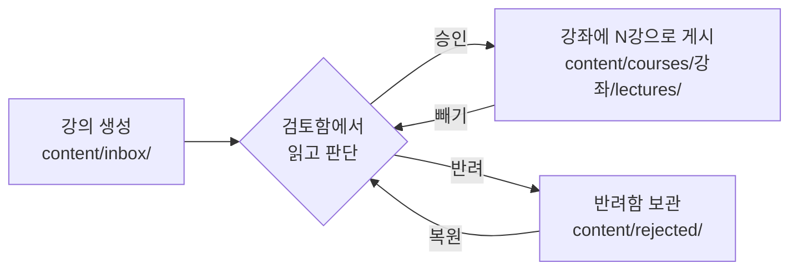

# 강의 작성 규격

이 문서는 플랫폼에 들어갈 강의 한 편의 **파일 구조와 작성 문법**을 정합니다. 새 강의는 모두 이 규격으로 만들어 `content/inbox/`에 넣고, 검토자가 승인하면 강좌로 옮겨집니다.

## 1. 흐름



| 상태 | 폴더 | 화면 |
|---|---|---|
| 검토 대기 | `content/inbox/<강의ID>/` | 검토함 |
| 게시됨 | `content/courses/<강좌ID>/lectures/<강의ID>/` | 강좌 › N강 |
| 반려 | `content/rejected/<강의ID>/` | 반려함 |

표: 강의의 세 가지 상태와 저장 위치

ID는 영문 소문자·숫자·하이픈만 씁니다. 예: `jmh-01-black-ships`.

## 2. 강의 폴더 구성

```
content/inbox/jmh-01-black-ships/
├── meta.json      ← 제목·요약·제안 강좌·참고문헌
├── lecture.md     ← 본문 (Markdown + 특수 블록)
└── assets/        ← 직접 내려받은 사진·사료 (선택)
```

### meta.json

```json
{
  "title": "흑선의 충격",
  "subtitle": "페리 내항과 막부의 개국, 1853–1858",
  "summary": "한두 문장 요약",
  "period": "1853–1858",
  "estimatedMinutes": 45,
  "objectives": ["배울 것 1", "배울 것 2"],
  "suggestedCourse": { "id": "japan-modern-history", "title": "일본근대사", "subtitle": "개국에서 패전까지" },
  "suggestedOrder": 1,
  "createdAt": "2026-11-19T00:00:00Z",
  "references": [
    { "author": "저자", "year": 2020, "title": "책 제목", "publisher": "출판사", "url": "https://..." }
  ]
}
```

`suggestedCourse`가 아직 없는 강좌를 가리키면, 승인할 때 그 이름으로 새 강좌가 만들어집니다.

## 3. 본문 문법

일반 Markdown(제목 `##`, `###`, 표, 목록, 인용)을 그대로 씁니다. `##`·`###` 제목은 자동으로 목차가 됩니다. 아래 특수 블록으로 시각자료를 넣습니다.

### 사진·사료 — `figure`

> [!주의] 이미지 원칙
> **AI 생성 그림은 쓰지 않습니다.** 실제 사진, 회화, 판화, 지도, 문서 사진 등 실물 자료만 쓰고, 모든 그림에 `source`(원본 페이지)와 `license`를 반드시 적습니다. 빠지면 자동 점검에서 오류로 표시됩니다.

````
```figure
src: https://commons.wikimedia.org/wiki/Special:FilePath/파일이름.jpg?width=1280
caption: 그림 설명 문장
credit: 작가 또는 소장처, 제작 연도
license: Public Domain
source: https://commons.wikimedia.org/wiki/File:파일이름.jpg
width: wide
```
````

- `src`: 이미지 주소. `assets/사진.jpg`처럼 강의 폴더 안의 파일도 됩니다.
- `width`: `wide`(넓게) · `narrow`(좁게) · 생략(본문 폭)
- 그림 번호(그림 1, 그림 2 …)는 자동으로 매겨집니다.

여러 장을 나란히 놓을 때는 `gallery` 블록에 같은 형식을 `---` 줄로 구분해 씁니다.

### 연표 — `timeline`

````
```timeline
1853.7 | 페리 함대 우라가 내항 | 미 동인도함대 사령관 페리가 군함 4척을 이끌고 도착
1854.3 | 미일화친조약 | 시모다·하코다테 개항
```
````

### 비교표 — `compare`

````
```compare
항목 | 미일화친조약 | 미일수호통상조약
체결 | 1854 | 1858
개항지 | 시모다, 하코다테 | 가나가와, 나가사키 등
```
````

### 차트 — `chart`

[Chart.js](https://www.chartjs.org/) 설정을 JSON으로 씁니다. `caption`, `height`를 덧붙일 수 있습니다. 색은 지정하지 않으면 자동으로 정해집니다.

````
```chart
{ "type": "bar", "caption": "연도별 수출액(가상 예시)",
  "data": { "labels": ["1860", "1865"], "datasets": [{ "label": "수출", "data": [4.7, 18.5] }] } }
```
````

### 도식 — `mermaid`

흐름도·관계도·조직도는 [Mermaid](https://mermaid.js.org/) 문법으로 씁니다. 첫 줄에 `%% caption: 설명`을 넣으면 그림 설명이 붙습니다.

### 표 캡션과 콜아웃

- 표 바로 아래 줄에 `표: 설명`을 쓰면 "표 N." 캡션이 됩니다.
- 인용문 첫 줄에 `[!핵심]`, `[!참고]`, `[!주의]`, `[!사료]`, `[!더알아보기]`를 쓰면 강조 상자가 됩니다.

```
> [!사료] 페리가 전달한 필모어 대통령 국서 (1853)
> "우리는 귀국과 우호와 통상을 바랍니다…"
```

## 4. 자동 점검 기준

검토 화면 오른쪽에 자동 점검 결과가 나옵니다.

| 구분 | 기준 |
|---|---|
| 오류 | 제목 없음, 본문 없음, 그림의 `src`·`source`·`license` 누락, AI 생성 표기, 차트 JSON 오류 |
| 주의 | 요약·참고문헌 없음, 그림 `credit`·`caption` 누락, 출처 없는 일반 이미지, 시각자료 3개 미만, 본문 3,000자 미만 |

표: 자동 점검 항목

터미널에서 `npm run check`로 모든 강의를 한 번에 점검할 수도 있습니다.
